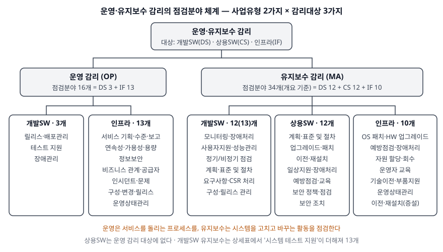

> **실행 검증 없음.** 공공 문서를 근거로 쓴 답안이다. 점검분야의 이름·개수·코드는 한국지능정보사회진흥원(NIA)이
> 공지한 「정보시스템 운영 및 유지보수 감리 점검 가이드 Ver.2.0」(2018.3) 본문 표에서 확인했다.
> 공지 글에 따르면 이 가이드는 당시 「정보시스템 감리기준」(행정안전부고시 제2017-1호) 제24조에 따라
> 개정·공지됐다. 가이드 안에서 유지보수 점검분야 개수가 개요(34개)와 상세표(35개)에서 하나 어긋나는데,
> 그 차이는 Ⅳ에서 밝혔다.

구축이 끝나 운영에 들어간 정보시스템을 감리할 때 무엇을 보는지 묻는 문제다. 세 가지를 순서대로 묻는다.
운영 감리와 유지보수 감리가 각각 무엇인지, 운영 감리는 어떤 분야를 점검하는지, 유지보수 감리는 어떤 분야를
점검하는지다. 문항이 가·나·다로 나눠 물었으므로 그 순서를 그대로 대항목으로 쓴다.

---

## Ⅰ. 개요 — 감리는 구축에서 끝나지 않는다

「전자정부법」은 정보시스템 감리를 이해관계에서 독립된 자가 **제3자의 관점에서 정보시스템의 구축 및 운영 등에
관한 사항을 종합적으로 점검하고 문제점을 개선하도록 하는 것**으로 정의한다(제2조제14호). 정의에 이미
**운영**이 들어 있다. 시스템은 한 번 구축되고 그 뒤로 여러 해 동안 운영·유지보수 사업으로 이어지므로,
감리가 구축 단계에만 머물면 수명 대부분이 점검 밖에 남는다.

구축 감리와 운영·유지보수 감리는 보는 대상이 다르다. 구축 감리는 **만들어지는 산출물**이 계약과 요구사항을
반영했는지를 요구정의·설계·종료 시점에 끊어서 본다. 운영·유지보수 감리는 **계속 반복되는 활동**을 본다.
그래서 NIA 가이드의 점검항목은 거의 모두 같은 꼴이다 — "그 활동을 위한 **절차와 계획이 수립되어 수행되고
있는가**". 산출물이 아니라 프로세스와 그 이행 기록이 점검 대상이다.

---

## Ⅱ. 가. 시스템 운영 감리와 유지보수 감리의 개념

### 가) 정의

NIA 가이드는 두 사업유형을 다음처럼 정의하고, 두 사업에 대한 감리를 각각 운영 감리(OP)와 유지보수 감리(MA)로
나눈다.

| 구분 | 가이드의 정의 (요지) | 감리의 초점 |
|---|---|---|
| **운영 (OP)** | 개발이 끝나 인도된 정보시스템에 대해 **유지보수를 제외한** 운영기획·관리, 모니터링, 테스트, 사용자 지원 등 정상 운영에 필요한 제반 활동 | 서비스가 약속된 수준으로 **돌아가게 하는** 관리 체계가 서 있고 이행되는가 |
| **유지보수 (MA)** | 개발·구축이 끝난 뒤 기능 변경·추가·보완·폐기, 사용방법 개선, 문서 보완 등 정보시스템 **개선**에 필요한 제반 활동 | 시스템을 **고치고 바꾸는** 활동이 계획·표준·절차대로 수행되고, 바뀐 결과가 통제되는가 |

두 정의를 가르는 선은 **시스템을 바꾸는가**다. 운영은 이미 있는 시스템을 정해진 수준으로 굴리는 일이고,
유지보수는 시스템 자체를 바꾸는 일이다. 운영 정의에 "유지보수를 제외한"이 명시된 것도 이 선을 긋기 위해서다.

### 나) 감리대상 3가지와 체계

가이드는 감리대상을 **개발소프트웨어(DS), 상용소프트웨어(CS), 인프라(IF)** 3가지로 나누고, 사업유형 2가지와
교차시켜 점검분야를 둔다. 점검분야마다 `OP-IF-09`처럼 사업유형 2자리·감리대상 2자리·일련번호로 코드를 붙인다.

> **출처**: [NIA, 정보시스템 운영 및 유지보수 감리 점검 가이드 Ver.2.0 (2018.3) — 가이드 개요·점검분야 체계표](https://www.nia.or.kr/site/nia_kor/ex/bbs/View.do?cbIdx=99860&bcIdx=19572)

운영 감리에는 **상용SW 칸이 없다.** 가이드는 상용SW를 유지보수 쪽에만 둔다. 가이드가 이유를 적지는 않지만,
상용SW의 유지보수 점검분야가 업그레이드·패치·기술지원처럼 공급사가 내놓는 변경을 다루는 것으로 보아
상용SW에서 일어나는 일 대부분을 변경 활동으로 묶은 것으로 읽힌다.

### 다) 구축 감리와의 비교

| 구분 | 구축 감리 | 운영 감리 | 유지보수 감리 |
|---|---|---|---|
| 점검 대상 | 개발 산출물 | 운영 프로세스와 이행 기록 | 변경 활동과 그 결과 |
| 시점 | 요구정의·설계·종료 (감리기준) | 사업 기간 중 반복 활동 | 사업 기간 중 반복 활동 |
| 판단 근거 | 과업내용·요구사항 대비 산출물 | 서비스수준협의서, 운영 절차 | 유지보수 계획·표준·절차 |
| 감리대상 | 시스템 개발 사업 전체 | DS · IF (2가지) | DS · CS · IF (3가지) |
| 점검분야 수 | 감리 영역별 | 16개 | 34개 (개요 기준) |
| 참조 관행 | 개발방법론·품질 표준 | ITSM (가이드 참고자료: ITIL V3, ISO/IEC 20000) | 소프트웨어 유지보수·구성관리 |
| 전형적 지적 | 요구사항 누락, 설계 미반영 | SLA 측정 미흡, 장애 기록 누락 | 긴급변경의 사후 승인 누락, 구성 미갱신 |

마지막 줄의 "전형적 지적"은 각 점검항목이 무엇을 묻는지에서 끌어낸 것이다. 운영 쪽 점검항목은 **측정과 보고**를,
유지보수 쪽은 **승인과 반영의 통제**를 묻는다.

---

## Ⅲ. 나. 시스템 운영 감리의 점검분야 — 16개

운영 감리는 **개발SW 3개 + 인프라 13개 = 16개** 점검분야로 이뤄진다.

### 가) 개발소프트웨어(DS) — 3개

| 코드 | 점검분야 | 점검 초점 |
|---|---|---|
| OP-DS-01 | 릴리스 및 배포관리(운영반영) | 개발SW를 운영에 반영하는 운영 조직의 절차·계획이 서 있고 수행되는가 |
| OP-DS-02 | 테스트 지원 | 개발SW 테스트를 운영 조직이 지원하는 절차·계획이 있는가 |
| OP-DS-03 | 장애관리 | 개발SW 장애를 관리하는 절차·계획이 서 있고 수행되는가 |

세 분야 모두 **운영 조직이 개발 결과물을 받아 들이는 접점**이다. 개발SW 자체를 고치는 일은 유지보수로 넘어간다.

### 나) 인프라(IF) — 13개

| 묶음 | 코드·점검분야 | 점검 초점 |
|---|---|---|
| 서비스 설계·수준 | 01 신규·변경 서비스 기획·구현 지원, 02 서비스 수준관리, 03 서비스 보고 | 서비스수준협의서를 세우고 지속 측정하는가, 발주기관이 제때 판단할 수 있게 보고하는가 |
| 서비스 보증 | 04 서비스 연속성·가용성 관리, 05 용량 관리, 06 정보보안 관리 | 요구수준에 맞는 가용성·연속성 계획, 용량 계획, 보안 정책이 서 있고 이행되는가 |
| 관계 | 07 비즈니스 관계 관리, 08 공급자 관리 | 이해당사자를 식별·관리하고, HW·상용SW 공급자와 연계 업무가 정해져 있는가 |
| 해결 | 09 인시던트·서비스 요청 관리, 10 문제 관리 | 인시던트와 요청을 처리하는 체계가 있고, 근본 원인을 다루는 문제관리 절차가 따로 도는가 |
| 통제 | 11 구성 관리, 12 변경·릴리스 관리 | 구성 정보와 변경·릴리스 정책이 정립돼 수행되는가 |
| 상태 | 13 운영상태관리 | 제공 중인 서비스의 운영 상태를 관리하는가 |

인프라 13개 분야는 이름부터 **ITSM(IT 서비스 관리) 프로세스**다. 가이드도 점검항목 해설의 참고자료로
ITIL V3와 ISO/IEC 20000을 든다. 따라서 운영 감리는 "서버가 잘 돌았는가"를 보는 것이 아니라
**서비스 관리 체계가 서 있고, 그 체계가 남긴 기록이 있는가**를 본다. 인시던트(09)와 문제(10)가 따로 있는
것이 그 예다. 장애를 복구한 기록만 있고 원인 분석·재발 방지 기록이 없으면 10번에서 지적된다.

---

## Ⅳ. 다. 유지보수 감리의 점검분야 — 34개

가이드 개요는 유지보수 감리를 **34개** 점검분야로 적는다. 다만 상세표는 개발SW에 '시스템 테스트 지원'을 더해
13개로 싣기 때문에 상세표를 합치면 35개다. 답안에는 개요의 34개를 쓰되, 개발SW를 13개로 셀 수도 있다는
사실을 한 줄 밝히는 편이 안전하다.

### 가) 개발소프트웨어(DS) — 12개(상세표 13개)

| 묶음 | 점검분야 | 점검 초점 |
|---|---|---|
| 운영 지원 | 응용서비스 모니터링, 응용서비스 장애처리, 사용자 지원, 성능관리, 정기/비정기 점검, (시스템 테스트 지원), 장애관리 | 각 활동의 절차·계획이 수립되어 수행되는가 |
| 유지보수 관리 | 유지보수 계획, 유지보수 표준 및 절차 | 계획이 적정한가, 처리 절차가 정해져 있는가 |
| 변경 수행 | 요구사항 관리, 유지보수 이행(CSR 처리) | 사용자 요구가 관리되고, 정의된 절차에 따라 변경 요청(CSR)을 처리하는가 |
| 변경 통제 | 구성관리, 릴리스 및 배포관리(운영이관) | 바뀐 자원·산출물의 구성과 변경을 관리하고, 검증·승인을 거쳐 반영하는가 |

개발SW 유지보수의 중심은 **요구사항 → CSR 처리 → 구성관리 → 릴리스**로 이어지는 변경의 사슬이다.
감리는 이 사슬의 기록이 끊기지 않았는지를 본다. 요청은 있는데 반영 기록이 없거나, 반영은 됐는데 구성
정보가 갱신되지 않았으면 지적된다.

### 나) 상용소프트웨어(CS) — 12개, 점검항목 13개

| 묶음 | 점검분야 |
|---|---|
| 관리 | 유지보수 계획, 유지보수 표준 및 절차 |
| 변경 | 업그레이드 및 패치(설치·업그레이드와 패치를 항목 2개로 나눠 점검), 이전 및 재설치 |
| 지원 | 일상지원, 장애처리 및 긴급변경, 예방점검 |
| 교육 | 운영자 교육, 사용자 교육 |
| 보안 | 보안 정책 및 계획 수립, 보안 점검 및 예방 활동, 보안 조치 및 기술지원 |

상용SW는 소스를 고칠 수 없으므로 유지보수가 **공급사가 내놓는 업그레이드·패치를 언제 어떻게 적용하는가**로
바뀐다. 보안 분야가 3개나 따로 서 있는 것도 이 때문이다. 공급사가 낸 보안 패치를 적용하지 않고 두면
그 공백이 곧 취약점이 된다.

### 다) 인프라(IF) — 10개, 점검항목 11개

| 묶음 | 점검분야 |
|---|---|
| 변경 | OS 업그레이드 및 패치(설치·업그레이드와 패치를 항목 2개로 나눔), HW 업그레이드, 이전 및 재설치(증설 지원) |
| 예방·대응 | 예방점검(일상·정기·비정기), 긴급/장애처리 |
| 자원 | 통합자원 할당 및 회수, 부품지원 |
| 역량 | 운영자 교육, 기술이전 |
| 상태 | 운영상태관리 |

인프라 유지보수는 **자원의 생애주기**를 본다. 할당한 자원을 회수했는지(05), 부품을 제때 받을 수 있는지(08)처럼
운영 감리의 인프라 분야와 달리 장비와 자원 자체의 변경을 다룬다.

---

## Ⅴ. 결론

운영 감리와 유지보수 감리는 **바꾸는가**로 갈린다. 운영 감리는 개발SW·인프라 2개 대상에 16개 분야를 두고
서비스 관리 체계가 서 있는지를 보며, 유지보수 감리는 개발SW·상용SW·인프라 3개 대상에 34개 분야를 두고
변경이 계획·절차·승인을 거쳐 반영되는지를 본다. 두 감리 모두 산출물 한 번이 아니라 반복 활동의 **기록**을
근거로 판정하므로, 감리를 받는 쪽의 정보시스템에 세 가지를 요구하게 된다. 서비스 수준을 자동으로 측정·보관하는
모니터링 데이터, 인시던트에서 문제·변경·릴리스까지 이어지는 처리 이력, 그리고 그 변경이 반영된 최신 구성 정보다.
이 셋이 시스템 안에 남아 있지 않으면 감리는 면담과 문서 확인에 그치고, 점검항목이 묻는 "수행되고 있는가"에
답할 근거가 사라진다.

> 개념 정리: [정보시스템 감리 — 제3자 점검이 법으로 자리 잡은 구조](../../it-management/2026-09-21-information-system-audit/index.md)
>
> 개념 정리: [ITSM과 ITIL 4 — 서비스 가치 시스템](../../it-management/2026-10-16-itsm-itil4-service-value-system/index.md)
>
> 개념 정리: [소프트웨어 유지보수 유형과 유지보수 프로세스 — ISO/IEC/IEEE 14764:2022 가 4유형을 5+1 로 바꾼 지점](../../software-engineering/2026-11-03-software-maintenance-types-and-process-14764/index.md)

끝

---

## 답안 작성 메모

- **Ⅱ의 정의표와 체계 그림을 먼저 쓴다.** "감리대상 3가지(DS·CS·IF) × 사업유형 2가지(OP·MA)"와 "16개·34개"가
  답안의 뼈대다. 이 개수를 앞에서 못 박으면 나·다의 표가 그 틀을 채우는 모양이 된다.
- **점수가 갈리는 지점은 운영과 유지보수의 경계를 한 줄로 긋는가다.** "운영은 유지보수를 제외한 활동"이라는
  가이드 정의를 인용하고, 그 기준이 "시스템을 바꾸는가"라고 풀어 쓴다. 둘을 섞어 점검분야를 나열하면
  채점자가 문항 나·다를 구분해 읽을 수 없다.
- **운영 인프라 13개는 외우지 말고 ITSM 프로세스로 묶는다.** 서비스 수준·보증·관계·해결·통제·상태의 6묶음으로
  기억하면 이름이 따라 나온다. 상용SW가 운영 쪽에 없다는 점도 한 줄 쓴다.
- **유지보수 34/35 차이는 밝히되 길게 쓰지 않는다.** 개요 기준 34개로 쓰고 괄호로 처리한다.
- **시간이 모자라면 버릴 것은 Ⅱ의 다) 비교표 중 "참조 관행" 줄과 Ⅳ 각 표의 "점검 초점" 열이다.** 점검분야 이름과
  개수는 버리지 않는다. 그림은 박스 8개라 3분 안에 옮겨 그린다.
- **결론은 정보시스템 쪽으로 내려간다.** 감리 제도 설명에서 멈추지 말고, 감리가 성립하려면 시스템이 측정
  데이터·처리 이력·구성 정보를 남겨야 한다는 데까지 쓴다. 이것이 정보관리기술사 답안의 축이다.

---

## 참고 자료

- [한국지능정보사회진흥원(NIA), 정보시스템 운영 및 유지보수 감리 점검 가이드 Ver.2.0 (2018.3.29 공지)](https://www.nia.or.kr/site/nia_kor/ex/bbs/View.do?cbIdx=99860&bcIdx=19572) — 가이드 목적과 체계, 운영·유지보수 정의, 감리대상 3가지, 점검분야·점검항목 표, 점검항목 해설의 참고자료(ITIL V3, ISO/IEC 20000)
- [전자정부법(법률 제21394호, 2026.2.27. 일부개정) 제2조제14호 — 국가법령정보센터](https://www.law.go.kr/%EB%B2%95%EB%A0%B9/%EC%A0%84%EC%9E%90%EC%A0%95%EB%B6%80%EB%B2%95) — 정보시스템 감리의 정의
- [정보시스템 감리기준(행정안전부고시) — 국가법령정보센터](https://www.law.go.kr/%ED%96%89%EC%A0%95%EA%B7%9C%EC%B9%99/%EC%A0%95%EB%B3%B4%EC%8B%9C%EC%8A%A4%ED%85%9C%EA%B0%90%EB%A6%AC%EA%B8%B0%EC%A4%80) — 구축 감리의 요구정의·설계·종료 3단계. 운영·유지보수 가이드는 제2017-1호 당시 제24조에 따라 공지됐다
- [정보시스템 감리 — 제3자 점검이 법으로 자리 잡은 구조](../../it-management/2026-09-21-information-system-audit/index.md) — 감리 정의·대상·절차를 조문 근거로 정리한 개념 글
