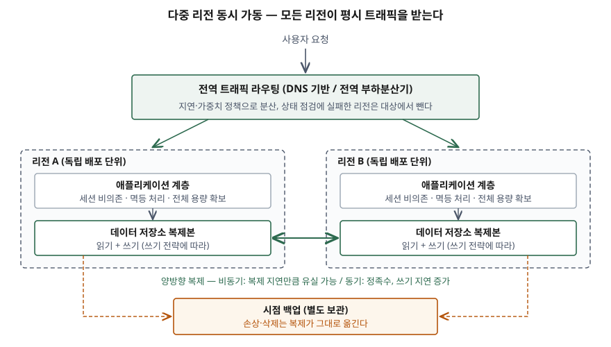

> **실행 검증 없음.** 개념 문제이므로 AWS·Microsoft의 공식 문서와 NIST SP 800-34 Rev.1만
> 근거로 정리했다. 제품 기능은 개념의 구현 예로만 들었고, 제품별 수치는 공식 문서에 적힌
> 것만 옮겼다.

기출문제에서 여러 리전이 동시에 서비스하는 재해복구시스템에 대해 두 가지를 묻는다.
이 방식이 무엇이고 어떤 특징이 있는지, 그리고 이것을 구성하는 주요 기술 요소가 무엇인지다.
"두 센터가 동시에 서비스한다"는 정의만으로는 점수가 나지 않는다. 점수는 **전환(failover)
단계가 없어지는 대신 그 비용이 쓰기 일관성 문제로 옮겨 간다**는 것을 특징의 축으로 세우고,
기술 요소를 라우팅·데이터·애플리케이션·운영 계층으로 나눠 빠짐없이 드는 데서 난다.

---

## Ⅰ. 개요

### 가. 등장 배경 — 대기 사이트 방식이 남기는 2가지 문제

전통적인 재해복구는 주 사이트가 평시 트래픽을 받고 대기 사이트는 복제만 받다가, 재해가
선언되면 **전환**하는 Active-Passive 형태다. 이 형태에는 문제가 2가지 남는다.

- ① **전환 자체가 위험 구간이다.** 재해 판단, 대기 DB 승격, 확장, 트래픽 전환이 모두 재해
  중에 이뤄진다. AWS 재해복구 백서는 확장처럼 제어 평면(설정 변경을 맡는 계층)에 기대는
  작업이 전환에 섞이면 회복력이 낮아진다고 적는다
- ② **대기 사이트가 실제로 도는지 평시에 알 수 없다.** 트래픽을 받지 않는 사이트는 훈련을
  하기 전까지 검증되지 않는다

다중 리전 동시 가동 방식은 **모든 리전이 평시부터 서비스**하게 해 이 두 문제를 없앤다.
NIST SP 800-34도 핫 사이트의 예로 두 지역에서 동시에 운영하며 데이터를 계속 동기화하는
구성을 든다.

### 나. 리전과 가용 영역 — 범위를 먼저 정한다

| 구분 | 다중 가용 영역 | 다중 리전 |
|---|---|---|
| 막는 재해 | 데이터센터 하나~여럿의 손실 | 리전 전체 손실, 광역 재해 |
| 거리 | 가깝다 — 동기 복제가 현실적이다 | 멀다 — 기본은 비동기 복제 |
| 주된 목적 | 가용성 | 재해복구 |

Azure Well-Architected Framework(이하 Azure WAF)의 이중화 지침은 지리적으로 먼 배포가
내결함성을 높이는 대신 **지연 증가, 데이터 일관성의 복잡성, 운영 부담**을 함께 가져온다고
적는다. 이 세 가지가 Ⅱ의 특징과 Ⅲ의 기술 요소가 다루는 대상이다.

## Ⅱ. 가. 개념 및 특징

### 가) 정의

**다중 리전 동시 가동 재해복구**는 지리적으로 떨어진 둘 이상의 리전에 같은 워크로드를
배포하고, **모든 리전이 평시 트래픽을 나눠 받다가** 한 리전이 장애를 겪으면 그 리전으로
가는 트래픽을 빼고 나머지 리전이 부하를 받는 방식이다.

- AWS 재해복구 백서는 이를 **배포된 모든 리전에서 트래픽을 처리하는** Multi-site
  active/active 전략으로 정의하고, 4가지 전략 가운데 가장 복잡하고 비싼 방식이라고 적는다
- Azure WAF는 여러 인스턴스가 동시에 돌며 **각자 트래픽을 처리하고**, 하나가 실패하면
  건강한 인스턴스로 트래픽을 돌리는 구조로 정의한다

### 나) 구성 모식도

> **출처**: [AWS, Disaster Recovery of Workloads on AWS — Multi-site active/active](https://docs.aws.amazon.com/whitepapers/latest/disaster-recovery-workloads-on-aws/disaster-recovery-options-in-the-cloud.html) · [AWS Multi-Region Fundamentals — Fundamental 2: Understanding the data](https://docs.aws.amazon.com/prescriptive-guidance/latest/aws-multi-region-fundamentals/fundamental-2.html) · [Azure WAF — Architecture strategies for designing for redundancy](https://learn.microsoft.com/en-us/azure/well-architected/reliability/redundancy)

### 다) 특징 — 5가지

① **전환 단계가 없다**
- AWS 백서는 이 방식에 전환이 없다고 적는다. 장애 대응은 "대기 사이트를 깨우는 일"이
  아니라 **장애 리전을 라우팅 대상에서 빼는 일**이다
- 그래서 시험할 것도 달라진다. 백서는 장애 리전에서 트래픽이 빠지는지, 나머지 리전이 늘어난
  부하를 감당하는지를 시험하라고 적는다

② **RTO는 0에 가깝고, RPO는 복제 방식이 정한다**
- 백서는 적절한 기술과 구현이 있으면 대부분의 재해에서 복구 시간을 0에 가깝게 할 수 있다고 적는다
- RPO는 리전 사이 복제가 비동기면 **복제 지연만큼** 0보다 크고, 동기면 0이 된다. DynamoDB
  문서는 비동기 모드의 RPO를 복제 지연과 같다고 하고, 강한 일관성 모드의 RPO를 0으로 적는다

③ **데이터 손상에는 RPO·RTO가 0이 아니다**
- 복제는 손상·삭제·악의적 변경도 그대로 옮긴다. 백서는 이 경우 복구 시간이 항상 0보다 크고,
  복구 시점은 **재해를 발견하기 전의 어느 시점**이 된다고 적는다. 시점 백업이 따로 있어야 한다

④ **쓰기 일관성이 설계의 중심 문제가 된다**
- AWS 다중 리전 지침은 리전 사이에 네트워크 분할이 생길 수 있으므로 **가용성과 일관성 중
  하나를 골라야 한다**고 적는다(CAP 정리)
- 쓰기가 많은 워크로드를 동시 가동으로 바꾸려면 리전 라우팅, 세션 친화성, 멱등 트랜잭션,
  충돌 처리를 다시 설계해야 한다. 같은 지침은 그래서 쓰기 집약 워크로드에는 주-대기 방식을
  먼저 권한다

⑤ **비용과 용량 계획이 가장 무겁다**
- 모든 리전이 서비스하므로 한 리전이 빠졌을 때 나머지가 전체 부하를 받을 용량이 있어야 한다
- Azure WAF는 이를 2가지로 나눈다. **용량 맞춤형**(평시 부하만큼만 두고 장애 때 확장 —
  비용은 낮지만 확장 동안 품질 저하 가능)과 **초과 프로비저닝형**(장애 때 필요한 용량을
  미리 확보 — 가장 회복력이 크고 비싸다)이다

### 라) Active-Passive와의 비교

| 구분 | Active-Passive (Hot Standby) | 다중 리전 Active-Active |
|---|---|---|
| 평시 트래픽 | 주 리전만 받는다 | 모든 리전이 나눠 받는다 |
| 장애 시 동작 | 대기 리전 승격 + 트래픽 **전환** | 장애 리전을 라우팅에서 **제외** |
| 쓰기를 받는 곳 | 주 리전 하나 | 쓰기 전략에 따라 하나 또는 여럿 |
| 데이터 충돌 | 생기지 않는다 | 다중 쓰기면 생긴다 — 해결 규칙 필요 |
| 대기 자원 검증 | 훈련 때만 확인된다 | 평시 서비스로 계속 확인된다 |
| 전역 라우팅 정책 (Azure WAF) | 우선순위(priority) | 지연(latency)·가중치(weighted) |
| 애플리케이션 변경 | 적다 | 크다 — 멱등·세션·충돌 처리 |
| 비용·복잡도 | 높다 | 가장 높다 |

## Ⅲ. 나. 주요 기술 요소

기술 요소를 **4계층 6가지**로 나눈다. 라우팅 계층 1가지, 데이터 계층 2가지, 애플리케이션
계층 2가지, 운영 계층 1가지다.

| 계층 | 기술 요소 | 무엇을 해결하는가 |
|---|---|---|
| 라우팅 | ① 전역 트래픽 라우팅 | 요청을 어느 리전으로 보내고, 장애 리전을 어떻게 빼는가 |
| 데이터 | ② 리전 간 복제와 쓰기 전략 | 어디서 쓰기를 받고 어떻게 퍼뜨리는가 |
| 데이터 | ③ 충돌 해결 | 두 리전이 같은 데이터를 동시에 바꾸면 무엇을 남기는가 |
| 애플리케이션 | ④ 세션 비의존·멱등 처리·조정 | 요청이 리전을 옮겨 가도 결과가 같은가 |
| 애플리케이션 | ⑤ 리전 독립 배포 단위 | 한 리전의 장애가 다른 리전으로 번지지 않는가 |
| 운영 | ⑥ 관측과 장애 훈련 | 복제 지연과 리전 격리를 평시에 보고 시험하는가 |

### 가) 전역 트래픽 라우팅

- **DNS 기반 부하분산**: 도메인 응답으로 리전을 고른다. Azure 아키텍처 센터는 장애 시 실제
  중단 시간이 DNS 레코드의 TTL, 상태 점검 주기와 임계치, 클라이언트·상위 리졸버의 캐시
  시간에 좌우되며 **상위 캐시가 낡은 응답을 계속 줄 수 있다**고 적는다
- **전역 부하분산기(프록시형)**: 사용자 가까운 접점에서 요청을 받아 건강한 리전으로 넘긴다.
  DNS 캐시에 기대지 않으므로 리전 제외가 빠르게 반영된다
- **라우팅 정책**: Azure WAF는 동시 가동에는 지연·가중치 기반, 주-대기에는 우선순위 기반
  라우팅을 권한다
- **상태 점검과 트래픽 제외는 데이터 평면 작업으로 한다.** AWS 백서는 전환 작업에 데이터
  평면 작업만 쓰라고 권하고, 가중치 정책 변경은 제어 평면 작업으로 분류한다

### 나) 리전 간 복제와 쓰기 전략

**복제 방식 2가지**

| 구분 | 비동기 복제 | 동기 복제 |
|---|---|---|
| 커밋 시점 | 로컬 리전에 쓰면 응답 | 다른 리전에도 반영돼야 응답 |
| RPO | 복제 지연만큼 유실 가능 | 0 |
| 쓰기 지연 | 작다 | AWS 지침은 **자릿수가 하나 바뀔 만큼(10배 규모)** 늘어난다고 적는다 |
| 구성 조건 | 2리전부터 | 보통 **3리전, 3곳 중 2곳 정족수** (AWS 지침) |
| 장애 후 처리 | 반영되지 못한 쓰기를 **조정(reconciliation)** 해야 한다 | 조정 부담이 작다 |

DynamoDB 전역 테이블이 두 방식을 모두 구현한다. 다중 리전 최종 일관성(MREC) 모드는 보통
1초 이내에 비동기 복제하고, 다중 리전 강한 일관성(MRSC) 모드는 쓰기를 다른 리전 한 곳
이상에 동기 복제한 뒤 응답하며 **정확히 3개 리전**(복제본 3개, 또는 복제본 2개와 읽기·쓰기를
받지 않는 감시 리전 1개)을 요구한다. 모드는 생성할 때 정하고 바꿀 수 없다.

**쓰기 전략 3가지** (AWS 재해복구 백서)

- ① **write global**: 쓰기는 한 리전에만 보내고 나머지 리전은 읽기만 한다. 쓰기 리전이
  죽으면 다른 리전을 승격한다. 읽기는 동시 가동, 쓰기는 주-대기인 셈이다
- ② **write local**: 가장 가까운 리전에서 쓰기를 받는다. 충돌 해결이 필요하다
- ③ **write partitioned**: 사용자 ID 같은 분할 키로 쓰기 리전을 정해 **충돌 자체를 피한다**

### 다) 충돌 해결

여러 리전이 쓰기를 받으면 충돌이 생긴다. Azure Cosmos DB 문서는 충돌을 **3가지**로 나눈다.
같은 고유 키를 두 리전에서 넣는 **삽입 충돌**, 같은 항목을 두 리전에서 고치는 **교체 충돌**,
한쪽은 지우고 다른 쪽은 고치는 **삭제 충돌**이다. 해결 방식은 다음 3가지로 갈린다.

| 방식 | 동작 | 구현 예 |
|---|---|---|
| 마지막 쓰기 우선(LWW) | 타임스탬프가 가장 늦은 쓰기를 남긴다. 먼저 들어온 쓰기는 조용히 사라진다 | DynamoDB MREC, Cosmos DB 기본값(삭제는 항상 이긴다) |
| 사용자 정의 병합 | 충돌을 감지하면 업무 규칙으로 두 값을 합친다. 실패하면 충돌 목록에 남겨 사람이 처리한다 | Cosmos DB 병합 저장 프로시저·충돌 피드 |
| 충돌을 오류로 돌려준다 | 다른 리전에서 고치는 중인 항목에 쓰면 실패시키고 재시도하게 한다 | DynamoDB MRSC의 복제 쓰기 충돌 예외 |

강한 일관성과 다중 쓰기 리전의 관계는 구현마다 다르다. Cosmos DB는 **다중 쓰기 리전 계정에서
강한 일관성을 쓸 수 없다**고 적고, DynamoDB MRSC는 다중 리전 쓰기를 받되 동시 수정을 오류로
돌려 일관성을 지킨다. 어느 쪽이든 **"모든 리전에서 쓰기 + 충돌 없음 + 낮은 지연"을 함께 얻는
방법은 없다**는 점이 같다.

### 라) 애플리케이션 계층 — 세션 비의존·멱등 처리·조정

- **세션 비의존(stateless)**: 리전이 빠지면 사용자의 다음 요청은 다른 리전으로 간다. 세션
  상태가 리전 메모리에 있으면 사용자가 로그아웃되거나 작업이 끊긴다. 상태는 복제되는 저장소에
  두거나, 세션 친화성을 둘 때도 리전 제외 시의 동작을 정해 둔다
- **멱등 처리**: 리전 제외 직후 클라이언트가 재시도하면 같은 요청이 두 리전에서 처리될 수
  있다. 요청마다 멱등 키를 붙여 두 번 처리돼도 결과가 한 번과 같게 만든다
- **조정 프로세스**: AWS 지침은 비동기 복제에서 장애 리전에 남은 쓰기가 유실되거나 늦게
  도착할 수 있으므로, 처리 중이던 트랜잭션을 **다시 실행하거나 대조하는 업무 로직**이 필요하다고
  적는다. 데이터 저장소가 대신 해 주지 않는다. 메시징 서비스도 한 리전에 적재된 메시지는
  그 리전과 함께 묶이므로 같은 조정 대상이다

### 마) 리전 독립 배포 단위

- **배포 스탬프**: Azure WAF는 반복 배포할 수 있는 **자기 완결형 단위**로 리전 배포를 만들라고
  권한다. 리전 하나를 더하거나 빼는 일이 같은 템플릿의 배포 하나가 된다
- **셀 분할**: AWS 지침은 대부분의 다중 리전 워크로드에 동시 가동이 필요하지 않다고 하면서,
  고객을 리전별 셀로 나눠 **장애 영향 범위(blast radius)** 를 줄이는 방식을 권한다.
  ③ write partitioned와 같은 발상이다
- **정적 안정성**: 장애 때 필요한 용량을 미리 띄워 둔 구성은 장애 순간에 확장 같은 제어 평면
  작업을 하지 않아도 된다. AWS 백서는 전체 용량을 미리 확보한 구성을 정적으로 안정된 구성이라
  부른다. Ⅱ의 초과 프로비저닝형이 여기에 해당한다
- **리전 간 의존 제거**: 한 리전의 요청 처리가 다른 리전의 서비스를 동기 호출하면, 그 리전이
  죽을 때 함께 죽는다. 리전 안에서 요청이 끝나게 설계한다

### 바) 관측과 장애 훈련

- **복제 지연 감시**: 비동기 모드의 RPO는 복제 지연이므로 지연이 곧 데이터 위험이다. DynamoDB
  MREC는 원본·대상 리전 쌍마다 복제 지연 지표를 내고, 문서는 이 값이 커지면 다른 리전으로
  트래픽을 돌리는 것을 검토하라고 적는다
- **리전 격리 훈련**: DynamoDB 문서는 장애 주입 도구로 한 복제본의 복제를 멈춰 **리전 격리를
  모의**할 수 있다고 적는다. 동시 가동은 전환이 없으므로, 훈련의 초점은 리전을 뺐을 때 나머지가
  부하와 조정을 견디는가다
- **시점 백업과 복귀 절차**: 손상은 복제로 막지 못하므로 시점 백업을 따로 둔다. 장애 리전이
  돌아올 때는 그동안 쌓인 쓰기를 따라잡고 조정을 끝낸 뒤 트래픽을 다시 넣는다

## Ⅳ. 도입 시 판단 기준

기술 요소를 다 갖추는 비용이 크므로, 먼저 이 방식이 필요한지를 따진다. 판단 기준은 **3가지**다.

| 판단 기준 | 동시 가동이 맞는 경우 | 주-대기가 맞는 경우 |
|---|---|---|
| 읽기·쓰기 비중 | 읽기 집약 — 정적 콘텐츠, 조회 서비스 | 쓰기 집약 — 주문·결제 원장 |
| 일관성 요구 | 최종 일관성을 받아들일 수 있다 | 리전 사이에서도 즉시 일관성이 필요하다 |
| RTO 요구와 예산 | 수 초 단위 RTO를 업무가 요구하고 상시 비용을 감당한다 | 분 단위 RTO로 충분하다 |

- AWS 지침은 읽기 집약 워크로드가 동시 가동으로 가기 쉽고, 쓰기 집약은 주-대기를 먼저
  고려하라고 적는다
- 한 시스템 안에서도 섞을 수 있다. 조회는 **read local, write global**로 모든 리전에서 읽고,
  원장 쓰기는 한 리전으로 모으는 식이다
- 2리전 구성에서 동기 복제를 쓰면 한 리전이 죽을 때 정족수를 잃는다. 동기 복제를 택하면
  3리전 이상이 전제가 된다

## Ⅴ. 결론

다중 리전 동시 가동 재해복구는 모든 리전이 평시부터 서비스하게 해 **전환이라는 위험 구간을
없애고 RTO를 0에 가깝게** 만든다. 대신 그 비용은 쓰기 일관성으로 옮겨 온다. 어디서 쓰기를
받을지(쓰기 전략), 어떻게 퍼뜨릴지(동기·비동기), 부딪치면 무엇을 남길지(충돌 해결)를 정해야
하고, 애플리케이션은 세션 비의존·멱등·조정을 갖춰야 한다. 그 위에 전역 라우팅이 장애 리전을
데이터 평면 작업만으로 빼고, 리전마다 독립된 배포 단위와 사전 확보 용량이 다른 리전의
장애를 흡수한다. 복제는 손상을 막지 못하므로 시점 백업과 리전 격리 훈련이 함께 있어야
재해복구시스템으로 완성된다. 도입은 업무의 읽기·쓰기 비중과 일관성 요구로 판단하고,
필요한 업무에만 적용한다.

> 개념 정리: [분산 데이터베이스 — CAP 정리와 BASE](../../database/2026-10-06-cap-theorem-base-pacelc/index.md)
>
> 개념 정리: [데이터베이스 이중화와 복제 방식](../../database/2026-10-27-database-replication-ha/index.md)
>
> 개념 정리: [재해복구 전략 — RTO·RPO·MTD와 4가지 복구 방식](../../system/2026-10-02-disaster-recovery-mtd-rto-rpo-strategies/index.md)
>
> 관련 답안: [기출문제 — 클라우드 네이티브 환경의 재해복구 전략](../2026-10-02-disaster-recovery-rto-rpo-strategies/index.md)

끝

## 답안 작성 메모

- **먼저 쓸 것**: Ⅱ-나의 모식도와 Ⅱ-라의 Active-Passive 비교표. 모식도에는 전역 라우팅,
  두 리전, 양방향 복제 화살표, **시점 백업 박스**까지 그린다. 백업 박스가 있어야 특징 ③(손상은
  복제로 못 막는다)이 그림으로 보인다.
- **점수가 갈리는 지점**:
  - 특징을 "무중단, 부하 분산, 비용 높음"으로 나열하지 않고 **전환이 없어지는 대신 쓰기
    일관성 문제가 생긴다**는 인과로 묶는지
  - 기술 요소에 **충돌 해결**과 **애플리케이션 계층(멱등·세션·조정)** 이 들어가는지. 네트워크와
    스토리지 복제만 쓰면 Active-Passive 답안과 구분되지 않는다
  - 동기 복제가 **3리전 정족수**를 전제로 한다는 것, 쓰기 전략 3가지를 이름으로 드는지
- **시간이 모자라면**: Ⅰ-나의 다중 AZ 비교표, Ⅲ-나의 DynamoDB 구현 설명 문단, Ⅳ 전체를
  버린다. Ⅲ의 6가지 요약표는 남긴다 — 채점자가 항목 수를 세는 곳이다.
- 답안지에는 제품 이름 대신 기능 이름("전역 테이블", "다중 쓰기 리전 데이터베이스")을 쓴다.
  여기서 제품 이름을 쓴 것은 공식 문서가 그 동작을 명시해 근거를 댈 수 있었기 때문이다.
- 수치는 공식 문서에 적힌 것만 옮겼다(비동기 복제가 보통 1초 이내, 동기 복제가 3리전을
  요구, 동기 복제 시 쓰기 지연이 자릿수 하나만큼 증가). 비용이 몇 배라는 식의 값은 쓰지 않았다.

## 참고 자료

- [AWS Prescriptive Guidance — AWS Multi-Region Fundamentals](https://docs.aws.amazon.com/prescriptive-guidance/latest/aws-multi-region-fundamentals/introduction.html)
  - [Multi-Region fundamental 2: Understanding the data](https://docs.aws.amazon.com/prescriptive-guidance/latest/aws-multi-region-fundamentals/fundamental-2.html) — CAP 선택, 동기 복제의 3리전 정족수, 조정 프로세스, 쓰기 집약 워크로드 권고, 셀 분할
- [AWS, Disaster Recovery of Workloads on AWS: Recovery in the Cloud (2021-02-12)](https://docs.aws.amazon.com/whitepapers/latest/disaster-recovery-workloads-on-aws/disaster-recovery-workloads-on-aws.html)
  - [Disaster recovery options in the cloud](https://docs.aws.amazon.com/whitepapers/latest/disaster-recovery-workloads-on-aws/disaster-recovery-options-in-the-cloud.html) — Multi-site active/active, 쓰기 전략 3가지, 데이터 평면 작업 권고, 정적 안정 구성
- [Amazon DynamoDB Developer Guide — How DynamoDB global tables work](https://docs.aws.amazon.com/amazondynamodb/latest/developerguide/V2globaltables_HowItWorks.html) — MREC·MRSC, 충돌 처리, 복제 지연 지표, 장애 주입
- [Microsoft, Azure Well-Architected Framework — Architecture strategies for designing for redundancy (2025-12-15 갱신)](https://learn.microsoft.com/en-us/azure/well-architected/reliability/redundancy) — Active-Active 정의, 용량 맞춤형·초과 프로비저닝형, 배포 스탬프, 라우팅 정책
- [Microsoft, Azure Architecture Center — Global routing redundancy for mission-critical web applications (2026-10-16 갱신)](https://learn.microsoft.com/en-us/azure/architecture/guide/networking/global-web-applications/overview) — DNS 기반 라우팅의 TTL·캐시 영향
- [Microsoft, Azure Cosmos DB — Conflict types and resolution policies (2026-04-27 갱신)](https://learn.microsoft.com/en-us/azure/cosmos-db/conflict-resolution-policies) — 충돌 3유형, LWW, 사용자 정의 병합
- [Microsoft, Azure Cosmos DB — Consistency levels (2026-04-27 갱신)](https://learn.microsoft.com/en-us/azure/cosmos-db/consistency-levels) — 다중 쓰기 리전과 강한 일관성
- [NIST SP 800-34 Rev.1, Contingency Planning Guide for Federal Information Systems (2010-05)](https://nvlpubs.nist.gov/nistpubs/Legacy/SP/nistspecialpublication800-34r1.pdf) — 대체 처리 시설(§5.1.5)
