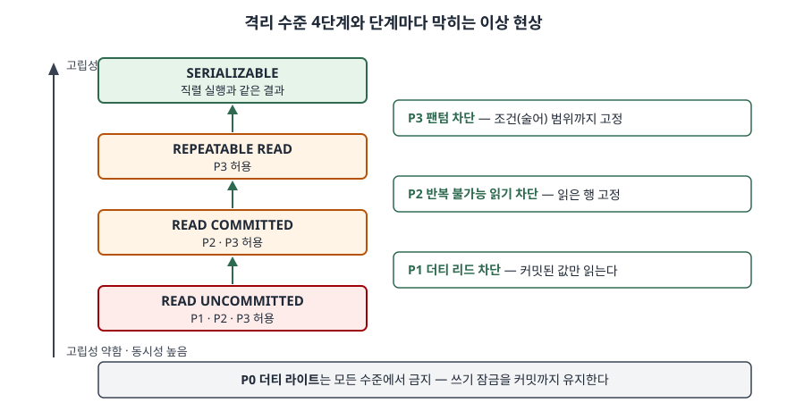

> **실행 검증 없음.** 개념 문제이므로 Berenson 외(1995) 원 논문과 PostgreSQL 16 공식 문서만
> 근거로 정리했다. 이상 현상을 SQLite로 실제 재현한 결과는
> [트랜잭션 격리 수준별로 실제 무슨 이상 현상이 보이는가](../../../Database/sqlite/2026-09-21-isolation-level-anomalies/index.md)에 있다.

기출문제에서 트랜잭션 격리 수준에 대해 두 가지를 묻는다. 격리 수준 4가지가 무엇인지,
그리고 수준에 따라 어떤 이상 현상이 생길 수 있는지다. 네 이름과 더티 리드·반복 불가능
읽기·팬텀 세 가지를 표로 그리는 것까지는 누구나 쓴다. 점수는 **격리 수준이 "어떤 현상을
막느냐"로 정의된다**는 구조를 축으로 세우고, 표준의 세 현상이 빠뜨린 **갱신 분실·쓰기 스큐**를
일정 표기로 보이는 데서 갈린다.

---

## Ⅰ. 개요

### 가. 격리 수준의 정의

**트랜잭션 격리 수준**은 동시에 실행되는 트랜잭션들이 서로의 중간 결과를 얼마나 볼 수
있는지를 정한 단계로, SQL 표준은 이를 **각 단계에서 일어나서는 안 되는 이상 현상의 목록**으로
정의한다. 가장 높은 `SERIALIZABLE`만은 현상이 아니라 "트랜잭션을 하나씩 차례로 실행한 어떤
순서와 같은 결과"라는 규칙으로 정의한다(PostgreSQL 16 문서 13.2절).

### 나. 등장 배경 — 고립성과 동시성의 맞교환

- ① **완전한 고립성은 비싸다.** 잠금으로 직렬 가능성을 보장하려면 읽은 데이터와 읽은 조건
  범위에까지 잠금을 커밋 때까지 쥐어야 하므로, 동시에 돌 수 있는 트랜잭션 수가 줄어든다
- ② **업무마다 감수할 수 있는 오류가 다르다.** 통계 조회는 약간 어긋난 값을 받아도 되지만
  계좌 이체는 안 된다. 그래서 표준은 **일부 이상 현상을 허용하는 대신 동시성을 얻는** 낮은
  단계를 함께 정의했다
- ③ **표준 정의가 모호했다.** Berenson 외(1995)는 표준이 현상을 영어 문장으로 정의해 해석이
  갈리고, 잠금 구현이 실제로 막는 현상과 맞지 않는다고 지적하면서 이상 현상을 **일정(history)
  표기**로 다시 정의했다. Ⅲ은 이 표기를 쓴다

## Ⅱ. 가. 트랜잭션 격리 수준 4가지

### 가) 수준별 정의와 잠금 구현

Berenson 외는 표준의 네 단계가 잠금 구현에서 **읽기 잠금을 얼마나 오래 쥐느냐**에 대응한다고
정리했다. 쓰기 잠금은 모든 단계에서 커밋(또는 철회)까지 쥔다.

| 격리 수준 | 정의 — 막는 현상 | 읽기 잠금 | 쓰기 잠금 |
|---|---|---|---|
| ① READ UNCOMMITTED | P0만 막는다. 커밋 전 데이터를 읽을 수 있다 | 걸지 않는다 | 커밋까지(장기) |
| ② READ COMMITTED | P0·P1을 막는다. 커밋된 데이터만 읽는다 | 읽는 동안만(단기) | 커밋까지 |
| ③ REPEATABLE READ | P0·P1·P2를 막는다. 한 번 읽은 행은 다시 읽어도 같다 | 행 잠금은 커밋까지, 조건(술어) 잠금은 단기 | 커밋까지 |
| ④ SERIALIZABLE | P0~P3를 막는다. 직렬 실행과 같은 결과 | 행·조건 잠금 모두 커밋까지 | 커밋까지 |

> 정의 열은 Berenson 외 Table 3(표준 수준을 P0~P3로 다시 정의한 표), 잠금 열은 같은 논문
> Table 2(잠금 기반 격리 수준)를 따랐다.

표를 아래로 읽으면 **읽기 잠금이 "없음 → 단기 → 행은 장기 → 조건까지 장기"로 한 칸씩 길어지고**,
그때마다 막히는 현상이 하나씩 늘어난다. 이 대응이 격리 수준 이름을 외우는 가장 짧은 길이다.

### 나) 구성 모식도

> **출처**: [H. Berenson et al., *A Critique of ANSI SQL Isolation Levels*, SIGMOD 1995 — Table 2, Table 3](https://www.microsoft.com/en-us/research/publication/a-critique-of-ansi-sql-isolation-levels/) · [PostgreSQL 16 — 13.2 Transaction Isolation, Table 13.1](https://www.postgresql.org/docs/16/transaction-iso.html#MVCC-ISOLEVEL-TABLE)

### 다) 표준과 구현의 차이 — 3가지

- ① **표준은 하한만 정한다.** PostgreSQL 16 문서는 표준이 각 수준에서 일어나서는 안 되는 현상만
  정하고, 더 강한 보장은 허용한다고 적는다. 그래서 PostgreSQL의 `READ UNCOMMITTED`는
  `READ COMMITTED`와 똑같이 동작하고, `REPEATABLE READ`는 표준이 허용하는 팬텀도 막는다
- ② **같은 이름이 다른 방식으로 구현된다.** PostgreSQL의 `REPEATABLE READ`는 잠금이 아니라
  **스냅숏 격리**(트랜잭션 시작 시점의 커밋된 상태를 읽는 다중 버전 방식)로 구현됐다고 문서가 밝힌다
- ③ **`SERIALIZABLE`도 구현이 갈린다.** PostgreSQL은 스냅숏 격리 위에 직렬화 이상을 일으킬
  수 있는 의존 관계를 감시하는 **직렬 가능 스냅숏 격리(SSI)** 를 쓰고, 이상이 감지되면
  SQLSTATE `40001`로 트랜잭션을 실패시킨다. 애플리케이션은 재시도를 준비해야 한다

## Ⅲ. 나. 격리 수준에 따라 발생할 수 있는 이상 현상

### 가) 일정 표기법

Berenson 외의 표기를 쓴다. `w1[x]`는 트랜잭션 1이 데이터 x를 쓰는 것, `r2[x]`는 트랜잭션 2가
x를 읽는 것, `r1[P]`는 조건 P를 만족하는 행 집합을 읽는 것, `c1`·`a1`은 커밋·철회다.
`...`은 사이에 다른 연산이 끼어도 된다는 뜻이다.

### 나) 표준이 정의한 이상 현상 — 3가지

| 기호 | 이상 현상 | 일정 | 무엇이 문제인가 |
|---|---|---|---|
| P1 | 더티 리드 | `w1[x] ... r2[x] ... (c1 또는 a1)` | T1이 철회하면 T2는 **존재한 적 없는 값**을 읽은 것이 된다 |
| P2 | 반복 불가능 읽기 | `r1[x] ... w2[x] ... (c1 또는 a1)` | T1이 x를 다시 읽으면 값이 바뀌어 있다 |
| P3 | 팬텀 | `r1[P] ... w2[y in P] ... (c1 또는 a1)` | T1이 같은 조건으로 다시 조회하면 **행이 늘거나 줄어** 있다 |

- P2와 P3의 차이는 **잠금 대상**이다. P2는 이미 읽은 행이 바뀌는 것이라 행 잠금으로 막히고,
  P3는 아직 없던 행이 조건 안으로 들어오는 것이라 **조건(술어) 범위 잠금**이 있어야 막힌다.
  `REPEATABLE READ`와 `SERIALIZABLE`을 가르는 것이 이 한 가지다
- Berenson 외는 표준 문장을 좁게 읽은 정의(A1~A3, 실제로 철회·재조회까지 일어난 경우만 셈)와
  넓게 읽은 정의(P1~P3, 그런 일정이 가능하기만 해도 셈)를 구분하고, **넓은 정의라야 잠금
  구현과 맞는다**고 결론 내렸다. 위 표의 일정은 넓은 정의다

### 다) 표준이 빠뜨린 이상 현상 — 4가지

| 기호 | 이상 현상 | 일정 | 예 |
|---|---|---|---|
| P0 | 더티 라이트 | `w1[x] ... w2[x] ... (c1 또는 a1)` | T1이 철회할 때 되돌릴 값을 정할 수 없다. T2의 쓰기까지 지워지거나 T1의 흔적이 남는다 |
| P4 | 갱신 분실 | `r1[x] ... w2[x] ... w1[x] ... c1` | 재고 10을 두 트랜잭션이 읽고 각각 1·2를 빼서 쓰면, 나중 쓰기가 앞 쓰기를 덮어 7이 아니라 9 또는 8이 남는다 |
| A5A | 읽기 스큐 | `r1[x] ... w2[x] ... w2[y] ... c2 ... r1[y] ...` | x·y 두 계좌의 합이 100이어야 하는데, T1이 이체 전 x와 이체 후 y를 읽어 합이 맞지 않게 본다 |
| A5B | 쓰기 스큐 | `r1[x] ... r2[y] ... w1[y] ... w2[x] ... (c1, c2 모두 커밋)` | "당직 의사가 최소 1명" 제약에서 두 의사가 동시에 남은 인원을 확인하고 각자 자기 당직을 빼면 0명이 된다 |

- **P0는 모든 수준에서 금지해야 한다.** Berenson 외는 P0를 허용하면 철회 시 복구할 이전 값을
  정할 수 없으므로 가장 낮은 `READ UNCOMMITTED`에서도 막아야 한다고 봤다. 쓰기 잠금을 커밋까지
  쥐는 것이 이 때문이다
- **P4·A5A·A5B는 표준의 세 현상만 막아서는 다 걸러지지 않는다.** 특히 쓰기 스큐는 두
  트랜잭션이 **서로 다른 행**을 쓰므로 행 단위 충돌 검사로 잡히지 않는다. 각 트랜잭션은 혼자서
  제약을 지켰는데 합친 결과가 제약을 깬다

### 라) 격리 수준별 발생 가능 대응표

Berenson 외 Table 4에서 표준 4단계와 스냅숏 격리 행을 옮겼다. ○는 발생 가능, ✕는 발생 불가,
△는 경우에 따라 발생이다.

| 격리 수준 | P0 | P1 | P4 | P2 | P3 | A5A | A5B |
|---|---|---|---|---|---|---|---|
| READ UNCOMMITTED | ✕ | ○ | ○ | ○ | ○ | ○ | ○ |
| READ COMMITTED | ✕ | ✕ | ○ | ○ | ○ | ○ | ○ |
| REPEATABLE READ | ✕ | ✕ | ✕ | ✕ | ○ | ✕ | ✕ |
| 스냅숏 격리 | ✕ | ✕ | ✕ | ✕ | △ | ✕ | ○ |
| SERIALIZABLE | ✕ | ✕ | ✕ | ✕ | ✕ | ✕ | ✕ |

이 표에서 읽어야 할 것은 두 가지다.

- ① **`READ COMMITTED`에서 갱신 분실이 난다.** 대부분 제품의 기본값이 이 수준 근처이므로,
  "읽고 → 계산하고 → 쓰는" 갱신은 격리 수준을 믿지 말고 `UPDATE ... SET x = x - 1`처럼 한 문장으로
  쓰거나 읽을 때 잠금을 걸어야 한다
- ② **`REPEATABLE READ`와 스냅숏 격리는 우열이 없다.** 잠금 기반 `REPEATABLE READ`는 팬텀을
  허용하고 쓰기 스큐를 막으며, 스냅숏 격리는 그 반대다(Berenson 외 Remark 9). 이름이 같아도
  구현 방식에 따라 막는 현상이 달라진다

## Ⅳ. 이상 현상 방지 — 잠금 방식과 다중 버전 방식의 비교

| 구분 | 잠금 기반(2단계 잠금) | 다중 버전(MVCC·스냅숏) |
|---|---|---|
| 읽기와 쓰기 | 서로 막는다 — 읽기 잠금과 쓰기 잠금이 충돌 | 서로 막지 않는다 — 읽기는 이전 버전을 본다 |
| P2 방지 수단 | 읽은 행 잠금을 커밋까지 유지 | 트랜잭션 시작 시점 스냅숏을 계속 읽는다 |
| P3 방지 수단 | 조건(술어)·범위 잠금 | 스냅숏에 없던 행은 보이지 않는다 |
| P4 방지 수단 | 읽기 잠금 때문에 나중 쓰기가 대기·교착 | 먼저 커밋한 쪽이 이기고 나중 쪽을 중단 |
| 남는 약점 | 교착 상태, 긴 읽기가 쓰기를 막음 | 쓰기 스큐 — SSI 같은 의존 감시가 추가로 필요 |
| 실패 처리 | 교착 시 한쪽 철회 | 직렬화 실패(`40001`) 시 재시도 |

> 다중 버전 열의 동작은 Berenson 외 4.2절(스냅숏 격리, 먼저 커밋한 쪽이 이기는 규칙)과
> PostgreSQL 16 문서 13.2.2·13.2.3절을 따랐다.

## Ⅴ. 결론

트랜잭션 격리 수준은 **고립성을 얼마나 포기하고 동시성을 얻을지 정하는 단계**이며, 표준은
이를 막아야 할 이상 현상으로 정의한다. 네 단계는 한 칸 오를 때마다 더티 리드 → 반복 불가능
읽기 → 팬텀 순으로 하나씩 막고, 잠금 구현에서는 읽기 잠금의 유지 기간이 그만큼 길어진다.
그러나 표준의 세 현상만으로는 더티 라이트·갱신 분실·읽기 스큐·쓰기 스큐가 설명되지 않으며,
특히 스냅숏 격리는 표준 이름과 다른 자리에 놓인다. 따라서 시스템을 설계할 때는 격리 수준의
**이름이 아니라 그 제품이 실제로 막는 현상**을 확인하고, 여러 행에 걸친 제약이나 읽고-쓰는
갱신처럼 낮은 수준에서 깨지는 업무에는 `SERIALIZABLE`과 재시도 로직, 또는 명시적 잠금을
함께 적용해야 한다.

> 개념 정리: [트랜잭션 ACID와 격리 수준 — 이상현상으로 수준을 정의하는 방식](../../database/2026-09-23-acid-and-isolation-levels/index.md)
>
> 개념 정리: [MVCC는 왜 읽기 잠금을 없앴고 무엇을 대가로 치르는가 — SQLite WAL로 잰 비용](../../../Database/2026-09-28-mvcc-wal-long-reader-cost/index.md)

끝

## 답안 작성 메모

- **먼저 쓸 것**: Ⅱ-가의 4단계 표와 Ⅲ-라의 대응표. 문항이 "가. 나."로 물었으므로 Ⅱ가 (가)
  격리 수준, Ⅲ이 (나) 이상 현상이다. 순서를 바꾸지 않는다.
- **점수가 갈리는 지점**:
  - 격리 수준을 "막는 현상"과 "읽기 잠금 기간" 두 축으로 정의하는지. 이름과 설명만 나열하면
    다른 답안과 구분되지 않는다
  - 이상 현상을 **일정 표기**(`w1[x] ... r2[x]`)로 쓰는지. 채점자가 정확성을 한눈에 확인한다
  - 표준 3가지에서 멈추지 않고 **P0·P4·쓰기 스큐**를 드는지, 그리고 P0가 모든 수준에서 금지된다는
    점을 쓰는지
  - P2와 P3의 차이를 **행 잠금 대 조건(술어) 잠금**으로 설명하는지
- **시간이 모자라면**: Ⅱ-다(구현 차이 3가지), Ⅳ 비교표의 실패 처리 행, Ⅲ-가 표기법 설명 문단을
  버린다. Ⅲ-라 대응표는 남긴다 — 채점자가 수준과 현상의 짝을 세는 곳이다.
- 모식도는 박스 4개를 쌓고 사이 화살표에 막히는 현상을 적은 뒤, 바닥에 P0 띠를 그리면 3분 안에 끝난다.
- 갱신 분실 예의 숫자(재고 10, 1·2 차감)는 설명용으로 만든 값이다. 통계나 측정값이 아니다.

## 참고 자료

- [H. Berenson, P. Bernstein, J. Gray, J. Melton, E. O'Neil, P. O'Neil, *A Critique of ANSI SQL Isolation Levels*, SIGMOD 1995](https://www.microsoft.com/en-us/research/publication/a-critique-of-ansi-sql-isolation-levels/) — Table 2 잠금 기반 격리 수준, 3절 P0와 넓은 해석 P1~P3, Table 3, 4.1절 P4, 4.2절 스냅숏 격리와 A5A·A5B, Remark 9, Table 4
- [PostgreSQL 16 — 13.2 Transaction Isolation](https://www.postgresql.org/docs/16/transaction-iso.html) — 이상 현상 정의, Table 13.1, 표준은 하한만 정한다는 설명, `READ UNCOMMITTED`·`REPEATABLE READ` 구현
  - [13.2.2 Repeatable Read Isolation Level](https://www.postgresql.org/docs/16/transaction-iso.html#XACT-REPEATABLE-READ) — 스냅숏 격리 구현, 재시도 필요성
  - [13.2.3 Serializable Isolation Level](https://www.postgresql.org/docs/16/transaction-iso.html#XACT-SERIALIZABLE) — SSI, 술어 잠금, SQLSTATE `40001`
