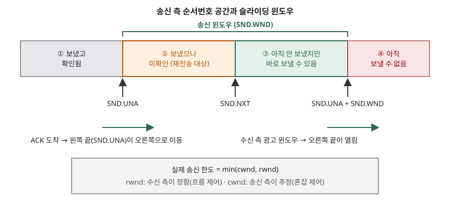

> 실행 검증 없음. 문장의 근거는 TCP 관련 RFC와 IAB의 설계 원칙 문서 본문이며, 대역폭-지연 곱 예시는 직접 계산했다.
> 문항은 통신 프로토콜을 (가) 오류 제어와 혼잡 제어, (나) 슬라이딩 윈도우 기법, (다) 프로토콜을 설계할 때 고려할 점으로 나누어 묻는다.

## 답안

### Ⅰ. 개요

통신 프로토콜은 통신하는 두 개체가 **무엇을, 어떤 형식으로, 어떤 순서로** 주고받을지 정한 규약이다. 신뢰성 있는 전송을 하려면 세 가지 제어가 함께 돌아야 한다. 깨지거나 사라진 데이터를 되살리는 **오류 제어**, 수신 측 버퍼를 넘치지 않게 하는 **흐름 제어**, 네트워크 자체가 막히지 않게 하는 **혼잡 제어**다. 슬라이딩 윈도우는 이 세 제어가 만나는 지점으로, "확인을 기다리지 않고 얼마나 더 보내도 되는가"를 하나의 창으로 표현한다.

### Ⅱ. 오류 제어와 혼잡 제어 (가)

**1. 오류 제어 — 검출 3가지 + 복구 2가지**

① **비트 오류 검출** — 체크섬·CRC로 내용이 바뀌었는지 판별한다. TCP는 세그먼트마다 체크섬을 둔다(RFC 9293 §3.1).
② **손실·순서 오류 검출** — 순서번호로 빠진 것, 중복된 것, 순서가 바뀐 것을 알아낸다.
③ **응답 부재 검출** — 재전송 타이머(RTO)가 만료되면 손실로 본다. RTO는 왕복 시간 표본으로 평활값 SRTT와 편차 RTTVAR를 갱신해 `RTO = SRTT + max(G, 4·RTTVAR)`로 계산하고(RFC 6298 §2.2~2.3), 만료될 때마다 두 배로 늘린다(§5.5).

복구는 두 갈래다. 수신 측이 중복 비트로 직접 고치는 **FEC**, 송신 측이 다시 보내는 **ARQ**다. ARQ는 정지-대기, Go-Back-N, Selective Repeat의 3가지로 나뉘며 뒤의 둘이 슬라이딩 윈도우를 쓴다.

**2. 혼잡 제어 — TCP의 4가지 알고리즘 (RFC 5681 §3)**

혼잡 제어는 송신 측이 **혼잡 윈도우(cwnd)** 라는 자기 추정값으로 네트워크에 넣는 양을 조절하는 기능이다. 종단 간 혼잡 제어가 없으면 재전송이 재전송을 부르는 **혼잡 붕괴**가 생긴다(RFC 2914 §3.1·§5).

| 단계 | 조건·계기 | cwnd 변화 |
|---|---|---|
| ① 느린 시작 | cwnd < ssthresh | ACK마다 최대 1 SMSS 증가 → RTT마다 약 2배 |
| ② 혼잡 회피 | cwnd > ssthresh | RTT마다 약 1 SMSS 증가(선형) |
| ③ 빠른 재전송 | 중복 ACK 3개 | 타이머를 기다리지 않고 유실 세그먼트 재전송 |
| ④ 빠른 회복 | ③ 직후 | ssthresh = max(FlightSize/2, 2·SMSS), cwnd = ssthresh + 3·SMSS, 새 ACK가 오면 cwnd = ssthresh |

타이머 만료는 더 심한 혼잡으로 보고 ssthresh를 같은 식으로 줄인 뒤 cwnd를 1 세그먼트로 내려 느린 시작부터 다시 한다(RFC 5681 §3.1). 손실을 기다리지 않는 신호로는 라우터가 IP 헤더에 CE 표시를 남기는 **ECN**이 있고, 송신 측은 이것을 손실 1건과 같게 취급한다(RFC 3168 §5·§6.1.2).

두 제어는 **같은 신호를 함께 쓴다**는 점에서 얽혀 있다. TCP에서 중복 ACK와 타이머 만료는 오류 제어에게는 재전송 계기이고 혼잡 제어에게는 cwnd를 줄일 계기다. TCP는 손실 원인을 따로 묻지 않으므로, 무선 구간의 비트 오류처럼 혼잡과 무관한 손실에도 송신율을 낮춘다. 링크 계층에서 오류를 먼저 복구하거나 ECN처럼 손실과 분리된 혼잡 신호를 쓰는 이유가 여기에 있다.

**3. 세 가지 제어의 비교**

| 구분 | 오류 제어 | 흐름 제어 | 혼잡 제어 |
|---|---|---|---|
| 지키는 대상 | 데이터의 정확성 | 수신 측 버퍼 | 네트워크 경로 |
| 판단 주체 | 송·수신 양측 | 수신 측이 알림 | 송신 측이 추정 |
| 쓰는 신호 | 체크섬, 순서번호, ACK, 타이머 | 광고 윈도우(rwnd) | 손실, 중복 ACK, ECN, 지연 |
| 조절 변수 | 재전송 여부와 시점 | rwnd | cwnd, ssthresh |
| 실패하면 | 깨진 데이터 전달 | 수신 측 폐기 | 혼잡 붕괴 |

### Ⅲ. 슬라이딩 윈도우 기법 (나)

**1. 개념** — 송신 측이 ACK를 받기 전에 정해진 양(윈도우)까지 연속으로 보내고, ACK가 오는 만큼 창을 앞으로 미는 방식이다. 정지-대기가 왕복 시간 동안 링크를 놀리는 문제를 푼다.

> **출처**: [RFC 9293 §3.3.1 Key Connection State Variables](https://www.rfc-editor.org/rfc/rfc9293#section-3.3.1), [RFC 5681 §3 Congestion Control Algorithms](https://www.rfc-editor.org/rfc/rfc5681#section-3)

**2. 구성 — 송신 측 순서번호 공간 4구간** (RFC 9293 §3.3.1)

① 보냈고 확인된 구간(SND.UNA 왼쪽) ② 보냈으나 확인 안 된 구간(SND.UNA~SND.NXT) ③ 아직 안 보냈지만 보낼 수 있는 구간(SND.NXT~SND.UNA+SND.WND) ④ 아직 보낼 수 없는 구간. 수신 측은 RCV.NXT(다음에 받을 번호)와 RCV.WND(받을 수 있는 양)를 둔다.

**3. 동작 절차 (4단계)**

① 송신 측은 ③ 구간 안에서 연속 전송하고 SND.NXT를 민다
② 누적 ACK가 오면 SND.UNA가 오른쪽으로 이동해 **왼쪽 끝이 닫힌다**
③ 수신 측이 버퍼를 비우고 광고 윈도우를 키우면 **오른쪽 끝이 열린다**
④ 실제로 보낼 수 있는 한도는 `min(cwnd, rwnd)`다(RFC 5681 §3). 흐름 제어와 혼잡 제어가 같은 창을 함께 조인다

**4. 윈도우 크기의 제약 4가지**

| 제약 | 내용 | 근거 |
|---|---|---|
| 순서번호 공간 | k비트 번호에서 Go-Back-N ≤ 2^k − 1, Selective Repeat ≤ 2^(k−1). 넘으면 재전송과 새 데이터를 구분 못 함 | ARQ 원리 |
| 헤더 필드 | TCP 윈도우 필드는 16비트라 최대 65,535바이트. 윈도우 스케일 옵션으로 최대 14비트 이동, 2^30바이트(1 GiB)까지 | RFC 9293 §3.1, RFC 7323 §2.2~2.3 |
| 대역폭-지연 곱 | 링크를 채우려면 윈도우 ≥ 대역폭 × RTT. 1 Gbps × 50 ms = 6.25 MB인데 64 KiB 윈도우면 처리율이 약 10.5 Mbps에 묶인다(직접 계산) | — |
| 0 윈도우 | 수신 측이 0을 광고하면 송신 측은 주기적으로 탐색 세그먼트를 보내야 한다(MUST-36), 간격은 지수로 늘린다 | RFC 9293 §3.8.6.1 |

작은 조각이 반복 전송되는 **어리석은 윈도우 증후군(SWS)** 도 막아야 한다. 송신 측은 한 세그먼트를 채울 만큼 모이거나 Nagle 조건을 만족할 때 보내고, 수신 측은 늘어난 공간이 버퍼의 절반이나 MSS 이상일 때만 오른쪽 끝을 연다(RFC 9293 §3.8.6.2.1~2.2).

### Ⅳ. 프로토콜 설계 시 고려사항 (다)

IAB의 인터넷 아키텍처 원칙(RFC 1958)을 뼈대로, 혼잡·확장·보안 지침을 더해 7가지로 정리한다.

| 고려사항 | 무엇을 판단하는가 | 근거 |
|---|---|---|
| ① 기능 배치 | 신뢰성·보안처럼 종단에서만 바르게 할 수 있는 기능은 종단에 두고 망은 단순하게. 모듈로 나눠 계층 간 의존을 줄인다 | RFC 1958 §2, §3.6 |
| ② 단순성 | 같은 일을 하는 방법은 하나만. 선택 항목과 파라미터를 줄이고 필요하면 협상으로 정한다 | RFC 1958 §3.2·§3.5·§3.8, RFC 9413 §2.3 |
| ③ 메시지 형식 | 유형·길이를 담아 스스로 해석되게 하고, 바이트 순서와 표기를 통일하며, 버전 번호와 예약 필드를 둔다 | RFC 1958 §3.12·§3.13, RFC 6709 §4.1·§4.2 |
| ④ 오류·이상 입력 처리 | 손실·중복·순서 바뀜과 잘못된 메시지를 받았을 때의 동작을 명세에 정한다. "보낼 때 엄격, 받을 때 관대"를 무조건 따르면 오류가 쌓여 명세가 무너지므로, 명세하지 않은 상황은 명시적 오류로 끊는 쪽이 권고된다 | RFC 1958 §3.9, RFC 9413 §4.1·§5.1 |
| ⑤ 혼잡 대응·공정성 | 혼잡 신호에 반응하고 같은 조건의 TCP보다 많은 대역폭을 차지하지 않게 한다. UDP 위 프로토콜도 송신율을 스스로 조절한다 | RFC 2914 §3.1·§3.2, RFC 8085 §3.1 |
| ⑥ 확장성 | 노드 수가 늘어도 성립하는가(규모), 새 기능을 붙여도 기존 구현과 호환되는가(확장). 모르는 확장을 받았을 때의 처리를 정한다 | RFC 1958 §3.3, RFC 6709 §3·§4.7 |
| ⑦ 보안과 검증 가능성 | 위협 분석을 명세에 포함하고 암호 알고리즘을 교체할 수 있게 한다. 시험 가능하게 설계하고 독립 구현 둘 이상으로 상호운용을 확인한다 | RFC 3552, RFC 6709 §3.5·§4.5, RFC 1958 §3.14 |

위 7가지는 서로 부딪힌다. 예컨대 ⑥ 확장을 위해 선택 항목을 늘리면 ② 단순성이 깨지고, ⑤ 혼잡 대응을 넣으면 처리율이 줄어든다. 설계자는 프로토콜이 쓰일 환경(지연, 오류율, 노드 규모, 신뢰 경계)을 먼저 정하고 그 환경에서 우선순위를 매긴다.

### Ⅴ. 결론

오류 제어는 **데이터**를, 흐름 제어는 **수신 측**을, 혼잡 제어는 **네트워크**를 지키며, 슬라이딩 윈도우는 `min(cwnd, rwnd)`라는 하나의 창으로 세 제어를 묶어 링크 이용률을 끌어올린다. 프로토콜을 새로 설계할 때는 기능 배치·단순성·형식·이상 입력·혼잡·확장성·보안의 7가지를 따지되, 강건성 원칙의 재평가(RFC 9413)처럼 기존 원칙도 운영 경험으로 바뀐다는 점을 고려해 명세를 계속 유지·보수하는 체계까지 갖춰야 한다.

> 개념 정리: [TCP 혼잡 제어 알고리즘 비교 — Reno·CUBIC·BBR은 무엇을 신호로 삼는가](../../network/2026-10-06-tcp-congestion-control-reno-cubic-bbr/index.md)
> 개념 정리: [TCP 3-way 핸드셰이크와 흐름·혼잡 제어](../../network/2026-09-28-tcp-handshake-flow-congestion-control/index.md)
> 개념 정리: [Selective Repeat ARQ와 TCP SACK — 선택적 재전송과 윈도우 크기 제약](../../network/2026-11-06-selective-repeat-arq-tcp-sack/index.md)
> 개념 정리: [인터넷 프로토콜 설계 원칙 — RFC 1958 아키텍처 원칙과 강건성 원칙의 재평가](../../network/2026-11-15-internet-protocol-design-principles-robustness/index.md)

끝

## 답안 작성 메모

- **먼저 쓸 것**: (가)의 혼잡 제어 4단계 표와 (나)의 4구간 그림. 그림은 막대 하나를 네 칸으로 나누고 화살표 셋(SND.UNA, SND.NXT, 오른쪽 끝)만 그리면 되므로 3분이면 옮긴다.
- **점수가 갈리는 곳**: 오류·흐름·혼잡 제어를 **구분하는 비교표**와 `min(cwnd, rwnd)` 한 줄. 이 둘이 없으면 (가)와 (나)가 따로 노는 답안이 된다. (다)는 항목 개수(7가지)와 각 항목의 근거 문서가 있는지가 차이를 만든다.
- **시간이 모자라면 버릴 것**: RTO 계산식, ECN, SWS 문단. 윈도우 제약 표는 순서번호 공간과 대역폭-지연 곱 두 줄만 남긴다.
- **더하면 좋은 것**: (다)에서 고려사항끼리의 충돌(확장 대 단순성)을 한 문장으로 짚으면 나열형 답안과 구별된다.

## 참고 자료

- [RFC 9293 Transmission Control Protocol (TCP)](https://www.rfc-editor.org/rfc/rfc9293) (STD 7, 2022-08)
- [RFC 5681 TCP Congestion Control](https://www.rfc-editor.org/rfc/rfc5681) (2009-09)
- [RFC 6298 Computing TCP's Retransmission Timer](https://www.rfc-editor.org/rfc/rfc6298) (2011-06)
- [RFC 7323 TCP Extensions for High Performance](https://www.rfc-editor.org/rfc/rfc7323) (2014-09)
- [RFC 3168 The Addition of Explicit Congestion Notification (ECN) to IP](https://www.rfc-editor.org/rfc/rfc3168) (2001-09)
- [RFC 1958 Architectural Principles of the Internet](https://www.rfc-editor.org/rfc/rfc1958) (1996-06)
- [RFC 2914 Congestion Control Principles](https://www.rfc-editor.org/rfc/rfc2914) (BCP 41, 2000-09)
- [RFC 8085 UDP Usage Guidelines](https://www.rfc-editor.org/rfc/rfc8085) (BCP 145, 2017-03)
- [RFC 6709 Design Considerations for Protocol Extensions](https://www.rfc-editor.org/rfc/rfc6709) (2012-09)
- [RFC 9413 Maintaining Robust Protocols](https://www.rfc-editor.org/rfc/rfc9413) (2023-06)
- [RFC 3552 Guidelines for Writing RFC Text on Security Considerations](https://www.rfc-editor.org/rfc/rfc3552) (BCP 72, 2003-07)
