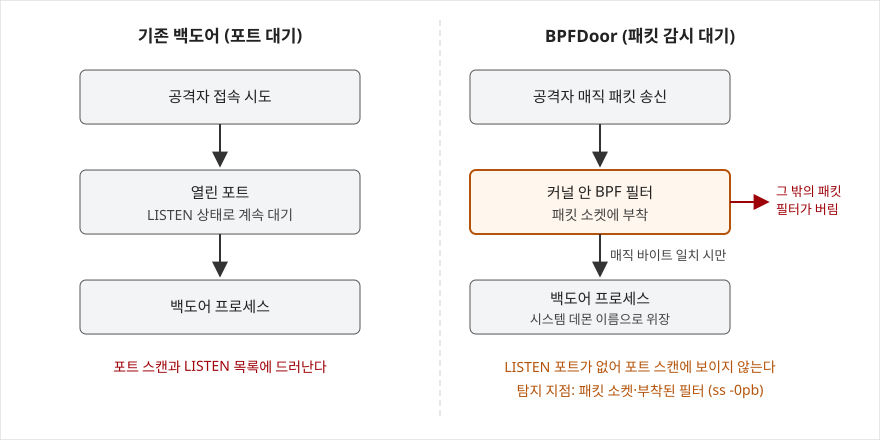

문항은 BPFDoor를 세 갈래로 묻는다. (가) 개념과 기존 백도어 방식과의 차이, (나) 위협요소와 기업
시스템에 미치는 영향, (다) 기술적·관리적 대응 방안이다. "가·나·다"로 나눠 물었으므로 순서를
바꾸지 않고 그대로 대항목으로 쓴다. 답안의 축은 **BPFDoor가 "포트를 열고 기다린다"는 백도어의
전제를 버렸다**는 점이다. 그래서 네트워크 바깥에서 들여다보는 점검이 통하지 않고, 대응은 서버
커널 안에서 무엇이 패킷을 보고 있는지를 확인하는 쪽으로 옮겨 간다.

> 실행 검증 없음. MITRE ATT&CK 항목, 리눅스 커널 문서, 싱가포르 IMDA 권고문, 과학기술정보통신부
> 발표를 근거로 정리했다. 악성코드의 패킷 형식과 인증 방식 같은 공격 수행 세부는 방어 판단에
> 필요하지 않아 싣지 않았다.

---

## Ⅰ. 개요

**BPFDoor** 는 리눅스 서버에 심어 두고 오래 머무는 **수동형(passive) 백도어**로, 커널의 BPF(Berkeley
Packet Filter) 기능으로 특정 패킷이 올 때만 동작한다(MITRE ATT&CK S1161). 2021년 처음 관찰됐고,
PwC가 이를 쓰는 집단을 Red Menshen으로 명명했으며 Trend Micro는 같은 집단을 Earth Bluecrow로
추적한다(IMDA 권고문). 2025년에는 아시아·중동의 통신·금융·유통 분야 리눅스 서버를 노린 새 제어기가
보고됐다.

국내에서는 2025년 통신사 침해사고에서 BPFDoor 계열이 쓰인 것으로 알려졌다. 정부의 최종 조사결과는
그 회사 서버 42,605대를 전수 점검해 감염 서버 28대와 악성코드 33종을 확인했다고 밝혔다
(과학기술정보통신부, 2025-07-04). 숨어 있는 악성코드 하나를 찾느라 **전체 서버를 다 열어 봐야 했다는
점**이 이 문제의 성격을 보여 준다.

---

## Ⅱ. BPFDoor의 개념 및 기존 백도어 방식과의 차이점 (가)

### 1. 개념 — 기반 기술 BPF와 BPFDoor

| 구분 | 내용 |
|---|---|
| BPF (소켓 필터) | 사용자 프로그램이 소켓에 작은 필터 프로그램을 붙여, 그 소켓으로 어떤 데이터를 통과시킬지 커널이 결정하게 하는 기능. `tcpdump`가 캡처 조건을 이 형태로 커널에 올린다 |
| BPFDoor | 패킷 소켓을 열고 BPF 필터를 붙여 TCP·UDP·ICMP를 감시하다가, 미리 정한 바이트열(매직 바이트)이 든 패킷이 올 때만 깨어나 명령을 수행하는 백도어 |

BPF는 1993년 McCanne·Jacobson의 BSD 패킷 필터에서 나왔고, 리눅스는 이를 소켓 필터로 구현해
`SO_ATTACH_FILTER` 옵션으로 붙인다(리눅스 커널 문서). 정상적인 패킷 캡처 기술을 그대로 빌려
쓴다는 점이 BPFDoor의 출발점이다.

> **출처**: [MITRE ATT&CK S1161 BPFDoor](https://attack.mitre.org/software/S1161/), [MITRE ATT&CK T1205.002 Traffic Signaling: Socket Filters](https://attack.mitre.org/techniques/T1205/002/), [Linux kernel docs — Linux Socket Filtering aka BPF, Introduction](https://docs.kernel.org/networking/filter.html)

### 2. 동작 흐름 — 4단계

| 단계 | 동작 | 근거 |
|---|---|---|
| ① 설치·위장 | 공유 메모리 경로에 자신을 복사하고 원본을 지운 뒤, 시스템 데몬 이름으로 프로세스 이름을 바꾸고 파일 시각을 고친다 | MITRE S1161, Elastic |
| ② 필터 부착·대기 | 패킷 소켓에 BPF 필터를 붙이고 포트는 열지 않은 채 기다린다 | MITRE T1205.002 |
| ③ 활성화 | 매직 바이트가 든 패킷만 사용자 공간으로 올라오고, 제어기는 비밀번호 확인을 거친다 | IMDA, Trend Micro |
| ④ 명령 수행 | 리버스 셸 열기, 새 연결을 특정 포트의 셸로 돌리기, 생존 확인 응답의 **3가지** 중 하나를 한다 | IMDA |

여기서 놓치면 안 되는 전제가 있다. 리눅스에서 패킷 소켓은 **root 또는 `CAP_NET_RAW` 권한**이
있어야 연다(packet(7)). 즉 BPFDoor는 최초 침투 수단이 아니라, **이미 관리자 권한을 얻은 공격자가
다시 들어오기 위해 남기는 재진입 수단**이다.

### 3. 기존 백도어 방식과의 차이

| 비교 항목 | 바인드형 백도어 | 리버스 연결형 백도어 | 포트 노킹 | BPFDoor |
|---|---|---|---|---|
| 대기 방식 | 포트를 열고 접속을 기다림 | 내부에서 외부 서버로 주기적으로 연결 | 닫힌 포트들에 정해진 순서로 접속하면 포트를 엶 | 포트 없이 커널 필터로 패킷을 감시 |
| 열린 포트 | 있음 | 없음 | 신호 전에는 없음 | 없음 |
| 평상시 트래픽 | 접속 대기만 | 주기적 외부 연결이 발생 | 거의 없음 | 거의 없음 |
| 외부 포트 스캔 | 드러남 | 해당 없음 | 신호 전에는 안 드러남 | 안 드러남 |
| 주로 잡는 곳 | 포트 스캔, LISTEN 목록 | 외부 연결 패턴, 평판 차단 | 방화벽 접속 기록 | 패킷 소켓·부착 필터, 시스템 콜 감사 |

포트 노킹과 BPFDoor는 MITRE에서 같은 상위 기법(트래픽 신호, T1205)의 형제 항목이다. 둘 다 "신호를
받기 전에는 보이지 않는다"는 점이 같지만, 포트 노킹은 신호 뒤 포트를 여는 반면 BPFDoor는 **필터가
패킷 내용을 보고 바로 깨어나며, 감시를 위해 포트를 전혀 쓰지 않는다**는 점이 다르다.

---

## Ⅲ. BPFDoor의 위협요소와 기업 시스템에 미치는 영향 (나)

### 1. 위협요소 — 6가지

| 번호 | 위협요소 | 내용 |
|---|---|---|
| ① | 네트워크 은닉 | LISTEN 포트가 없어 포트 스캔과 열린 포트 점검에 나타나지 않는다 |
| ② | 호스트 은닉 | 원본 파일 삭제, 데몬 이름으로 위장(MITRE는 10개의 위장 이름을 기록), 파일 시각 변경, 환경 변수 흔적 삭제 |
| ③ | 작업 기록 삭제 | 셸과 MySQL 클라이언트의 명령 이력 파일을 `/dev/null`로 돌려 기록을 남기지 않는다 |
| ④ | 방화벽 규칙 변조 | iptables 규칙을 바꿔 공격자 패킷을 특정 고번호 포트의 셸로 돌린다. 방화벽이 통제 수단이 아니라 통로가 된다 |
| ⑤ | 장기 잠복 | 신호가 오기 전에는 CPU 사용과 트래픽이 거의 없어(MITRE T1205.002) 수년간 머무를 수 있다 |
| ⑥ | 내부 확산 거점 | 열린 리버스 셸이 다른 서버로 넘어가는 발판이 된다(IMDA는 측면 이동에 대응시킴) |

①~⑤가 **"찾기 어렵다"** 는 성질이고 ⑥이 **"찾지 못하는 동안 피해가 커진다"** 는 성질이다.
둘이 겹쳐 있다는 점이 일반 악성코드와 다르다.

### 2. 기업 시스템에 미치는 영향 — 4가지

| 영향 | 내용 |
|---|---|
| ① 기밀성 상실 | 잠복 기간 동안 데이터가 반출된다. 앞의 통신사 사고에서 정부는 유심정보 25종, 9.82GB, 가입자 식별번호(IMSI) 기준 2,696만 건의 유출을 확인했다 |
| ② 시스템 무결성 상실 | 감염 서버의 프로세스 목록·방화벽 규칙·명령 이력을 믿을 수 없게 된다. 정리는 개별 파일 삭제가 아니라 재구축이 된다 |
| ③ 탐지·복구 비용 | 어느 서버에 있는지 모르므로 전수 점검이 필요하다. 앞의 사고에서는 4만 대가 넘는 서버를 점검했다 |
| ④ 법적·사업적 책임 | 정부 조사단은 해당 사업자가 주의의무를 다하지 않아 과실이 있다고 보고 이용약관상 위약금 면제 규정을 적용할 수 있다고 판단했다 |

②가 실무에서 가장 무겁다. 백도어가 방화벽과 이력을 고친다는 것은 **사고 조사에 쓸 근거 자체가
오염된다**는 뜻이다. 그래서 감염이 확인된 서버는 증거를 확보한 뒤 새로 세우는 것이 원칙이 된다.

> 개념 정리: [사이버 킬체인과 침해지표(IoC) — 고통의 피라미드](../../security/2026-11-02-cyber-kill-chain-and-indicators-pyramid-of-pain/index.md)

---

## Ⅳ. BPFDoor의 위협에 대응하기 위한 기술적·관리적 방안 (다)

### 1. 기술적 방안 — 7가지

| 계층 | 방안 | 근거 |
|---|---|---|
| ① 소켓 | `ss -0pb`를 root로 돌려 패킷 소켓을 연 프로세스와 그 소켓에 붙은 BPF 필터를 확인하고, 패킷 캡처가 필요한 정상 프로세스 목록과 대조한다 | ss(8) |
| ② 시스템 콜 | 소켓에 필터를 붙이는 호출(`SO_ATTACH_FILTER`, `bpf()`) 직후 같은 프로세스가 외부로 연결하는 흐름을 감사 로그로 잡는다 | MITRE T1205.002 탐지 전략 |
| ③ 프로세스·파일 | 공유 메모리 경로(`/dev/shm`)에서 실행된 바이너리, `/var/run`의 비정상 PID·잠금 파일을 경보로 건다 | Elastic |
| ④ 파일 스캔 | KrCERT가 배포한 BPFDoor YARA 룰을 통제된 환경에서 시험한 뒤 서버 전반에 적용한다 | IMDA (KrCERT 2025-05-12 자료 인용) |
| ⑤ 방화벽 규칙 무결성 | iptables 규칙의 기준선을 두고 바뀌면 경보를 낸다. 고번호 포트로의 리다이렉트 규칙이 특히 표식이다 | MITRE S1161 |
| ⑥ 네트워크 | 비표준 프로토콜 행위와 원시 패킷의 매직 바이트를 검사하는 NDR을 둔다. 상태 기반 방화벽은 일부 변종을 막는다 | IMDA, MITRE M1037 |
| ⑦ 노출 최소화 | 업무상 필요 없는 프로세스·포트·프로토콜을 막고, 명령 이력을 끄는 환경 변수 설정을 탐지한다 | IMDA |

①이 BPFDoor에 가장 직접적인 점검이다. 포트를 보는 도구(`ss -lt`, 외부 포트 스캔)로는 안 보이지만,
**패킷 소켓과 부착된 필터는 커널이 알고 있으므로** 관리자 권한으로 물으면 드러난다. 다만 프로세스
이름은 위장되므로 이름이 아니라 실행 파일 경로와 소켓 소유 관계로 판단한다.

### 2. 관리적 방안 — 6가지

| 번호 | 방안 | 내용 |
|---|---|---|
| ① | 계정·비밀번호 관리 | 서버 관리 계정의 비밀번호 주기 변경과 공유 금지. 정부 조사는 사고 원인으로 계정정보 관리 부실을 들고 비밀번호 관리 강화를 재발방지 대책에 넣었다 |
| ② | 주요 정보 암호화 | 반출돼도 쓸 수 없도록 핵심 정보를 암호화한다(정부 재발방지 대책) |
| ③ | 관리체계·인력·예산 | 정보보호 관리체계를 강화하고 인력과 예산을 늘린다(정부 재발방지 대책) |
| ④ | 탐지 규칙의 지속 검증 | 탐지 규칙을 위협 행위에 대고 정기적으로 시험·검증한다(IMDA) |
| ⑤ | 위협정보 공유와 신고 | 침해지표를 받아 자체 점검하고, 흔적이 보이면 즉시 신고해 다른 기관과 공유한다 |
| ⑥ | 리눅스 서버의 관제 편입 | 단말 위주인 EDR·관제 범위를 리눅스 서버까지 넓힌다(Elastic) |

기술적 방안 ①~⑦은 **이미 심긴 것을 찾는** 수단이고, 관리적 방안 ①은 **심을 권한을 애초에 주지 않는**
수단이다. BPFDoor가 관리자 권한을 전제로 하므로(Ⅱ-2), 계정 관리가 대응의 출발점이 된다. 정부 조사가
과거 침해사고 대응 미흡을 원인으로 함께 든 것도 같은 맥락이다. 이전 사고 뒤에 **남아 있는 재진입
수단까지 전수 점검하지 않으면** 같은 공격자가 같은 문으로 돌아온다.

> 개념 정리: [보안 관제 체계 — SIEM, SOAR, EDR의 역할 분담](../../security/2026-10-30-security-operations-siem-soar-edr/index.md),
> [침해사고 대응 절차 6단계](../../security/2026-09-29-incident-response-six-phases/index.md),
> [ISMS-P 인증 체계와 통제 항목 구조](../../security/2026-10-13-isms-p-certification-control-structure/index.md)

---

## Ⅴ. 결론

BPFDoor는 정상 패킷 캡처 기술인 BPF를 빌려 **포트를 열지 않고 커널 안에서 신호만 기다리는** 백도어다.
이 방식이 "열린 포트를 찾으면 백도어를 찾는다"는 경계형 점검의 전제를 무너뜨렸다. 대응은 세 축이다.
**패킷 소켓·시스템 콜·방화벽 규칙을 서버 안에서 직접 보는 탐지**, **위장과 기록 삭제를 견디는 감사
체계**, 그리고 **관리자 권한 탈취 자체를 막는 계정 관리**다. 한 번 감염된 서버는 그 서버가 보여 주는
기록을 믿을 수 없으므로, 증거를 확보한 뒤 재구축하는 것을 원칙으로 둔다.

끝

---

## 답안 작성 메모

- **시간 배분.** (가) 개념·도식·비교표에 10분, (나) 위협 6가지와 영향 4가지에 8분, (다) 기술 7가지와
  관리 6가지에 9분, 개요·결론에 3분.
- **점수가 갈리는 지점.** (가)의 차이점을 "더 은밀하다"로 끝내면 감점이다. **LISTEN 포트가 없고 커널의
  BPF 필터가 매직 바이트 패킷만 사용자 공간으로 올린다**는 구조를 써야 왜 포트 스캔이 소용없는지
  설명된다. (다)는 백신·패치 같은 일반론보다 **패킷 소켓과 부착 필터 점검(`ss -0pb`)** 처럼 이 악성코드에
  맞춘 점검을 하나 이상 넣어야 한다.
- **놓치기 쉬운 전제.** 패킷 소켓에 관리자 권한이 필요하다는 점을 써 두면 (다)에서 계정 관리를 첫째로
  드는 논리가 선다. 이 연결이 기술과 관리를 한 답안으로 묶는다.
- **시간이 모자라면.** (가)의 비교표에서 포트 노킹 열을 빼고, (나)의 영향은 4가지 이름만 쓰고, (다)의
  기술 7가지 표는 남긴다. 숫자(4단계, 6가지, 4가지, 7가지, 6가지)가 곧 점수다.
- **도식 옮겨 그리기.** 박스 6개다. 왼쪽 "공격자 → 열린 포트 → 백도어", 오른쪽 "매직 패킷 → BPF 필터
  → 백도어"와 필터 옆의 "나머지 버림" 화살표만 그리면 된다.
- **실명 사례.** 국내 사고 사례는 정부 발표 수치만 쓴다. 보도에 나온 변종 개수 같은 수치는 정부
  원문에서 확인하지 못했으므로 답안에 쓰지 않는다.

---

## 참고 자료

- [MITRE ATT&CK — S1161 BPFDoor (v1.1, 2026-05-12 수정)](https://attack.mitre.org/software/S1161/) — 정의, 최초 관찰 시기, 위장·시각 변경·이력 삭제·iptables 변조 등 기법 목록
- [MITRE ATT&CK — T1205.002 Traffic Signaling: Socket Filters (v2.0, 2026-05-12 수정)](https://attack.mitre.org/techniques/T1205/002/) — 소켓 필터 기법, 완화 M1037, 탐지 전략 DET0162
- [MITRE ATT&CK — T1205.001 Traffic Signaling: Port Knocking](https://attack.mitre.org/techniques/T1205/001/) — 포트 노킹 비교
- [Linux kernel docs — Linux Socket Filtering aka Berkeley Packet Filter (BPF)](https://docs.kernel.org/networking/filter.html) — 소켓 필터 개념, `SO_ATTACH_FILTER`, tcpdump와 libpcap
- [McCanne, Jacobson — The BSD Packet Filter, USENIX Winter 1993](https://www.tcpdump.org/papers/bpf-usenix93.pdf) — BPF 원 논문
- [packet(7) — Linux manual page](https://man7.org/linux/man-pages/man7/packet.7.html) — 패킷 소켓 생성 권한
- [ss(8) — Linux manual page (iproute2, 2026-07)](https://man7.org/linux/man-pages/man8/ss.8.html) — `-0`·`-p`·`-b` 옵션
- [IMDA — Advisory for ICM Sector: Earth Bluecrow Deploys BPFDoor Malware Across Telcos in Asia (2025)](https://www.imda.gov.sg/-/media/imda/files/regulations-and-licensing/regulations/advisories/infocomm-media-cyber-security/earth-bluecrow-deploys-bpfdoor-malware-across-telcos-in-asia.pdf) — 3가지 동작, 탐지·완화 권고, KrCERT YARA 룰 인용
- [과학기술정보통신부 — SK텔레콤 침해사고 최종 조사결과 발표 (2025-07-04, KDI 경제정보센터 게재본)](https://eiec.kdi.re.kr/policy/materialView.do?num=268466&topic=L) — 점검 서버 수, 감염 서버·악성코드 수, 유출 규모, 사고 원인, 재발방지 대책
- [Trend Micro — BPFDoor's Hidden Controller Used Against Asia, Middle East Targets (2025-04-14)](https://www.trendmicro.com/en_us/research/25/d/bpfdoor-hidden-controller.html) — 제어기 분석, 대상 분야, 귀속
- [Elastic Security Labs — A peek behind the BPFDoor (2022-07-13)](https://www.elastic.co/security-labs/a-peek-behind-the-bpfdoor) — 은닉 동작과 탐지 규칙
