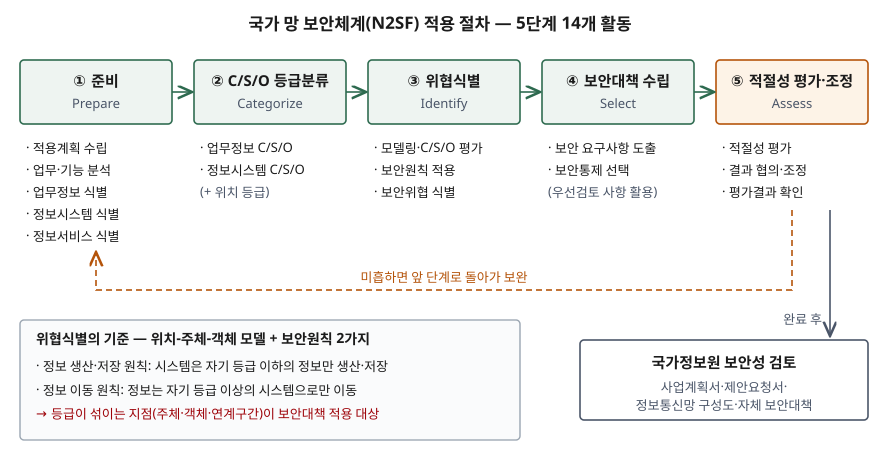

> **실행 검증 없음.** 제도·절차 문제이므로 국가정보원이 발간한 「국가 망 보안체계 보안
> 가이드라인」 1.0 본문만 근거로 정리했다. 기출문제는 2025년 1월 공개된 초안(Draft)을 두고
> 물었지만, 같은 해 9월 정식판 1.0이 나왔으므로 1.0을 기준으로 쓰고 초안과의 관계를 밝혔다.
> 언론 보도에 나온 통제 항목 수나 평가 제도 변경 일정은 본문에서 확인되지 않아 쓰지 않았다.

기출문제는 국가정보원이 공공기관용으로 내놓은 국가 망 보안체계(N2SF)에 대해 세 가지를
순서대로 묻는다. 개념, 적용 절차, 고려사항이다. "망 분리를 완화하는 제도"라는 한 줄로는
점수가 나지 않는다. 점수는 **보호 단위가 '망'에서 '업무정보의 등급'으로 바뀌었다**는 것을
개념의 축으로 세우고, 절차를 **5단계와 각 단계의 활동까지** 이름으로 들며, 위협이 어디서
생기는지를 **등급이 섞이는 지점**으로 설명하는 데서 난다.

---

## Ⅰ. 개요

### 가. 등장 배경 — 망 분리 정책이 남긴 문제

망 분리는 2006년부터 국가·공공기관에 시행된 정책으로, 업무망을 인터넷망과 떼어 외부에서
들어오는 사이버 위협을 원천 차단하는 것이 목적이다. 가이드라인은 이 정책이 강력한 효과를
냈다고 평가하면서도, 다음 변화 앞에서 한계가 드러났다고 적는다.

- ① **업무환경이 바뀌었다.** 재택·원격근무가 도입되면서 업무가 업무망 밖에서도 이뤄지게 됐다
- ② **신기술은 인터넷 너머에 있다.** 클라우드와 생성형 AI는 외부 서비스로 제공되므로, 망을
  끊어 두는 방식으로는 쓸 수가 없다
- ③ **보호 수준이 일률적이다.** 업무망 안의 정보는 공개해도 되는 것이든 비밀이든 같은 방식으로
  묶인다. 공개 가능한 정보까지 외부와 단절돼 공공데이터 활용이 막힌다

국가정보원은 관계기관과 산학연 전문가가 참여한 「국가 망 보안정책 개선 TF」를 꾸려 새
체계를 만들고, **2025년 1월 초안(Draft)** 을 공개해 의견을 받은 뒤 **2025년 9월 정식판
1.0**을 발간했다(가이드라인 문서이력).

### 나. 추진 목표 — 5가지

가이드라인이 밝힌 추진 목표는 5가지다(제1장 제1절).

| 번호 | 목표 |
|---|---|
| ① | 획일적인 망 분리에서 N2SF 기반 보안정책으로 패러다임 전환 |
| ② | AI·클라우드 등 신기술 융합으로 언제 어디서나 일하는 스마트 업무환경 실현 |
| ③ | 기관 자율보안 개념을 접목한 국내 현실 최적화 정책 개발 |
| ④ | 기관별 자율 추진 지원과 평가·검증 제도의 점진적 개선 |
| ⑤ | 공공정보의 보안성과 활용성을 함께 높여 관련 산업과 디지털 경제 활성화 |

## Ⅱ. 가. 국가 망 보안체계(N2SF)의 개념

### 가) 정의

**국가 망 보안체계(National Network Security Framework, N2SF)** 는 각급기관의 업무정보와
정보시스템을 식별하고, 업무 중요도에 따라 **기밀(C)·민감(S)·공개(O)** 3개 등급으로 분류해
**등급별로 차등적인 보안통제를 적용하는 보안 프레임워크**다(제1장 제2절).

핵심은 두 가지다.

- **보호 단위의 전환**: 무엇이 어느 망에 있는가가 아니라 **그 정보가 얼마나 중요한가**로 보호
  수준을 정한다
- **기관 자율**: 기관이 스스로 위협을 식별하고 보안대책을 설계·시행한다. 국가정보원은 절차·
  통제 항목·서식을 제공하고, 결과는 보안성 검토로 확인한다

### 나) C/S/O 등급 — 3가지

업무정보의 등급은 법령에 근거해 나눈다(제1장 제3절 2).

| 등급 | 대상 | 법적 근거 |
|---|---|---|
| **C (Classified, 기밀)** | 비밀·안보·국방·외교·수사 등의 기밀정보, 국민 생명·안전과 직결된 정보 | 정보공개법 비공개 대상 정보(제9조) 제1호~제4호 |
| **S (Sensitive, 민감)** | 공개 시 개인·국가 이익 침해가 우려되는 정보, 시스템 로그·임시 백업 등 | 같은 조 제5호~제8호 + 기타 정보 |
| **O (Open, 공개)** | C·S 이외의 모든 정보, 공개 요건을 충족했거나 비공개 필요성이 소멸한 정보 | — |

등급은 **3가지 대상**에 붙는다.

- ① **업무정보**: 위 기준으로 분류한다
- ② **정보시스템**: 그 시스템이 생산·저장·처리하는 업무정보의 등급을 따른다. 여러 등급이
  섞이면 **가장 높은 등급**을 붙인다. 이때 낮은 등급 정보까지 높은 수준의 통제를 받게 되므로,
  가이드라인은 **같은 등급끼리 시스템을 나눠 운영하라**고 권고한다
- ③ **위치(영역)**: 인터넷 영역은 O, 업무 영역은 S, 기밀을 다루는 특수 환경은 C가 원칙이다

### 다) 위협을 찾는 방법 — 위치-주체-객체 모델과 보안원칙 2가지

N2SF가 망 분리와 갈리는 지점이 여기다. 망 분리는 "경계를 넘는 모든 연결"을 위협으로
보지만, N2SF는 **등급이 섞이는 곳**을 위협으로 본다.

- 정보서비스를 **위치(Domain)–주체(Subject)–객체(Object)** 로 단순화한다. 주체는 업무정보를
  쓰는 정보시스템, 객체는 주체가 접속·이용하는 대상 시스템, 위치는 주체가 놓인 물리적·논리적
  영역이다. 셋 모두에 C/S/O를 붙인다
- 셋의 등급이 같으면 위협이 없고, **다르면 보안대책이 필요하다.** 위치와 주체가 S인데 객체가
  O이면 주체, 객체, 둘 사이 연계구간의 **3곳**에 대책을 검토한다
- 어떤 정보가 문제인지는 **보안원칙 2가지**로 가린다

| 원칙 | 허용되는 경우 | 위협이 되는 경우 |
|---|---|---|
| **정보 생산·저장 원칙** | 시스템이 자기 등급 **이하**의 정보를 생산·저장 | S 정보가 O 시스템에 저장된다 |
| **정보 이동 원칙** | 정보가 자기 등급 **이상**의 시스템으로 이동 | S 정보가 O 시스템으로 옮겨 간다 |

### 라) 보안통제 항목 — 6개 대항목

위협에 대응하는 관리적·기술적 보안대책이 **보안통제 항목**이다. 가이드라인 부록1(보안통제
항목 해설서)에 수록되며, **6개 대항목** 아래 중항목·소항목으로 구성된다(제1장 제3절 4).

> ① 권한 ② 인증 ③ 분리 및 격리 ④ 통제 ⑤ 데이터 ⑥ 정보자산

항목마다 고유 식별자(예: 원격접속 `N2SF-RA-1`~)가 있고, **C/S/O 등급별 우선 검토 사항**이
표시돼 있어 등급을 알면 먼저 볼 통제가 정해진다. 본문은 이 우선 검토 사항을 공통 기준선으로
두고 기관 특성에 맞춰 통제를 덧붙이는 방식을 **오버레이(Overlay)** 라 부르며, 미국 NIST
위험관리 프레임워크(RMF)의 오버레이 개념과 같은 계열이라고 설명한다(참고 제2절).

### 마) 망 분리 정책과의 비교

| 구분 | 망 분리 정책 | 국가 망 보안체계(N2SF) |
|---|---|---|
| 보호 단위 | 망(업무망·인터넷망) | 업무정보·정보시스템·위치의 등급 |
| 보호 수준 | 업무망 안은 일률적 | C/S/O 등급별 차등 |
| 위협을 보는 기준 | 망 경계를 넘는 연결 | 등급이 섞이는 주체·객체·연계구간 |
| 외부 서비스 이용 | 원칙적으로 차단, 망연계로 예외 허용 | O·S 업무는 통제를 갖추면 클라우드·생성형 AI 이용 가능 |
| 보안대책 결정 | 정해진 구성 | 기관이 위협을 식별해 통제를 선택·추가 |
| 확인 방식 | 구성 준수 여부 | 5단계 산출물(자체 보안대책)로 보안성 검토 |

## Ⅲ. 나. 국가 망 보안체계(N2SF) 적용 절차

### 가) 적용 절차 모식도

N2SF는 정보화사업(신규 구축, 또는 기존 서비스에 N2SF 적용)을 추진할 때 **5단계 14개
활동**으로 수행한다(제2장, 표 2-1).

> **출처**: [국가정보원, 국가 망 보안체계 보안 가이드라인 1.0 (2025-09) — 제1장 제2절 2. 적용 절차, 제1장 제3절 3. 위협 모델링과 식별 절차, 제2장 표 2-1, 제3장 제2절](https://www.ncsc.go.kr:4018/)

### 나) 단계별 활동

| 단계 | 활동 | 하는 일 |
|---|---|---|
| **① 준비 (Prepare)** | 1-1 N2SF 적용계획 수립 / 1-2 기관 업무·기능 분석 / 1-3 업무정보 식별 / 1-4 정보시스템 식별 / 1-5 정보서비스 식별 | 정부·지방 기능분류체계와 연계해 업무를 식별하고, 업무 → 업무정보 → 정보시스템 → 정보서비스로 이어지는 관계를 정리한다. 규정·지침에서 오는 기초 요구사항을 **보안목표**로 정한다 |
| **② C/S/O 등급분류 (Categorize)** | 2-1 업무정보 C/S/O 분류 / 2-2 정보시스템 C/S/O 분류 | 업무정보 → 정보시스템 → 위치 순으로 등급을 붙인다. 공개할 정보가 비공개로, 비공개 정보가 공개로 잘못 분류되지 않게 한다 |
| **③ 위협식별 (Identify)** | 3-1 모델링 및 C/S/O 평가 / 3-2 보안원칙 적용 / 3-3 보안위협 식별 | 위치-주체-객체 모델에 등급을 기재해 혼용 지점을 찾고, 생산·저장 원칙과 이동 원칙으로 위협과 대책 적용 대상을 정한다 |
| **④ 보안대책 수립 (Select)** | 4-1 보안 요구사항 도출 / 4-2 보안통제 선택 | 위협별로 예방·차단·탐지·대응·완화·복구가 가능한 요구사항을 세우고, 준비 단계의 보안목표를 더한다. 부록1에서 등급별 우선 검토 사항을 기준으로 통제를 고르되 **제외·수정·추가**할 수 있다. 구현계획도 세운다 |
| **⑤ 적절성 평가·조정 (Assess)** | 5-1 적절성 평가 / 5-2 평가결과 협의·조정 / 5-3 평가결과 확인 | 앞 네 단계의 결과를 단계별 평가지표로 점검하고, 미흡하면 보완한다. 확인이 끝나면 절차가 종료된다 |

### 다) 절차 이후 — 국가정보원 보안성 검토

5단계가 끝나면 「국가정보보안기본지침」에 따라 국가정보원에 보안성 검토를 요청한다. 제출
문서는 **4종**이다(제3장 제2절).

| 문서 | N2SF 결과가 들어가는 부분 |
|---|---|
| ① 사업계획서 | 도출된 보안통제를 구현(제품 도입·개발)하는 세부 내용과 계획 |
| ② 제안요청서 | 같은 내용 — 사업자가 구현할 범위가 된다 |
| ③ 정보통신망 구성도 | 보안통제가 적용된 네트워크 구조 |
| ④ 자체 보안대책 | 5단계 주요 활동의 결과를 종합한 최종 산출물(서식 제공) |

자체 보안대책 서식에는 보안목표, 시스템·정보별 C/S/O 등급, 식별한 위협, 선택한 통제가
차례로 들어간다. **보안성 검토의 대상이 '망 구성'에서 '기관이 스스로 한 위험 판단의 근거'로
바뀐 것**이 절차상의 가장 큰 변화다.

## Ⅳ. 다. 국가 망 보안체계(N2SF) 고려사항

### 가) 가이드라인이 제시한 고려사항 — 6가지

가이드라인 제1장 제4절이 드는 고려사항은 6가지다.

| 번호 | 고려사항 | 내용 |
|---|---|---|
| ① | 보안업무 절차와 인식의 틀에 N2SF 정착 | 단계별 활동을 기관의 실제 정보보안 업무 절차에 반영한다 |
| ② | 기관 특성과 환경을 반영한 맞춤형 보안대책 | 목표 보안수준·호환성 같은 기술 여건과 규정·예산·인력 같은 비기술 여건을 함께 반영한다 |
| ③ | 정보서비스 모델 해설서(부록2) 활용 | 같은 구조의 서비스를 만들면 해설서를 토대로 산출물을 쓸 수 있다. 구조를 바꾸면 **바뀐 부분은 위협식별부터 다시** 한다 |
| ④ | 기관 업무·기능 범위 설정과 BRM 연계 | 사업 범위 안의 업무 기능을 분석하고, 업무 중요도·보안등급 판단에 BRM을 연계할 수 있다 |
| ⑤ | 추가 보안통제 항목 정의 및 적용 | 부록1은 일반 모델용이므로, 서비스 구조와 위협 특성에 맞춰 기관이 통제를 추가 정의한다 |
| ⑥ | 관련 지침·가이드라인 고려 | N2SF는 최소한의 공통 절차다. 클라우드 협업은 「국가 클라우드 컴퓨팅 보안 가이드라인」, 생성형 AI는 「챗GPT 등 생성형 AI 활용 보안 가이드라인」의 요구사항도 충족해야 한다 |

부록2의 정보서비스 모델은 인터넷 단말의 업무 활용, 업무환경의 생성형 AI 활용, 외부
클라우드 기반 업무협업, 공공데이터의 외부 AI 융합처럼 기관이 자주 마주칠 구성을 미리
위협식별·통제까지 풀어 둔 것이다.

### 나) 정보시스템 관점의 고려사항 — 4가지

가이드라인의 고려사항이 정책 차원이라면, 실제 시스템을 설계하는 쪽에서는 다음이 남는다.
각 항목은 가이드라인 본문이 언급한 지점에서 끌어냈다.

① **등급분류의 정확성이 전체를 좌우한다**
- 이후 위협식별·통제 선택이 모두 등급에서 출발한다. 과대 분류는 공공데이터 활용을 막고,
  과소 분류는 그 자체가 보안 사고다. 업무정보 목록과 등급을 데이터 자산 관리 체계(메타데이터
  카탈로그 등)에 남겨 사업마다 다시 판단하지 않게 한다

② **혼합 등급 시스템은 분리해 설계한다**
- 하나의 시스템에 S·O 정보가 섞이면 시스템 전체가 S가 되어 O 정보도 외부 서비스와 연계할 수
  없다. 가이드라인 권고대로 **등급별로 시스템을 나누고**, 그 사이를 통제된 연계로 잇는다

③ **등급 사이 연계구간이 기술적 핵심이다**
- 이동 원칙에 따라 S → O 방향 흐름은 대책이 필요하다. 본문 참고 절은 서로 다른 등급 도메인
  사이에서 데이터를 검증된 방식으로 넘기는 **CDS(Cross Domain Solution)** 를 소개하며, 접근형·
  전송형·다중등급형으로 나누고 DLP·CDR·ABAC로 흐름을 통제할 수 있다고 적는다

④ **제로트러스트와 함께 설계한다**
- 본문은 제로트러스트를 별도 단계가 아니라 **보안대책 수립 단계의 원칙**(항상 검증, 최소 권한)
  으로 적용하고, 부록1의 6개 대항목이 제로트러스트의 필러(pillar)와 대응된다고 설명한다.
  등급을 경계 대신 쓰는 이상, 접근마다 신원·기기·맥락을 확인하는 구조가 따라와야 통제가 유지된다

## Ⅴ. 결론

국가 망 보안체계는 2006년 이후 공공 보안의 뼈대였던 망 분리를 **업무정보 중요도 기반의
차등 통제**로 바꾸는 제도다. 정보를 C·S·O로 나누고, 위치-주체-객체 모델과 생산·저장 원칙,
이동 원칙으로 **등급이 섞이는 지점**을 위협으로 찾아, 6개 대항목의 보안통제를 골라 적용한다.
절차는 준비·등급분류·위협식별·보안대책 수립·적절성 평가조정의 5단계이고, 결과는 자체
보안대책으로 묶여 국가정보원 보안성 검토를 받는다. 성패는 등급분류의 정확성, 혼합 등급
시스템의 분리, 등급 사이 연계구간의 통제에 달려 있으며, 이는 정보시스템 설계가 데이터
분류 체계와 제로트러스트 접근 통제를 함께 갖춰야 한다는 뜻이다. 기관은 부록2의 정보서비스
모델에서 시작해 자기 업무에 맞춰 통제를 덧붙여 가는 방식으로 전환을 추진하는 것이 현실적이다.

> 개념 정리: [제로 트러스트 아키텍처 — NIST SP 800-207의 7원칙과 3구성요소](../../security/2026-10-08-zero-trust-architecture-nist-sp-800-207/index.md)

끝

## 답안 작성 메모

- **먼저 쓸 것**: Ⅲ-가의 5단계 모식도와 Ⅱ-마의 망 분리 비교표. 모식도에는 단계 이름 아래
  영문(Prepare·Categorize·Identify·Select·Assess)을 적고, 평가에서 앞 단계로 돌아가는 화살표와
  보안성 검토 박스까지 그린다. 영문 단계 이름이 NIST RMF와 닮았다는 점을 한 줄 덧붙이면 출처를
  아는 답안으로 읽힌다.
- **점수가 갈리는 지점**:
  - C/S/O를 "기밀·민감·공개"로만 쓰지 않고 **정보공개법 비공개 대상 정보 조항**에 근거한다는
    것, 등급이 **업무정보·정보시스템·위치** 3가지에 붙는다는 것을 쓰는지
  - 위협식별을 "위협을 식별한다"로 넘기지 않고 **위치-주체-객체 모델과 보안원칙 2가지**로
    설명하는지. 이것이 망 분리와 N2SF를 가르는 핵심이다
  - 절차를 5단계 이름만이 아니라 **14개 활동 중 대표 활동**과 **보안성 검토 4종 문서**까지 잇는지
- **시간이 모자라면**: Ⅰ-나 추진 목표 표, Ⅲ-다의 문서별 설명 표, Ⅳ-나의 ④를 버린다.
  Ⅳ-가의 6가지 표는 남긴다 — 문항 (다)에 직접 답하는 곳이고 채점자가 개수를 센다.
- 문제는 2025년 1월 초안을 가리키지만 답안은 정식판 1.0 기준으로 쓴다. 초안과 1.0의 차이를
  다는 것보다 "초안 공개 후 의견 수렴을 거쳐 1.0으로 확정됐다"는 한 줄이 안전하다.
- 보안통제 항목 수는 본문에 적혀 있지 않고 보도마다 다르게 나와 쓰지 않았다. 답안지에도
  "6개 대항목, 등급별 우선 검토 사항"으로 쓰면 충분하다.

## 참고 자료

- [국가정보원, 국가 망 보안체계 보안 가이드라인 1.0 (2025-09)](https://www.ncsc.go.kr:4018/) — 국가사이버안보센터 발간. 본문·부록1(보안통제 항목 해설서)·부록2(정보서비스 모델 해설서)
  - 제1장 제1절 추진배경(추진 목표 5가지), 제2절 개요(정의·5단계 절차), 제3절 핵심 개념(등급분류·위협 모델링·보안원칙·보안통제 항목), 제4절 고려사항(6가지)
  - 제2장 표 2-1 단계별 주요활동, 제3장 제2절 보안성 검토 시 제출하는 최종 산출물
  - 참고 제2절 N2SF 오버레이 개념, 제3절 CDS
  - [본문·부록 PDF 게시물 — 목포대학교 정보보안 게시판 (제3자 전재)](https://mnuk2.mokpo.ac.kr/bbs/mnusecu/1544/278520/artclView.do)
- [NIST SP 800-37 Rev.2, Risk Management Framework for Information Systems and Organizations (2018-12)](https://csrc.nist.gov/pubs/sp/800/37/r2/final) — 가이드라인이 오버레이 개념의 출발점으로 드는 RMF
