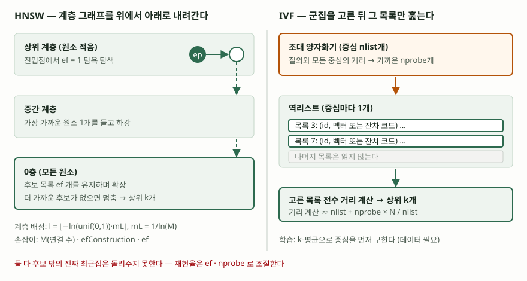

> **실행 검증 없음.** 개념 문제이므로 HNSW 원 논문, Faiss 라이브러리 논문, pgvector 공식
> README만 근거로 정리했다. 본문의 거리 계산 횟수는 Faiss 논문의 단순화 식에 값을 넣어 손으로
> 계산한 것이며 측정값이 아니다. HNSW 계층 배정을 직접 돌려 본 결과는
> [근사 최근접 이웃 탐색과 HNSW 색인](../../database/2026-09-22-approximate-nearest-neighbor-hnsw/index.md)에 있다.

기출문제에서 벡터 데이터베이스의 대표 색인 두 가지, HNSW와 IVF가 **어떻게 동작하는지**를 묻는다.
두 이름을 "그래프 기반"과 "군집 기반"으로 한 줄씩 소개하는 데서 끝나면 점수가 나지 않는다.
점수는 각 색인이 **구축할 때 무엇을 만들고, 질의할 때 어떤 순서로 후보를 좁히는지**를 단계로
쓰고, 두 색인이 모두 **근사**라서 재현율을 조절하는 손잡이(`ef`, `nprobe`)가 따로 있다는 점을
짚는 데서 갈린다.

---

## Ⅰ. 개요

### 가. 벡터 데이터베이스와 근사 최근접 탐색의 정의

**벡터 데이터베이스**는 텍스트·이미지를 임베딩한 고차원 벡터를 저장하고, 질의 벡터와
거리(L2·코사인·내적)가 가까운 상위 k개를 돌려주는 유사도 검색을 핵심 연산으로 갖는 저장소다.
이때 쓰는 **근사 최근접 이웃 탐색(ANNS)** 은 정확한 상위 k개를 찾는 조건을 완화해 **일부 오답을
허용하는 대신 거리 계산 횟수를 줄이는 탐색**이며, 품질은 찾아낸 진짜 최근접의 비율인
**재현율**로 잰다(Malkov & Yashunin 1절).

### 나. 색인이 필요한 이유 — 3가지

- ① **전수 비교는 데이터 크기에 비례한다.** 색인이 없으면 질의마다 N개 벡터와 거리를 모두
  계산해야 한다. 수백만 건이면 질의 하나가 수백만 번의 고차원 내적이 된다
- ② **고차원에서는 정확 색인이 순차 주사를 이기지 못한다.** 차원이 오르면 최근접과 최원점의
  거리가 비슷해져 가지치기 기준이 사라지고, 트리·분할 기반 정확 색인은 대략 10차원을 넘으면
  순차 주사보다 느려진다(Weber 외 1998)
- ③ **그래서 정확성을 일부 포기한다.** 후보를 빠르게 좁히는 방식에 따라 **그래프 기반(HNSW)** 과
  **분할·군집 기반(IVF)** 이 갈린다. Faiss 논문(5.3절)은 실무 선택지가 사실상 이 둘이라고 적는다

> **출처**: [Malkov & Yashunin, arXiv:1603.09320v4, 4절 알고리즘 1·2·5](https://arxiv.org/abs/1603.09320) · [Douze et al., *The Faiss library*, arXiv:2401.08281v4, §5.1 Inverted files](https://arxiv.org/html/2401.08281v4)

## Ⅱ. HNSW의 동작 원리

### 가. 개념과 구조

**HNSW(Hierarchical Navigable Small World)** 는 저장 벡터를 **여러 계층의 근접 그래프로 쌓고**,
위 계층일수록 원소를 드물게 두어 **먼 거리의 연결은 위층, 가까운 거리의 연결은 아래층**이
맡도록 나눈 그래프 색인이다. 위층에서 큰 보폭으로 방향을 잡고 아래층으로 내려오며 좁히므로
탐색 비용이 데이터 크기의 로그에 비례한다(원 논문 4.2절).

| 구성요소 | 역할 | 근거 |
|---|---|---|
| ① 계층 배정 | 원소마다 최대 계층 `l = ⌊−ln(unif(0,1))·mL⌋`를 뽑는다. `mL = 1/ln(M)`이면 한 층 오를 때 원소가 약 `1/M`로 준다 | 4절 알고리즘 1, 4.1절 |
| ② 계층별 근접 그래프 | 각 계층은 그 계층 원소들만의 그래프. 원소당 연결 수는 `Mmax`, 0층만 `Mmax0 = 2M` | 4.1절 |
| ③ 계층 내 탐색 | 후보 목록 `ef`개를 유지하며 가장 가까운 미평가 원소의 이웃을 펼친다 | 알고리즘 2 |
| ④ 이웃 선택 휴리스틱 | 가까운 순으로만 잇지 않고, 이미 연결한 이웃보다 삽입 원소에 더 가까운 후보만 잇는다 | 알고리즘 4 |

### 나. 구축(삽입) 절차 — 4단계

HNSW는 **별도 학습 단계 없이 원소를 하나씩 넣으며** 그래프를 키운다(알고리즘 1).

- ① **계층 결정**: 새 원소 q의 최대 계층 `l`을 위 식으로 뽑는다
- ② **상위 계층 하강**: 현재 최상위 계층에서 진입점(entry point)부터 `ef = 1`로 탐욕 탐색해
  가장 가까운 원소 하나를 찾고, 그 원소를 들고 `l + 1`층까지 한 층씩 내려온다
- ③ **연결 생성**: `l`층부터 0층까지 각 층에서 후보 목록 크기 `efConstruction`으로 탐색해 이웃
  후보를 모으고, 휴리스틱으로 `M`개를 골라 **양방향**으로 잇는다. 상대 원소의 연결이
  `Mmax`를 넘으면 그 원소의 이웃을 다시 골라 줄인다
- ④ **진입점 갱신**: `l`이 기존 최상위 계층보다 높으면 q가 새 진입점이 된다

### 다. 탐색 절차 — 3단계

- ① **진입**: 최상위 계층의 진입점에서 시작한다
- ② **탐욕 하강**: 1층까지는 각 층에서 `ef = 1`로 질의에 가장 가까운 원소 하나만 찾아
  다음 층의 시작점으로 넘긴다. 위층은 원소가 적어 몇 번의 이동으로 대략의 위치가 잡힌다
- ③ **0층 확장**: 0층에서 후보 목록을 `ef`(≥ k)개로 유지하며 이웃을 펼친다.
  **목록의 가장 먼 원소보다 가까운 후보가 더 나오지 않으면 멈추고**, 목록에서 상위 k개를 돌려준다

### 라. 매개변수 — 3가지

| 매개변수 | 정하는 때 | 효과 | pgvector 0.8.7 기본값 |
|---|---|---|---|
| `M` | 구축 | 원소당 연결 수. 재현율과 **메모리**가 함께 오른다. 논문 권장 5~48 | `m = 16` |
| `efConstruction` | 구축 | 연결을 고를 때의 후보 수. 그래프 품질과 구축 시간 | `ef_construction = 64` |
| `ef` | 질의 | 0층 후보 목록 크기. **재현율과 지연의 손잡이**, 즉시 바뀐다 | `hnsw.ef_search = 40` |

원소당 연결 수는 평균 `Mmax0 + mL·Mmax`이므로 링크를 4바이트로 잡으면 `M = 16`에서 원소당
약 151바이트가 그래프에 들고, 벡터 본체는 따로 든다. **HNSW의 비용은 메모리**다.

## Ⅲ. IVF의 동작 원리

### 가. 개념과 구조

**IVF(Inverted File Index, 역파일 색인)** 는 **조대 양자화기(coarse quantizer)** 로 벡터 공간을
`nlist`개 군집으로 나누고, 각 군집 중심마다 그 군집에 속한 벡터를 모아 둔 **역리스트**를 만든 뒤,
질의 때 **가까운 `nprobe`개 군집의 역리스트만 훑는** 색인이다(Faiss 논문 5.1절).
문서 검색의 역색인이 "단어 → 그 단어가 든 문서 목록"이라면, IVF는 "**군집 중심 → 그 군집에 든
벡터 목록**"이다.

| 구성요소 | 역할 |
|---|---|
| ① 조대 양자화기 | k-평균으로 학습한 중심 `nlist`개. 벡터를 가장 가까운 중심 번호로 바꾼다 |
| ② 역리스트 | 중심마다 1개. 그 군집 벡터들을 (id, 벡터 또는 압축 코드) 형태로 연속 저장한다 |
| ③ 목록 선택 | 질의와 중심들의 거리를 재서 가까운 `nprobe`개 목록을 고른다 |
| ④ 목록 내 비교 | 고른 목록의 원소와 실제 거리를 계산해 상위 k개를 남긴다 |

### 나. 구축 절차 — 3단계

- ① **학습**: 대표 표본으로 k-평균을 돌려 중심 `nlist`개를 구한다. Faiss는 `IndexIVFFlat`이
  **학습 단계가 있어야 한다**고 명시하고, pgvector도 IVFFlat 색인을 **테이블에 데이터가 들어간
  뒤에 만들라**고 권한다. 빈 테이블에서는 중심을 정할 근거가 없기 때문이다
- ② **배정**: 각 벡터를 가장 가까운 중심의 역리스트에 넣는다
- ③ **저장**: 벡터를 그대로(IVFFlat) 또는 압축해(IVF-PQ) 저장한다. 압축할 때는 벡터 대신
  **중심과의 차이인 잔차(residual)** 를 부호화하는 편이 더 정확하다. 잔차의 크기가 원래 벡터보다
  작고, 조대 양자화기가 이미 담은 정보를 활용하기 때문이다. Faiss는 이것이 기본값이다
  (5.1절, Jégou 외 2011 인용)

### 다. 탐색 절차 — 3단계

- ① **조대 양자화**: 질의와 `nlist`개 중심의 거리를 계산해 가장 가까운 `nprobe`개를 고른다
- ② **목록 주사**: 고른 역리스트의 원소와 질의의 거리를 계산한다. IVF-PQ면 압축 코드로 거리를 근사한다
- ③ **상위 k 선택**: 계산한 거리 중 작은 k개를 돌려준다. **고르지 않은 군집에 든 진짜 최근접은
  돌려줄 수 없다.** 질의가 군집 경계 근처에 있을 때 오답이 나는 이유다

### 라. 매개변수 — 2가지와 비용 식

| 매개변수 | 정하는 때 | 효과 | 출처의 권장·기본값 |
|---|---|---|---|
| `nlist` | 구축(학습) | 군집 수. 크면 목록이 짧아지지만 중심 비교가 늘어난다 | pgvector: 100만 행까지 `행 수/1000`, 그 이상 `√행 수` |
| `nprobe` | 질의 | 훑는 목록 수. **재현율과 지연의 손잡이** | pgvector `ivfflat.probes` 기본 1, 시작점 `√lists` / Faiss 기본 1 |

Faiss 논문은 목록 크기가 고르고 벡터를 압축하지 않은 단순한 경우 거리 계산 횟수를
**`nlist + nprobe × N / nlist`** 로 적고(식 18), 이것이 `nlist = √(nprobe·N)`에서 최소가 된다고 보인다.
N = 1,000,000, `nlist = 1,000`, `nprobe = 32`를 넣으면 1,000 + 32 × 1,000 = **33,000회**로
전수 비교의 3.3%다. 다만 논문은 세 가지 이유로 이 식이 거친 근사라고 밝힌다.

- ① 목록 수를 늘리면 같은 재현율을 위해 `nprobe`도 늘려야 한다
- ② 목록 크기가 고르지 않으면 기대 계산량이 **불균형 계수**(목록 크기의 상대 분산)만큼 곱해진다
- ③ 중심이 많으면 조대 양자화 자체를 HNSW 같은 비전수 색인으로 하는 경우가 흔하다

`nprobe = nlist`로 두면 모든 목록을 훑으므로 전수 탐색과 결과가 같아진다(Faiss 위키).

## Ⅳ. HNSW와 IVF의 비교

| 구분 | HNSW | IVF |
|---|---|---|
| 분류 | 그래프 기반 | 분할·군집 기반 |
| 후보를 좁히는 방식 | 계층 그래프를 위에서 아래로 따라 이동 | 가까운 군집 `nprobe`개만 선택 |
| 사전 학습 | 없음 — 삽입하며 그래프를 만든다 | 필요 — k-평균으로 중심 학습 |
| 재현율 손잡이 | `ef` | `nprobe` |
| 질의 성능 | 속도-재현율 절충이 IVFFlat보다 좋다(pgvector) | HNSW보다 낮다(pgvector) |
| 구축 시간·메모리 | 구축이 느리고 메모리를 더 쓴다 — 원소마다 간선 저장 | 구축이 빠르고 메모리가 적다 — 중심 + 목록 |
| 압축 결합 | 간선은 압축되지 않아 메모리 하한이 남는다 | 잔차 PQ로 벡터를 바이트 단위까지 압축 가능 |
| 갱신 | 즉시 추가 가능, Faiss 구현은 삭제·변경 미지원 | id 맵을 두면 삭제·변경 가능. 분포가 바뀌면 중심이 낡아 효율 저하 |
| 맞는 규모 | 메모리 제약이 없는 대략 100만 건 이하, 1,000만 건을 넘으면 구축 시간이 한계 | 압축해야 메모리에 들어가는 대규모에서는 사실상 유일한 선택지 |

> 질의 성능·구축 시간·메모리 행은 pgvector 0.8.7 README의 HNSW·IVFFlat 절, 갱신·규모 행은
> Faiss 논문 6.1절(Identifier-based operations)과 5.3절(How to choose an index)을 따랐다.

두 방식은 대립하지 않고 결합된다. Faiss 논문은 군집 수가 많을 때 **IVF의 조대 양자화기를 HNSW로
만드는 구성**이 흔하다고 적는다. 군집 수천~수만 개의 중심을 HNSW로 찾고, 목록 안은 IVF-PQ로
압축해 훑는 식이다.

## Ⅴ. 결론

HNSW와 IVF는 모두 고차원에서 정확 탐색을 포기하고 **거리 계산 횟수를 줄이기 위해 후보를 먼저
좁히는** 근사 색인이다. HNSW는 계층 그래프를 내려가며 0층의 후보 `ef`개를 모으고, IVF는 k-평균
군집 중 가까운 `nprobe`개의 역리스트만 훑는다. 그래서 두 색인 모두 **후보 밖의 정답은 돌려주지
못하며**, 재현율은 질의 시점 매개변수로 조절한다. 선택 기준은 성능 하나가 아니라 **메모리 예산,
데이터 규모, 갱신 빈도**다. 메모리가 넉넉하고 수시로 추가되는 중소 규모는 HNSW, 압축이 필요한
대규모는 IVF-PQ가 맞고, 어느 쪽이든 운영 데이터로 재현율을 측정해 `ef`·`nprobe`를 정해야 한다.

> 개념 정리: [근사 최근접 이웃 탐색과 HNSW 색인 — 정확한 답을 포기하고 얻는 것](../../database/2026-09-22-approximate-nearest-neighbor-hnsw/index.md)
>
> 개념 정리: [벡터 양자화와 율-왜곡 이론 — 비트를 줄이면 무엇을 잃는가](../../data-analysis/2026-10-19-vector-quantization-rate-distortion/index.md)

끝

## 답안 작성 메모

- **먼저 쓸 것**: Ⅱ-다와 Ⅲ-다의 탐색 절차. 문항이 묻는 것은 "동작 원리"이므로 절차가 몸통이다.
  그다음 Ⅳ 비교표를 쓴다. 문항이 비교를 직접 묻지 않았어도 논술형은 비교표가 있어야 균형이 잡힌다.
- **점수가 갈리는 지점**:
  - HNSW를 "그래프"라고만 쓰지 않고 **위층 `ef = 1` 탐욕 하강 → 0층 `ef` 후보 확장**의 두 국면으로
    나누는지, 계층 배정 식과 `1/M` 감소를 쓰는지
  - IVF에 **학습 단계(k-평균)** 가 있다는 점, 그리고 `nprobe`개 목록 밖의 정답은 놓친다는 점을 쓰는지
  - 재현율 손잡이를 `ef`와 `nprobe`로 **짝지어** 제시하는지
  - 거리 계산 식 `nlist + nprobe × N / nlist`를 쓰면 채점자가 원리를 이해했다고 본다
- **시간이 모자라면**: Ⅱ-나 구축 절차를 2줄로 줄이고, Ⅲ-라의 "거친 근사인 이유 3가지"와
  Ⅳ 아래 결합 문단을 버린다. 탐색 절차와 비교표는 남긴다.
- 모식도는 왼쪽에 층 박스 3개를 쌓고 아래 화살표, 오른쪽에 중심 → 목록 2개 강조 → 상위 k를
  그리면 4분 안에 끝난다.
- 33,000회는 식 18에 예시 값을 넣은 계산이다. 측정값이 아니므로 답안에도 "단순화 가정에서"를 붙인다.

## 참고 자료

- [Yu. A. Malkov, D. A. Yashunin, *Efficient and robust approximate nearest neighbor search using Hierarchical Navigable Small World graphs*, arXiv:1603.09320v4 (2018)](https://arxiv.org/abs/1603.09320) — 알고리즘 1(삽입), 2(SEARCH-LAYER), 4(이웃 선택 휴리스틱), 5(K-NN-SEARCH), 4.1절 매개변수, 4.2절 복잡도
- [M. Douze, A. Guzhva, C. Deng, J. Johnson, G. Szilvasy, P.-E. Mazaré, M. Lomeli, L. Hosseini, H. Jégou, *The Faiss library*, arXiv:2401.08281v4 (2025-10-23)](https://arxiv.org/html/2401.08281v4) — §5.1 Inverted files(식 18, 불균형 계수, 잔차 부호화), §5.2 Graph based, §5.3 How to choose an index, §6.1 Identifier-based operations
- [H. Jégou, M. Douze, C. Schmid, *Product Quantization for Nearest Neighbor Search*, IEEE TPAMI 33(1), pp.117–128, 2011](https://doi.org/10.1109/TPAMI.2010.57) — 조대 양자화기와 잔차 PQ를 결합한 비전수 탐색의 원 제안
- [Faiss wiki — Faster search](https://github.com/facebookresearch/faiss/wiki/Faster-search) — `IndexIVFFlat`, `nlist`·`nprobe`, 학습 단계, `nprobe = nlist`이면 전수 탐색과 같은 결과
- [pgvector README (v0.8.7, 2026-11-16 확인)](https://github.com/pgvector/pgvector) — HNSW 옵션 기본값, IVFFlat `lists`·`probes` 권장값, 두 색인의 구축 시간·메모리·질의 성능 비교
- [R. Weber, H.-J. Schek, S. Blott, *A Quantitative Analysis and Performance Study for Similarity-Search Methods in High-Dimensional Spaces*, VLDB 1998](https://dl.acm.org/doi/10.5555/645924.671192) — 고차원에서 정확 색인이 순차 주사에 진다
