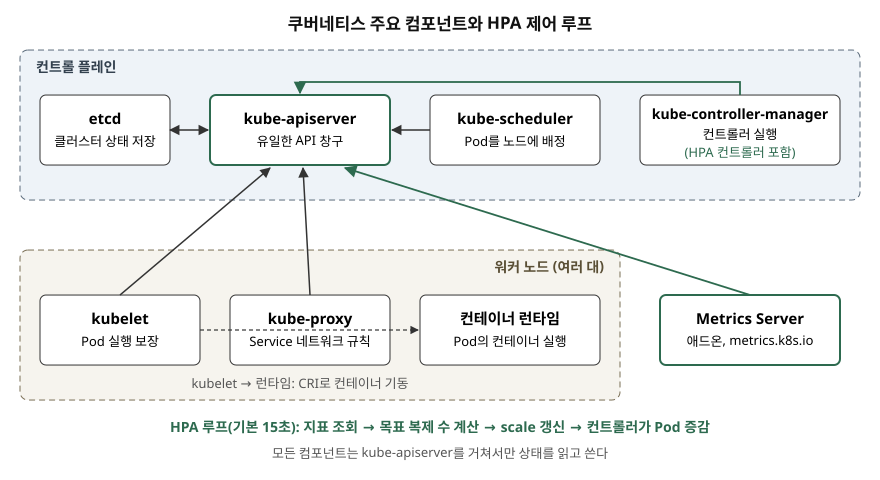

> **실행 검증 없음.** 개념 문제이므로 Kubernetes v1.37 공식 문서와 Borg 관련 논문만 근거로
> 정리했다. 본문의 복제 수 계산 예는 공식 문서의 식에 임의 값을 넣어 손으로 계산한 것이며
> 측정값이 아니다.

기출문제에서 쿠버네티스를 세 갈래로 묻는다. 개념과 특징, 주요 컴포넌트, 그리고 HPA다.
컴포넌트 이름을 나열하는 것만으로는 점수가 갈리지 않는다. 갈리는 지점은 **"선언한 상태와 현재
상태의 차이를 제어 루프가 메운다"는 한 원리로 세 문항을 꿰는가**다. 컴포넌트는 그 루프를 나눠 맡은
부품이고, HPA는 그 루프가 복제 수에 적용된 사례다.

---

## Ⅰ. 개요

### 가. 쿠버네티스의 정의

**쿠버네티스(Kubernetes)** 는 컨테이너화한 워크로드와 서비스를 관리하는 이식 가능하고 확장
가능한 오픈소스 플랫폼으로, **선언적 구성과 자동화**를 함께 지원한다(공식 문서 Overview).
운영자는 "무엇이 몇 개 떠 있어야 하는가"를 API 객체로 선언하고, 클러스터는 그 상태를 유지하도록
스스로 조치한다.

### 나. 등장 배경 — 배포 방식의 3단계 변화

| 단계 | 방식 | 남은 문제 |
|---|---|---|
| ① 전통적 배포 | 물리 서버에 애플리케이션 직접 설치 | 자원 경계가 없어 한 앱이 자원을 독점, 앱마다 서버를 두면 활용률이 낮다 |
| ② 가상화 배포 | 한 서버에 VM 여러 대 | 격리·활용률은 개선, VM마다 OS 전체를 실어 무겁다 |
| ③ 컨테이너 배포 | 호스트 OS 커널을 공유하는 컨테이너 | 가볍고 이식성이 높지만 **수백 개 컨테이너의 배치·재기동·확장을 사람이 할 수 없다** |

③의 남은 문제가 **컨테이너 오케스트레이션**의 필요다. 쿠버네티스는 Google 내부 클러스터 관리자
Borg에서 얻은 경험을 바탕으로 설계됐다. Borg 논문은 수만 대 규모 클러스터에서 작업을 배치하고
실패를 복구한 경험을, 후속 글은 그 교훈 중 무엇을 쿠버네티스로 옮겼는지(파드 단위 묶음, 레이블,
API 서버 중심 구조)를 정리한다(Verma 외 2015, Burns 외 2016).

## Ⅱ. 쿠버네티스의 개념 및 특징

### 가. 핵심 개념 — 원하는 상태와 제어 루프

- ① **선언적 API**: 객체의 `spec`에 원하는 상태를 적고, `status`에 현재 상태가 기록된다
- ② **제어 루프(control loop)**: 컨트롤러는 끝나지 않는 루프로 클러스터를 관찰하고, 현재 상태를
  원하는 상태에 가깝게 만드는 변경을 직접 하거나 API 서버에 요청한다(공식 문서 Controllers)
- ③ **파드(Pod)**: 배포·스케줄링의 최소 단위. 네트워크·저장소를 공유하는 컨테이너 묶음이다
- ④ **레이블과 셀렉터**: 객체를 이름이 아닌 레이블로 묶어 서비스·컨트롤러가 대상을 고른다

공식 문서는 쿠버네티스가 **"단순한 오케스트레이션 시스템이 아니다"** 라고 적는다. A 다음 B를
실행하는 정해진 작업 흐름 대신, 서로 독립적인 제어 프로세스들이 각자 현재 상태를 원하는
상태로 끌어간다. 그래서 일부 컴포넌트가 잠시 멈춰도 다시 돌면 차이를 메운다.

### 나. 특징 — 공식 문서가 드는 10가지

| 구분 | 특징 | 내용 |
|---|---|---|
| 배치 | ① 자동 빈 패킹 | 컨테이너가 선언한 CPU·메모리 요구량을 보고 노드에 배치 |
| 가용성 | ② 자가 치유 | 실패한 컨테이너 재시작·교체, 헬스 체크 실패 컨테이너 제거 |
| 배포 | ③ 자동 롤아웃·롤백 | 원하는 상태로 정해진 속도로 바꾸고 문제 시 되돌림 |
| 네트워크 | ④ 서비스 디스커버리·부하 분산 | DNS 이름·IP로 노출하고 트래픽 분산 |
| 네트워크 | ⑤ IPv4/IPv6 이중 스택 | 파드·서비스에 두 주소 체계 할당 |
| 저장소 | ⑥ 스토리지 오케스트레이션 | 로컬·클라우드 저장소를 자동 마운트 |
| 구성 | ⑦ 시크릿·구성 관리 | 이미지 재빌드 없이 비밀값·설정 갱신 |
| 작업 | ⑧ 배치 실행 | 배치·CI 워크로드 관리, 실패 시 교체 |
| 확장 | ⑨ 수평 확장 | 명령·UI·CPU 사용률 기반 자동 확장 |
| 확장 | ⑩ 확장성 있는 설계 | 원본 소스 수정 없이 기능 추가(CRD·오퍼레이터) |

반대로 쿠버네티스는 **소스 빌드·배포 파이프라인, 미들웨어·DB 같은 애플리케이션 서비스, 로깅·모니터링
방식을 정해 주지 않는다**(What Kubernetes is not). PaaS가 아니라 PaaS를 만드는 **빌딩 블록**이다.

## Ⅲ. 쿠버네티스의 주요 컴포넌트



> **출처**: [Kubernetes v1.37 문서 — Kubernetes Components §Control Plane Components·§Node Components·§Addons](https://kubernetes.io/docs/concepts/overview/components/) · [Horizontal Pod Autoscaling §How does a HorizontalPodAutoscaler work?](https://kubernetes.io/docs/concepts/workloads/autoscaling/horizontal-pod-autoscale/#how-does-a-horizontalpodautoscaler-work)

### 가. 컨트롤 플레인 컴포넌트 — 5가지

클러스터 전체의 결정(스케줄링)과 이벤트 대응(복제 수가 모자라면 새 파드 기동)을 맡는다.

| 컴포넌트 | 역할 | 비고 |
|---|---|---|
| ① kube-apiserver | 쿠버네티스 HTTP API를 노출하는 중심 서버 | 모든 컴포넌트가 이것을 거쳐서만 상태를 읽고 쓴다 |
| ② etcd | API 서버의 모든 데이터를 담는 일관성·고가용성 키-값 저장소 | 클러스터의 원하는 상태와 현재 상태가 여기 있어 별도 백업 계획이 필요하다 |
| ③ kube-scheduler | 노드가 정해지지 않은 파드를 찾아 알맞은 노드에 배정 | 자원 요청, 어피니티, 테인트·톨러레이션을 고려 |
| ④ kube-controller-manager | 쿠버네티스 API 동작을 구현하는 컨트롤러들을 실행 | 노드·잡·엔드포인트·레플리카셋 컨트롤러, **HPA 컨트롤러**가 여기 있다 |
| ⑤ cloud-controller-manager | 하부 클라우드 제공자와 연동(선택) | 로드밸런서·노드 수명 주기를 클라우드 API로 처리 |

### 나. 노드 컴포넌트 — 3가지

모든 노드에서 돌며 실행 중인 파드를 유지하고 실행 환경을 제공한다.

| 컴포넌트 | 역할 |
|---|---|
| ① kubelet | 그 노드에 배정된 파드의 컨테이너가 실제로 돌고 있는지 보장한다. API 서버에서 파드 명세를 받아 런타임에 지시하고 상태를 보고한다 |
| ② kube-proxy | 노드의 네트워크 규칙을 유지해 Service를 구현한다. 문서에 **선택** 항목으로 표시돼 있다 |
| ③ 컨테이너 런타임 | 컨테이너를 실제로 실행한다. kubelet과는 CRI(Container Runtime Interface)로 연결된다(containerd, CRI-O 등) |

### 다. 애드온 — 4가지

클러스터 기능을 넓히는 구성요소로, 문서는 **DNS, 웹 UI(대시보드), 컨테이너 자원 모니터링,
클러스터 수준 로깅**을 든다. HPA가 읽는 자원 지표를 내는 **Metrics Server**도 별도로 띄워야 하는
애드온이다.

### 라. 컴포넌트가 협력하는 흐름 — Deployment 생성 예

- ① 사용자가 `replicas: 3`인 Deployment를 API 서버에 제출 → etcd에 저장
- ② 컨트롤러 매니저의 Deployment·ReplicaSet 컨트롤러가 파드 3개가 없음을 보고 파드 객체 생성
- ③ 스케줄러가 노드 미배정 파드를 찾아 노드를 정해 API 서버에 기록
- ④ 해당 노드의 kubelet이 자기 노드에 배정된 파드를 보고 런타임으로 컨테이너 기동, 상태 보고
- ⑤ kube-proxy가 Service의 엔드포인트 변화를 보고 노드의 전달 규칙 갱신

각 단계의 주체는 서로를 직접 부르지 않는다. **API 서버의 상태를 관찰하고 자기 몫만 바꾼다.**
이것이 Ⅱ-가의 제어 루프 원리가 구조로 드러난 모습이다.

## Ⅳ. HPA(Horizontal Pod Autoscaler)

### 가. 정의

**HPA** 는 Deployment·StatefulSet 같은 워크로드 자원의 **복제 수를 관측 지표에 맞춰 자동으로
갱신**해, 처리 용량을 수요에 맞추는 쿠버네티스 API 자원이자 컨트롤러다. 부하가 늘면 파드를
더 띄우는 **수평 확장**이며, 이미 떠 있는 파드에 CPU·메모리를 더 주는 수직 확장과 다르다.
DaemonSet처럼 복제 수를 바꿀 수 없는 객체에는 적용되지 않는다. 현재 안정 버전은 `autoscaling/v2`다.

### 나. 동작 절차 — 4단계

HPA는 연속 프로세스가 아니라 **주기적으로 도는 제어 루프**다. 주기는 kube-controller-manager의
`--horizontal-pod-autoscaler-sync-period`로 정하며 기본 **15초**다.

- ① **대상 식별**: `scaleTargetRef`의 셀렉터로 대상 파드를 찾는다
- ② **지표 조회**: 지표 종류에 따라 세 API 중 하나를 읽는다
  - 자원 지표(CPU·메모리): `metrics.k8s.io` — 보통 Metrics Server가 제공
  - 사용자 정의 지표(파드·객체 단위): `custom.metrics.k8s.io`
  - 외부 지표(큐 길이 등 클러스터 밖 값): `external.metrics.k8s.io`
- ③ **목표 복제 수 계산**: 아래 식으로 계산한다
- ④ **반영**: 안정화 창·정책을 적용한 뒤 대상의 `scale` 하위 자원을 갱신한다.
  실제 파드 증감은 Deployment·ReplicaSet 컨트롤러가 맡는다

### 다. 복제 수 계산 알고리즘

```text
desiredReplicas = ceil[ currentReplicas × ( currentMetricValue / desiredMetricValue ) ]
```

예: 파드 3개, 목표 CPU 사용률 50%, 현재 평균 80%이면 `ceil(3 × 80/50) = ceil(4.8) = 5`개로 늘린다.
(임의 값을 넣은 계산 예)

| 규칙 | 내용 |
|---|---|
| ① 허용 오차 | 비율이 1.0에 충분히 가까우면(기본 **0.1** 이내) 조정하지 않는다. `--horizontal-pod-autoscaler-tolerance` |
| ② 사용률 기준 | 사용률은 **파드의 자원 요청(requests) 대비** 사용량이다. 컨테이너 중 하나라도 요청이 없으면 그 지표로는 동작하지 않는다 |
| ③ 지표 누락 파드 | 일단 제외하고 계산한 뒤, 축소 방향이면 목표값의 100%, 확대 방향이면 0%를 쓴 것으로 보고 보수적으로 다시 계산한다 |
| ④ 준비 안 된 파드 | CPU 지표에서 아직 준비되지 않은 파드는 제외하고, 확대 계산 시 0%로 본다. 갓 뜬 파드의 시작 부하로 과잉 확장되는 것을 막는다 |
| ⑤ 다중 지표 | 지표마다 복제 수를 계산해 **가장 큰 값**을 고른다 |
| ⑥ 범위 | 결과는 `minReplicas`~`maxReplicas` 안으로 제한된다 |

### 라. 확장 동작 제어 — 출렁임 방지

지표가 흔들릴 때 복제 수가 늘었다 줄었다를 반복하는 것을 막기 위해 `behavior` 필드로 방향별
동작을 정한다.

| 항목 | 축소(scaleDown) 기본값 | 확대(scaleUp) 기본값 |
|---|---|---|
| 안정화 창 `stabilizationWindowSeconds` | **300초** — 창 안에서 계산된 값 중 가장 큰 값을 쓴다 | 0초 — 즉시 확대 |
| 정책 `policies` | 15초마다 100%까지 | 15초마다 100% 또는 파드 4개 |
| 정책 선택 `selectPolicy` | — | `Max`(더 크게 바뀌는 정책) |

정책 종류는 `Pods`(개수)와 `Percent`(비율) 두 가지이고, `selectPolicy: Disabled`로 그 방향의
확장을 끌 수 있다. **확대는 빠르게, 축소는 느리게**가 기본 설계다.

### 마. 자동 확장 방식 비교

| 구분 | HPA | VPA | 노드 오토스케일링 |
|---|---|---|---|
| 바꾸는 것 | 파드 **개수** | 파드의 CPU·메모리 **요청값** | 클러스터의 **노드 수** |
| 기본 포함 | 포함(API 자원) | 애드온, 기본 미포함 | 클러스터·클라우드별 구성 |
| 맞는 워크로드 | 무상태, 수평 분산 가능한 서비스 | 복제하기 어려운 단일 인스턴스, 요청값 산정 | 파드가 자원 부족으로 배치되지 못할 때 |
| 주의 | 자원 요청이 있어야 사용률 계산 | 같은 자원 지표로 HPA와 함께 쓰면 서로 간섭 | 노드 기동 시간만큼 지연 |

> VPA 행은 공식 문서 Autoscaling Workloads 절이 "기본으로 포함되지 않는 애드온"이라 적은 범위까지만
> 썼다. HPA와의 간섭은 같은 CPU·메모리 지표를 한쪽은 개수로, 한쪽은 요청값으로 바꾸려 하기 때문이다.

## Ⅴ. 결론

쿠버네티스는 원하는 상태를 선언하면 **독립된 제어 루프들이 현재 상태를 그쪽으로 끌어가는** 컨테이너
운영 플랫폼이다. API 서버와 etcd가 상태를 보관하고, 스케줄러·컨트롤러 매니저·kubelet·kube-proxy가
각자 자기 몫의 차이를 메운다. HPA는 같은 원리를 복제 수에 적용한 컨트롤러로, 15초마다 지표를 읽어
`ceil(현재 복제 수 × 현재값/목표값)`으로 개수를 정하고, 허용 오차와 300초 축소 안정화 창으로
출렁임을 막는다. 도입할 때는 **자원 요청 설정, Metrics Server 같은 지표 파이프라인, 상태를 밖에 두는
무상태 설계**가 전제되어야 HPA가 의미 있게 동작한다.

> 개념 정리: [컨테이너와 가상머신 — 격리 수준의 차이](../../emerging-tech/2026-09-30-container-vs-vm-isolation/index.md)
>
> 개념 정리: [무중단 배포 전략 — 롤링·블루그린·카나리와 확장-축소 스키마 변경](../../software-engineering/2026-10-09-zero-downtime-deployment-expand-contract/index.md)

끝

## 답안 작성 메모

- **먼저 쓸 것**: Ⅲ의 모식도와 Ⅳ-다의 계산식. 컴포넌트 그림 하나로 (나)를 거의 채울 수 있고,
  HPA는 식이 들어가야 "설명"이 된다. 그다음 Ⅱ-가의 제어 루프 문단을 써서 세 문항을 한 원리로 묶는다.
- **문항 순서를 지킨다**: (가) 개념·특징 → (나) 컴포넌트 → (다) HPA를 Ⅱ·Ⅲ·Ⅳ에 그대로 두었다.
- **점수가 갈리는 지점**:
  - 컴포넌트를 "컨트롤 플레인 5 / 노드 3"으로 **개수를 밝혀** 나누는지, 모두 API 서버를 거친다는 점을 쓰는지
  - HPA를 쓸 때 **계산식, 기본 주기 15초, 허용 오차 0.1, 축소 안정화 300초** 중 셋 이상이 나오는지
  - 사용률이 **requests 대비**라는 점 — 실무에서 HPA가 안 도는 가장 흔한 이유다
  - HPA와 VPA·노드 오토스케일링을 구분하는 비교표
- **시간이 모자라면**: Ⅰ-나 배포 3단계 표를 두 줄로 줄이고, Ⅱ-나 특징 10가지를 대표 5개(빈 패킹·자가 치유·
  롤아웃·서비스 디스커버리·수평 확장)만 쓴다. Ⅳ-다의 ③④ 규칙은 한 줄로 합친다.
- 모식도는 위에 컨트롤 플레인 4칸, 아래에 노드 3칸과 Metrics Server, 모든 화살표를 API 서버로 모으면
  4분 안에 그린다.
- 5개로 늘린 계산은 임의 값 예시다. 답안에도 "예를 들어"를 붙인다.

## 참고 자료

- [Kubernetes v1.37 문서 — Overview](https://kubernetes.io/docs/concepts/overview/) — 정의, 제공 기능 10가지(§Why you need Kubernetes and what it can do), What Kubernetes is not, 배포 방식 변화(§Going back in time)
- [Kubernetes v1.37 문서 — Kubernetes Components](https://kubernetes.io/docs/concepts/overview/components/) — §Control Plane Components, §Node Components, §Addons
- [Kubernetes v1.37 문서 — Controllers](https://kubernetes.io/docs/concepts/architecture/controller/) — 제어 루프, 원하는 상태와 현재 상태(§Desired versus current state)
- [Kubernetes v1.37 문서 — Horizontal Pod Autoscaling](https://kubernetes.io/docs/concepts/workloads/autoscaling/horizontal-pod-autoscale/) — §How does a HorizontalPodAutoscaler work?, §Algorithm details, §Support for metrics APIs, §Configurable scaling behavior, §Default behavior
- [Kubernetes v1.37 문서 — HorizontalPodAutoscaler Walkthrough](https://kubernetes.io/docs/tasks/run-application/horizontal-pod-autoscale-walkthrough/) — `autoscaling/v2` 매니페스트 예
- [Kubernetes v1.37 문서 — Autoscaling Workloads](https://kubernetes.io/docs/concepts/workloads/autoscaling/) — 수평·수직·노드 오토스케일링 구분, VPA는 애드온
- [A. Verma, L. Pedrosa, M. Korupolu, D. Oppenheimer, E. Tune, J. Wilkes, *Large-scale cluster management at Google with Borg*, EuroSys 2015](https://research.google/pubs/large-scale-cluster-management-at-google-with-borg/) — 쿠버네티스의 전신이 된 클러스터 관리자
- [B. Burns, B. Grant, D. Oppenheimer, E. Brewer, J. Wilkes, *Borg, Omega, and Kubernetes*, ACM Queue 14(1), 2016](https://queue.acm.org/detail.cfm?id=2898444) — Borg의 교훈 중 쿠버네티스로 옮긴 것
