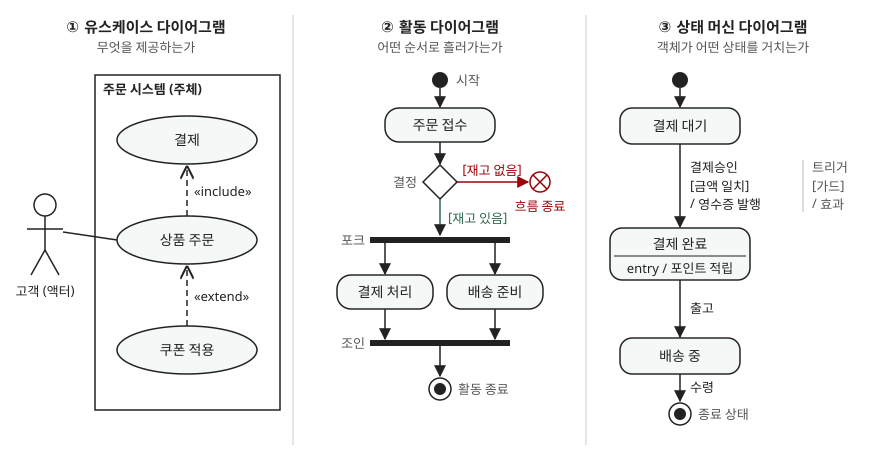

> **실행 검증 없음.** 표기법 문제이므로 OMG UML 2.5 표준 문서(formal/15-03-01)의 15장(활동),
> 14장(상태 머신), 18장(유스케이스), 13장(공통 행위)만 근거로 정리했다. 쪽 번호는 이 판본의
> 인쇄 쪽 기준이다. 현행 정식판은 UML 2.5.1(formal/17-12-05)이며, 이 글은 열람한 2.5 판본을 인용한다.

기출문제에서 UML 행위 다이어그램 가운데 세 가지를 골라 각각 설명하라고 묻는다. 활동, 상태,
유스케이스다. 기호를 그려 보이는 것만으로는 점수가 갈리지 않는다. 갈리는 지점은 **세 다이어그램이
서로 다른 질문에 답한다는 것**을 보이는가다. 유스케이스는 "시스템이 무엇을 제공하는가", 활동은
"일이 어떤 순서로 흘러가는가", 상태 머신은 "객체 하나가 어떤 상태를 거치는가"에 답한다. 그리고 표준은
각각에 실행 의미를 따로 정해 두었다. 활동은 토큰 흐름, 상태 머신은 run-to-completion이다.

---

## Ⅰ. 개요

### 가. UML 행위 다이어그램의 정의

UML 표준은 다이어그램을 **구조 다이어그램과 행위 다이어그램 두 갈래**로 나눈다. 행위 다이어그램은
객체들의 **동적 행위**를 보이며, 시스템의 행위를 시간에 따른 변화의 연속으로 기술한다(부속서 A).
행위 다이어그램은 **7종**이다.

- ① 유스케이스 ② 활동 ③ 상태 머신
- ④~⑦ 상호작용 다이어그램 4종: 순차, 통신, 상호작용 개요, 타이밍

문항이 묻는 세 가지는 ①~③이다. 상호작용 4종으로 묶이지 않는 나머지 셋이 모두 나온 셈이다.

### 나. 세 다이어그램의 바탕이 되는 형식

공통 행위 장의 행위 개요(13.2.1)는 UML이 행위를 명세하는 방법으로 셋을 든다. **상태 머신은 유한
오토마타**를, **활동은 페트리 넷과 비슷한 그래프**를, 상호작용은 부분 순서를 가진 이벤트 발생열을
모델링한다. 같은 행위를 여러 방법으로 나눠 그릴 수도 있다고 덧붙인다.

유스케이스는 이 셋과 결이 다르다. 유스케이스는 행위 자체가 아니라 **주체가 제공하는 행위의 선언**을
나타내는 분류자(BehavioredClassifier)이고, 그 인스턴스는 흔히 상호작용으로 기술된다(18.1.1).

| 다이어그램 | 바탕 형식 | 답하는 질문 | 보는 단위 |
|---|---|---|---|
| 유스케이스 | 제공 행위의 선언 | 시스템이 **무엇을** 제공하는가 | 시스템 전체와 외부 액터 |
| 활동 | 페트리 넷 유사 그래프(토큰 흐름) | 일이 **어떤 순서로** 흘러가는가 | 작업·프로세스 |
| 상태 머신 | 유한 오토마타(Harel statechart 변형) | 객체가 **어떤 상태를** 거치는가 | 객체 하나의 수명 |

### 다. 한 예제로 본 세 다이어그램

온라인 주문 하나를 세 다이어그램으로 나눠 그리면 아래와 같다.



> **출처**: [OMG UML 2.5 (formal/15-03-01) — 18.1.4 Use Case Notation, 15.3 Control Nodes, 14.2.4.9 Transition notation](https://www.omg.org/spec/UML/2.5/PDF)

같은 업무인데 그림이 답하는 질문이 다르다. 왼쪽은 고객이 시스템에서 얻는 기능의 목록, 가운데는
주문 한 건을 처리하는 작업 순서, 오른쪽은 주문 객체 하나의 상태 변화다.

## Ⅱ. 활동 다이어그램(Activity Diagram)

### 가. 정의

**활동(Activity)** 은 하위 단위들의 순서를 **제어 흐름과 데이터 흐름 모델**로 명세한 행위다
(15.2.1). 노드와 엣지로 이루어진 그래프로 그리며, 표준은 이를 흔히 말하는 "제어·데이터 흐름"
모델이라고 적는다(15.1). 명시적으로 순서를 정하지 않은 계산에는 순서를 강제하지 않으므로
**본래 병행적**이다.

### 나. 구성요소 — 노드 3종, 엣지 2종, 그룹 2종

| 구분 | 요소 | 내용 |
|---|---|---|
| 노드 | ① 실행 노드 | 하위 단계를 수행한다. UML의 실행 노드는 **액션(Action)뿐**이다 |
| | ② 객체 노드 | 실행 노드에 들어가고 나오는 데이터를 담는다(핀 등) |
| | ③ 제어 노드 | 실행 노드의 순서를 정한다. 아래 6종 |
| 엣지 | ① 제어 흐름 | 데이터 없이 제어 토큰만 흐른다 |
| | ② 객체 흐름 | 값을 담은 객체 토큰이 흐른다 |
| 그룹 | ① 활동 파티션 | 공통 특성을 가진 노드를 묶는다. 흔히 수영 레인(swimlane)으로 그려 담당 주체를 나눈다 |
| | ② 인터럽트 가능 영역 | 영역 안 흐름을 한꺼번에 중단할 수 있게 묶는다 |

제어 노드는 **6종**이다(15.3.1). 최종 노드가 둘로 나뉘므로 구체 기호는 7개다.

| 제어 노드 | 기호 | 동작 |
|---|---|---|
| ① 초기 노드 | ● | 활동 시작 시 제어 토큰 하나가 놓인다. 여럿이면 병행 흐름이 여럿 시작된다 |
| ② 최종 노드 — 활동 종료 | ◉ | 토큰이 닿으면 **활동 전체**를 끝낸다 |
| ② 최종 노드 — 흐름 종료 | ⊗ | 닿은 토큰만 없앤다. **다른 흐름에는 영향이 없다** |
| ③ 포크 | 굵은 막대(입 1, 출 n) | 흐름 하나를 병행 흐름 여럿으로 나눈다. 토큰을 복사해 넘긴다 |
| ④ 조인 | 굵은 막대(입 n, 출 1) | 병행 흐름을 **동기화**한다. 기본 조건은 모든 입력에 토큰이 있는 것(`and`) |
| ⑤ 병합 | ◇(입 n, 출 1) | 여러 흐름을 **동기화 없이** 하나로 모은다 |
| ⑥ 결정 | ◇(입 1, 출 n) | 가드 조건으로 나가는 흐름 하나를 고른다 |

### 다. 실행 의미 — 토큰 흐름

활동의 실행은 **토큰이 엣지를 따라 흐르는 것**으로 정의된다(15.2.3.1).

- ① 토큰은 두 가지다. **제어 토큰**은 데이터를 싣지 않고 제어 흐름으로만, **객체 토큰**은 값을
  담고 객체 흐름으로 흐른다
- ② 토큰은 바로 움직이지 않는다. 출발 노드가 토큰을 **제안(offer)** 하고, 엣지와 도착 노드가
  **수락(accept)** 해야 옮겨 간다
- ③ 실행 노드는 들어오는 제어 흐름 **전부**가 토큰을 제안해야 실행되고(암묵적 조인), 끝나면 나가는
  제어 흐름 전부에 토큰을 제안한다(암묵적 포크). 실행 노드 의미 절(15.5.3.1)이 정한 규칙이다
- ④ 활동 종료 노드가 토큰을 받으면 객체 노드에 남은 토큰을 지우고, 동기 호출한 행위도 끝낸다

병합과 조인의 차이가 시험에 자주 나온다. **병합은 들어온 토큰을 그대로 내보내고, 조인은 모일 때까지
기다린다.** 포크로 나눈 흐름을 병합으로 모으면 뒤의 액션이 두 번 실행된다.

### 라. 활용

- ① 업무 프로세스·워크플로 모델링. 표준이 직접 비즈니스 프로세스 공학과 워크플로를 쓰임새로 든다(15.1)
- ② 유스케이스 하나의 기본 흐름·대안 흐름을 순서로 풀어 쓸 때
- ③ 병렬 처리 설계. 포크·조인으로 동시에 해도 되는 작업과 기다려야 하는 지점을 드러낸다
- ④ 파티션으로 부서·시스템 간 책임 경계를 나눠 연계 지점을 찾을 때

## Ⅲ. 상태 다이어그램(State Machine Diagram)

### 가. 정의

**상태 머신(StateMachine)** 은 **이산 이벤트로 움직이는 행위를 유한 상태 기계 형식으로 모델링**하는
개념이다(14.1). UML의 상태 머신은 David Harel의 statechart를 객체지향으로 변형한 것이다.

- UML 1.x에서는 **상태차트(statechart) 다이어그램**이라 불렀고, 2.x의 공식 이름은 **상태 머신
  다이어그램**이다. 문항의 "상태 다이어그램"은 이것을 가리킨다
- 두 종류가 있다. 객체의 행위를 기술하는 **행위 상태 머신**, 허용되는 호출 순서(프로토콜)를
  기술하는 **프로토콜 상태 머신**이다

### 나. 구성요소 — 6가지

| 요소 | 내용 |
|---|---|
| ① 상태(State) | 어떤 불변 조건이 성립하는 실행 중의 상황. **단순·복합·서브머신 3종**. 영역이 여럿인 복합 상태를 **직교 상태**라 한다 |
| ② 상태 내부 행위 | 들어갈 때 `entry`, 머무는 동안 `do`, 나올 때 `exit` |
| ③ 전이(Transition) | 상태 간 이동. 표기는 `트리거 [가드] / 효과` |
| ④ 의사상태(Pseudostate) | 전이를 잇는 일시적 꼭짓점. **10종** |
| ⑤ 최종 상태 | 영역의 실행이 끝났음을 뜻한다 |
| ⑥ 영역(Region) | 상태와 전이를 담는 칸. 영역이 여럿이면 병행 상태를 표현한다 |

전이 표기는 표준이 BNF로 정해 두었다(14.2.4.9).

```text
[<trigger> [',' <trigger>]* ['[' <guard> ']'] ['/' <behavior-expression>]]
```

의사상태 10종은 다음과 같다(14.5.7).

| 갈래 | 의사상태 | 역할 |
|---|---|---|
| 시작 | ① initial | 영역의 기본 시작점 |
| 기억 | ② deepHistory ③ shallowHistory | 복합 상태로 돌아올 때 마지막 하위 상태를 복원 |
| 병행 | ④ fork ⑤ join | 직교 영역으로 나누고, 모두 끝나야 합친다 |
| 분기 | ⑥ junction ⑦ choice | junction은 가드를 **미리** 평가(정적 분기), choice는 도달한 **그때** 평가(동적 분기) |
| 캡슐화 | ⑧ entryPoint ⑨ exitPoint | 상태 머신·복합 상태의 들어가고 나오는 지점 |
| 종료 | ⑩ terminate | 즉시 실행을 끝낸다. exit 행위도 수행하지 않는다 |

### 다. 실행 의미 — run-to-completion

상태 머신의 이벤트 처리 규칙은 **run-to-completion(RTC, 한 이벤트를 끝까지 처리한 뒤 다음 이벤트로
넘어가는 방식)** 이다(14.2.3.9.1).

- ① 이벤트는 **한 번에 하나씩** 이벤트 풀에서 꺼내 처리한다
- ② 하나의 처리 단계는 복합 전이를 실행하고 **안정된 상태 구성**에 도달해야 끝난다. 이전 이벤트를
  처리하는 중에는 다음 이벤트를 꺼내지 않는다
- ③ 맞는 전이가 없고 지연(deferrable) 대상도 아니면 그 이벤트는 **버려진다**
- ④ 직교 영역이 있으면 같은 이벤트로 여러 전이가 일어날 수 있다. 다만 맨 아래 영역 하나당 전이는
  최대 하나다

표준은 이 방식을 고른 이유를 **겹치는 이벤트에 동시에 반응할 때 생기는 병행성 충돌을 피하려는 것**이라
적는다. 실행 중인 상태 머신은 언제나 **정확히 하나의 활성 상태 구성**에 있다(14.2.3.4.2).

### 라. 활용

- ① 주문·결제·계정처럼 **수명 주기가 있는 엔티티**의 허용 전이 정의. DB의 상태 컬럼이 가질 수 있는
  값과 바뀔 수 있는 방향이 이 그림에서 나온다
- ② 프로토콜 상태 머신으로 인터페이스의 호출 순서 규약 명세(열기 전에 읽지 못한다 등)
- ③ 임베디드·제어 소프트웨어처럼 이벤트에 반응하는 시스템의 설계
- ④ 화면 상태(로딩·오류·완료) 정의

## Ⅳ. 유스케이스 다이어그램(Use Case Diagram)

### 가. 정의

**유스케이스(UseCase)** 는 **주체(subject)가 수행하는 행동의 집합으로, 하나 이상의 액터나 이해관계자에게
가치 있는 관찰 가능한 결과를 내는 것**이다(18.2.5). 유스케이스는 시스템의 요구사항, 즉 **시스템이 무엇을
해야 하는가를 포착하는 수단**이다(18.1.1). 주체가 제공하는 행위를 **내부 구조를 참조하지 않고** 정의하며,
예외·오류 처리 같은 변형도 포함할 수 있다(18.1.3.1).

### 나. 구성요소 — 4가지

| 요소 | 표기 | 내용 |
|---|---|---|
| ① 액터(Actor) | 사람 모양 | 주체와 상호작용하는 사용자나 다른 시스템이 맡는 **역할**. 이름이 반드시 있어야 하고, 연관은 이항이며 유스케이스·컴포넌트·클래스와만 맺는다 |
| ② 유스케이스 | 타원 | 주체가 제공하는 행위 하나 |
| ③ 주체(시스템 경계) | 사각형 | 유스케이스가 적용되는 고려 대상 시스템. 이름은 왼쪽 위에 쓴다 |
| ④ 관계 | 선 | 연관, 포함, 확장, 일반화 **4종** |

액터는 **사람이 아니라 역할**이다. 같은 사람이 고객이면서 관리자일 수 있고, 외부 결제 시스템도 액터다.

### 다. 포함과 확장 — 가장 자주 묻는 비교

| 구분 | 포함(include) | 확장(extend) |
|---|---|---|
| 방향 | 기반 유스케이스 → 포함되는 유스케이스 | 확장하는 유스케이스 → 기반 유스케이스 |
| 실행 | 기반을 실행하면 **항상** 포함된 행위가 실행된다 | 확장점에 도달했을 때 **조건이 참이면** 삽입된다. 조건이 없으면 무조건 |
| 목적 | 여러 유스케이스의 **공통 부분 재사용** | 기반에 **선택적 행위 추가** |
| 기반의 완결성 | 포함된 부분이 있어야 의미가 완결된다 | 확장 없이도 완결된다 |
| 소유 | 포함 관계는 기반이 소유한다 | 확장 관계는 확장하는 쪽이 소유한다 |

두 관계 모두 유스케이스가 여럿 관여해도 **행위 실행은 하나**다(18.1.3.2). 확장점의 위치를 정하는
방식은 표준이 일부러 정하지 않았다. 유스케이스를 자연어·표·트리 등 여러 형식으로 쓰기 때문이다.

### 라. 활용

- ① 요구사항 도출과 범위 합의. 경계 사각형이 곧 "이번 시스템이 하는 일"의 범위다
- ② 기능 목록을 기준으로 한 일정·공수 산정의 출발점
- ③ 유스케이스 명세(기본·대안 흐름)를 바탕으로 인수 테스트 시나리오 작성
- ④ 주의: 내부 구조를 그리지 않으므로 **설계 산출물이 아니다**. 화면 단위나 함수 단위로 쪼개면 기능
  분해도가 되어 유스케이스의 목적(액터에게 가치 있는 결과)이 흐려진다

## Ⅴ. 결론

### 가. 세 다이어그램 비교

| 구분 | 유스케이스 | 활동 | 상태 머신 |
|---|---|---|---|
| 관점 | 외부(액터)에서 본 기능 | 작업의 흐름 | 객체 하나의 수명 |
| 핵심 요소 | 액터, 유스케이스, 주체, 관계 4종 | 노드 3종, 엣지 2종, 제어 노드 6종 | 상태 3종, 전이, 의사상태 10종 |
| 시간·순서 표현 | 없음(순서는 명세서에) | 엣지의 토큰 흐름 | 이벤트에 따른 전이 |
| 병행 표현 | 없음 | 포크·조인 | 직교 영역, fork·join 의사상태 |
| 실행 의미 | 행위 실행은 하나 | 토큰 제안·수락 | run-to-completion |
| 주로 쓰는 단계 | 요구사항 분석 | 분석~설계 | 설계 |

### 나. 결론

세 다이어그램은 같은 시스템을 다른 질문으로 자른다. **유스케이스로 무엇을 제공할지 합의하고, 활동으로
그 기능의 처리 순서와 병행 지점을 풀고, 상태 머신으로 그 과정에서 바뀌는 핵심 엔티티의 허용 상태와
전이를 고정한다.** 주문 예에서 "상품 주문" 유스케이스의 흐름이 가운데 활동 다이어그램이 되고, 그
흐름이 주문 객체에 남기는 흔적이 오른쪽 상태 머신이 된다. 정보시스템 관점에서는 유스케이스가
기능 요구사항의 범위를, 활동이 시스템 간 연계 순서를, 상태 머신이 데이터의 상태 값과 무결성 규칙을
정한다는 점에서 셋을 함께 그려야 설계 누락이 줄어든다.

> 개념 정리: [UML 다이어그램 분류 — 구조 7종과 행위 7종](../../software-engineering/2026-10-26-uml-diagram-classification-structure-behavior/index.md)
>
> 개념 정리: [페트리 넷(Petri Net) — 플레이스·트랜지션·토큰과 병행성 분석](../../software-engineering/2026-11-18-petri-net-reachability-liveness-boundedness/index.md)

끝

## 답안 작성 메모

- **먼저 쓸 것**: Ⅰ-다의 모식도. 같은 주문 예를 세 칸으로 나눠 그리면 세 다이어그램을 한 번에 보일 수
  있고, "서로 다른 질문에 답한다"는 축이 그림으로 드러난다. 각 칸에 기호 4~5개면 충분하다.
- **문항 순서를 지킨다**: 문항이 든 순서(활동 → 상태 → 유스케이스)대로 Ⅱ·Ⅲ·Ⅳ를 두었다. 친숙하다고
  유스케이스를 앞으로 옮기지 않는다.
- **점수가 갈리는 지점**:
  - 활동: 제어 노드를 **6종**으로 개수를 밝히고, **병합과 조인의 차이(동기화 유무)**, 활동 종료와
    흐름 종료의 차이를 쓰는지. "토큰"이라는 말이 나오면 표준을 읽은 답안이 된다
  - 상태: 전이 표기 `트리거 [가드] / 효과`, 상태 3종, **run-to-completion**을 쓰는지
  - 유스케이스: **포함과 확장의 방향과 실행 조건**을 비교표로 쓰는지, 액터가 "역할"이라는 점
- **시간이 모자라면**: 의사상태 10종 표를 initial·history·fork/join·choice 정도로 줄이고, 각 장의
  "라. 활용"을 두 줄로 줄인다. Ⅴ-가의 비교표는 버리지 않는다. 논술형에서 표가 빠지면 감점이 크다.
- 문항은 "상태 다이어그램"이라고 묻지만 답안 첫 줄에 **"UML 2.x 공식 이름은 상태 머신 다이어그램"** 을
  한 번 밝혀 두면 판본을 안다는 신호가 된다.
- 모식도 칸마다 박스는 3개 안팎이다. 타원 3개, 액션 3개, 상태 3개로 그리면 5분 안에 옮긴다.

## 참고 자료

- [OMG — Unified Modeling Language (UML) Version 2.5, formal/15-03-01](https://www.omg.org/spec/UML/2.5/PDF)
  - 13.2.1 Behaviors Summary (283쪽) — 상태 머신·활동·상호작용의 바탕 형식
  - 14.1 StateMachines Summary (303쪽), 14.2.3.4 States (306쪽), 의사상태 종류별 의미 (310~311쪽),
    14.2.3.9.1 The run-to-completion paradigm (314쪽), 14.2.4.9 Transition (329쪽), 14.5.7 PseudostateKind (349쪽)
  - 15.1 Activities Summary·15.2.1 (371쪽), 15.2.3.1 Activities 토큰 의미 (372쪽), 15.3 Control Nodes (385~387쪽), 15.5.3.1 Executable Nodes (401쪽),
    15.6.1 Activity Groups (403쪽), 15.7.7 ActivityPartition (416쪽)
  - 18.1.1 Use Cases Summary·18.1.3 Semantics (637~639쪽), 18.2.1 Actor·18.2.2 Extend (645쪽), 18.2.5 UseCase (647쪽)
  - Annex A Diagrams — 구조·행위 다이어그램 분류
- [OMG — About the Unified Modeling Language Specification Version 2.5.1 (formal/17-12-05)](https://www.omg.org/spec/UML/2.5.1/About-UML/)
