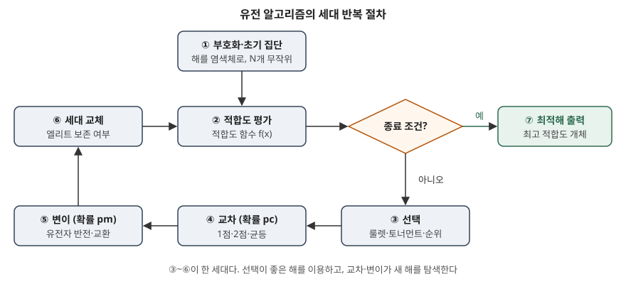

기출문제에서 유전 알고리즘을 두 갈래로 묻는다. 하나는 개념과 절차이고, 다른 하나는 이 알고리즘으로
최적화를 어떻게 하는가, 곧 최적화 성능을 끌어올리는 방법이다. 절차는 교재마다 거의 같아서 점수가
잘 갈리지 않는다. 갈리는 곳은 두 번째 문항이다. **기본형 유전 알고리즘은 전역 최적해로 수렴한다는
보장이 없고, 엘리트 보존을 넣어야 수렴이 증명된다**는 사실(Rudolph, 1994)을 쓰는지, 그리고 각
최적화 방법이 탐색과 이용 사이의 균형 중 어디를 건드리는지 설명하는지가 답안의 깊이를 가른다.

아래 한 세대 따라가기와 설정별 비교 수치는 전부 [`code/ga.py`](code/ga.py)로 돌려 확인했다.
수행 기록은 [`code/output.txt`](code/output.txt)에 있다.

---

## Ⅰ. 개요

### 가. 유전 알고리즘의 정의

**유전 알고리즘(Genetic Algorithm, GA)** 은 **후보 해를 염색체로 부호화한 집단을 두고, 적합도에
따른 선택과 교차·변이 연산을 세대마다 반복해 더 나은 해를 찾아가는 확률적 탐색 기법**이다.
Holland가 1975년 저서 *Adaptation in Natural and Artificial Systems*에서 자연 선택과 유전의
원리를 적응 시스템의 일반 이론으로 정식화한 것이 시작이다. 지금은 진화 전략·진화 프로그래밍과
함께 **진화 연산(Evolutionary Computation)** 의 한 갈래로 분류된다(Eiben·Smith, 2015).

### 나. 등장 배경

| 기존 방식 | 한계 | 유전 알고리즘이 바꾼 점 |
|---|---|---|
| 전수 탐색 | 후보가 2ⁿ, n!로 늘어 n이 조금만 커져도 끝나지 않는다 | 후보 일부만 평가해 좋은 해를 찾는다 |
| 경사 하강 | 미분이 필요하고, 시작점 근처의 지역 최적해에 멈춘다 | 적합도 값만 있으면 되고, 여러 점에서 동시에 출발한다 |
| 단일 해 탐색(언덕 오르기) | 해 하나만 개선하므로 다른 봉우리로 건너가지 못한다 | 교차로 서로 다른 해의 좋은 부분을 합친다 |

### 다. 생물학 용어와 알고리즘 요소의 대응

| 생물학 용어 | 유전 알고리즘에서의 뜻 | 0/1 배낭 문제의 예 |
|---|---|---|
| 염색체(chromosome)·개체 | 후보 해 하나 | `0111001000` |
| 유전자(gene) | 해의 한 성분 | 3번 물건을 넣는가(1/0) |
| 집단(population) | 동시에 유지하는 후보 해의 집합 | 염색체 20개 |
| 적합도(fitness) | 해의 좋은 정도 | 담은 가치 − 초과 무게 벌점 |
| 세대(generation) | 선택·교차·변이 한 번의 반복 | 40세대 |

## Ⅱ. 유전 알고리즘의 개념 및 절차

### 가. 개념 — 구성요소 5가지

| 구성요소 | 내용 | 설계 시 판단할 것 |
|---|---|---|
| ① 부호화(표현) | 해를 염색체로 바꾸는 규칙. 이진·정수·실수·순열 | 문제 구조를 보존하는가. 교차 후에도 유효한 해가 나오는가 |
| ② 적합도 함수 | 염색체 하나를 숫자 하나로 평가 | 제약 위반을 어떻게 반영하는가 |
| ③ 집단 | N개 후보 해의 모음 | N이 크면 다양성↑, 평가 비용↑ |
| ④ 유전 연산자 | 선택, 교차, 변이 **3가지** | 선택은 이용, 교차·변이는 탐색을 맡는다 |
| ⑤ 제어 파라미터 | 집단 크기 N, 교차 확률 pc, 변이 확률 pm, 세대 수 | 고정할지, 실행 중 바꿀지 |

### 나. 절차 — 7단계



> **출처**: [Eiben·Smith, Introduction to Evolutionary Computing 2nd ed. (2015) Ch.3 What Is an Evolutionary Algorithm?](https://link.springer.com/book/10.1007/978-3-662-44874-8), [Rudolph (1994) Convergence Analysis of Canonical Genetic Algorithms §2](https://ls11-www.cs.tu-dortmund.de/people/rudolph/publications/papers/TNN5.1.pdf)

| 단계 | 하는 일 | 주요 방식 |
|---|---|---|
| ① 부호화·초기 집단 생성 | 해를 염색체로 표현하고 N개를 무작위로 만든다 | 이진 문자열, 순열 |
| ② 적합도 평가 | 각 염색체의 적합도를 계산한다 | 목적 함수 + 제약 벌점 |
| ③ 선택 | 적합도가 높을수록 부모로 뽑힐 확률을 높인다 | 룰렛(적합도 비례), 토너먼트, 순위 |
| ④ 교차 | 부모 둘의 유전자를 확률 pc로 섞어 자식을 만든다 | 1점, 2점, 균등, 순열용 순서·간선 재조합 |
| ⑤ 변이 | 자식의 유전자를 확률 pm으로 바꾼다 | 비트 반전, 교환, 가우스 잡음 |
| ⑥ 세대 교체 | 자식으로 다음 세대를 구성한다 | 전 세대 교체, 일부 교체(steady-state), 엘리트 보존 |
| ⑦ 종료 판정·출력 | 세대 수·목표값·정체 여부로 끝내고 최고 해를 낸다 | 최대 세대, 개선 없는 세대 수 |

### 다. 한 세대 따라가기 — 검산

물건 10개(무게·가치), 용량 40인 0/1 배낭 문제로 개체 6개의 한 세대를 따라갔다. 초과 무게 1당
가치 5를 깎는 벌점으로 제약을 적합도에 넣었다. 1,024개 후보를 전수 평가한 최적해는
`0111001000`(무게 40, 가치 79)이다.

```text
[gen 0] initial population
  no  chromosome  weight  value  fitness  roulette
   0  1010001000      37     75       75     0.253
   1  0110001000      32     64       64     0.215
   2  0100001100      26     49       49     0.165
   3  1000100001      24     44       44     0.148
   4  1111110000      53    102       37     0.125
   5  1111100101      55    103       28     0.094
  sum of fitness = 297, best = 75

[crossover] one-point, pc = 0.9
  1010001000 x 0100001100 -> 1010001100, 0100001000 (cut after gene 6)

[mutation] bit flip, pm = 0.1 per gene
  1010001100 -> 0110101100 flipped [0, 1, 4]

[gen 1] next population
  sum of fitness = 303, best = 60
```

세 가지가 보인다.

- ① **룰렛 선택의 확률은 적합도의 비율이다.** 0번 개체는 75/297 = 0.253의 확률로 뽑힌다.
  4·5번은 가치 합은 가장 크지만 무게를 넘겨 벌점을 받았고, 그만큼 뽑힐 확률이 낮다
- ② **1점 교차는 자른 자리 앞뒤를 맞바꾼다.** 6번째 유전자 뒤를 잘라 앞 6개는 첫 부모, 뒤 4개는
  둘째 부모에서 가져왔다. 변이는 0·1·4번 유전자(0부터 셈)를 뒤집었다
- ③ **집단 평균은 올랐지만 최고 해는 75에서 60으로 떨어졌다.** 적합도 합은 297에서 303으로
  늘었으나, 0번 개체 `1010001000`이 교차·변이를 거치며 사라졌다. 이것이 Ⅲ장에서 다루는
  엘리트 보존이 필요한 이유다

### 라. 탐색 원리 — 스키마 정리와 탐색·이용의 균형

- ① **스키마 정리(Schema Theorem)**: Holland는 `1**0*` 처럼 일부 자리만 고정한 패턴을 스키마라 하고,
  **길이가 짧고 차수가 낮으며 평균보다 적합도가 높은 스키마는 다음 세대에서 기대 개수가 늘어난다**는
  하한을 제시했다. 좋은 부분 해(빌딩 블록)가 교차로 조합된다는 설명의 근거다. 다만 이것은 한 세대의
  기대값에 대한 부등식이며 **수렴을 보장하지 않는다**
- ② **탐색과 이용(exploration·exploitation)**: 선택은 지금 좋은 해 주변을 파고드는 이용을, 교차·변이는
  새 영역을 보는 탐색을 맡는다. 이용이 지나치면 집단이 한 해로 몰려 지역 최적해에 멈추는
  **조기 수렴**이 생기고, 탐색이 지나치면 무작위 탐색과 다를 바 없어진다. Ⅲ장의 최적화 방법은
  전부 이 균형을 조절하는 장치다

## Ⅲ. 유전 알고리즘의 최적화 방법

### 가. 기본형의 한계 — 왜 최적화 방법이 필요한가

Rudolph(1994)는 유한 마르코프 체인으로 기본형 유전 알고리즘(변이, 교차, 적합도 비례 선택)을 분석해
**초기화·교차 연산자·목적 함수와 무관하게 전역 최적해로 수렴하지 않음**을 증명했다. 같은 논문에서
**지금까지 찾은 최고 해를 선택 전이나 후에 항상 보존하는 변형은 전역 최적해로 수렴함**을 보였다.
Ⅱ-다에서 최고 해가 75에서 60으로 떨어진 것이 이 결과가 말하는 현상이다.

### 나. 최적화 방법 — 6가지

| 방법 | 내용 | 조절하는 것 | 근거 |
|---|---|---|---|
| ① 엘리트 보존(elitism) | 세대마다 최고 개체 1개 이상을 그대로 다음 세대에 넘긴다 | 최고 해 손실 차단 | Rudolph(1994) |
| ② 선택압 조절 | 룰렛 대신 토너먼트(크기 k)·순위 선택을 쓴다. k를 키우면 선택압↑ | 이용의 세기 | Eiben·Smith Ch.5 |
| ③ 다양성 유지 | 적합도 공유(fitness sharing)·군집(crowding)으로 비슷한 개체의 몫을 줄인다 | 조기 수렴 방지 | Eiben·Smith Ch.5 |
| ④ 파라미터 제어 | pc·pm 등을 실행 중 바꾼다. **결정적·적응적·자기 적응적 3종** | 탐색→이용 전환 시점 | Eiben·Hinterding·Michalewicz(1999) |
| ⑤ 하이브리드(메메틱) | 자식마다 지역 탐색(언덕 오르기 등)을 붙인다 | 이용의 정밀도 | Moscato(1989), Eiben·Smith Ch.10 |
| ⑥ 제약·다목적 처리 | 벌점 함수·수선(repair)으로 제약을, 비지배 정렬로 여러 목적을 다룬다 | 문제 형태 적합 | Deb 외(2002) NSGA-II |

①~③은 **선택 쪽**, ④·⑤는 **연산자 쪽**, ⑥은 **문제 표현 쪽**을 고친다고 묶으면 답안에서 구조가 선다.

- **파라미터 제어 3종**: 세대 수에 따라 pm을 정해진 식으로 줄이는 것이 **결정적**, 개선 여부 같은 탐색
  상태를 보고 바꾸는 것이 **적응적**, pm 자체를 염색체에 넣어 함께 진화시키는 것이 **자기 적응적**
  제어다. 같은 논문은 실행 내내 값을 고정하는 방식이 적절하지 않다고 본다
- **NSGA-II**: 부모와 자식 집단을 합친 뒤 비지배 순위와 분포(혼잡 거리)로 다음 세대 N개를 고른다.
  합쳐서 고르는 단계가 곧 엘리트 보존이고, 기존 방식의 적합도 공유 파라미터를 없앴다(Deb 외, 2002)

### 다. 검산 — 네 가지 설정 비교

같은 배낭 문제를 집단 20, 40세대, pc 0.9, pm 0.1로 두고 시드 0~49로 50번씩 돌렸다.

```text
setting              final=opt  mean final  lost best  mean evals
A roulette               5/50        75.1         44         820
B roulette+elite        42/50        78.8          0         820
C tournament+elite      46/50        78.9          0         820
D C+local search        50/50        79.0          0       14098
```

| 설정 | 마지막 세대 최고가 최적해(79)인 실행 | 찾았던 최고 해를 잃은 실행 | 평균 평가 횟수 |
|---|---|---|---|
| A 룰렛, 엘리트 없음 | 5/50 | 44/50 | 820 |
| B 룰렛 + 엘리트 보존 | 42/50 | 0/50 | 820 |
| C 토너먼트(k=2) + 엘리트 보존 | 46/50 | 0/50 | 820 |
| D C + 지역 탐색(메메틱) | 50/50 | 0/50 | 14,098 |

표의 값은 위 출력에서 옮겼다.

- ① **엘리트 보존 하나로 5회가 42회가 됐다.** 평가 횟수는 같다. A는 50번 중 44번이 도중에 찾은 최고
  해를 마지막 세대에 잃었다. Rudolph의 결론이 작은 문제에서도 그대로 드러난다
- ② **선택압을 바꾼 효과는 엘리트 보존보다 작다.** B→C는 42회에서 46회다
- ③ **지역 탐색은 50/50이지만 평가를 17배 썼다.** 메메틱 방식이 좋은지는 "같은 평가 횟수에서" 비교해야
  판단할 수 있다. 적합도 평가가 비싼 문제(시뮬레이션, 실측)에서는 이 비용이 결정 요인이 된다

### 라. 다른 최적화 기법과의 비교

| 구분 | 경사 하강 | 시뮬레이티드 어닐링 | 유전 알고리즘 |
|---|---|---|---|
| 탐색 단위 | 해 1개 | 해 1개 | 해 N개(집단) |
| 필요한 정보 | 기울기(미분) | 목적 함수 값 | 적합도 값 |
| 지역 최적해 탈출 | 못 한다 | 온도에 따라 나쁜 해도 확률적으로 받아들인다 | 집단 다양성과 교차·변이 |
| 해 공간 | 연속 | 이산·연속 | 이산·연속·순열 |
| 결정성 | 결정적 | 확률적 | 확률적(시드 고정 시 재현 가능) |
| 약점 | 볼록하지 않으면 시작점에 좌우된다 | 냉각 일정 설계 | 평가 횟수가 많고 파라미터가 많다 |

## Ⅳ. 결론

### 가. 정보시스템 적용 사례 — 질의 최적화

PostgreSQL 16의 **유전 질의 최적화기(GEQO)** 가 대표적이다. 조인할 테이블이 많아지면 조인 순서 후보가
계승으로 늘어 전수 탐색이 불가능해진다. GEQO는 조인 순서를 **정수 문자열(테이블 번호의 순열)** 로
부호화하고, 조인 비용을 적합도로 삼아 순회 판매원 문제처럼 푼다. 일부 교체(steady-state) 방식과
간선 재조합 교차를 쓰며, FROM 항목이 `geqo_threshold`(기본 12) 이상일 때 동작한다. 문서는 이 방식이
전수 탐색보다 못한 계획을 낼 수 있다고 적는다. 선택압은 `geqo_selection_bias`, 난수 시작값은
`geqo_seed`로 둔다. Ⅲ-나의 선택압 조절과 재현성 문제가 DBMS 파라미터로 노출된 예다.

### 나. 적용 시 고려사항 — 4가지

- ① **만능이 아니다.** 공짜 점심 없음 정리(Wolpert·Macready, 1997)에 따라 모든 문제에서 평균하면
  어떤 탐색 기법도 다른 기법보다 낫지 않다. 문제 구조를 아는 전용 알고리즘이 있으면 그것이 먼저다
- ② **부호화와 적합도 함수가 성능을 정한다.** 교차 후 무효 해가 쏟아지는 부호화는 연산자를 아무리
  조절해도 회복되지 않는다. 순열 문제에는 순열 전용 교차를 쓴다
- ③ **평가 비용을 예산으로 관리한다.** 설정 비교는 세대 수가 아니라 평가 횟수 기준으로 한다(Ⅲ-다 ③)
- ④ **재현성을 확보한다.** 확률적 기법이므로 운영 시스템에서는 시드를 기록하거나 고정해, 같은 입력에
  같은 결과가 나오게 한다

### 다. 결론

유전 알고리즘은 **집단·선택·교차·변이**로 미분 정보 없이 넓은 해 공간을 탐색한다. 다만 기본형은 수렴
보장이 없으므로, 실무에서는 **엘리트 보존을 기본으로 깔고, 선택압·다양성·파라미터 제어로 탐색과 이용의
균형을 맞추며, 평가 예산이 허락하면 지역 탐색을 결합**한다. 정보시스템에서는 질의 최적화, 작업 스케줄링,
자원 배치처럼 조합이 폭증하는 문제에서 "최적은 아니어도 정해진 시간 안의 좋은 해"가 필요할 때 쓴다.

끝

## 답안 작성 메모

- **먼저 쓸 것**: Ⅱ-나의 순서도. 7단계를 박스로 그리고 ③~⑥ 반복 고리를 화살표로 보이면 절차 문항의
  절반이 끝난다. 박스 7개와 마름모 1개라 5분 안에 옮긴다.
- **점수가 갈리는 지점**:
  - (가) 문항: 구성요소 **5가지**, 절차 **7단계**, 연산자 **3가지**처럼 개수를 밝히는지.
    스키마 정리를 쓰되 "수렴 보장은 아니다"까지 쓰는지
  - (나) 문항: **Rudolph의 수렴 결과(기본형은 수렴하지 않고, 엘리트 보존 변형은 수렴한다)** 를 쓰는지.
    이것이 엘리트 보존을 "있으면 좋은 기법"이 아니라 "기본"으로 만드는 근거다
  - 최적화 방법을 나열만 하지 않고 **탐색·이용 중 무엇을 조절하는지**로 묶는지
- **시간이 모자라면**: Ⅰ-다 용어 대응표와 Ⅲ-라 비교표 중 Ⅰ-다를 버린다. 논술형에서 비교표는 남긴다.
  Ⅱ-다의 검산 숫자는 "최고 해 75 → 60으로 하락" 한 줄만 남긴다.
- **IT 축을 놓치지 않는다**: 결론에 GEQO 같은 정보시스템 적용을 한 단락 넣는다. 생물학 비유 설명만으로
  채우면 정보관리기술사 답안의 축이 서지 않는다.

## 참고 자료

- Holland, J. H. *Adaptation in Natural and Artificial Systems*. University of Michigan Press, 1975.
  MIT Press 재판, 1992. [doi:10.7551/mitpress/1090.001.0001](https://doi.org/10.7551/mitpress/1090.001.0001)
- [Rudolph, G. "Convergence Analysis of Canonical Genetic Algorithms." *IEEE Transactions on Neural Networks* 5(1):96–101, 1994](https://ls11-www.cs.tu-dortmund.de/people/rudolph/publications/papers/TNN5.1.pdf) — 초록, §1 서론, §2 기본형 정의
- [Eiben, A. E., Smith, J. E. *Introduction to Evolutionary Computing*, 2nd ed. Springer, 2015](https://link.springer.com/book/10.1007/978-3-662-44874-8) — Ch.3 What Is an Evolutionary Algorithm?, Ch.5 Fitness, Selection, and Population Management, Ch.8 Parameter Control, Ch.10 Hybridisation with Other Techniques: Memetic Algorithms
- Eiben, A. E., Hinterding, R., Michalewicz, Z. "Parameter Control in Evolutionary Algorithms." *IEEE Transactions on Evolutionary Computation* 3(2):124–141, 1999. [doi:10.1109/4235.771166](https://doi.org/10.1109/4235.771166)
- Deb, K., Pratap, A., Agarwal, S., Meyarivan, T. "A Fast and Elitist Multiobjective Genetic Algorithm: NSGA-II." *IEEE Transactions on Evolutionary Computation* 6(2):182–197, 2002. [doi:10.1109/4235.996017](https://doi.org/10.1109/4235.996017)
- Moscato, P. "On Evolution, Search, Optimization, Genetic Algorithms and Martial Arts: Towards Memetic Algorithms." Caltech Concurrent Computation Program, C3P Report 826, 1989.
- Wolpert, D. H., Macready, W. G. "No Free Lunch Theorems for Optimization." *IEEE Transactions on Evolutionary Computation* 1(1):67–82, 1997. [doi:10.1109/4235.585893](https://doi.org/10.1109/4235.585893)
- [PostgreSQL 16 Documentation — Chapter 62 Genetic Query Optimizer](https://www.postgresql.org/docs/16/geqo.html), [62.3 Genetic Query Optimization (GEQO) in PostgreSQL](https://www.postgresql.org/docs/16/geqo-pg-intro.html), [Query Planning — Genetic Query Optimizer 파라미터](https://www.postgresql.org/docs/16/runtime-config-query.html#RUNTIME-CONFIG-QUERY-GEQO)
