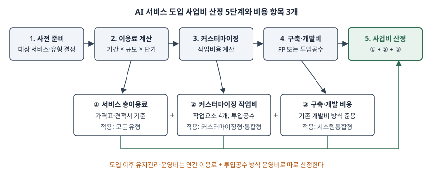

> 목적·사업유형·절차는 한국인공지능·소프트웨어산업협회(KOSA)가 2025-08-11에 공표한
> 「SW사업 대가산정 가이드(2025년 개정판)」 원문에 적힌 것만 옮겼다.
> 가이드 적용 사례의 금액은 `code/`의 스크립트로 다시 더했고, 기록은 `code/output.txt`에 있다.

문항은 두 갈래로 묻는다. 대가산정 가이드가 무엇을 위해 있는지, 그리고 인공지능(AI)
서비스를 들여오는 사업을 어떤 유형으로 나누고 사업비를 어떤 순서로 산정하는지다.
물은 순서대로 (가)를 Ⅱ장에, (나)를 Ⅲ·Ⅳ장에 쓴다.

---

## Ⅰ. 개요

공공 SW사업의 대가는 한때 정부 고시인 「소프트웨어사업 대가의 기준」으로 정했다.
이 고시는 2012년 2월 26일 이후 더 이상 적용할 수 없게 됐고, 그 자리를 KOSA가
공표하는 「SW사업 대가산정 가이드」가 대신한다. 고시가 아니라 가이드이므로 강제 규정은
아니지만, 행정안전부의 정보시스템 구축·운영 지침과 기획재정부의 예산 편성·집행
세부지침이 활용 근거로 이 가이드를 명시하고 있어 공공 발주의 사실상 기준이 된다.

AI 서비스는 기존 가이드의 산정 단위로 잘 잡히지 않는다. 기능점수(FP)는 **만들어야 할
기능의 양**을 재는데, AI 서비스 도입 사업의 비용은 대부분 **이미 있는 서비스의 구독료**와
**그 서비스를 기관 데이터에 맞추는 작업**에서 나온다. 2025년 개정판은 이 부분의
'전문작업비'를 '커스터마이징 작업비용'으로 이름을 바꾸고, 사업유형별로 어떤 작업
항목이 붙는지를 구체적으로 적었다.

---

## Ⅱ. SW사업 대가산정 가이드의 목적 (가)

### 가. 목적

> 국가기관 등에서 소프트웨어의 **기획·구현·운영 등 수명주기 전체**에 걸친 사업을
> 추진할 때 **예산수립·사업발주·계약** 시 **적정대가를 산정하기 위한 기준**을 제공한다.
> — 가이드 Ⅰ장의 목적 절(1.1)을 요약

여기서 "국가기관 등"은 국가·지방자치단체, 이들이 투자하거나 출연한 법인, 그 밖의
공공단체를 묶어 부르는 말이다. 목적 문장은 **대상·범위·시점** 세 축으로 나눠 읽는다.

| 축 | 가이드가 정한 것 | 답안에서 짚을 점 |
|---|---|---|
| ① 대상 | 국가기관 등이 발주하는 SW사업. 공급자도 준용 가능 | 발주자와 수주자가 같은 산식을 쓰므로 협상 기준선이 된다 |
| ② 범위 | 수명주기 3단계 — 기획(ISP·ISP/BPR·EA/ITA·ISMP·정보보안 컨설팅), 구현(SW 개발), 운영(유지관리·운영·재개발) | 단계마다 산정 모형이 다르다 |
| ③ 시점 | 예산확보 → 사업발주 → 사후정산 | 같은 사업도 시점마다 가용 정보가 달라 쓸 수 있는 모형이 갈린다 |

### 나. 가이드가 기대하는 효과 — 3가지

가이드는 목적 절에서 다음 세 효과를 기대한다고 적는다.

1. **합리적·객관적 대가산정 유도** — 담당자 재량이 아니라 공표된 산식으로 금액을 낸다
2. **SW사업 품질 향상과 제값주기 환경 정착** — 과소 산정이 부실 수행으로 이어지는 고리를 끊는다
3. **SW산업 경쟁력 제고** — 적정 대가가 기업의 인력·기술 투자로 이어진다

### 다. 정보시스템 관점에서 목적이 요구하는 것

가이드는 모형을 고르는 일반 절차를 **사업유형 식별 → 대가산정 시점 식별 → 대가산정 모형
선정**의 3단계로 제시한다. 이 절차가 성립하려면 발주기관은 산정 이전에 두 가지를
정보로 갖고 있어야 한다.

- **규모를 셀 수 있는 요구사항** — 기능점수 방식은 요구사항이 기능 단위로 정의돼 있어야
  센다. 요구사항 정의의 해상도가 곧 예산의 해상도다
- **비교 가능한 단가 자료** — 투입공수 방식은 KOSA가 공표하는 SW기술자 평균임금을,
  AI 서비스 도입은 가격표·견적서·유사 거래 실례가격을 쓴다. 단가 근거가 없으면 산식이
  있어도 금액이 나오지 않는다

따라서 가이드의 목적은 금액표 제공에 그치지 않고, **발주기관이 요구사항과 단가 근거를
문서로 갖추도록 강제하는 장치**로 읽는 것이 정보관리 관점의 답이다.

---

## Ⅲ. AI 서비스 도입 사업유형 (나-1)

### 가. 산정식

가이드 Ⅲ장의 AI 도입 방식 개요(2.2.1)는 사업비를 세 항목의 합으로 정의한다.

```text
AI 서비스 도입 사업비 = 서비스 총이용료 + 커스터마이징 작업비용 + 구축·개발비용
```

| 항목 | 산정 근거 | 산정 방식 |
|---|---|---|
| 서비스 총이용료 | 서비스 가격표 또는 견적서의 단위 이용료 | 도입 기간(월) × 사용 규모 × 단위 이용료 |
| 커스터마이징 작업비용 | 서비스 기업 견적가, 없으면 유사 서비스 가격표·견적서 | 작업 단위(시간·일·주·월)와 단가로 산정하는 투입공수 방식 |
| 구축·개발비용 | 기존 SW 개발비 산정 기준 | 기능점수 방식 또는 투입공수 방식 |

### 나. 사업유형 — 3가지, 커스터마이징형은 다시 3가지

| 사업유형 | 정의 | 세부 유형 |
|---|---|---|
| ① 단순 AI 서비스 도입형 | 공공 도입이 가능한 AI 서비스를 개발·변형 없이 정기 이용료(구독료)만 내고 쓴다 | — |
| ② 커스터마이징형 | AI 서비스를 들여오면서 발주기관 목적에 맞춘 커스터마이징 작업이 필요하다 | **기본** 커스터마이징: 기초 수준 분석·설계, 샘플 데이터셋, 사전 학습 모델 적용<br>**AI 데이터 구축** 커스터마이징: 데이터 신규 구축·재구축과 품질 검증<br>**AI 모델** 커스터마이징: 기존 모델 최적화·파인튜닝, 새 모델·알고리즘 개발 |
| ③ 시스템통합형 | 커스터마이징에 더해 추가 SW 개발과 시스템통합 작업이 함께 이뤄진다 | — |

세부 유형의 차이는 **기관 고유의 데이터와 모델에 얼마나 깊이 손을 대느냐**다. 기본형은
사전 학습된 모델을 그대로 얹고, 데이터형은 학습 데이터를 기관 자료로 새로 만들며,
모델형은 모델 자체를 바꾼다. 내려갈수록 작업요소가 늘어난다.

### 다. 커스터마이징 작업비용 요소 — 4가지

| 요소 | 세부 활동 |
|---|---|
| ① 요구사항 분석 및 설계 | 고객 목표·기능 요구 정의, AI 모델과 데이터 흐름 설계, PoC로 초기 요구사항 적합성 검증과 위험 식별 |
| ② 데이터 구축 | **수집 → 정제 → 가공(라벨링) → 검수** 4단계. 외부 데이터는 법적 요구사항·라이선스 검토 |
| ③ 모델 구현 및 학습 | 알고리즘 선택, 학습·파인튜닝 반복, 하이퍼파라미터 조정, 프롬프트 엔지니어링, 정확도·신뢰성 검증 |
| ④ 서비스 검증 및 안정화 | UX 테스트, 모델 성능 평가와 서비스 환경 실효성 검증, 사용자 검수·인수인계 |

가이드는 **성능 미달 시 위 요소를 반복 수행**하고, 반복에 따른 비용 증가와 일정 지연을
예산·일정에 반영하라고 적는다. 일반 SW 개발과 달리 AI 작업은 목표 성능에 한 번에
도달한다는 보장이 없기 때문이다.

### 라. 사업유형별 비용 항목과 작업요소 — 비교표

| 비용 항목 / 작업요소 | 단순 도입형 | 커스터마이징형 기본 | 커스터마이징형 데이터 | 커스터마이징형 모델 | 시스템통합형 |
|---|:---:|:---:|:---:|:---:|:---:|
| 서비스 이용료 | ○ | ○ | ○ | ○ | △ |
| 요구사항 분석·설계 | | ○ | ○ | ○ | △ |
| 데이터 구축 | | | ○ | ○ | △ |
| 모델 구현 및 학습 | | | | ○ | △ |
| 검증 및 안정화 | | ○ | ○ | ○ | △ |
| 구축·개발비용 | | | | | ○ |

△는 필요한 경우에만 산정한다는 뜻이다. 시스템통합형은 서비스 이용료가 발생하지 않는
사업이면 이용료를 빼고, 커스터마이징 작업비용도 필요한 항목만 넣는다. 특히
**커스터마이징의 요구사항 분석·설계와 구축·개발의 분석·설계가 겹치지 않도록**
가이드가 따로 주의를 단다.

---

## Ⅳ. AI 서비스 도입 사업비 산정 절차 (나-2)

### 가. 절차 — 5단계



> **출처**: [SW사업 대가산정 가이드(2025년 개정판) Ⅲ장 2.2.2 절차별 주요 내용 표3-26, 2.2.4 산출물 표3-29 (한국인공지능·소프트웨어산업협회, 2025-08-11)](https://www.swai.or.kr/common/board/Download.do?bcIdx=63607&cbIdx=276&streFileNm=84780de7-b25f-49b0-acb3-cca17aa78f67.pdf)

| 단계 | 주요 활동 | 산출물 |
|---|---|---|
| 1. 사전 준비 | 도입 대상 서비스와 필요한 기능 수준 식별, **도입 유형 결정**, 유형별 추가 작업 요구사항 정의 | 대상 서비스 및 추가 활동 항목 |
| 2. 서비스 이용료 계산 | 기능 수준·도입 기간·규모(인원수, 사용량)를 정하고 가격표·견적가로 이용료 산정 | 서비스 이용료 |
| 3. 커스터마이징 작업비용 계산 | 이용료에 포함된 기본 지원과 **별도로 비용이 드는 작업**을 식별하고 항목별 단위·단가로 산정 | 커스터마이징 작업비용 |
| 4. 구축·개발 비용 계산 | 통합시스템 구축, 추가 기능 개발, UI/UX 개선 항목을 식별하고 기능점수 또는 투입공수 방식으로 산정 | 구축·개발 비용 |
| 5. AI 서비스 도입 사업비 산정 | 세 항목을 합산 (부가세 별도) | 서비스 도입 사업비 총괄표 |

1단계에서 유형이 정해지면 뒤 단계 중 무엇을 건너뛸지가 결정된다. 단순 도입형은
2단계에서 바로 5단계로 가고, 커스터마이징형은 4단계를 건너뛴다. 가이드의 적용 사례도
이 구조를 따라 단순 도입형은 3단계, 커스터마이징형은 4단계로 줄여 쓴다.

### 나. 적용 사례 검산

가이드는 두 사례를 싣는다. 단순 도입형(번역 서비스, 10명 × 12개월 × 월 5만 원)과
커스터마이징형(지식관리 서비스, 20명 × 12개월 × 월 3만 원에 학습 데이터 구축)이다.
두 번째 사례를 세부 작업 단가에서 출발해 다시 더하면 다음과 같다.

```text
[사례 2] AI 지식관리 서비스 — 커스터마이징형(데이터 구축 포함)
  서비스 총이용료 (12개월 x 20명 x 30,000)      7,200,000 원
  - 요구사항 분석 및 설계
      소계                            8,000,000 원
  - 데이터 구축
      소계                          150,000,000 원
  - 모델 구현 및 학습
      소계                           20,500,000 원
  - 검증 및 안정화
      소계                            6,600,000 원
  커스터마이징 작업비용 합계 (재계산)            185,100,000 원
  총 서비스 도입 사업비 (재계산)              192,300,000 원

  가이드에 적힌 값과 비교
  가이드 커스터마이징 합계                   178,500,000 원
  재계산 - 가이드                         6,600,000 원
  가이드 총 사업비                       185,700,000 원
  재계산 - 가이드                         6,600,000 원
  검증 및 안정화를 뺀 합계                  178,500,000 원
```

전체 출력과 세부 작업별 금액은 [code/output.txt](code/output.txt)에 있다.

가이드 본문은 합계 식에 검증 및 안정화 660만 원을 넣어 적었지만, 적힌 합계
178,500,000원은 **그 항목을 뺀 값**과 같다. 항목 소계는 전부 맞고 마지막 합산에서만
6,600,000원이 빠졌다. 답안에 사례를 옮길 때는 금액보다 **세 항목을 더하는 구조**를 쓰고,
금액을 쓴다면 항목 합으로 다시 계산한 값을 쓴다.

### 다. 산정 시 유의사항 — 5가지

1. **중복 산정 금지** — 커스터마이징 작업이 이미 이용료에 포함돼 있으면 따로 지급하지 않는다.
   시스템통합형에서는 AI 커스터마이징 쪽 요구사항 분석·설계를 빼는 예시를 가이드가 든다
2. **단가 근거의 다양화** — 디지털서비스 이용지원시스템 견적, 서비스 제공업체 가격 정책,
   최근 도입가격이나 유사 거래 실례가격을 참고할 수 있다
3. **반복 학습 비용** — 성능 미달 시 작업을 반복하므로 그 비용과 일정을 처음부터 반영한다
4. **데이터 적법성** — 외부 데이터 수집 시 법적 요구사항과 라이선스 준수 지침을 검토한다
5. **도입 이후 비용은 별도** — 유지관리·운영비는 연간 이용료와 투입공수 방식 운영비로 따로 산정한다

### 라. 기존 SW 개발비 방식과 비교

| 구분 | 기능점수 방식 SW 개발비 | AI 서비스 도입 사업비 |
|---|---|---|
| 측정 대상 | 새로 만들 기능의 규모 | 이용할 서비스의 양과 맞춤 작업의 양 |
| 규모 단위 | 기능점수(FP) | 기간 × 사용 규모, 작업 단위(MD 등)·데이터 건수 |
| 단가 근거 | KOSA 공표 FP당 단가 | 서비스 가격표·견적서, SW기술자 평균임금 |
| 결과물 소유 | 발주기관이 개발 SW를 가진다 | 서비스는 공급자 것이고 이용권을 산다 |
| 반복의 취급 | 요구사항이 확정되면 규모가 정해진다 | 성능 목표 미달 시 작업 반복을 예산에 반영한다 |
| 운영 단계 비용 | 요율제 유지관리비 등 | 연간 이용료 + 투입공수 운영비 |

---

## Ⅴ. 결론

SW사업 대가산정 가이드는 국가기관 등이 SW 수명주기 전체 사업의 예산수립·발주·계약에서
적정대가를 산정하도록 기준을 주는 문서이고, 사업유형과 산정 시점에 맞는 모형을 고르게
하는 것이 핵심이다.

AI 서비스 도입 사업은 **이용료·커스터마이징 작업비용·구축·개발비용** 세 항목의 합으로
산정하며, 사업유형(단순 도입형·커스터마이징형·시스템통합형)이 어느 항목을 넣을지를
정한다. 2025년 개정판은 커스터마이징을 기본·데이터·모델 세 갈래와 작업요소 4가지로
나눠, 발주기관이 "무엇을 맞추는지"를 작업 단위로 적게 만들었다.

남는 과제는 단가 근거다. 커스터마이징 작업비는 공급자 견적에 기대고, 견적이 없으면
유사 서비스 가격을 참고하라는 수준에 머문다. 발주기관이 데이터 규모와 성능 목표를
요구사항으로 먼저 정의해 두어야 견적끼리 비교가 되고, 이것이 가이드가 정보시스템
쪽에 요구하는 실질적인 준비다.

> 개념 정리: [소프트웨어 비용 산정 — 기능점수와 COCOMO](../../software-engineering/2026-10-19-function-point-cocomo-cost-estimation/index.md)

끝

---

## 답안 작성 메모

- **분량 배분**: (가) 0.8장, (나) 2장. (나)를 유형 1장, 절차 1장으로 나눈다.
  목적은 누구나 쓰므로 짧게, 유형과 절차에서 점수를 받는다.
- **먼저 쓸 것**: ① 산정식 한 줄, ② 5단계 도식, ③ 유형별 비용 항목 비교표.
  이 셋이 있으면 (나)의 뼈대가 선다.
- **점수가 갈리는 지점 셋**
  1. **2025년 개정 사항을 썼는가.** 문항이 개정판을 기준으로 못 박았으므로 '전문작업비'가
     '커스터마이징 작업비용'으로 바뀌고 기본·데이터·모델 세부 유형과 작업요소가 명시됐다는
     점을 쓴다. 옛 명칭만 쓰면 기준판을 모른다는 표시가 된다
  2. **유형이 절차를 가지치기한다는 점.** 1단계에서 정한 유형에 따라 3·4단계가 빠진다는
     것을 도식이나 표로 보이면 절차를 외운 답안과 구별된다
  3. **중복 산정 주의.** 시스템통합형에서 분석·설계가 두 번 잡히는 문제와 이용료에 포함된
     작업의 중복 지급 금지는 가이드가 직접 단 주의다
- **시간이 모자라면 버릴 것**: Ⅱ-다(정보시스템 관점)와 Ⅳ-라(기존 방식 비교표).
  다만 논술형은 비교표가 하나는 있어야 하므로 Ⅲ-라 표는 남긴다.
- **쓰지 말 것**: 사례 금액을 외워 쓰는 것. 가이드 사례 합계에 6,600,000원 차이가 있으므로
  금액은 구조를 보이는 데만 쓴다. AI 사업 시장 규모나 절감 효과 같은 수치는 근거를 찾지 못했다.

---

## 참고 자료

- [SW사업 대가산정 가이드(2025년 개정판) 공표 게시글 (한국인공지능·소프트웨어산업협회, 2025-08-11)](https://www.swai.or.kr/site/sw/ex/board/View.do?cbIdx=276&bcIdx=63607) — 개정 내용(AI 도입사업 대가산정 체계 개선, 개발·운영 통합 사업 가이드 추가)과 적용 시점
- [SW사업 대가산정 가이드(2025년 개정판) PDF (한국인공지능·소프트웨어산업협회, 2025-08-11)](https://www.swai.or.kr/common/board/Download.do?bcIdx=63607&cbIdx=276&streFileNm=84780de7-b25f-49b0-acb3-cca17aa78f67.pdf) — Ⅰ장 목적·배경·적용범위(1.1~1.5), Ⅲ장 2.2 인공지능(AI) 도입 방식(사업유형, 작업비용 요소, 표3-26~3-29, 적용 사례)
