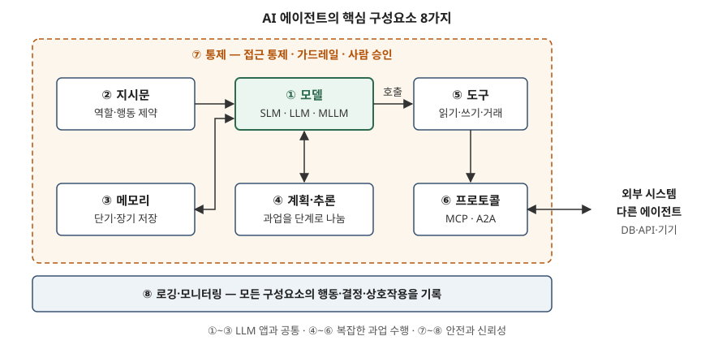

기출문제에서 에이전틱 AI를 묻는다. "스스로 일하는 AI"라고만 쓰면 생성형 AI와 구분되지 않는다.
답안의 축은 **모델에 무엇을 붙여야 에이전트가 되는가**와 **그 에이전트가 어디까지 손댈 수 있고
어디까지 혼자 정하는가**다. 앞의 것이 구성요소이고 뒤의 것이 설계와 통제의 대상이다.

> 실행 검증 없음 — 문서 근거로 정리한 답안이다. 정의를 정한 국제 표준은 찾지 못했고, 싱가포르
> 정보통신미디어개발청(IMDA)의 정부 발간 프레임워크와 OpenAI 백서를 근거로 했다.

---

## Ⅰ. 정의

**에이전틱 AI(Agentic AI)** 는 **사용자가 정한 목표를 이루기 위해 계획 수립·의사결정·행동 실행을
여러 단계에 걸쳐 어느 정도 독립적으로 수행하는 AI 에이전트 하나 또는 여럿으로 이루어진 소프트웨어
시스템**이다. IMDA 프레임워크의 서술을 따랐다.

**정의가 정립되는 중이다.** IMDA는 에이전트의 정의에 합의가 없다고 먼저 밝히고 공통 특징만 든다.
OpenAI 백서는 에이전트인가 아닌가로 나누지 않고 **에이전트성(agenticness)** 이라는 정도로 본다.
"복잡한 환경에서 복잡한 목표를 제한된 직접 감독 아래 적응적으로 달성하는 정도"이며 4개 요소로 나뉜다.

| 에이전트성의 요소 | 무엇을 재는가 |
|---|---|
| ① 목표 복잡도 | 달성할 수 있는 목표가 얼마나 어렵고 범위가 넓은가 |
| ② 환경 복잡도 | 여러 영역·이해관계자·긴 시간·여러 외부 도구에 걸친 환경에서도 되는가 |
| ③ 적응성 | 처음 보는 상황에 얼마나 잘 대응하는가 |
| ④ 독립 실행 | 사람의 개입과 감독이 적어도 목표를 안정적으로 달성하는가 |

**생성형 AI와의 차이**는 행동이다. 생성형 AI는 응답을 만들고, 에이전트는 도구를 호출해 외부 시스템의
상태를 바꾼다.

| 구분 | LLM 앱(생성형 AI) | 워크플로 | 에이전트 |
|---|---|---|---|
| 제어 흐름 | 요청 1회에 응답 1회 | 미리 짠 코드 경로가 LLM과 도구를 순서대로 부른다 | LLM이 절차와 도구 사용을 실행 중에 정한다 |
| 외부 영향 | 없음(텍스트 생성) | 정해진 도구만 | 허용된 도구 범위 안에서 스스로 선택 |
| 예측 가능성 | 높음 | 높음 | 낮음 — 통제와 기록이 필요하다 |

> 워크플로와 에이전트의 구분은 Anthropic(2024-12-19)의 것이다. Anthropic은 둘을 묶어 에이전틱 시스템이라 부른다.

## Ⅱ. 구성요소

> **출처**: [IMDA, Model AI Governance Framework for Agentic AI v1.5 §1.1.1 Core components of an agent](https://www.imda.gov.sg/assets/d1e45a56-d898-4b9f-972e-8ae94be1a5a5.pdf)

### 가. 핵심 구성요소 8가지

| 묶음 | 구성요소 | 내용 |
|---|---|---|
| LLM 앱과 공통 | ① 모델 | 추론과 계획의 중심. 소형·대형·멀티모달 언어 모델 |
| | ② 지시문 | 역할·능력·행동 제약을 정한 자연어 명령(시스템 프롬프트) |
| | ③ 메모리 | 단기·장기 저장소. 이전 대화와 외부 지식을 다시 가져온다 |
| 복잡한 과업 수행 | ④ 계획·추론 | 과업에 필요한 단계를 모델이 출력한다 |
| | ⑤ 도구 | 파일·DB 쓰기, 기기 제어, 거래 실행. 다른 에이전트도 도구로 호출된다 |
| | ⑥ 프로토콜 | 도구·에이전트와 통신하는 표준 방식. 도구 연결은 MCP, 에이전트 간은 A2A |
| 안전·신뢰성 | ⑦ 통제 | 접근 통제, 가드레일, 사람 승인. 행동 공간과 자율성을 제한한다 |
| | ⑧ 로깅·모니터링 | 행동·결정·상호작용을 기록해 감시·디버깅·책임 추적에 쓴다 |

### 나. 다중 에이전트 구성 패턴 3가지

| 패턴 | 동작 | 맞는 과업 |
|---|---|---|
| ① 순차(sequential) | 앞 에이전트의 출력이 다음 에이전트의 입력이 된다 | 단계가 정해진 과업 |
| ② 감독(supervisor) | 감독 에이전트가 전문 에이전트를 도구처럼 호출한다 | 역할 분담이 뚜렷한 과업 |
| ③ 군집(swarm) | 여러 에이전트가 동시에 일하고 필요할 때 서로 넘긴다 | 여러 갈래를 탐색하는 열린 과업 |

에이전트를 나누면 **도구와 권한을 에이전트별로 따로 줄 수 있다.** 다중 구성이 성능만이 아니라
권한 분리 수단이기도 한 이유다.

### 다. 설계의 두 축

| 축 | 뜻 | 무엇으로 정해지는가 |
|---|---|---|
| ① 행동 공간(action-space) | 에이전트가 할 수 있는 행동의 범위 | 쓸 수 있는 도구와 그 권한. 샌드박스 → 내부 시스템 → 외부 시스템, 읽기 → 쓰기 순으로 넓어진다 |
| ② 자율성(autonomy) | 목표를 향해 어떻게 행동할지 스스로 정하는 정도 | 지시문의 상세도(표준 절차서 준수 ↔ 자체 판단)와 사람의 관여 수준 |

사람의 관여는 4단계로 나뉜다. **모든 행동 승인 → 중요 단계 승인(협업) → 치명적 단계만 승인 → 사후 감사**.

## Ⅲ. 활용 및 고려사항

### 가. 활용

- **코딩 보조**: 코드 작성, 테스트 실행, 수정 배포까지 여러 단계를 이어 수행한다
- **고객 응대**: 문의 내용을 해석하고 내부 시스템을 조회·갱신해 처리한다
- **업무 자동화**: 사내 여러 시스템에 걸친 반복 업무를 묶어 처리한다

### 나. 위험 유형 5가지

에이전트는 실제 행동을 하므로 오작동이 곧 외부 피해가 된다.

| 유형 | 내용 |
|---|---|
| ① 잘못된 행동 | 틀린 날짜로 예약, 결함 있는 코드 작성 |
| ② 권한 밖 행동 | 승인 절차를 건너뛰고 허용 범위 밖의 일을 수행 |
| ③ 편향된 행동 | LLM의 편향이 거래처 선정·채용 같은 행동으로 이어진다 |
| ④ 데이터 유출·변조 | 접근 범위가 넓어 유출뿐 아니라 잘못된 수정도 일어난다 |
| ⑤ 연결 시스템 장애 | 운영 코드 삭제, 외부 시스템에 과도한 요청 |

여기에 **속도**(사람이 실시간으로 막기 어렵다)와 **연쇄 효과**(한 단계의 오류가 뒤 단계로 커진다)가
위험을 키운다. 보안 관점의 위협은 OWASP가 10개로 정리했고 첫 항목이 에이전트 목표 탈취다.

### 다. 고려사항 — 거버넌스 4개 차원

| 차원 | 정보시스템이 갖춰야 할 것 |
|---|---|
| ① 위험을 미리 평가하고 한정 | 행동 범위·되돌릴 수 있는지·자율성 수준으로 위험을 평가한다. 도구와 외부 시스템 접근을 설계 단계에서 줄이고, 에이전트에 신원을 부여해 접근 통제를 건다 |
| ② 사람이 실질적으로 책임 | 조직 안팎의 책임을 나눠 정한다. 승인자가 습관적으로 승인하는 자동화 편향을 막도록 감독 절차를 설계한다 |
| ③ 기술 통제와 절차 | 개발 중에는 계획·도구에 가드레일, 배포 전에는 안전성·신뢰성 시험, 배포 후에는 지속 감시와 시험 |
| ④ 최종 사용자의 책임 지원 | 에이전트의 능력과 한계를 알리고, 사용자가 감독할 수 있도록 교육한다 |

네 차원은 한 번 거치고 끝나는 순서가 아니라 반복한다. 운영 중 이상이 발견되면 ①로 돌아가 다시 한정한다.

> 관련 답안: [기출문제 — 다중 에이전트 시스템(MAS)의 정의·비교·효과](../2026-10-16-multi-agent-system-enterprise/index.md)
>
> 개념 정리: [에이전트 간 상호운용 프로토콜 — 능력 공표와 과업 수명주기](../../emerging-tech/2026-10-20-agent-interop-capability-and-task-lifecycle/index.md)

끝

## 답안 작성 메모

- **먼저 쓸 것**: 정의 한 줄에 "계획·결정·행동", "여러 단계", "사용자가 정한 목표" 세 가지를 넣는다.
  행동이 빠지면 생성형 AI의 정의가 된다.
- **점수가 갈리는 지점**: 구성요소 8가지를 세 묶음으로 나눠 쓰는 것과, **행동 공간·자율성 두 축**이다.
  두 축을 쓰면 "에이전트를 어떻게 통제하는가"가 도구 권한과 승인 지점이라는 시스템 설계 항목으로 내려온다.
  특징만 나열한 답안과 여기서 갈린다.
- **차별화 한 줄**: 정의에 합의가 없다는 사실과 에이전트성을 정도로 본다는 관점. 최신 주제에서
  "정의가 정립되는 중"은 감점이 아니라 근거를 읽었다는 표시다.
- **시간이 모자라면**: Ⅱ-나 다중 에이전트 패턴과 Ⅲ-가 활용을 한 줄씩으로 줄인다. 구성요소 표,
  두 축, 거버넌스 4개 차원은 남긴다. 에이전트성 4요소 표는 정의 문장 속 열거로 바꿔도 된다.
- **주의**: 구성요소 개수는 판마다 다르다. IMDA v1.0은 통제와 로깅·모니터링을 핵심 구성요소에 넣지
  않았고 v1.5에서 추가했다. 답안에는 "8가지(안전 요소 2가지 포함)"로 쓴다.

## 참고 자료

- [IMDA, Model AI Governance Framework for Agentic AI, Version 1.5 (2026-05-20 발행, 2026-06-05 갱신)](https://www.imda.gov.sg/assets/d1e45a56-d898-4b9f-972e-8ae94be1a5a5.pdf) — 에이전틱 AI의 공통 특징, 핵심 구성요소, 다중 에이전트 패턴, 행동 공간과 자율성, 위험 유형, 거버넌스 4개 차원
- [Shavit 외, Practices for Governing Agentic AI Systems (OpenAI 백서)](https://cdn.openai.com/papers/practices-for-governing-agentic-ai-systems.pdf) — 에이전트성의 정의와 4개 요소. 문서 안에 발행일 표기가 없다
- [Anthropic Engineering, Building effective agents (2024-12-19)](https://www.anthropic.com/engineering/building-effective-agents) — 워크플로와 에이전트의 구분
- [OWASP GenAI Security Project, OWASP Top 10 for Agentic Applications (2025-12-09)](https://genai.owasp.org/2025/12/09/owasp-top-10-for-agentic-applications-the-benchmark-for-agentic-security-in-the-age-of-autonomous-ai/) — 에이전트 애플리케이션의 보안 위협 10개 항목
