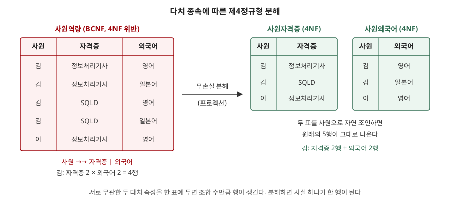

기출문제에서 제4정규형을 묻는다. 정규화 답안은 BCNF에서 멈추는 경우가 많은데, BCNF까지 만족해도
중복이 남는 표가 있다. 함수 종속이 하나도 없는데 행이 조합 수만큼 늘어나는 표다. 제4정규형은 이
중복을 **다치 종속**이라는 별도의 종속 개념으로 설명하고 분해로 없앤다.

> 실행 검증 없음 — 제4정규형을 제안한 원 논문(Fagin, 1977)을 근거로 정리한 답안이다. 예제 표의
> 행 수는 손으로 계산했다.

---

## Ⅰ. 정의

**제4정규형(Fourth Normal Form, 4NF)** 은 **릴레이션 스키마에 자명하지 않은 다치 종속 X →→ Y 가
성립할 때마다, 모든 속성 A에 대해 함수 종속 X → A 도 성립하는 정규형**이다. 곧 자명하지 않은 다치
종속의 결정자는 전부 슈퍼키다. 원 논문은 이를 "모든 종속이 키의 결과"라고 요약한다.

정의에 쓰인 두 용어는 다음과 같다.

| 용어 | 뜻 |
|---|---|
| 다치 종속 X →→ Y | R(X, Y, Z)에서 X 값 하나에 대응하는 **Y 값의 집합**이 X만으로 정해지고 Z 값과 무관하다 |
| 자명한 다치 종속 | 어떤 릴레이션에서도 성립하는 것. Y가 공집합이거나, X와 Y가 R의 속성 전부일 때(Z가 없을 때) |

함수 종속은 "X 값 하나에 Y 값 하나"이고, 다치 종속은 "X 값 하나에 Y 값의 집합 하나"다.

## Ⅱ. 구성요소

### 가. 다치 종속의 성질 3가지

| 성질 | 내용 |
|---|---|
| ① 함수 종속의 일반화 | X → Y 가 성립하면 X →→ Y 도 성립한다. 대응 집합의 원소가 많아야 1개인 경우가 함수 종속이다 |
| ② 상보 규칙 | R(X, Y, Z)에서 X →→ Y 이면 X →→ Z 다. 그래서 X →→ Y \| Z 로 함께 적는다. 함수 종속에는 없는 성질이다 |
| ③ 무손실 분해의 필요충분조건 | X →→ Y 가 성립하는 것과, R이 프로젝션 R1(X, Y)와 R2(X, Z)의 조인과 같다는 것은 동치다 |

③이 제4정규형 분해의 근거다. 다치 종속이 있으면 그 종속대로 나눠도 정보가 줄지 않는다.

### 나. 분해 예 — 사원·자격증·외국어

> **출처**: [R. Fagin, Multivalued Dependencies and a New Normal Form for Relational Databases §2 Theorem 1, §3 A New Normal Form](https://doi.org/10.1145/320557.320571)

사원의 자격증과 외국어는 서로 무관하다. 한 표에 두면 다음과 같이 된다.

| 단계 | 내용 |
|---|---|
| ① 종속 파악 | 함수 종속이 없다. 키는 (사원, 자격증, 외국어) 전체이므로 **BCNF를 만족한다** |
| ② 위반 확인 | 사원 →→ 자격증 \| 외국어 가 성립하는데 사원은 슈퍼키가 아니다 → 4NF 위반 |
| ③ 이상 현상 | 김 사원에게 자격증 1개를 더하려면 외국어 수만큼 2행을 넣어야 한다. 1행만 넣으면 다치 종속이 깨진다 |
| ④ 분해 | 사원자격증(사원, 자격증), 사원외국어(사원, 외국어)로 나눈다. 각각 3행이고 자명한 다치 종속만 남는다 |
| ⑤ 검증 | 두 표를 사원으로 자연 조인하면 김 2×2 = 4행, 이 1×1 = 1행으로 원래의 5행이 나온다 |

### 다. BCNF와의 비교

| 구분 | BCNF | 제4정규형 |
|---|---|---|
| 다루는 종속 | 함수 종속 | 다치 종속(함수 종속 포함) |
| 조건 | 자명하지 않은 X → Y 의 X가 슈퍼키 | 자명하지 않은 X →→ Y 의 X가 슈퍼키 |
| 없애는 중복 | 결정자가 키가 아니어서 생기는 중복 | 서로 무관한 다치 속성의 조합으로 생기는 중복 |
| 포함 관계 | — | 4NF이면 BCNF다. 역은 성립하지 않는다 |
| 무손실 분해 | 가능 | 어떤 스키마든 4NF 스키마들로 무손실 분해할 수 있다 |

## Ⅲ. 활용 및 고려사항

### 가. 활용

- **다치 속성이 둘 이상인 엔터티의 설계**: 사원의 자격증·외국어, 과목의 교재·담당 강사처럼 한 대상에
  딸린 목록이 여럿이면 목록마다 표를 나눈다
- **전체가 키인 표의 점검**: 모든 컬럼이 키라서 함수 종속이 없는 표는 BCNF 검사를 그대로 통과한다.
  이런 표가 다치 종속 점검의 대상이다

### 나. 고려사항 — 4가지

| 항목 | 내용 |
|---|---|
| ① 독립성은 업무 의미로 판단한다 | 다치 종속은 스키마의 제약이다. 지금 든 데이터가 조합 형태라는 것만으로 선언하지 않는다. "특정 자격증으로 특정 외국어 업무를 한다"처럼 둘이 연관되면 다치 종속이 아니고 나누면 정보가 사라진다 |
| ② 묶음을 쪼개지 않는다 | X →→ {Y1, Y2} 가 성립한다고 X →→ Y1 이 성립하는 것은 아니다. 급여와 연도처럼 함께 움직이는 속성은 한 덩어리로 옮긴다 |
| ③ 분해 결과는 하나가 아니다 | 어느 종속부터 적용하느냐에 따라 최종 스키마가 달라질 수 있다. 다른 표의 프로젝션에 지나지 않는 표는 제거한다 |
| ④ 4NF가 최대 분해는 아니다 | 키 하나에 함수 종속된 속성들은 이미 4NF다. 더 나눌 수 있어도 얻는 것이 없으면 나누지 않는다 |

이 예처럼 다치 속성만 떼어 낸 표는 모든 컬럼이 키가 된다. 원래 모양으로 조회할 때 조인이 늘어나므로 조회 빈도가 높으면 뷰로 묶어 제공한다.

> 개념 정리: [정규화 1NF부터 BCNF까지](../../database/2026-09-23-normalization-1nf-to-bcnf/index.md)

끝

## 답안 작성 메모

- **먼저 쓸 것**: 정의에 "자명하지 않은 다치 종속"과 "결정자가 슈퍼키" 두 구절을 넣는다. "다치 종속을
  제거한 정규형"이라고 쓰면 틀린다. 결정자가 슈퍼키인 다치 종속과 자명한 다치 종속은 남아도 된다.
- **점수가 갈리는 지점**: 예제 표가 **BCNF를 만족한다는 것을 먼저 보이는 것**이다. 전체가 키라서 함수
  종속이 없다는 한 줄이 있어야 "왜 정규형이 하나 더 필요한가"에 답이 된다. 그다음이 무손실 분해의
  근거(성질 ③)다.
- **모식도**: 표 3개와 화살표 하나면 된다. 김 사원의 2×2 = 4행이 2행 + 2행으로 바뀌는 것만 보이면 충분하다.
- **시간이 모자라면**: Ⅲ-가 활용과 고려사항 ③·④를 버린다. 정의, 예제 분해, BCNF 비교표는 남긴다.
- **시간이 남으면**: 제5정규형은 조인 종속을 다룬다는 한 줄을 결론 자리에 덧붙일 수 있다. 다만 이 글이
  근거로 삼은 논문의 범위 밖이므로 본 답안에는 넣지 않았다.

## 참고 자료

- [R. Fagin, Multivalued Dependencies and a New Normal Form for Relational Databases, ACM Transactions on Database Systems, Vol. 2, No. 3, September 1977, pp. 262–278](https://doi.org/10.1145/320557.320571) — 다치 종속의 정의(2절), 함수 종속과의 관계(명제 1), 무손실 분해와의 동치(정리 1), 상보 규칙(명제 2), 제4정규형의 정의와 BCNF 포함(3절 정리 2), 4NF 무손실 분해(정리 3), 분해 예(4절)
