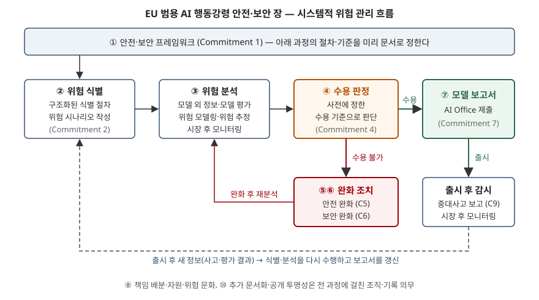

기출문제에서 범용 AI(General-Purpose AI, GPAI)의 위험관리 프레임워크를 묻는다. 일반 AI 위험관리
(NIST AI RMF, ISO/IEC 23894)를 그대로 옮겨 쓰면 절반만 맞는다. 범용 AI는 **용도를 정하지 않고
만들어져 수많은 하위 시스템에 통합**되므로, 위험을 용도별로 평가하는 기존 틀로는 출시 전에 위험을
다 셀 수 없다. 그래서 위험관리의 책임을 **상류 모델 개발자**에게 두고, **모델 역량 자체**를 평가
대상으로 삼는 별도 틀이 생겼다. 이 차이를 쓰는지가 답안의 깊이를 가른다.

> 실행 검증 없음 — 법령·행동강령·공개 프로파일 문서를 근거로 정리한 답안이다.

---

## Ⅰ. 정의

**범용 AI 위험관리 프레임워크**는 **다양한 과업을 수행하고 여러 하위 시스템에 통합될 수 있는 범용 AI
모델의 위험을, 개발·출시·출시 후 전 주기에 걸쳐 식별·분석·수용 판정·완화·보고하도록 모델 개발자가
미리 정해 두는 절차와 기준의 체계**다.

- **범용 AI 모델**: EU AI법의 정의(제3조 제63호)로는 상당한 범용성을 보이고 서로 다른 넓은 범위의
  과업을 수행할 수 있으며, 다양한 하위 시스템·응용에 통합될 수 있는 AI 모델이다
- **시스템적 위험**: 고영향 역량에서 비롯해 공중 보건·안전·공공 안보·기본권·사회 전체에 영향을 주고
  가치사슬을 따라 대규모로 퍼질 수 있는 위험이다(같은 조 제65호). 누적 학습 연산량이 **10²⁵ FLOP**을
  넘으면 고영향 역량을 가진 것으로 추정한다(제51조 제2항)
- **법적 위치**: 시스템적 위험이 있는 범용 AI 모델의 제공자는 모델 평가(적대적 시험 포함), 위험 평가·
  완화, 중대사고 보고, 사이버보안 보호 **4가지 의무**를 진다(제55조 제1항). 이를 이행하는 방법으로
  2025-07-10에 공개된 **범용 AI 행동강령(Code of Practice) 안전·보안 장**이 제공자에게
  **안전·보안 프레임워크**를 만들도록 요구한다

**범용 AI에서 위험관리가 따로 필요한 이유** — Berkeley 프로파일은 위험의 출처를 **3가지**로 든다.
① 많은 시스템이 하나의 모델에 기대는 **규모와 도달 범위**, ② 악의적 활동의 진입 장벽을 낮추는
**오용·악용**, ③ 대형 모델에서 거듭 발견되는 **창발적 역량·취약점에 따른 예상 밖 영향**.

## Ⅱ. 구성요소

> **출처**: [General-Purpose AI Code of Practice, Safety and Security 장 Commitment 1~10 (2025-07-10)](https://code-of-practice.ai/?section=safety-security), [European Commission, The General-Purpose AI Code of Practice](https://digital-strategy.ec.europa.eu/en/policies/contents-code-gpai)

### 가. 안전·보안 장의 약속(Commitment) 10가지

| 번호 | 약속 | 핵심 내용 |
|---|---|---|
| ① | 안전·보안 프레임워크 | 아래 절차·기준을 문서로 만들고 이행·갱신하며 AI Office에 알린다 |
| ② | 시스템적 위험 식별 | 구조화된 절차로 위험을 찾고 위험마다 시나리오를 쓴다 |
| ③ | 시스템적 위험 분석 | 아래 5요소로 위험을 분석한다 |
| ④ | 수용 판정 | 사전에 정한 수용 기준으로 위험이 받아들일 만한지 판정하고, 그 결과에 따라 개발·출시를 계속할지 정한다 |
| ⑤ | 안전 완화 | 수용 가능 수준이 될 때까지 모델의 위험을 낮추는 조치 |
| ⑥ | 보안 완화 | 모델 가중치 유출·무단 접근을 막는 보안 조치 |
| ⑦ | 모델 보고서 | 식별·분석·완화 결과와 수용 판단의 근거를 AI Office에 제출하고 갱신한다 |
| ⑧ | 책임 배분 | 위험 관리 책임·자원을 배정하고 위험 문화를 조성한다 |
| ⑨ | 중대사고 보고 | 중대사고를 추적·기록해 보고한다 |
| ⑩ | 추가 문서화 | 이행 문서를 남기고 필요한 범위를 공개한다 |

②→③→④가 반복 고리이고, ④에서 수용 불가면 ⑤·⑥을 거쳐 ③으로 돌아간다. 위험을 식별·분석하는
것으로 끝나지 않고 **"계속 개발·출시해도 되는가"라는 결정**을 절차 안에 넣은 것이 일반 위험관리와의 차이다.

### 나. 위험 분석 5요소와 지정된 시스템적 위험 4종

| 위험 분석 5요소 (Commitment 3) | 지정된 시스템적 위험 4종 (부록 1) |
|---|---|
| ① 모델 외 정보 | ① 화학·생물·방사능·핵(CBRN) |
| ② 모델 평가 | ② 통제 상실(loss of control) |
| ③ 위험 모델링 | ③ 사이버 공격(cyber offence) |
| ④ 위험 추정 | ④ 유해한 조작(harmful manipulation) |
| ⑤ 시장 후 모니터링 | — |

지정된 4종은 모든 서명 제공자가 반드시 식별 대상에 넣는 위험이다. 그 밖의 위험은 ②의 구조화된
절차로 각 제공자가 찾는다. 행동강령은 모델 평가를 원칙적으로 **독립된 외부 평가자**가 하도록 요구한다.

## Ⅲ. 활용 및 고려사항

### 가. 유사 프레임워크 비교

| 구분 | EU 범용 AI 행동강령 안전·보안 장 | Berkeley GPAI 프로파일 v1.1 | NIST AI 600-1 |
|---|---|---|---|
| 성격 | AI법 제55조 이행 수단(자율 서명, 의무 준수를 입증하는 근거로 쓴다) | 자율 지침 | 자율 지침 |
| 기반 | AI법 시스템적 위험 정의 | NIST AI RMF 4기능 + ISO/IEC 23894 | NIST AI RMF 4기능 |
| 대상 | 시스템적 위험이 있는 범용 AI 모델 제공자 | 대규모 GPAI·파운데이션 모델의 상류 개발자 | 생성형 AI 개발·배포 조직 전반 |
| 위험 분류 | 지정된 시스템적 위험 4종 | 규모·오용·예상 밖 영향 3갈래 | 생성형 AI 고유 위험 12가지 |
| 핵심 장치 | 수용 판정과 모델 보고서 제출 | 위험 허용 임계치와 진행·중단(go/no-go) 결정 | 위험별 권고 조치 목록 |

Berkeley 프로파일은 최소 기대치로 지켜야 할 **우선 단계**를 NIST AI RMF 하위 범주에 묶어 든다. 개발·
배포의 주요 단계마다 **진행·중단 결정**(Manage 1.1)에 반영하고, **위험 허용 임계치를 정해 수용 불가 위험을
막으며**(Map 1.5), **레드팀·적대적 시험으로 위험한 역량을 찾고**(Measure 1.1), **점진적 규모 확대·단계적
공개·구조화된 접근·독립 감사**로 위험을 줄이도록(Manage 1.3·2.3·2.4) 권고한다. EU 행동강령의 ①~⑦과
같은 순서다.

### 나. 정보시스템 관점의 고려사항 — 4가지

| 항목 | 내용 |
|---|---|
| ① 학습 연산량 집계 | 10²⁵ FLOP 추정 기준에 해당하는지 판단하려면 학습 작업의 누적 연산량을 기록·집계하는 체계가 있어야 한다 |
| ② 평가 파이프라인 | 출시 전·출시 후 평가를 반복하므로 벤치마크·레드팀 결과를 모델 버전별로 관리하고 재현할 수 있어야 한다. 측정할 수 없는 위험도 목록에 남겨 추적한다(Berkeley, Measure 3.2) |
| ③ 모델 가중치 보안 | 가중치가 유출되면 완화 조치가 무력해진다. 접근 통제·내부자 위협 대응을 보안 완화(⑥)로 따로 관리한다 |
| ④ 하류 정보 제공과 사고 보고 | 모델을 통합하는 하류 제공자에게 역량·한계 정보를 넘기고(AI법 제53조 제1항), 하류에서 일어난 사고가 모델 개발자에게 돌아오는 보고 경로(⑨)를 만든다 |

> 개념 정리: [프런티어 AI 안전 프레임워크 — 역량 임계치와 안전장치로 배포를 정하는 구조](../../security/2026-10-01-frontier-ai-safety-frameworks/index.md)
>
> 개념 정리: [인공지능 기본법과 EU AI법 — 위험 기반 규제 구조 비교](../../it-management/2026-10-05-korea-ai-basic-act-vs-eu-ai-act/index.md)
>
> 개념 정리: [EU 범용 AI 행동강령 — 투명성·저작권·안전보안 3개 장](../../ai/2026-11-20-eu-gpai-code-of-practice-three-chapters/index.md)
>
> 관련 답안: [기출문제 — NIST AI RMF의 핵심구조 4가지와 신뢰 가능한 AI 특성 7가지](../2026-10-24-nist-ai-rmf-core-and-trustworthy-characteristics/index.md)

끝

## 답안 작성 메모

- **먼저 쓸 것**: 정의에 "상류 모델 개발자"와 "개발·출시 계속 여부를 정하는 수용 판정"을 넣는다.
  이 둘이 일반 AI 위험관리와 범용 AI 위험관리를 가른다.
- **점수가 갈리는 지점**: 구조도의 반복 고리(식별→분석→수용 판정→완화→재분석)와 **지정된 시스템적
  위험 4종**. 개수가 분명해 채점자가 세기 쉽다. 10²⁵ FLOP 기준을 쓰면 법적 위치가 정확해진다.
- **시간이 모자라면**: Ⅱ-가의 10개 약속 표를 ①~⑦만 남기고 ⑧~⑩은 "조직·문서 의무"로 한 줄로 묶는다.
  Ⅲ-가 비교표는 EU 행동강령과 Berkeley 두 열만 남긴다.
- **IT 축**: Ⅲ-나의 연산량 집계·평가 파이프라인·가중치 보안이 정보시스템 이야기다. 규제 설명만으로
  채우면 법제 답안이 된다.
- **주의**: 행동강령의 수용 기준 세부(위험 단계 설정 방식)와 갱신 주기는 이번에 원문을 확인하지 못해
  답안에 넣지 않았다.

## 참고 자료

- [Regulation (EU) 2024/1689 (Artificial Intelligence Act)](https://eur-lex.europa.eu/eli/reg/2024/1689/oj) — 범용 AI 모델 정의(제3조 제63호), 시스템적 위험 정의(제3조 제65호), 시스템적 위험 분류와 10²⁵ FLOP 추정(제51조), 범용 AI 모델 제공자 의무(제53조), 시스템적 위험 모델 제공자 의무(제55조)
- [General-Purpose AI Code of Practice, Safety and Security 장 (2025-07-10 최종본)](https://code-of-practice.ai/?section=safety-security) — Commitment 1~10, 부록 1 시스템적 위험, 부록 3 외부 평가
- [European Commission, The General-Purpose AI Code of Practice](https://digital-strategy.ec.europa.eu/en/policies/contents-code-gpai) — 공개일과 장 구성
- [Barrett, A. M., Newman, J. et al., AI Risk-Management Standards Profile for General-Purpose AI (GPAI) and Foundation Models, Version 1.1, UC Berkeley CLTC (2025-01)](https://cltc.berkeley.edu/publication/ai-risk-management-standards-profile-v1-1/) — 위험 출처 3갈래, 우선 위험관리 단계(2.3절), [arXiv:2506.23949](https://arxiv.org/abs/2506.23949)
- [NIST AI 600-1, Artificial Intelligence Risk Management Framework: Generative Artificial Intelligence Profile (2024-07)](https://doi.org/10.6028/NIST.AI.600-1)
- [NIST AI 100-1, Artificial Intelligence Risk Management Framework (AI RMF 1.0) (2023-01)](https://doi.org/10.6028/NIST.AI.100-1)
