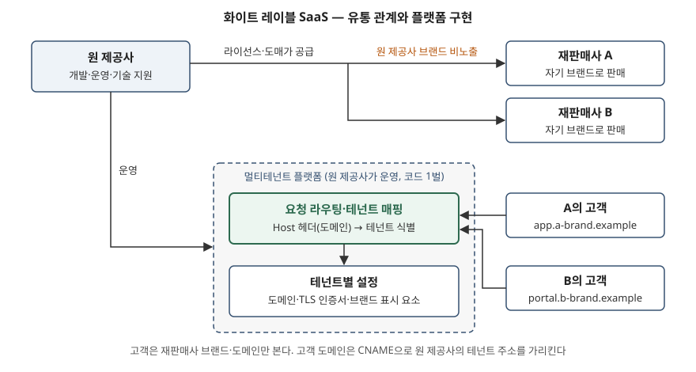

기출문제에서 화이트 레이블 마케팅을 묻는다. 경영·마케팅 용어처럼 보이지만, "남이 만든 것을
내 이름으로 판다"는 정의만 쓰면 정보관리기술사 답안이 되지 않는다. 오늘날 화이트 레이블로
유통되는 상품의 상당수는 소프트웨어이고, 그 경우 **한 벌의 플랫폼이 여러 브랜드로 보이게 하는
멀티테넌트 구현**이 이 방식의 실체다. 점수는 그 구현 요소와 운영 위험을 쓰는 데서 갈린다.

> 1차 자료 없음 — 화이트 레이블의 정의를 정한 표준이나 공적 정의는 찾지 못했다. 정의는 2차 자료
> 3건(Shopify 2026-09-07, BotPenguin 2026-10-09 갱신, Voluum 용어집 발행일 표기 없음·2026-11-19 확인)을
> 교차 확인해 정리했다. 플랫폼 구현과 운영 위험은 Microsoft 공식 아키텍처 문서(1차)를 근거로 했다. (§10)
>
> 실행 검증 없음 — 문서 근거로 정리한 답안이다.

---

## Ⅰ. 정의

**화이트 레이블 마케팅(White Label Marketing)** 은 **한 회사(원 제공사)가 만든 제품·서비스를 다른
회사(재판매사)가 사들이거나 라이선스를 받아 자기 브랜드로 바꿔 판매하고, 원 제공사는 최종 고객에게
드러나지 않는 유통·마케팅 방식**이다. 세 2차 자료가 이 핵심에서 일치한다.

소프트웨어에서는 **화이트 레이블 SaaS** 로 나타난다. 원 제공사는 플랫폼 하나를 운영하고, 재판매사마다
도메인·브랜드 표시를 바꿔 각자의 서비스처럼 보이게 한다. 마케팅 대행사가 SEO·검색 광고·콘텐츠 제작을
외부에 맡기고 자기 이름으로 납품하는 것도 같은 구조다.

**정의가 엇갈리는 지점** — 프라이빗 레이블과의 관계다. 한 용어집(Impartner)은 둘을 같은 말로 쓰고,
Voluum은 흔히 섞어 쓰지만 전통적으로 프라이빗 레이블은 한 판매사 전용 생산을 뜻한다고 본다.
Shopify와 BotPenguin은 둘을 구분한다. 답안에는 "구분하는 쪽이 다수"라고 쓰고 아래 기준을 적는다.

| 구분 | 화이트 레이블 | 프라이빗 레이블 | 리셀러 | 제휴(affiliate) |
|---|---|---|---|---|
| 고객이 보는 브랜드 | 재판매사 | 판매사 | 원 제공사 | 원 제공사 |
| 상품 | 표준 상품을 여러 재판매사에 공급 | 한 판매사 사양으로 전용 개발 | 원 상품 그대로 | 원 상품 그대로 |
| 가격·수익 | 재판매사가 가격 결정, 마진 확보 | 판매사가 결정 | 원 제공사가 결정, 고정 수수료 | 소개 수수료 |
| 고객 관계 | 재판매사 소유 | 판매사 소유 | 원 제공사 소유 | 원 제공사 소유 |

> 표의 기준은 BotPenguin(2026-10-09 갱신)의 비교표와 Shopify(2026-09-07)의 독점성 구분을 합친 것이다.

## Ⅱ. 구성요소

> **출처**: [Microsoft Azure Architecture Center, Domain name considerations in multitenant solutions](https://learn.microsoft.com/en-us/azure/architecture/guide/multitenant/considerations/domain-names), [Map requests to tenants in a multitenant solution](https://learn.microsoft.com/en-us/azure/architecture/guide/multitenant/considerations/map-requests), [Shopify Blog, White label products (2026-09-07)](https://www.shopify.com/blog/white-label-products) (유통 관계는 2차 자료 기반)

### 가. 참여 주체 3가지

| 주체 | 역할 | 얻는 것 |
|---|---|---|
| ① 원 제공사 | 제품 개발·운영·기술 지원. 고객에게 보이지 않는다 | 판로 확대, 반복 매출, 마케팅 비용 절감 |
| ② 재판매사 | 자기 브랜드로 영업·판매·고객 관리 | 빠른 시장 진입, 개발 비용·위험 회피 |
| ③ 최종 고객 | 재판매사 브랜드의 서비스를 쓴다 | 재판매사 한 곳과만 계약·지원 |

### 나. 화이트 레이블 SaaS의 IT 구현 요소 4가지

| 요소 | 내용 |
|---|---|
| ① 테넌트 식별·요청 매핑 | 요청마다 어느 테넌트인지 정한다. 근거는 Host 헤더의 도메인, URL 경로, 토큰 클레임, API 키 등이다. 브랜드 노출에는 도메인 방식이 맞다 |
| ② 커스텀 도메인 | 고객 도메인(`app.a-brand.example`)을 CNAME으로 원 제공사의 테넌트 주소에 연결한다. 등록 전에 CNAME이나 온보딩마다 새로 만든 무작위 값의 TXT 레코드로 **도메인 소유권을 검증**한다 |
| ③ TLS 인증서 | 원 제공사가 대신 발급·갱신하거나(고객 측 CAA 레코드가 허용해야 한다), 고객이 직접 제공한다(원 제공사가 개인 키를 보관하고, 고객이 갱신 시한을 지켜야 한다) |
| ④ 테넌트별 설정 | 서비스 이름·로고·색상 같은 표시 요소와 도메인을 테넌트 단위로 저장해, 코드 한 벌이 테넌트마다 다르게 보이게 한다 |

①~③은 Microsoft 멀티테넌트 지침이 다루는 항목이고, ④는 그 결과를 화면에 반영하는 설정 계층이다.

## Ⅲ. 활용 및 고려사항

### 가. 활용

- **마케팅 대행**: 대행사가 SEO·검색 광고·소셜 운영을 전문 업체에 외주로 맡기고 자기 이름으로 보고서를 낸다
- **SaaS 재판매**: 이메일 마케팅 플랫폼, 챗봇 빌더 같은 소프트웨어를 대행사·컨설팅사가 자기 고객에게 자기 브랜드로 공급한다
- **원 제공사의 채널 전략**: 직접 영업이 닿지 않는 시장을 재판매사 브랜드로 연다

### 나. 고려사항 — 5가지

| 항목 | 내용 | 근거 |
|---|---|---|
| ① 댕글링 DNS·서브도메인 탈취 | 고객이 서비스를 해지했는데 CNAME을 남겨 두면, 공격자가 같은 테넌트 이름을 다시 등록해 그 고객의 브랜드로 피싱 페이지를 띄울 수 있다. 해지 전 CNAME 삭제 요구, 테넌트 식별자 재사용 금지, 온보딩마다 새 TXT 값으로 막는다 | Microsoft 도메인 지침 |
| ② 매핑과 인가의 분리 | 도메인으로 테넌트를 찾았다고 권한이 생기는 것이 아니다. 요청마다 인가를 검사하고, OAuth 2.0 토큰이면 audience·scope 클레임까지 본다 | Microsoft 요청 매핑 지침 |
| ③ 인증서 갱신 책임 | 발급 주체를 계약에 정하지 않으면 만료가 재판매사 브랜드의 장애로 나타난다 | Microsoft 도메인 지침 |
| ④ 공급사 종속과 평판 위험 | 원 제공사의 품질 문제·장애를 고객은 재판매사 탓으로 본다. 차별화도 어렵다 | Voluum, BotPenguin |
| ⑤ 계약과 종료 계획 | 원 제공사의 고객 직접 접촉 금지, 재판매사용 SLA, 가격 변경 조건, 계약 종료 시 고객 데이터 이관 방법을 정한다 | BotPenguin |

> 개념 정리: [멀티테넌트 SaaS의 테넌트 격리 모델과 요청-테넌트 매핑](../../cloud/2026-11-20-multitenant-saas-isolation-tenant-mapping/index.md)

끝

## 답안 작성 메모

- **먼저 쓸 것**: 정의 한 줄에 "원 제공사가 드러나지 않는다"를 넣는다. 이것이 빠지면 리셀러와 구분되지 않는다.
- **점수가 갈리는 지점**: 프라이빗 레이블·리셀러 비교표와 **화이트 레이블 SaaS 구현 요소**다. 마케팅
  정의와 장단점만 쓴 답안은 마케팅 분야의 답안이지 정보관리 답안이 아니다. 테넌트 매핑·커스텀 도메인·인증서를 쓰면
  정보시스템 축이 선다. 판별법대로 Ⅱ-나를 걷어내면 답안이 무너져야 한다.
- **차별화 한 줄**: 서브도메인 탈취. 화이트 레이블의 핵심 자산인 "고객 브랜드"가 공격 수단으로 바뀌는
  지점이라 고려사항 중 가장 정보관리답다.
- **시간이 모자라면**: Ⅲ-가 활용을 한 줄로 줄이고, Ⅰ의 정의 엇갈림 단락을 "프라이빗 레이블과 혼용되나
  전용 개발 여부로 구분"으로 줄인다. 비교표와 구조도는 남긴다.

## 참고 자료

- [Microsoft Azure Architecture Center, Domain name considerations in multitenant solutions (ms.date 2025-06-13)](https://learn.microsoft.com/en-us/azure/architecture/guide/multitenant/considerations/domain-names) — 테넌트별 서브도메인, 커스텀 도메인, 도메인 검증, 댕글링 DNS, TLS 인증서
- [Microsoft Azure Architecture Center, Map requests to tenants in a multitenant solution (ms.date 2024-11-24)](https://learn.microsoft.com/en-us/azure/architecture/guide/multitenant/considerations/map-requests) — 도메인·경로·헤더·토큰 클레임·API 키 기반 매핑, 요청 검증
- [Shopify Blog, White label products (2026-09-07)](https://www.shopify.com/blog/white-label-products) — 정의, 프라이빗 레이블과의 독점성 차이 (2차)
- [BotPenguin, What Is a White Label Partnership? (2026-10-09 갱신)](https://botpenguin.com/glossary/whitelabel-partnership) — 화이트 레이블·리셀러·제휴·프라이빗 레이블 비교, 계약상 주의점 (2차)
- [Voluum Glossary, White label (발행일 표기 없음, 2026-11-19 확인)](https://voluum.com/blog/glossary/white-label/) — 정의, 재판매사·원 제공사의 장단점 (2차)
- [Impartner Glossary, What is white labeling? (발행일 표기 없음, 2026-11-19 확인)](https://impartner.com/glossary/what-is-white-labeling) — 프라이빗 레이블과 같은 말로 쓰는 용례 (2차)
