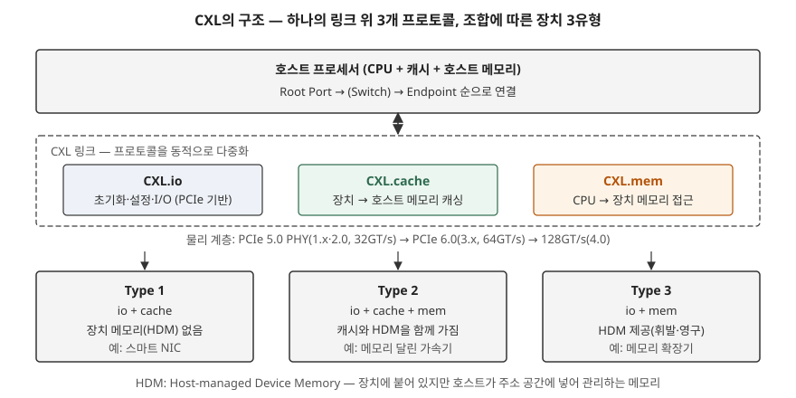

기출문제에서 CXL을 묻는다. AI·분석 작업이 커지면서 서버 한 대에 꽂을 수 있는 DRAM 슬롯 수가 먼저
한계에 닿고, 가속기와 CPU가 데이터를 서로 복사하느라 시간을 쓰는 문제가 생겼다. CXL은 이 두 문제를
**PCIe 슬롯을 통해 메모리와 가속기를 캐시 일관성 있게 붙이는 방법**으로 푼다. 단답형에서 점수가 갈리는
곳은 **프로토콜 3개와 장치 유형 3가지의 대응 관계**, 그리고 **풀링과 공유의 차이**다.

> 실행 검증 없음 — CXL 장치가 없는 환경이라 공식 자료 근거로만 정리했다. CXL 컨소시엄의 3.0 백서와
> 4.0 발표 자료, 리눅스 커널 7.4.0-rc3의 CXL 드라이버 문서를 1차 자료로 썼다. 명세서 본문은
> 평가판 동의 절차가 있어 직접 열람하지 않았다.

---

## Ⅰ. 정의

**CXL(Compute Express Link)** 은 **PCIe 기반 I/O 의미론 위에 캐시 일관성(coherency)과 메모리 의미론을 더해,
호스트 프로세서와 가속기·메모리 버퍼·스마트 I/O 장치 사이를 고대역·저지연으로 잇는 개방형 산업 표준
인터커넥트**다. CXL 컨소시엄이 표준을 만들며, 1.0이 2019년 3월에 나왔다.

| 핵심 | 뜻 |
|---|---|
| ① PCIe 물리 계층 재사용 | 슬롯·전기 규격을 PCIe와 공유하므로 새 커넥터 없이 붙는다 |
| ② 캐시 일관성 | CPU와 장치가 같은 메모리 영역을 다루면서도 서로의 캐시가 어긋나지 않게 하드웨어가 맞춘다 |

## Ⅱ. 구성요소

### 가. 프로토콜 3개와 장치 유형 3가지

> **출처**: [Linux kernel 7.4.0-rc3 문서 — CXL Device Types](https://docs.kernel.org/driver-api/cxl/devices/device-types.html), [CXL Consortium — Compute Express Link 3.0 White Paper (2022)](https://computeexpresslink.org/wp-content/uploads/2023/12/CXL_3.0_white-paper_FINAL.pdf), [CXL Consortium — CXL 4.0 Specification Release (2025-11-18)](https://computeexpresslink.org/wp-content/uploads/2025/11/CXL_4.0-Specification-Release_FINAL_Website-Copy.pdf)

| 프로토콜 | 역할 |
|---|---|
| ① CXL.io | PCIe와 같은 방식의 초기화·설정·I/O 접근. 모든 CXL 장치가 쓴다 |
| ② CXL.cache | **장치가** 호스트 메모리를 일관성 있게 읽고 자기 캐시에 담는다 |
| ③ CXL.mem | **CPU가** 장치에 붙은 메모리를 일관성 있게 읽고 캐싱한다 |

세 프로토콜은 한 링크 위에서 동적으로 다중화된다. 이 조합으로 장치 유형이 나뉜다.

| 유형 | 프로토콜 | 장치 메모리(HDM) | 예 |
|---|---|---|---|
| ① Type 1 | io + cache | 없다 | 스마트 NIC |
| ② Type 2 | io + cache + mem | 있다(캐시와 함께) | 메모리를 가진 가속기 |
| ③ Type 3 | io + mem | 있다(휘발·영구 또는 둘 다) | 메모리 확장기 |

HDM(Host-managed Device Memory)은 장치에 달려 있지만 호스트가 자기 주소 공간에 넣어 관리하는 메모리다.
리눅스는 HDM 디코더로 이 주소 범위를 장치에 연결하고, 여러 호스트 브리지·장치에 걸쳐 RAID처럼
줄무늬로 나눠 배치(interleave)할 수 있다.

### 나. 버전별 진화 — 4단계

| 버전 | 발표 | 물리 계층·속도 | 더해진 것 |
|---|---|---|---|
| ① 1.0 / 1.1 | 2019 | PCIe 5.0 | 프로토콜 3개, 단일 호스트에 직접 연결 |
| ② 2.0 | 2020-11 | PCIe 5.0 유지 | 단일 단계 스위치, 메모리 풀링, 영구 메모리 지원, 보안 |
| ③ 3.0 (3.1, 3.2) | 2022-08 | PCIe 6.0, 64GT/s, 256B 플릿 | 다단계 스위치·패브릭(최대 4,096 노드, PBR), 메모리 공유, 역무효화(back-invalidate) |
| ④ 4.0 | 2025-11 | 128GT/s, 256B 플릿 유지 | 묶음 포트(bundled port), 메모리 RAS 강화, 네이티브 x2 폭 |

모든 버전이 이전 버전과의 하위 호환을 유지한다. 1.x·2.0·3.0은 3.0 백서, 4.0은 컨소시엄 발표 자료에
근거했다. 3.0 백서는 x16 링크 기준 원시 대역폭이 최대 256GB/s라고 적는다.

## Ⅲ. 활용 및 고려사항

### 가. 활용 — 메모리 풀링과 공유

| 구분 | 메모리 풀링(2.0~) | 메모리 공유(3.0~) |
|---|---|---|
| 정의 | CXL 메모리를 여러 서버에 필요한 만큼 나눠 할당·회수한다 | 같은 메모리 영역을 여러 호스트가 **동시에** 쓴다 |
| 한 영역에 접근하는 호스트 | 한 시점에 하나 | 여럿 |
| 일관성 | 할당받은 호스트 안에서만 | 하드웨어 일관성으로 모든 호스트가 최신 값을 본다 |
| 얻는 것 | 서버마다 메모리를 넉넉히 꽂아 두는 과잉 구성을 줄인다 | 소프트웨어 조정 없이 공유 메모리로 클러스터 문제를 푼다 |

이 밖에 Type 2 가속기는 CXL.cache로 호스트 메모리를 직접 캐싱하므로 CPU와 가속기 사이의 데이터 복사를
줄인다. Type 3 메모리 확장기는 DIMM 슬롯 수와 무관하게 용량을 늘린다.

### 나. 고려사항 — 3가지

| 항목 | 내용 |
|---|---|
| ① 메모리 계층 배치 | CXL 메모리는 CPU에 직결된 DRAM보다 경로가 길다. 자주 쓰는 데이터는 직결 DRAM에, 덜 쓰는 데이터는 CXL 메모리에 두도록 운영체제·응용의 배치 정책을 정한다 |
| ② 장애 범위 | 풀링·공유된 메모리 장치나 스위치 하나가 고장 나면 여러 서버가 함께 영향을 받는다. 4.0이 메모리 RAS(신뢰성·가용성·유지보수성) 강화를 내세운 이유이며, 오류 보고·격리 체계를 함께 설계한다 |
| ③ 세대 호환과 협상 | 하위 호환은 되지만 링크는 양쪽이 지원하는 낮은 세대 기능으로 맞춰진다. 공유·패브릭 같은 3.0 기능을 쓰려면 CPU·스위치·장치가 모두 그 세대를 지원해야 한다 |

> 개념 정리: [메모리 계층과 캐시 일관성 프로토콜 — MESI 네 상태와 전이](../../system/2026-10-13-memory-hierarchy-cache-coherence-mesi/index.md)

끝

## 답안 작성 메모

- **먼저 쓸 것**: 정의 한 문장에 "PCIe 기반"과 "캐시 일관성" 두 낱말을 넣는다. 바로 아래에 호스트 –
  프로토콜 3개 – Type 1·2·3을 그린다. 박스 7개로 끝난다.
- **점수가 갈리는 지점**: 장치 유형별 프로토콜 조합(1: io+cache, 2: 셋 다, 3: io+mem)을 정확히 쓰는 것과
  CXL.cache·CXL.mem의 방향(장치→호스트 메모리, CPU→장치 메모리)을 헷갈리지 않는 것이다.
  풀링과 공유를 "한 시점 한 호스트 vs 동시 여러 호스트"로 구분하면 가산점이 된다.
- **시간이 모자라면**: 버전표에서 4.0 항목과 HDM 인터리브 설명을 버린다. 정의, 구조도, 유형표,
  풀링·공유 비교는 남긴다.
- **시간이 남으면**: 3.0의 패브릭(포트 기반 라우팅, 최대 4,096 노드)을 PCIe의 트리 구조를 넘어선 점으로
  한 줄 덧붙인다.

## 참고 자료

- [CXL Consortium — Compute Express Link 3.0 White Paper (Das Sharma·Agarwal, 2022)](https://computeexpresslink.org/wp-content/uploads/2023/12/CXL_3.0_white-paper_FINAL.pdf) — 정의, 1.0·2.0 경과, 3.0의 64GT/s·256B 플릿·역무효화·풀링과 공유·패브릭
- [CXL Consortium — CXL 4.0 Specification Release 보도자료 (2025-11-18)](https://computeexpresslink.org/wp-content/uploads/2025/11/CXL_4.0-Specification-Release_FINAL_Website-Copy.pdf) — 128GT/s, 묶음 포트, 메모리 RAS, 하위 호환
- [CXL Consortium — About CXL](https://computeexpresslink.org/about-cxl/) — 컨소시엄의 표준 소개
- [Linux kernel 7.4.0-rc3 문서 — CXL Device Types](https://docs.kernel.org/driver-api/cxl/devices/device-types.html) — 프로토콜 3개의 역할, Type 1·2·3, 메모리 확장기, 스위치
- [Linux kernel 7.4.0-rc3 문서 — CXL Driver Theory of Operation](https://docs.kernel.org/driver-api/cxl/theory-of-operation.html) — HDM 디코더, 인터리브
