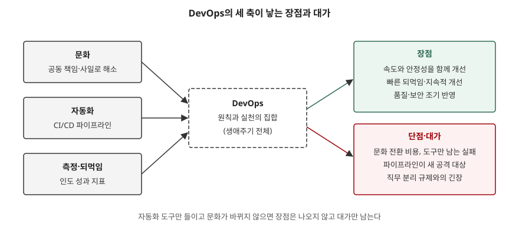

기출문제에서 DevOps의 장점과 단점을 묻는다. 장점만 늘어놓는 답안이 많은데, 이 문항은 단점에
배점의 절반이 걸려 있다. 단점을 "도입이 어렵다" 한 줄로 끝내지 않고, **무엇이 비용이고 어디에
새 위험이 생기는지**를 근거와 함께 쓰는 것이 핵심이다.

> 실행 검증 없음 — 국제표준(ISO/IEC/IEEE 32675:2022), DORA 공개 연구 자료, NIST 특별간행물을 근거로
> 정리한 답안이다. DORA 자료의 성과 수치는 조사 연도와 표본에 따라 달라지므로 싣지 않았다.

---

## Ⅰ. 정의

**DevOps**는 **관련 이해관계자 사이의 의사소통과 협업을 개선해, 소프트웨어·시스템 제품과 서비스를
명세·개발·운영하고 생애주기의 모든 측면을 지속적으로 개선하게 하는 원칙과 실천의 집합**이다
(ISO/IEC/IEEE 32675:2022 용어 정의). 개발은 속도를, 운영은 신뢰성과 보안을 우선하는 관점 차이에서
균형을 찾는 것이 출발점이다.

정의에서 장단점이 그대로 나온다. **"원칙과 실천의 집합"** 이므로 도구를 사는 것으로 끝나지 않고,
**"생애주기 전체"** 를 대상으로 하므로 개발팀만 바뀌어서는 효과가 없다.

## Ⅱ. 장점과 단점

### 가. 세 축과 장단점의 관계

> **출처**: 정의와 범위는 [ISO/IEC/IEEE 32675:2022 §3.1 Terms and definitions, §5.1 Overview](https://www.iso.org/standard/83670.html), 문화 축은 [R. Wilsenach, DevOpsCulture (martinfowler.com, 2015-07-09)](https://martinfowler.com/bliki/DevOpsCulture.html), 측정 축과 속도·안정성 관계는 [DORA — software delivery performance metrics (2026-01-05 갱신)](https://dora.dev/guides/dora-metrics-four-keys/), 파이프라인 위험은 [NIST SP 800-204D Abstract (2024-02)](https://csrc.nist.gov/pubs/sp/800/204/d/final)를 합쳐 그린 개념 관계도다.

### 나. 장점 4가지

| 장점 | 내용 | 근거 |
|---|---|---|
| ① 속도와 안정성의 동시 개선 | 배포를 자주 하면 불안정해진다는 통념과 달리, DORA는 처리량과 안정성이 **상충 관계가 아니며** 대부분의 팀에서 함께 움직인다고 보고한다 | DORA 지표 가이드 |
| ② 빠른 되먹임과 지속적 개선 | 변경 리드 타임·배포 빈도가 짧아져 운영에서 얻은 결과가 다음 변경에 곧바로 반영된다. 정의의 "생애주기 모든 측면의 지속적 개선"이 이것이다 | 32675 정의, DORA 지표 |
| ③ 품질·보안의 조기 반영 | 좌측 이동(shift-left) 원칙에 따라 테스트·위험관리를 설계·개발과 같은 시점에 수행한다. 결함이 운영까지 가지 않는다 | 32675 DevOps 원칙 절(§5.2) |
| ④ 조직 성과와 구성원 웰빙 | DORA는 인도 성과 지표가 조직 성과와 웰빙을 예측한다고 적고, 배포가 고통스러운 팀일수록 인도·조직 성과가 낮다고 보고한다 | DORA 지표 가이드, 웰빙 역량 |

네 장점은 한 사슬로 이어진다. 되먹임이 빨라야(②) 결함을 일찍 잡고(③), 결함을 일찍 잡아야 배포를
자주 해도 안정성이 떨어지지 않는다(①). 그 결과 배포가 두려운 일이 아니게 되는 것이 ④다. 따라서
답안에서는 장점을 따로 떨어진 효과로 쓰지 말고, **되먹임 주기가 짧아진 데서 나머지가 따라온다**는
순서로 쓰는 편이 논리가 선다.

### 다. 단점 4가지

| 단점 | 내용 | 근거 |
|---|---|---|
| ① 문화 전환 비용 | 도구와 애자일 실천만으로는 DevOps의 이점이 나오지 않는다. 공동 책임·사일로 해소 같은 문화가 함께 바뀌어야 하며, 이는 조직 구조와 평가 체계를 건드리는 장기 비용이다 | Wilsenach, DevOpsCulture |
| ② "DevOps 팀"이라는 새 사일로 | 누군가에게 DevOps 역할을 맡기거나 DevOps 팀을 따로 두는 것은 흔한 안티패턴이다. 개발과 운영 사이에 칸막이가 하나 더 생긴다 | Wilsenach, DevOpsCulture |
| ③ 파이프라인이 새 공격 대상 | 소스부터 배포까지 자동으로 흐르는 CI/CD 파이프라인이 소프트웨어 공급망의 일부가 된다. NIST가 공급망 보안을 파이프라인에 통합하는 전략을 별도 간행물로 낸 이유다 | NIST SP 800-204D |
| ④ 직무 분리 규제와의 긴장 | 표준은 한 사람이 여러 프로세스를 수행할 수 있다고 하면서 **법적·규제적 제약 안에서**라는 단서를 단다. 개발자가 운영 배포까지 하는 구조는 금융·공공의 직무 분리 요구와 부딪힌다 | 32675 |

단점은 두 갈래로 나뉜다. ①·②는 **문화 축**에서 나온다. 자동화는 예산을 들이면 갖춰지지만 공동 책임은
조직 구조와 평가 체계를 바꿔야 생기므로, 도구만 먼저 들어오고 일하는 방식은 그대로인 상태가 길어진다.
③·④는 **자동화 축**에서 나온다. 사람이 하던 확인을 파이프라인이 대신하면, 그 파이프라인 자체가
지켜야 할 자산이 되고 규제가 요구하는 통제의 증적도 파이프라인이 남겨야 한다. 장점이 자동화와
되먹임에서 나오는 만큼, 단점도 같은 자리에서 생긴다는 점이 이 문항의 요지다.

## Ⅲ. 고려사항

| 항목 | 내용 |
|---|---|
| ① 지표를 짝으로 본다 | 배포 빈도만 올리고 변경 실패율·배포 재작업률을 보지 않으면 장점 ①이 거꾸로 된다. DORA 지표 5개를 처리량(3)과 불안정성(2)으로 나눠 함께 잰다 |
| ② 파이프라인을 보안 통제 대상에 넣는다 | 빌드·배포 서버, 자격증명, 산출물 저장소를 운영 시스템과 같은 등급으로 관리한다. DevSecOps는 이 단점 ③에 대한 대응이다 |
| ③ 직무 분리를 자동화 통제로 대체 설계한다 | 사람의 승인 단계를 없애는 대신 파이프라인이 남기는 승인 기록·감사 증적으로 통제 요건을 충족한다 |
| ④ 문화를 역량으로 관리한다 | DORA는 정보 흐름을 중시하는 생성적(generative) 조직 문화를 인도 성과를 예측하는 핵심 역량으로 둔다. 도입 계획에 조직 문화 항목을 따로 둔다 |

> 개념 정리: [애자일과 DevOps — 무엇이 같고 무엇이 다른가](../../software-engineering/2026-09-22-agile-and-devops-scope/index.md),
> [DevOps 파이프라인 구성요소와 DORA 지표](../../software-engineering/2026-10-03-devops-pipeline-dora-metrics/index.md)

끝

## 답안 작성 메모

- **먼저 쓸 것**: 정의를 32675 문장으로 쓰고, "원칙과 실천의 집합"과 "생애주기 전체" 두 구절에서
  장단점이 나온다는 한 줄을 붙인다. 이 연결이 있어야 장단점 표가 나열이 아니라 논증이 된다.
- **점수가 갈리는 지점**: 장점 ①의 **"속도와 안정성은 상충하지 않는다"** 와 단점 ②의 **"DevOps 팀이라는
  새 사일로"** 다. 둘 다 흔한 오해를 뒤집는 문장이라 채점자 눈에 띈다. 단점 ③은 근거 간행물 이름
  (NIST SP 800-204D)을 쓰면 일반론과 구별된다.
- **모식도**: 왼쪽 세 축(문화·자동화·측정), 가운데 DevOps, 오른쪽 장점·단점 두 칸. 박스 6개다.
- **시간이 모자라면**: Ⅲ 고려사항을 ①·②만 남긴다. 장점·단점은 4개씩 개수를 맞춰 남긴다.
- **피할 것**: "배포 빈도 n배" 같은 수치. DORA 보고서의 수치는 연도·표본마다 다르고 출처를 정확히
  적지 못하면 감점 요인이 된다.

## 참고 자료

- [ISO/IEC/IEEE 32675:2022 — Information technology — DevOps — Building reliable and secure systems including application build, package and deployment](https://www.iso.org/standard/83670.html) — DevOps 정의(§3.1), 개요(§5.1), 원칙(§5.2), 규제 제약 단서
- [DORA — DORA's software delivery performance metrics (N. Harvey, 2026-01-05 갱신)](https://dora.dev/guides/dora-metrics-four-keys/) — 지표 5개, 처리량·불안정성 구분, 속도와 안정성이 상충하지 않는다는 결과
- [DORA — Capabilities: Generative organizational culture](https://dora.dev/capabilities/generative-organizational-culture/) — Westrum 조직 문화 유형과 인도 성과의 관계
- [DORA — Capabilities: Well-being](https://dora.dev/capabilities/well-being/) — 배포 고통, 번아웃, 재작업
- [NIST SP 800-204D — Strategies for the Integration of Software Supply Chain Security in DevSecOps CI/CD Pipelines (2024-02)](https://csrc.nist.gov/pubs/sp/800/204/d/final) — CI/CD 파이프라인에 공급망 보안을 통합하는 전략
- [R. Wilsenach — DevOpsCulture (martinfowler.com, 2015-07-09)](https://martinfowler.com/bliki/DevOpsCulture.html) — 협업·공동 책임, 도구만으로 부족하다는 점, DevOps 팀 안티패턴
