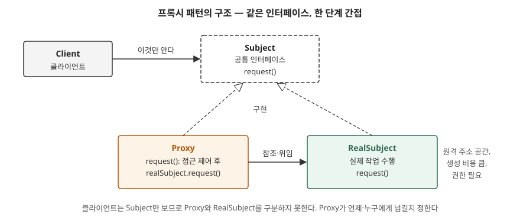

기출문제에서 프록시 디자인 패턴을 묻는다. 객체에 바로 닿지 않고 대리 객체를 거쳐 닿게 하는 구조로,
원격 호출 스텁, 지연 로딩, 권한 검사, 프레임워크의 트랜잭션 처리처럼 실무 곳곳에 이미 깔려 있다.
단답형에서 점수가 갈리는 곳은 구조를 그리는 것보다 **왜 같은 인터페이스여야 하는가**와
**데코레이터와 무엇이 다른가**를 쓰는 데 있다.

> 실행 검증 없음 — 원전(GoF, 1994)의 프록시 장 본문은 직접 열람하지 못했다. 원전 정의 문장과
> 프록시 종류는 2차 자료 3건을 교차 확인해 정리했다(SourceMaking, refactoring.guru, Wikipedia —
> 앞의 둘은 발행일 표시 없음, Wikipedia는 2026-03-10 판). 3건에 모두 나오지 않은 항목은 본문에
> 그 사실을 적었다. Java 동적 프록시는 Java SE 21 공식 API 문서를 근거로 했다.

---

## Ⅰ. 정의

**프록시 패턴(Proxy Pattern)** 은 **다른 객체에 대한 접근을 제어하기 위해 그 객체의 대리자(surrogate)
또는 자리 표시자(placeholder)를 두는 구조 패턴**이다. GoF가 분류한 23개 패턴 중 구조(structural)
패턴 7개의 하나이며, 객체 범위(합성) 패턴이다.

핵심 조건은 두 가지다.

| 조건 | 뜻 |
|---|---|
| ① 같은 인터페이스 | 프록시가 실제 객체와 같은 인터페이스를 구현하므로 클라이언트는 둘을 구분하지 못한다 |
| ② 한 단계 간접 | 프록시가 실제 객체의 참조를 갖고 요청을 넘긴다. 넘기기 전후에 접근 제어 로직을 넣는다 |

## Ⅱ. 구성요소

### 가. 구조와 참여자 4개

> **출처**: [SourceMaking — Proxy Design Pattern (Intent, Structure)](https://sourcemaking.com/design_patterns/proxy), [refactoring.guru — Proxy (Structure)](https://refactoring.guru/design-patterns/proxy), [Wikipedia — Proxy pattern (UML class and sequence diagram, 2026-03-10 판)](https://en.wikipedia.org/wiki/Proxy_pattern) (2차 자료 기반)

| 참여자 | 역할 |
|---|---|
| ① Subject | 프록시와 실제 객체가 함께 구현하는 공통 인터페이스. 클라이언트는 이것에만 의존한다 |
| ② RealSubject | 실제 작업을 수행하는 객체. 원격에 있거나, 만들기 비싸거나, 접근에 권한이 필요하다 |
| ③ Proxy | RealSubject의 참조를 갖고 같은 인터페이스를 구현한다. 접근을 제어한 뒤 요청을 위임한다 |
| ④ Client | Subject를 통해 요청한다. 받은 것이 Proxy인지 RealSubject인지 모른다 |

### 나. 프록시 종류 4가지

| 종류 | 무엇을 제어하는가 | 예 |
|---|---|---|
| ① 원격 프록시 | 다른 주소 공간에 있는 객체를 로컬 객체처럼 보이게 하고 요청을 네트워크로 전달한다 | RPC 스텁 |
| ② 가상 프록시 | 생성 비용이 큰 객체를 처음 쓰일 때 만든다(지연 초기화) | 대용량 이미지, ORM 지연 로딩 |
| ③ 보호 프록시 | 호출자의 권한을 확인한 뒤에만 요청을 넘긴다 | 역할별 접근 통제 |
| ④ 스마트 참조 | 접근할 때 부가 작업을 한다. 참조 수 세기, 첫 참조 때 영속 객체 적재, 잠금 확인 | 참조 계수 기반 해제 |

①~③은 교차 확인한 3건에 모두 나온다. ④ 스마트 참조는 2건(SourceMaking, refactoring.guru)에 나오고
Wikipedia에는 없다. 로깅·캐싱 프록시는 refactoring.guru가 별도 종류로 들지만 나머지 두 자료는
종류로 분류하지 않으므로, 답안에서는 ④의 부가 작업 예로 붙이는 편이 안전하다.

### 다. 유사 패턴 비교

| 구분 | 프록시 | 데코레이터 | 어댑터 |
|---|---|---|---|
| 목적 | **접근 제어** | **책임(기능) 추가** | **인터페이스 변환** |
| 인터페이스 | 실제 객체와 같다 | 같은 인터페이스를 확장해 쓴다 | 다른 인터페이스로 바꾼다 |
| 구조 | 실제 객체의 참조를 갖고 위임 | 같다(구조가 비슷하다) | 피적응자의 참조를 갖고 변환 |
| 실제 객체의 생성·수명 | 대개 프록시가 관리한다 | 클라이언트가 조합을 정한다 | 클라이언트가 넘겨준다 |

이 비교는 SourceMaking과 refactoring.guru 2건에서 확인했다. 두 자료 모두 "프록시와 데코레이터는
구조가 비슷하고 목적이 다르다"고 적는다.

## Ⅲ. 활용 및 고려사항

### 가. 활용 — 언어·프레임워크가 만들어 주는 프록시

Java는 1.3부터 **동적 프록시**를 표준 API로 제공한다. `java.lang.reflect.Proxy.newProxyInstance`가
지정한 인터페이스 목록을 구현하는 프록시 클래스를 **실행 시점에** 만들고, 프록시 인스턴스에 대한
메서드 호출은 연결된 `InvocationHandler.invoke(proxy, method, args)` 하나로 모인다. 프록시 클래스를
인터페이스마다 손으로 쓰지 않아도 되므로, 트랜잭션·권한 검사·로깅처럼 여러 메서드에 같은 처리를
덧붙이는 데 쓰인다. 공식 문서는 `hashCode`·`equals`·`toString` 호출도 `invoke`로 넘어온다고 적는다.

### 나. 고려사항 — 4가지

| 항목 | 내용 |
|---|---|
| ① 응답 지연 | 요청이 한 단계를 더 거친다. 원격 프록시는 로컬 호출처럼 보여도 네트워크 지연·실패가 생기므로 호출 횟수를 줄이도록 인터페이스를 설계한다 |
| ② 투명성의 한계 | 같은 인터페이스라도 객체 동일성은 다르다. 프록시와 실제 객체를 `==`로 비교하거나, 실제 객체 내부에서 자기 메서드를 부르면(self-invocation) 프록시를 거치지 않아 제어가 빠진다 |
| ③ 인터페이스 의존 | Java 표준 동적 프록시는 인터페이스만 대상으로 한다. 인터페이스 없는 클래스를 감싸려면 바이트코드 생성 같은 별도 수단이 필요하다 |
| ④ 클래스 수 증가 | 프록시 종류마다 클래스가 늘어 구조가 복잡해진다. 부가 기능이 여럿이면 프록시 하나에 몰지 말고 역할별로 나눠 겹쳐 쓴다 |

①과 ④는 refactoring.guru가 단점으로 드는 "응답 지연"과 "코드 복잡도 증가"에 해당한다. ③은 Java SE 21
API 문서의 프록시 클래스 정의("지정한 인터페이스 목록을 구현하는 클래스")에서 나온다.

> 개념 정리: [GoF 디자인 패턴 23개의 3분류](../../software-engineering/2026-10-02-gof-design-patterns-three-purposes/index.md)

끝

## 답안 작성 메모

- **먼저 쓸 것**: 정의에 "대리자"와 "접근 제어" 두 낱말을 넣고, 바로 아래에 클래스 다이어그램을 그린다.
  Subject를 점선 인터페이스로, Proxy와 RealSubject가 함께 구현하고 Proxy가 RealSubject를 참조하는 것까지
  보이면 된다. 박스 4개로 끝난다.
- **점수가 갈리는 지점**: 프록시 종류를 **개수와 함께** 쓰는 것(원격·가상·보호·스마트 참조 4가지)과
  데코레이터와의 비교다. "구조는 같고 목적이 다르다(접근 제어 vs 기능 추가)" 한 줄이 핵심이다.
- **시간이 모자라면**: Ⅲ-가의 Java 동적 프록시 설명과 고려사항 ③·④를 버린다. 정의, 구조도, 종류 4가지,
  비교표는 남긴다.
- **시간이 남으면**: 실무 예로 ORM의 지연 로딩(가상 프록시)과 트랜잭션 처리(동적 프록시)를 한 줄씩
  붙인다. 특정 프레임워크의 내부 동작은 이 글의 근거 범위 밖이므로 이름만 든다.

## 참고 자료

- [Gamma, E., Helm, R., Johnson, R., Vlissides, J. — Design Patterns: Elements of Reusable Object-Oriented Software, Addison-Wesley, 1994 (Pearson InformIT)](https://www.informit.com/store/design-patterns-elements-of-reusable-object-oriented-9780201633610) — 원전. 프록시 장(207쪽 이하). 본문은 직접 열람하지 못했다
- [Oracle — Java SE 21 API, java.lang.reflect.Proxy](https://docs.oracle.com/en/java/javase/21/docs/api/java.base/java/lang/reflect/Proxy.html) — 동적 프록시 클래스의 정의, `newProxyInstance`, 호출 위임 규칙
- [Oracle — Java SE 21 API, java.lang.reflect.InvocationHandler](https://docs.oracle.com/en/java/javase/21/docs/api/java.base/java/lang/reflect/InvocationHandler.html) — `invoke`의 인자와 반환값 처리
- [SourceMaking — Proxy Design Pattern](https://sourcemaking.com/design_patterns/proxy) — 원전의 의도 문장, 네 가지 적용 상황, 어댑터·데코레이터와의 비교 (발행일 표시 없음)
- [refactoring.guru — Proxy](https://refactoring.guru/design-patterns/proxy) — 프록시 종류, 장단점, 데코레이터·어댑터와의 비교 (발행일 표시 없음)
- [Wikipedia — Proxy pattern (2026-03-10 판)](https://en.wikipedia.org/wiki/Proxy_pattern) — 원격·가상·보호 프록시, UML 구조, 원전 쪽수 인용
