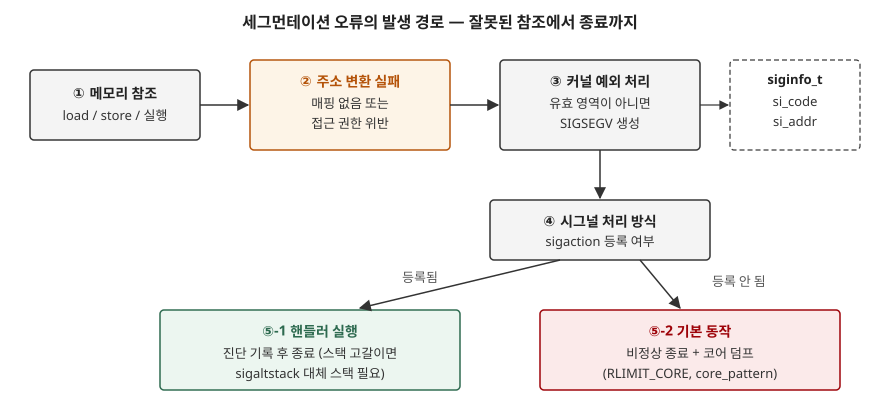

기출문제에서 세그먼테이션 오류를 묻는다. C·C++로 만든 서버가 `Segmentation fault (core dumped)` 한 줄을
남기고 내려가는 장면은 운영 경험이 있으면 한 번쯤 본다. 단답형에서 점수가 갈리는 곳은 "잘못된 포인터"라는
원인 나열보다 **하드웨어 주소 변환 실패가 어떻게 시그널이 되어 프로세스를 끝내는가**라는 경로와,
**정상 페이지 폴트와 무엇이 다른가**를 쓰는 데 있다.

> 실행 검증 없음 — 이 환경(Windows)에는 SIGSEGV를 그대로 재현할 POSIX 런타임이 없어 공식 표준과
> 매뉴얼 근거로만 정리했다. 시그널 정의는 POSIX.1-2024, 리눅스 동작은 Linux man-pages 6.19와
> 커널 7.4.0-rc3 문서를 따랐다.

---

## Ⅰ. 정의

**세그먼테이션 오류(Segmentation Fault)** 는 **프로세스가 자기 주소 공간에 매핑되지 않은 주소를 참조하거나,
매핑된 영역을 허용되지 않은 방식(읽기 전용 영역에 쓰기 등)으로 참조할 때 운영체제가 그 프로세스에
SIGSEGV 시그널을 보내는 메모리 보호 위반**이다.

POSIX는 SIGSEGV를 "잘못된 메모리 참조(Invalid memory reference)"로 정의하고, 기본 동작을 "추가 동작을
동반한 비정상 종료"(A)로 둔다. 리눅스 signal(7)은 이 기본 동작을 `Core`, 곧 종료와 함께 코어 덤프를
남기는 것으로 적는다.

| 핵심 | 뜻 |
|---|---|
| ① 하드웨어가 잡는다 | 주소 변환·권한 검사 단계에서 위반이 드러난다. 프로그램이 스스로 검사하는 것이 아니다 |
| ② 운영체제가 알린다 | 커널이 위반을 SIGSEGV로 바꿔 그 프로세스에만 보낸다. 다른 프로세스와 커널은 보호된다 |

## Ⅱ. 구성요소

### 가. 발생 경로 5단계

> **출처**: [POSIX.1-2024 — signal.h (SIGSEGV, si_code, si_addr)](https://pubs.opengroup.org/onlinepubs/9799919799/basedefs/signal.h.html), [Linux man-pages 6.19 — sigaction(2) (siginfo_t, NOTES)](https://man7.org/linux/man-pages/man2/sigaction.2.html), [sigaltstack(2) NOTES](https://man7.org/linux/man-pages/man2/sigaltstack.2.html), [core(5)](https://man7.org/linux/man-pages/man5/core.5.html)

| 단계 | 내용 |
|---|---|
| ① 메모리 참조 | 명령어가 주소를 읽고, 쓰고, 실행하려 한다 |
| ② 주소 변환 실패 | 그 가상 주소에 매핑이 없거나, 매핑은 있지만 요청한 접근 권한이 없다 |
| ③ 커널 예외 처리 | 하드웨어 예외를 받은 커널이 유효한 영역이 아니라고 판단하면 SIGSEGV를 만든다. 원인 코드(`si_code`)와 위반 주소(`si_addr`)를 `siginfo_t`에 채운다 |
| ④ 처리 방식 결정 | 프로세스가 `sigaction`으로 핸들러를 등록했는지 본다 |
| ⑤ 결과 | 핸들러가 있으면 실행하고, 없으면 기본 동작대로 비정상 종료하며 코어 덤프를 남긴다 |

### 나. 원인 코드(`si_code`) 4종

| 코드 | 뜻 | 정의 위치 |
|---|---|---|
| ① `SEGV_MAPERR` | 객체에 매핑되지 않은 주소 | POSIX |
| ② `SEGV_ACCERR` | 매핑된 객체에 대한 권한 위반 | POSIX |
| ③ `SEGV_BNDERR` | 주소 경계 검사 실패 | 리눅스 3.19부터 |
| ④ `SEGV_PKUERR` | 메모리 보호 키(protection key)가 접근을 거부 | 리눅스 4.6부터 |

①·②가 답안의 뼈대다. ③·④는 리눅스 확장이므로 "리눅스에서는 2종이 더 있다"로 붙인다.
POSIX는 `si_addr`가 구현에 따라 정확하지 않을 수 있다고 적어 두었다.

### 다. 주요 원인 5가지

| 원인 | 대개 나오는 코드 |
|---|---|
| ① 널 포인터 역참조 — 0 근처 주소는 보통 매핑하지 않는다 | `SEGV_MAPERR` |
| ② 해제된 메모리·끊긴 포인터 참조 — 그 영역이 이미 반납된 경우 | `SEGV_MAPERR` |
| ③ 배열·버퍼 경계 초과 — 넘친 범위가 매핑 밖까지 간 경우 | `SEGV_MAPERR` |
| ④ 스택 고갈 — 깊은 재귀나 큰 지역 배열로 스택 영역을 넘는다 | `SEGV_MAPERR` |
| ⑤ 권한 위반 — 읽기 전용 영역에 쓰기, 실행 불가 영역에서 실행 | `SEGV_ACCERR` |

②·③은 **넘친 곳이 우연히 매핑된 영역이면 오류가 나지 않는다.** 세그먼테이션 오류는 "메모리 오류가
있었다"의 증거이지, "없으면 안전하다"의 증거가 아니다.

## Ⅲ. 활용 및 고려사항

### 가. 정상 페이지 폴트와의 차이

| 구분 | 페이지 폴트(정상) | 세그먼테이션 오류 |
|---|---|---|
| 시작 | 둘 다 주소 변환 실패에서 시작한다 | 같다 |
| 커널 판단 | 유효한 영역인데 페이지가 아직 메모리에 없다 | 유효한 영역이 아니거나 권한이 없다 |
| 처리 | 페이지를 적재·할당하고 그 명령어를 다시 수행한다 | SIGSEGV를 보낸다 |
| 프로세스가 아는가 | 모른다(지연만 생긴다) | 시그널로 안다. 기본은 종료 |

### 나. 진단 — 3가지

| 수단 | 내용 |
|---|---|
| ① 코어 덤프 | 종료 시점 메모리를 파일로 남겨 디버거로 호출 스택을 본다. `RLIMIT_CORE`가 0이면 남지 않고, `core_pattern`이 `\|`로 시작하면 지정한 프로그램(systemd-coredump 등)이 받는다 |
| ② 커널 로그 | 리눅스 `exception-trace` sysctl이 1이면 처리되지 않은 시그널 정보가 `dmesg`에 남는다. x86 등 대부분 1이고 arm64는 0이 기본값이다 |
| ③ 주소 검사 도구 | AddressSanitizer(`-fsanitize=address`)는 힙·스택·전역 경계 초과, 해제 후 사용, 이중 해제를 **매핑 안쪽에서도** 잡는다. 공식 문서가 밝힌 전형적 속도 저하는 약 2배라 운영보다 시험 환경에 쓴다 |

### 다. 고려사항 — 3가지

| 항목 | 내용 |
|---|---|
| ① 무시하지 않는다 | sigaction(2)은 `kill`·`raise`가 아닌 하드웨어 원인의 SIGSEGV를 무시한 뒤의 동작을 **정의되지 않음**으로 적는다. 핸들러는 진단 기록 후 종료하는 데만 쓴다 |
| ② 스택 고갈은 대체 스택 | 스택이 다 찬 상태에서는 핸들러도 그 스택에서 돌 수 없다. `sigaltstack`으로 대체 스택을 준비하고 `SA_ONSTACK`으로 등록해야 잡힌다. 대체 스택은 자동으로 늘지 않는다 |
| ③ 코어 덤프 관리 | 덤프에는 메모리 내용이 그대로 들어가므로 개인정보·비밀 값이 남을 수 있다. 저장 위치의 접근 권한과 보존 기간을 정해 둔다 |

> 개념 정리: [기출문제 — 가상메모리 관리기법과 단편화](../2026-10-22-virtual-memory-management-fragmentation/index.md)

끝

## 답안 작성 메모

- **먼저 쓸 것**: 정의 한 문장에 "매핑되지 않은 주소"와 "권한 위반" 두 갈래, 그리고 "SIGSEGV"를 넣는다.
  바로 아래에 ①참조 → ②변환 실패 → ③커널 → ④처리 방식 → ⑤종료·덤프 다섯 박스를 그린다.
- **점수가 갈리는 지점**: `SEGV_MAPERR`·`SEGV_ACCERR` 두 코드를 원인과 짝지어 쓰는 것, 그리고
  정상 페이지 폴트와의 비교표다. "출발점은 같고 커널 판단이 갈린다"는 한 줄이 핵심이다.
- **시간이 모자라면**: 리눅스 확장 코드 ③·④와 커널 로그 항목을 버린다. 정의, 경로도, 원인 5가지,
  페이지 폴트 비교는 남긴다.
- **시간이 남으면**: "오류가 안 나는 메모리 오류"(매핑 안쪽 침범)를 한 줄 덧붙이고, 그래서 AddressSanitizer
  같은 도구가 필요하다는 것으로 고려사항을 맺는다.

## 참고 자료

- [The Open Group — Base Specifications Issue 8, IEEE Std 1003.1-2024: signal.h](https://pubs.opengroup.org/onlinepubs/9799919799/basedefs/signal.h.html) — SIGSEGV 정의와 기본 동작, `SEGV_MAPERR`·`SEGV_ACCERR`, `si_addr`
- [Linux man-pages 6.19 — signal(7)](https://man7.org/linux/man-pages/man7/signal.7.html) — SIGSEGV의 기본 동작 `Core`
- [Linux man-pages 6.19 — sigaction(2)](https://man7.org/linux/man-pages/man2/sigaction.2.html) — `siginfo_t`, 리눅스 확장 `si_code`, 하드웨어 원인 SIGSEGV를 무시했을 때의 동작
- [Linux man-pages 6.19 — sigaltstack(2)](https://man7.org/linux/man-pages/man2/sigaltstack.2.html) — 스택 고갈 시 SIGSEGV를 대체 스택에서 처리하는 방법
- [Linux man-pages 6.19 — core(5)](https://man7.org/linux/man-pages/man5/core.5.html) — 코어 덤프 생성 조건, `RLIMIT_CORE`, `core_pattern`
- [Linux kernel 7.4.0-rc3 문서 — Documentation for /proc/sys/debug/ (exception-trace)](https://docs.kernel.org/admin-guide/sysctl/debug.html) — 처리되지 않은 시그널의 커널 로그 기록
- [LLVM/Clang — AddressSanitizer](https://clang.llvm.org/docs/AddressSanitizer.html) — 탐지하는 오류 종류와 전형적 속도 저하
