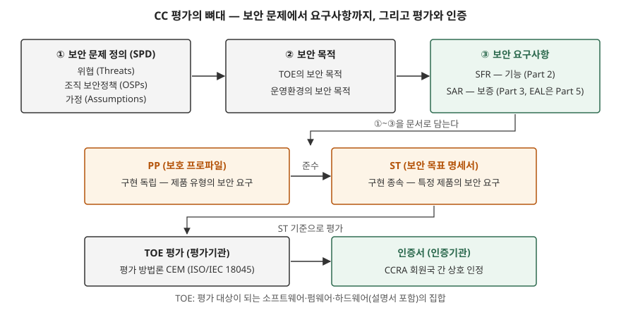

기출문제에서 CC를 묻는다. 공공기관이 보안 제품을 들일 때 "CC 인증 받았느냐"를 묻는 이유는, 제품마다
보안 기능을 스스로 주장하면 **서로 비교할 방법이 없기** 때문이다. CC는 그 주장을 정해진 틀로 쓰게 하고,
제3자가 같은 방법으로 확인하게 한다. 단답형에서 점수가 갈리는 곳은 **PP와 ST의 차이**,
**SFR과 SAR의 구분**, 그리고 **EAL이 무엇을 재는가**다.

> 실행 검증 없음 — 평가 기준을 정리하는 개념 문제라 CC 포털이 배포하는 CC:2022 원문(Part 1·5)과
> CCRA 협정 페이지를 1차 자료로 썼다.

---

## Ⅰ. 정의

**CC(Common Criteria for Information Technology Security Evaluation, 공통평가기준)** 는 **IT 제품의
보안 특성을 평가하는 일반 개념·원칙과 평가 모델을 정해, 독립적으로 수행한 보안 평가 결과를 서로
비교할 수 있게 하는 국제 표준**이다. ISO 판은 ISO/IEC 15408-1~5:2022이고, 짝이 되는 평가
방법론(CEM)은 ISO/IEC 18045:2022다.

| 핵심 | 뜻 |
|---|---|
| ① 공통 언어 | 보안 요구를 기능(SFR)과 보증(SAR)의 표준 컴포넌트로 적는다 |
| ② 독립 평가 | 개발자가 아닌 평가자가 같은 방법론(CEM)으로 확인한다 |

CC:2022는 2017년의 CC v3.1 Revision 5 이후 첫 대개정이다. CC 포털이 배포하는 판에는 한국
국가보안기술연구소를 포함한 12개국 정부 기관이 공동 저작권자로 올라 있다.

## Ⅱ. 구성요소

### 가. 문서 구성 — 5개 파트 + CEM

| 파트 | 내용 |
|---|---|
| Part 1 | 소개와 일반 모델 — 용어, TOE, PP·ST, 평가 모델 |
| Part 2 | 보안 기능 컴포넌트 — SFR의 카탈로그 |
| Part 3 | 보안 보증 컴포넌트 — SAR의 카탈로그 |
| Part 4 (신설) | 평가 방법(EM)·평가 활동(EA)을 정하는 틀 |
| Part 5 (신설) | 미리 정의한 요구사항 패키지 — EAL1~7, 조합 보증 패키지(CAP-A~C) |

### 나. 평가 구조와 핵심 개념

> **출처**: [CC:2022 Release 1 Part 1 §7 Specifying security requirements, §3.68·§3.82·§3.90 정의](https://commoncriteriaportal.org/files/ccfiles/CC2022PART1R1.pdf), [CCRA — Common Criteria Recognition Arrangement](https://www.commoncriteriaportal.org/ccra/index.cfm)

| 개념 | 정의 (Part 1 용어 절) |
|---|---|
| ① TOE (평가 대상) | 평가의 대상이 되는 소프트웨어·펌웨어·하드웨어의 집합. 설명서가 딸릴 수 있다 |
| ② PP (보호 프로파일) | TOE **유형**의 보안 요구를 **구현과 무관하게** 적은 문서 |
| ③ ST (보안 목표 명세서) | 보안 문제 정의를 바탕으로 특정 TOE의 보안 요구를 **구현에 맞춰** 적은 문서 |
| ④ SFR / SAR | 무엇을 막는가(기능) / 그것이 제대로 구현됐다는 근거를 어떻게 얻는가(보증) |
| ⑤ EAL (평가보증등급) | 미리 정해 둔 보증 척도의 한 지점을 나타내는 SAR 패키지 |

요구사항은 **3단계**로 도출된다. 위협·조직 보안정책·가정으로 보안 문제를 정의하고, 이를 TOE와
운영환경의 보안 목적으로 옮긴 뒤, 목적을 SFR·SAR로 구체화한다(Part 1 §7). 앞 단계와 뒤 단계가
서로 추적되어야 한다.

### 다. EAL 7단계 (Part 5 §4.4)

| 등급 | 이름 | 등급 | 이름 |
|---|---|---|---|
| EAL1 | 기능 시험 | EAL5 | 준정형 설계 및 시험 |
| EAL2 | 구조 시험 | EAL6 | 준정형 검증된 설계 및 시험 |
| EAL3 | 방법론적 시험 및 점검 | EAL7 | 정형 검증된 설계 및 시험 |
| EAL4 | 방법론적 설계, 시험 및 검토 | | |

## Ⅲ. 활용 및 고려사항

### 가. 활용 — CCRA 상호 인정

CCRA(2014-07-02 협정, 2014-09-08 비준)는 회원국 인증기관이 발행한 인증서를 다른 회원국이 **추가
평가 없이** 조달·사용에 인정하는 협정이다. 목적은 일관된 평가, 평가 제품의 공급 확대, **중복 평가
제거**, 평가 비용 절감이다. 인정 범위는 공동 보호 프로파일(cPP)을 따른 인증과, 그 밖의 인증은
EAL2와 결함 교정(ALC_FLR)까지다. 그보다 높은 등급의 결과는 인정 상한까지만 인정된다.

### 나. 고려사항 — 3가지

| 항목 | 내용 |
|---|---|
| ① EAL은 강도가 아니라 깊이 | EAL은 **얼마나 깊이 확인했는가**를 나타낸다. 어떤 보안 기능이 있는지는 ST의 SFR이 정한다. 도입 시 EAL 숫자보다 ST의 SFR과 보안 문제 정의가 우리 위협과 맞는지 먼저 본다 |
| ② TOE 경계와 평가된 구성 | 인증은 ST가 정한 **TOE 범위와 구성**에만 유효하다(Part 1 §5.3). 평가에 없던 모듈을 켜거나 운영환경 가정(예: 관리 단말 격리)을 지키지 않으면 인증된 상태가 아니다. 운영 설정을 ST와 대조해 관리한다 |
| ③ 인증 이후의 취약점 | 인증은 평가 시점의 판단이다. 버전이 바뀌거나 새 취약점이 나오면 결함 교정 절차(ALC_FLR)와 재인증·유지 관리가 필요하다. 조달 계약에 패치 후 인증 유지 의무를 넣는다 |

> 개념 정리: [CC(공통평가기준) — PP·ST·EAL과 CC:2022에서 달라진 것](../../security/2026-11-21-common-criteria-pp-st-eal-cc2022/index.md)

끝

## 답안 작성 메모

- **먼저 쓸 것**: 정의 한 문장에 "평가 결과의 비교 가능성"과 "ISO/IEC 15408"을 넣는다. 바로 아래에
  SPD → 보안 목적 → SFR·SAR → PP/ST → 평가 → 인증 흐름을 그린다. 박스 7개다.
- **점수가 갈리는 지점**: PP는 구현 독립(제품 유형), ST는 구현 종속(특정 제품)이라는 대비와,
  SFR(기능)·SAR(보증)의 구분이다. EAL을 "보안 수준이 높다"로 쓰면 감점 요인이다 — 보증의 깊이다.
- **시간이 모자라면**: 5개 파트 표를 "Part 1 일반 모델, 2 기능, 3 보증, 4 평가 방법 틀, 5 패키지"
  한 줄로 줄이고, EAL 표는 EAL1·4·7만 남긴다. CCRA 인정 범위는 버리지 않는다.
- **시간이 남으면**: CC:2022에서 달라진 점으로 Part 4·5 신설, 정확 준수(exact conformance),
  TSF의 부분마다 다른 보증을 적용하는 다중 보증 평가를 한 줄씩 덧붙인다.

## 참고 자료

- [CC:2022 Release 1 Part 1: Introduction and general model (CCMB, 2022-11)](https://commoncriteriaportal.org/files/ccfiles/CC2022PART1R1.pdf) — 서문(5개 파트, ISO/IEC 15408·18045와의 관계), 범위, 용어 정의(§3.39 EAL, §3.68 PP, §3.82 ST, §3.90 TOE), 대상 독자(§5.2.2), TOE(§5.3), 보안 요구사항 도출(§7)
- [CC:2022 Release 1 Part 5: Pre-defined packages of security requirements (CCMB-2022-11-005)](https://www.commoncriteriaportal.org/files/ccfiles/CC2022PART5R1.pdf) — EAL1~7 이름(§4.4), 조합 보증 패키지 CAP-A~C(§5.4)
- [Common Criteria Portal — CCRA](https://www.commoncriteriaportal.org/ccra/index.cfm) — 협정 목적 4가지, 2014-07-02 협정문
- [BSI — Recognition of CC certificates in the context of the CCRA](https://bsi.bund.de/EN/Themen/Unternehmen-und-Organisationen/Standards-und-Zertifizierung/Zertifizierung-und-Anerkennung/Zertifizierung-von-Produkten/Zertifizierung-nach-CC/Internationale-Anerkennung/CCRA_Anerkennung_dvl.html) — CCRA-2014의 인정 범위(cPP, EAL2·ALC_FLR)
