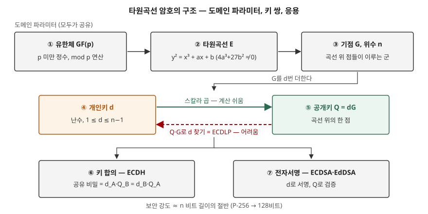

기출문제에서 타원곡선 암호(ECC)를 묻는다. TLS 인증서와 모바일 기기의 서명이 RSA에서 ECC로
넘어온 이유는 **같은 보안 강도를 훨씬 짧은 키로 얻기** 때문이다. 단답형에서 점수가 갈리는 곳은
정의에 **ECDLP**를 넣는가, RSA와의 키 길이 대비를 **표준의 수치**로 쓰는가, 그리고 양자 컴퓨팅에
대한 **전환 일정**까지 내려가는가다.

> 실행 검증 없음 — 정의와 구조를 묻는 개념 문제라 NIST 표준(SP 800-186, FIPS 186-5,
> SP 800-57 Part 1)을 1차 자료로 썼다. 양자 전환 일정은 NIST IR 8547의 **초안** 기준이다.

---

## Ⅰ. 정의

**타원곡선 암호(ECC, Elliptic Curve Cryptography)** 는 **유한체 위에 정의한 타원곡선의 점들이
이루는 군에서, 기점 G와 점 Q = dG가 주어졌을 때 정수 d를 찾는 타원곡선 이산대수 문제(ECDLP)가
어렵다는 데 안전성을 두는 공개키 암호 방식**이다.

| 핵심 | 뜻 |
|---|---|
| ① 일방향성 | d와 G로 Q = dG를 구하는 스칼라 곱은 쉽고, Q와 G로 d를 구하는 것은 어렵다 |
| ② 짧은 키 | 보안 강도가 기점 위수 n의 비트 길이의 **약 절반**이다(SP 800-186 기저 체 선택 절, §3.1.2). 256비트 곡선이 128비트 강도를 낸다 |

ECC는 그 자체가 하나의 알고리즘이 아니라 **키 합의(ECDH)와 전자서명(ECDSA·EdDSA)의 기반이
되는 수학 구조**다. SP 800-186은 ECC의 쓰임을 이 두 갈래로 든다.

## Ⅱ. 구성요소

### 가. 구조 — 도메인 파라미터 3, 키 쌍 2, 응용 2

> **출처**: [NIST SP 800-186 §2.1.1 Curves in Short-Weierstrass Form, §3.1.1~3.1.2](https://nvlpubs.nist.gov/nistpubs/SpecialPublications/NIST.SP.800-186.pdf), [FIPS 186-5 §6.2 Private/Public Keys, 부록 A.2.1](https://nvlpubs.nist.gov/nistpubs/FIPS/NIST.FIPS.186-5.pdf)

| 구분 | 요소 | 내용 |
|---|---|---|
| 도메인 파라미터 | ① 유한체 GF(p) | 소수 p를 법으로 하는 정수 체. 이진체 GF(2^m) 곡선도 있으나 **폐지 예정**(deprecated)이다 |
| | ② 타원곡선 E | 짧은 바이어슈트라스 형 y² = x³ + ax + b, 조건 4a³ + 27b² ≠ 0 (SP 800-186 §2.1.1) |
| | ③ 기점 G와 위수 n | 큰 소수 위수 n을 갖는 점 G. 곡선 위 점의 개수는 h·n이고 보조인수 h는 1·2·4·8 중 하나다 |
| 키 쌍 | ④ 개인키 d | 1 ≤ d ≤ n−1인 난수 정수 (FIPS 186-5 부록 A.2.1) |
| | ⑤ 공개키 Q | Q = dG. 곡선 위의 한 점 |
| 응용 | ⑥ ECDH | A와 B가 공개키를 바꿔 d_A·Q_B = d_B·Q_A를 공유 비밀로 쓴다 |
| | ⑦ ECDSA·EdDSA | 개인키로 서명하고 공개키로 검증한다. FIPS 186-5가 승인한다 |

곡선 위 두 점의 덧셈은 두 점을 잇는 직선(같은 점이면 접선)이 곡선과 만나는 셋째 점을 x축에 대해
뒤집는 **현-접선 규칙**으로 정의되고, 무한원점이 항등원이다(SP 800-186 §2.1.1). 스칼라 곱 dG는
이 덧셈을 반복한 것이다.

### 나. RSA와의 키 길이 비교 (SP 800-57 Part 1 비교 표, §5.6.1.1)

| 보안 강도 | 대칭키 | RSA 모듈러스 k | ECC 키 크기 f (n의 비트 길이) |
|---|---|---|---|
| 112비트 | 3TDEA | 2048 | 224~255 |
| 128비트 | AES-128 | 3072 | 256~383 |
| 192비트 | AES-192 | 7680 | 384~511 |
| 256비트 | AES-256 | 15360 | 512 이상 |

강도가 오를수록 RSA는 키가 빠르게 길어지고 ECC는 강도의 두 배 정도로 늘어난다. 128비트 강도에서
키 길이가 3072 대 256이다.

### 다. NIST 권고 곡선 (SP 800-186 허용 용도 표)

| 곡선 | 허용 용도 |
|---|---|
| P-256·P-384·P-521 (P-224 포함) | ECDSA, EC 키 합의 |
| Edwards25519·Edwards448 | EdDSA |
| Curve25519·Curve448 (몽고메리 형) | 구현 유연성을 위한 대체 표현. ECDSA·EdDSA에 직접 쓰지 않는다 |
| K-·B- 이진체 곡선 | 폐지 예정 |
| Brainpool / secp256k1 | 상호운용 목적 / 블록체인 용도로만 허용 |

## Ⅲ. 활용 및 고려사항

### 가. 활용

TLS 핸드셰이크의 키 교환(ECDHE)과 서버 인증서 서명, 코드 서명, 스마트카드·IoT 기기의 인증처럼
**연산 자원과 대역폭이 제한된 곳**에서 쓴다. 키와 서명이 짧아 저장·전송량이 줄기 때문이다.

### 나. 고려사항 — 3가지

| 항목 | 내용 |
|---|---|
| ① 곡선 선택 | 새 구현은 소수체 곡선(P-256·P-384, Edwards25519)을 고른다. 이진체 곡선은 폐지 예정이고, 112비트 강도에 못 미치는 FIPS 186-4 곡선은 **기존 서명 검증·복호에만** 쓸 수 있다(SP 800-186 요약). 몽고메리·에드워즈 형은 성능과 부채널 저항성이 낫다고 SP 800-186이 적는다 |
| ② 서명용 일회성 난수 k | ECDSA는 서명마다 비밀 난수 k를 새로 만들고 **개인키와 같은 수준으로 보호**해야 한다(FIPS 186-5 §6.3). 서명 식 s = k⁻¹(e + r·d) mod n에서 k가 드러나면 d가 바로 풀린다. 난수 생성기가 약한 기기에는 **결정적 ECDSA나 EdDSA**(FIPS 186-5에 새로 포함)를 쓴다. 키 생성 전 도메인 파라미터 유효성도 확인한다(§6.2.2) |
| ③ 양자 전환 | ECC는 RSA와 함께 **양자 취약** 알고리즘으로 분류된다. NIST IR 8547 초안은 112비트 강도의 ECDSA·ECDH를 **2030년 이후 폐지 예정**, 모든 강도를 **2035년 이후 사용 불가**로 둔다. 암호 모듈을 교체 가능하게 설계(암호 민첩성)하고, 장기 보존 데이터의 키 합의부터 양자 내성 방식으로 옮긴다 |

> 관련 글: [RSA 공개키 암호 — 키 생성, 암복호, 서명을 작은 수로 계산하기](../../security/2026-11-15-rsa-key-generation-encrypt-sign/index.md)
>
> 관련 글: [대칭키와 공개키 — 쓰임이 갈리는 지점](../../security/2026-09-29-symmetric-vs-public-key-hybrid/index.md)

끝

## 답안 작성 메모

- **먼저 쓸 것**: 정의 한 문장에 "타원곡선 위 점들의 군"과 "ECDLP"를 넣는다. 바로 아래에
  GF(p) → 곡선 → 기점 G → d → Q = dG → ECDH·ECDSA 흐름을 그린다. 박스 7개다.
  Q = dG 사이에 "쉬움 →, ← 어려움" 두 화살표를 그리면 일방향성이 그림 하나로 설명된다.
- **점수가 갈리는 지점**: RSA 대비 키 길이를 **SP 800-57 수치**로 쓰는가다. "ECC 256비트 =
  RSA 3072비트 = AES-128"을 한 줄로 외워 둔다. "RSA보다 n배 빠르다" 같은 근거 없는 배수는 쓰지 않는다.
- **시간이 모자라면**: 권고 곡선 표를 버리고 "P-256·Ed25519 권고, 이진체 폐지 예정" 한 줄로 줄인다.
  키 길이 비교 표와 고려사항 ③(양자 전환)은 버리지 않는다 — 최신 출제 경향이 여기에 있다.
- **시간이 남으면**: 곡선 위 점 개수가 (q+1)−t이고 |t| ≤ 2√q라서 점 개수가 체의 크기 q와 같은
  자릿수라는 점(SP 800-186 곡선 개요 절)과, 서명을 검증하기 전에 공개키 Q의 유효성도 확인해야
  한다는 점을 덧붙인다.

## 참고 자료

- [NIST SP 800-186, Recommendations for Discrete Logarithm-based Cryptography: Elliptic Curve Domain Parameters (2023-02)](https://nvlpubs.nist.gov/nistpubs/SpecialPublications/NIST.SP.800-186.pdf) — 요약(이진체 곡선 폐지 예정, Brainpool·secp256k1 허용 범위, 레거시 곡선), §1 배경(ECDSA·ECDH), §2 곡선 형태와 군 연산, §3.1.1 보조인수, §3.1.2 보안 강도 표, 허용 용도 표
- [FIPS 186-5, Digital Signature Standard (2023-02)](https://nvlpubs.nist.gov/nistpubs/FIPS/NIST.FIPS.186-5.pdf) — 개정 요약(DSA 서명 생성 승인 제외, EdDSA·결정적 ECDSA 추가), §6.2 키 쌍, §6.3 서명용 비밀 난수 k, 부록 A.2.1 키 쌍 생성
- [NIST SP 800-57 Part 1 Rev. 5, Recommendation for Key Management: Part 1 – General (2020-05)](https://nvlpubs.nist.gov/nistpubs/SpecialPublications/NIST.SP.800-57pt1r5.pdf) — §5.6.1.1 표 2 대칭키·FFC·IFC·ECC의 비교 보안 강도
- [NIST IR 8547 ipd, Transition to Post-Quantum Cryptography Standards (2024-11, 초기 공개 초안)](https://nvlpubs.nist.gov/nistpubs/ir/2024/NIST.IR.8547.ipd.pdf) — 표 2·3 양자 취약 서명 알고리즘 전환 일정, 표 4 양자 취약 키 합의 전환 일정
