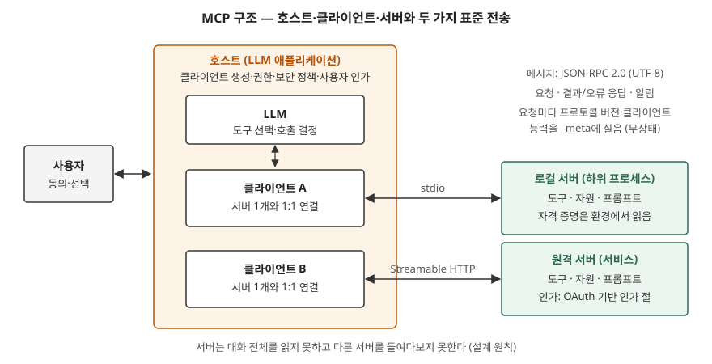

기출문제에서 MCP를 묻는다. 사내 문서 검색, 일정 조회, 이슈 등록 같은 기능을 AI 비서에 붙일 때마다
AI 제품별로 연동 코드를 따로 짜면, 붙일 기능과 AI 제품이 늘어나는 만큼 연동 작업이 곱으로 늘어난다.
MCP는 그 사이에 공통 규격을 두어 **기능 쪽은 서버를 한 번, AI 제품 쪽은 클라이언트를 한 번**만
구현하게 한다. 단답형에서 점수가 갈리는 곳은 **3역할의 관계(호스트 안의 클라이언트가 서버와 1:1)**,
**서버 기능 3가지의 제어 주체**, 그리고 **최신 개정판의 변화**다.

> 실행 검증 없음 — 프로토콜 정의를 묻는 개념 문제라 MCP 공식 사양 개정판 2026-07-28을 1차 자료로
> 썼다. 이 개정판은 이전 개정판(2025-11-25)과 연결 수립 방식이 크게 다르므로, 답안에서 버전에 따라
> 갈리는 부분은 따로 밝혔다.

---

## Ⅰ. 정의

**MCP(Model Context Protocol)** 는 **LLM 애플리케이션과 외부 데이터 원천·도구 사이의 연동을
하나의 규격으로 정한 개방형 프로토콜**이다. 메시지는 JSON-RPC 2.0을 따르고, 호스트 안의
클라이언트가 서버와 1:1로 연결되어 서버가 내놓는 도구·자원·프롬프트를 LLM이 쓰게 한다.

| 핵심 | 뜻 |
|---|---|
| ① 표준 연동 | 데이터 원천·도구를 어느 MCP 호스트에든 같은 방식으로 붙인다 |
| ② 역할 분리 | 사용자 동의와 보안 정책은 **호스트**가, 기능 제공은 **서버**가 맡는다 |

## Ⅱ. 구성요소

### 가. 구조 — 3역할과 2가지 표준 전송

> **출처**: [MCP 사양 개정판 2026-07-28 — Architecture](https://modelcontextprotocol.io/specification/latest/architecture), [Base Protocol](https://modelcontextprotocol.io/specification/latest/basic), [Transports](https://modelcontextprotocol.io/specification/latest/basic/transports)

| 역할 | 하는 일 (사양 Architecture 절) |
|---|---|
| ① 호스트 | 컨테이너이자 조정자. 클라이언트를 만들고 권한·수명주기를 관리하며 보안 정책과 사용자 인가를 맡는다. 여러 클라이언트를 둔다 |
| ② 클라이언트 | 호스트가 만들고, **정확히 하나의 서버**와 통신한다 |
| ③ 서버 | MCP 기능으로 도구·자원·프롬프트를 내놓는다. 로컬 프로세스일 수도, 원격 서비스일 수도 있다 |

사양은 설계 원칙 4가지를 든다. 서버는 **만들기 쉬워야** 하고, **조합하기 쉬워야** 하며,
**대화 전체를 읽거나 다른 서버를 들여다볼 수 없어야** 하고, 기능은 **점진적으로** 추가할 수 있어야
한다. 셋째 원칙 때문에 서버 사이의 격리와 문맥 공유 범위를 호스트가 정한다.

### 나. 기능 — 서버 3가지, 클라이언트 1가지

| 쪽 | 기능 | 내용 | 사용 시점을 정하는 주체 |
|---|---|---|---|
| 서버 | ① 도구 (Tools) | LLM이 실행하는 함수 | **모델** (model-controlled) |
| 서버 | ② 자원 (Resources) | LLM에 문맥으로 주는 데이터 | **애플리케이션** (application-driven) |
| 서버 | ③ 프롬프트 (Prompts) | 사용자가 고르는 메시지 템플릿·작업 흐름 | **사용자** (user-controlled) |
| 클라이언트 | ④ 정보 요청 (Elicitation) | 서버가 클라이언트를 거쳐 사용자에게 추가 정보를 묻는다. 폼·URL 두 방식 | 사용자 응답 |

개정판 2026-07-28에서 클라이언트 기능이던 **샘플링(Sampling)과 루트(Roots)는 폐지 예정**이 되어
새 구현에 쓰지 않도록 했고, 로깅 유틸리티도 폐지 예정이다. 이전 개정판 기준 교재에는 클라이언트
기능이 3가지로 나오므로, 답안에는 개정판을 밝히고 쓴다.

### 다. 프로토콜 계층 — 메시지 4종과 전송 2종

| 구분 | 항목 | 내용 |
|---|---|---|
| 메시지 (JSON-RPC 2.0) | 요청 | `id`(문자열·정수, null 불가)와 메서드를 갖는다 |
| | 결과 응답 | 같은 `id`와 `result`. `resultType`으로 완료·추가 입력 필요를 구분한다 |
| | 오류 응답 | 정수 `code`, `message`, 선택 `data` |
| | 알림 | `id`가 없고 받는 쪽은 응답하지 않는다 |
| 표준 전송 | stdio | 클라이언트가 띄운 하위 프로세스의 표준 입출력에 줄 단위로 메시지를 싣는다 |
| | Streamable HTTP | 메시지마다 단일 MCP 엔드포인트로 HTTP POST, 응답은 JSON 또는 요청 단위 SSE 스트림 |

사양은 **전송이 달라도 프로토콜 의미는 같다**고 정하고, 같은 메시지 형식을 지키는 사용자 정의
전송도 허용한다.

**개정판 2026-07-28은 무상태 프로토콜이다.** 요청 하나에 처리에 필요한 정보가 모두 들어가야 하고,
서버는 같은 연결의 이전 요청에 기대어 문맥을 만들면 안 된다(MUST NOT). 그래서 연결 수립용
`initialize` 핸드셰이크가 없고, **요청마다 `_meta`에 프로토콜 버전과 클라이언트 능력을 싣는다.**
서버는 지원 버전·능력을 알려 주는 `server/discover`를 반드시 구현한다. 2025-11-25 이전 개정판은
`initialize` 핸드셰이크로 세션을 맺는 방식이며, 사양은 이를 레거시로 구분한다.

## Ⅲ. 활용 및 고려사항

### 가. 활용

사내 문서 저장소·DB·업무 시스템을 MCP 서버로 한 번 감싸 두면, 사내 AI 비서·코딩 도구·업무
에이전트 등 여러 호스트가 같은 서버를 붙여 쓴다. 로컬 파일·개발 도구는 stdio 서버로, 사내 공용
서비스는 원격 HTTP 서버로 나눠 제공한다.

### 나. 고려사항 — 3가지

| 항목 | 내용 |
|---|---|
| ① 도구 실행 통제 | 사양은 도구를 호출하기 전에 호스트가 **사용자의 명시적 동의**를 받아야 한다고 적고, 도구 설명·주석은 신뢰된 서버에서 온 것이 아니면 **신뢰하지 않는다**고 적는다. 도구 결과에 숨은 지시문(간접 프롬프트 인젝션)이 LLM의 판단에 섞이므로 영향이 큰 도구는 사람 승인을 거치게 한다 |
| ② 인가와 전송 선택 | HTTP 기반 전송은 사양의 인가 절(OAuth 기반)을 따르는 것이 권고(SHOULD)이고, stdio 서버는 그 절을 따르지 않고 **환경에서 자격 증명을 읽는다.** 로컬 서버에 넘기는 키는 그 서버 전용·최소 권한으로 따로 발급한다 |
| ③ 개정판 호환 | 2026-07-28은 무상태 구조로 바뀌어 이전 개정판과 연결 방식이 다르다. 서버는 지원하지 않는 버전 요청에 지원 버전 목록과 함께 오류(`-32022`)를 돌려줘야 하고, 클라이언트는 그중 하나로 다시 요청한다. 요청을 넘나드는 상태는 클라이언트가 매 요청에 넘기는 **명시적 식별자**로만 이어야 하므로, 기존 세션 기반 서버는 설계를 바꿔야 한다 |

> 관련 답안: [기출문제 — MCP로 AI 서비스를 구축할 때의 보안 취약점과 대응 방안](../2026-11-11-mcp-ai-service-security-threats-and-controls/index.md)
>
> 개념 정리: [MCP 인가 구조 — OAuth 2.1, 보호 자원 메타데이터, 자원 지시자와 토큰 대상 검증](../../security/2026-11-11-mcp-authorization-oauth-resource-audience/index.md)
>
> 개념 정리: [MCP 개정판 2026-07-28의 무상태 전환 — 핸드셰이크 제거, 요청별 버전·능력 선언, server/discover](../../emerging-tech/2026-11-22-mcp-stateless-revision-2026-07-28/index.md)
>
> MCP 구조: [에이전트 간 상호운용 프로토콜 — 능력 공표와 과업 수명주기](../../emerging-tech/2026-10-20-agent-interop-capability-and-task-lifecycle/index.md)

끝

## 답안 작성 메모

- **먼저 쓸 것**: 정의 한 문장에 "LLM 애플리케이션 ↔ 외부 데이터·도구", "개방형 프로토콜",
  "JSON-RPC 2.0"을 넣는다. 바로 아래에 호스트 상자 안에 클라이언트 둘, 각각 서버 하나로 잇는
  그림을 그린다. 상자 7개다. **클라이언트와 서버가 1:1**이라는 점이 그림에서 보여야 한다.
- **점수가 갈리는 지점**: 서버 기능 3가지를 이름만 쓰지 않고 **제어 주체(모델·애플리케이션·사용자)**
  까지 붙이는 것이다. 도구=모델, 자원=애플리케이션, 프롬프트=사용자로 외운다.
- **버전 문제**: 교재·기출 해설 대부분은 `initialize` 핸드셰이크와 클라이언트 기능 3가지(샘플링·루트·
  정보 요청)를 쓴다. 최신 개정판을 쓰려면 개정판 날짜를 밝히고 "무상태 전환, 샘플링·루트 폐지 예정"을
  한 줄로 덧붙인다. 날짜를 밝히지 않고 섞어 쓰면 틀린 답안처럼 읽힌다.
- **시간이 모자라면**: 메시지 4종 표를 "JSON-RPC 2.0의 요청·응답·알림" 한 줄로 줄인다.
  3역할 표와 서버 기능 표, 고려사항 ①은 버리지 않는다.

## 참고 자료

- [Model Context Protocol 사양 개정판 2026-07-28 — Overview](https://modelcontextprotocol.io/specification/latest) — 정의, 서버·클라이언트 기능 목록, 유틸리티, 보안 원칙(도구 호출 전 사용자 동의, 주석 불신)
- [MCP 사양 — Architecture](https://modelcontextprotocol.io/specification/latest/architecture) — 클라이언트-호스트-서버 구조, 3역할의 책임, 설계 원칙 4가지, 샘플링·루트 폐지 예정 각주
- [MCP 사양 — Base Protocol](https://modelcontextprotocol.io/specification/latest/basic) — JSON-RPC 2.0 메시지(요청·결과·오류·알림), 무상태 원칙, 로깅 폐지 예정
- [MCP 사양 — Versioning and Compatibility](https://modelcontextprotocol.io/specification/latest/basic/lifecycle) — 요청별 버전 선언, 핸드셰이크 없음, `-32022` 오류, 레거시(2025-11-25 이전) 구분
- [MCP 사양 — Transports](https://modelcontextprotocol.io/specification/latest/basic/transports) — stdio, Streamable HTTP, 사용자 정의 전송, stdio 자격 증명 취급
- [MCP 사양 — Server Discovery](https://modelcontextprotocol.io/specification/latest/server/discover) — `server/discover` 구현 의무, 응답 필드
- [MCP 사양 — Tools](https://modelcontextprotocol.io/specification/latest/server/tools) · [Resources](https://modelcontextprotocol.io/specification/latest/server/resources) · [Prompts](https://modelcontextprotocol.io/specification/latest/server/prompts) — 각 기능의 사용자 상호작용 모델(제어 주체)
- [MCP 사양 — Elicitation](https://modelcontextprotocol.io/specification/latest/client/elicitation) — 서버가 클라이언트를 거쳐 사용자 정보를 요청하는 흐름, 폼·URL 방식
- [JSON-RPC 2.0 Specification](https://www.jsonrpc.org/specification) — 요청·응답·알림 객체
