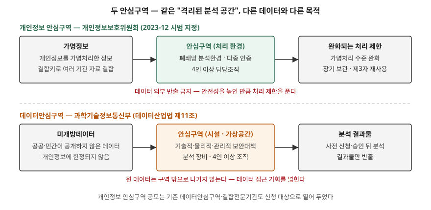

기출문제에서 이름이 비슷한 두 "안심구역"을 비교하라고 묻는다. 둘 다 **격리된 공간에서만 데이터를
분석하게 한다**는 겉모습이 같아서, 정의를 하나로 뭉뚱그려 쓰면 점수를 잃는다. 갈리는 곳은 네 가지다.
누가 무슨 근거로 지정하는가, **어떤 데이터**를 다루는가, 공간의 안전성을 높인 대가로 **무엇을 풀어
주는가**, 그리고 무엇이 구역 밖으로 나갈 수 있는가.

> 실행 검증 없음 — 제도 비교 문제라 개인정보보호위원회 보도자료와 과학기술정보통신부 공고문을
> 1차 자료로 정리했다. 데이터산업법 조문은 법령 원문 사이트가 이 환경에서 열리지 않아 공고문에
> 인용된 조문 이름과 제3자 전재 조문으로 확인했다.

---

## Ⅰ. 정의

| 구분 | 정의 |
|---|---|
| **개인정보 안심구역** | 제로 트러스트 원칙 아래 보안·개인정보보호 등 **환경적 안전성을 갖춘 곳에서 가명정보를 더 유연하게 처리**하도록 개인정보보호위원회가 지정하는 처리 환경. 2023년 12월 통계청·국립암센터를 시범 지정했다 |
| **데이터안심구역** | 기술적·물리적·관리적 보안대책을 갖춘 시설(클라우드 가상 공간 포함)에서 **미개방데이터를 안전하게 분석·활용하고 분석 결과물만 반출**하도록 과학기술정보통신부가 지정하는 구역. 근거는 「데이터 산업진흥 및 이용촉진에 관한 기본법」 제11조다 |

한 줄로 줄이면, 개인정보 안심구역은 **처리 제한을 풀어 주는 제도**이고 데이터안심구역은
**데이터 접근 기회를 열어 주는 제도**다.

## Ⅱ. 비교

> **출처**: [개인정보보호위원회 보도자료 — '개인정보 안심구역' 추가 지정 (2024-07-02)](https://www.pipc.go.kr/np/cop/bbs/selectBoardArticle.do?bbsId=BS074&mCode=C020010000&nttId=10303), [과학기술정보통신부 공고 제2026-0905호 — 2026년 하반기 데이터안심구역 지정 신청 공고 (2026-09-01)](https://grant-documents.thevc.kr/313653_1.+%28%EA%B3%B5%EA%B3%A0%EB%AC%B8%29+2026%EB%85%84+%ED%95%98%EB%B0%98%EA%B8%B0+%EB%8D%B0%EC%9D%B4%ED%84%B0%EC%95%88%EC%8B%AC%EA%B5%AC%EC%97%AD+%EC%A7%80%EC%A0%95+%EC%8B%A0%EC%B2%AD+%EA%B3%B5%EA%B3%A0.pdf) (제3자 전재)

### 가. 제도 비교 — 6가지 관점

| 관점 | 개인정보 안심구역 | 데이터안심구역 |
|---|---|---|
| ① 소관·근거 | 개인정보보호위원회. 가명정보 활용 확대방안(2023-07-21)의 과제로 **시범운영** | 과기정통부·관계 중앙행정기관. **데이터산업법 제11조**, 같은 법 시행령 제12조, 지정·운영 고시 |
| ② 대상 데이터 | **가명정보** — 개인정보를 가명처리한 것, 결합 데이터 포함 | **미개방데이터** — 공공·민간이 공개하지 않은 데이터. 개인정보에 한정되지 않는다 |
| ③ 목적 | 안전성을 높인 만큼 가명처리·보관·재사용 **제한을 완화** | 공개되지 않은 데이터를 **유출 우려 없이 분석**할 기회를 제공 |
| ④ 지정 요건 | 환경적 안전성 4가지: 4인 이상 담당조직, 오프라인 폐쇄망 분석환경, 멀티팩터 인증, 데이터 외부반출 금지 | 지정 기준 5가지: 공간·시설, 담당 조직(운영·보안책임자, 4인 이상), 장비·시스템, 기술적·물리적·관리적 보안대책(가상환경 포함), 최근 3년 법령 위반 없음 |
| ⑤ 얻는 것 | 가명처리 수준 완화, 다양한 결합키 활용, 장기 보관·제3자 재사용, 비정형 데이터 표본 검사, 개인정보보호 강화기술(PET) 실증 — **5가지** | 미개방데이터·분석 시스템·도구 지원(법 제11조 제2항), 데이터 제공 요청과 기술적·재정적 지원 |
| ⑥ 반출 통제 | 데이터 외부 반출 금지가 지정 요건 | 사전 신청·승인 뒤 분석, **분석 결과물만 반출** |

두 제도가 푸는 문제가 다르기 때문에 ③과 ⑤가 갈린다. 가명정보는 이미 처리자의 손에 있지만
가명처리 수준, 보관기간, 재사용 범위에 묶여 있다. 그래서 개인정보 안심구역은 **규칙을 풀어 주는**
쪽으로 설계됐다. 미개방데이터는 애초에 밖으로 나오지 않는 것이 문제다. 그래서 데이터안심구역은
데이터를 내주지 않고 **이용자를 데이터 쪽으로 불러들이는** 쪽으로 설계됐다.

### 나. 지정 절차 — 공통점

두 제도 모두 신청을 받아 심사위원회가 **서류 심사로 시작해 현장 확인으로 끝낸다.** 개인정보
안심구역은 서류·발표·현장실사를 거치고, 데이터안심구역은 서류·현장·최종심사를 거친다. 개인정보
안심구역은 먼저 조건부로 지정한 뒤 6개월 안에 지정요건 충족을 현장실사로 확인받게 했다.
데이터안심구역은 관리기관이 매년 관리 실적을 보고하고, 지정기준에 맞지 않게 되면 지정이 취소될 수
있다(시행령 제12조 제5항·제6항).

## Ⅲ. 활용 및 고려사항

### 가. 활용 — 어느 쪽을 고르는가

| 상황 | 맞는 제도 |
|---|---|
| 병원·공공기관의 개인 단위 자료를 결합해 **오래 두고 여러 연구에 다시 쓰려는** 경우 | 개인정보 안심구역 — 보관기간·재사용 제한이 풀린다 |
| 기업이 공개되지 않은 공공·산업 데이터(교통량, 전력, 금융 집계)를 **한 번 분석해 결과만 가져가려는** 경우 | 데이터안심구역 — 원 데이터는 남기고 결과만 반출한다 |

개인정보 안심구역 공모는 기존 **데이터안심구역과 결합전문기관도 신청 대상**으로 두었다. 같은
시설이 두 지정을 겹쳐 받을 수 있다는 뜻이므로, 운영 기관은 하나의 분석 환경 위에 두 제도의
통제를 함께 얹는 설계를 고려한다.

### 나. 고려사항 — 3가지

| 항목 | 내용 |
|---|---|
| ① 반출 심사의 자동화 | 결과물만 내보내려면 반출물에 개인 단위 값이나 소수 집계(재식별 위험)가 섞이지 않았는지 검사해야 한다. 반출 요청·승인·검사 이력을 시스템에 남긴다 |
| ② 접근 통제와 감사 기록 | 폐쇄망·다중 인증만으로는 구역 **안에서의** 오남용을 막지 못한다. 이용자·과제·데이터셋 단위 권한과 행위 로그를 남겨 사후 통제를 가능하게 한다 |
| ③ 제도의 법적 지위 | 개인정보 안심구역은 시범운영으로 출발했고, 개인정보위는 제도화를 준비하겠다고 밝혔다(2024-07). 확인한 공개 자료에서 법제화 일정은 찾지 못했으므로 장기 사업은 근거 법령의 변화를 계약·운영 계획에 반영한다 |

> 개념 정리: [개인정보 비식별·가명처리 절차와 적정성 평가 — k-익명성·ℓ-다양성·t-근접성이 막는 공격과 못 막는 공격](../../security/2026-10-08-pseudonymization-steps-k-anonymity-limits/index.md)

끝

## 답안 작성 메모

- **먼저 쓸 것**: Ⅰ의 정의 두 줄 끝에 "처리 제한 완화 vs 데이터 접근 기회"를 한 줄로 대비시킨다.
  그다음 Ⅱ-가의 비교표다. 이 문제는 비교표가 곧 답안이다.
- **점수가 갈리는 지점**: ② 대상 데이터(가명정보 vs 미개방데이터)와 ⑥ 반출 통제(외부 반출 금지 vs
  결과물만 반출)를 정확히 나누는 것. 근거를 "데이터산업법 제11조"로 조문까지 쓰면 가산점이다.
  개인정보 안심구역을 법정 제도로 쓰지 않도록 주의한다 — 확인한 자료에서는 시범운영이다.
- **시간이 모자라면**: Ⅱ-나 절차 공통점과 Ⅲ-가 활용표를 버린다. 정의, 모식도, 6관점 비교표,
  고려사항 3가지는 남긴다.
- 지정 기관 수는 해마다 바뀌므로 답안에 쓰지 않았다.

## 참고 자료

- [개인정보보호위원회 보도자료 — '개인정보 안심구역' 추가 지정 (2024-07-02)](https://www.pipc.go.kr/np/cop/bbs/selectBoardArticle.do?bbsId=BS074&mCode=C020010000&nttId=10303) — 정의, 환경적 안전성 4가지, 2024년 지정 기관, 제도화 준비 방침
- [개인정보보호위원회 보도자료 — 대폭 개선된 가명정보 활용 정책, 핵심 내용은? (2024-02-27)](https://www.pipc.go.kr/np/cop/bbs/selectBoardArticle.do?bbsId=BS074&mCode=C020010000&nttId=9953) — 완화 항목 5가지, 가명정보 활용 확대방안(2023-07-21) 과제, 통계청·국립암센터 지정
- [보안뉴스 — 개인정보위, '개인정보 안심 구역' 시범운영기관 공모 (2023-10-31)](http://www.boannews.com/news/articleView.html?idxno=123231) — 신청 대상(결합전문기관·데이터안심구역·가명정보 활용지원센터), 서류·발표·현장 심사, 조건부 지정
- [과학기술정보통신부 공고 제2026-0905호 — 2026년 하반기 데이터안심구역 지정 신청 공고 (2026-09-01)](https://grant-documents.thevc.kr/313653_1.+%28%EA%B3%B5%EA%B3%A0%EB%AC%B8%29+2026%EB%85%84+%ED%95%98%EB%B0%98%EA%B8%B0+%EB%8D%B0%EC%9D%B4%ED%84%B0%EC%95%88%EC%8B%AC%EA%B5%AC%EC%97%AD+%EC%A7%80%EC%A0%95+%EC%8B%A0%EC%B2%AD+%EA%B3%B5%EA%B3%A0.pdf) (제3자 전재) — 사업 목적, 추진 근거, 지정 기준 5가지
- 「데이터 산업진흥 및 이용촉진에 관한 기본법」 제11조(데이터안심구역 지정)·같은 법 시행령 제12조(데이터안심구역의 지정·운영 등) — 조문은 [IT위키 제11조](https://www.itwiki.kr/w/%EB%8D%B0%EC%9D%B4%ED%84%B0_%EC%82%B0%EC%97%85%EC%A7%84%ED%9D%A5_%EB%B0%8F_%EC%9D%B4%EC%9A%A9%EC%B4%89%EC%A7%84%EC%97%90_%EA%B4%80%ED%95%9C_%EA%B8%B0%EB%B3%B8%EB%B2%95_%EC%A0%9C11%EC%A1%B0)·[시행령 제12조](https://www.itwiki.kr/w/%EB%8D%B0%EC%9D%B4%ED%84%B0%EC%82%B0%EC%97%85%EB%B2%95_%EC%8B%9C%ED%96%89%EB%A0%B9_%EC%A0%9C12%EC%A1%B0) (제3자 전재)로 확인
