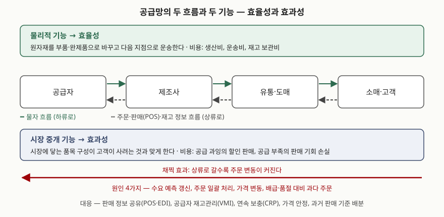

> 실행 검증 없음. 정의는 CSCMP 용어집과 ISO 9000:2015, 성과 속성은 ASCM의 SCOR Digital
> Standard 소개 문서(2020), 두 기능과 제품 유형 구분은 Fisher(1997) 원문, 채찍 효과는
> Lee 외(1997) 원문에 적힌 것만 옮겼다. 효과성·효율성과 SCOR 속성을 짝지은 것은 SCOR 문서의
> "고객 지향 / 내부 지향" 구분을 ISO 9000 정의에 맞춰 읽은 해석이며, 본문에서 해석임을 밝혔다.

문항은 두 갈래로 묻는다. 공급망관리가 무엇이고 왜 생겼는지, 그리고 공급망을 평가할 때
효과성과 효율성이 각각 무엇을 가리키는지다. 물은 순서대로 (가)를 Ⅱ장, (나)를 Ⅲ장에 쓴다.

---

## Ⅰ. 개요

공급망은 원자재 공급자에서 최종 고객까지 물자가 내려가고 주문·판매 정보가 거슬러
올라가는 기업 간 연결이다. 한 기업이 자기 재고와 생산만 최적화해도, 앞뒤 기업이 서로
다른 수요 예측으로 움직이면 사슬 전체에는 재고 과잉과 품절이 동시에 생긴다.

공급망관리(SCM)는 이 문제를 **기업 경계를 넘는 계획·정보 공유**로 푸는 관리 방식이다.
그래서 SCM은 처음부터 정보시스템의 문제였다. 판매 시점 정보(POS)를 상류에 넘기는
EDI, 공급자가 고객 재고를 대신 보고 보충하는 VMI가 SCM의 대표 수단으로 등장한 이유다.

---

## Ⅱ. 공급망관리의 정의와 배경 (가)

### 가. 정의

> 조달·구매, 변환(생산), 물류관리의 모든 활동을 계획하고 관리하는 것이며,
> **공급자·중간 유통·제3자 물류·고객 같은 채널 파트너와의 조정과 협업**을 포함한다.
> 본질적으로 **기업 안팎에 걸쳐 공급관리와 수요관리를 통합**한다.
> — CSCMP(미국 공급망관리전문가협회) 용어집의 SCM 정의를 요약

정의에서 답안에 짚을 열쇠말은 셋이다.

| 열쇠말 | 뜻 | 정보시스템에 요구하는 것 |
|---|---|---|
| ① 모든 활동 | 조달·생산·물류를 따로가 아니라 하나의 계획 대상으로 본다 | 부문별 시스템(구매·생산·창고·운송)이 같은 기준 정보를 쓴다 |
| ② 채널 파트너와 협업 | 관리 범위가 자기 회사 밖까지 넓어진다 | 기업 간 데이터 교환 표준(EDI, GS1 EPCIS 등) |
| ③ 공급과 수요의 통합 | 공급 계획이 실제 수요 신호에 맞춰 움직인다 | 하류의 판매·재고 정보가 상류 계획 시스템에 들어간다 |

SCM의 범위는 ASCM이 관리하는 SCOR 모델의 최상위 프로세스 **6가지 — 계획(Plan),
조달(Source), 생산(Make), 배송(Deliver), 반품(Return), 지원(Enable)** — 로 나눠
쓸 수 있다. 답안에서 범위를 물으면 이 6개를 쓰면 된다.

### 나. 등장 배경 — 4가지

**① 채찍 효과(bullwhip effect)**

Lee·Padmanabhan·Whang(1997)은 P&G의 기저귀 사례를 든다. 소매 판매는 큰 변동이 없는데
유통업체 주문은 더 출렁이고, 그 위 원료 공급자 주문은 더 크게 출렁였다. 논문의 핵심 문장은
**상류 지점의 변동은 항상 하류보다 크다**는 것이다. 원인으로 4가지를 든다.

| 원인 | 무슨 일이 일어나는가 | 논문이 든 대응 |
|---|---|---|
| ① 수요 예측 갱신 | 각 단계가 바로 아래의 주문을 수요로 보고 예측을 새로 고친다 | POS 판매 정보 공유, EDI, VMI·연속 보충(CRP) |
| ② 주문 일괄 처리 | 주문 비용을 아끼려고 모아서 한 번에 주문한다 | EDI로 주문 비용 절감, 혼적 배송, 제3자 물류 |
| ③ 가격 변동 | 할인 기간에 미리 사 두는 선행 구매가 생긴다 | 상시 저가(EDLP), 도매 할인 축소 |
| ④ 배급·품절 대비 과다 주문 | 공급 부족 때 배분을 더 받으려고 부풀려 주문한다 | 과거 판매 실적 기준 배분, 생산능력·재고 정보 공유 |

네 원인 중 셋의 대응이 **정보 공유**다. 각 기업이 아래 단계의 주문이 아니라 최종 수요를
보게 되면 증폭이 줄어든다. 이것이 SCM을 정보시스템 과제로 만든 직접적인 근거다.

**② 제품 다양화와 수명주기 단축**

Fisher(1997)는 유행·기술 혁신을 앞세운 **혁신적 제품**이 늘면서 수명주기가 몇 달로 짧아지고
수요 예측이 어려워졌다고 적는다. 기능적 제품을 전제로 만든 저비용 공급망으로는
혁신적 제품의 품절과 재고 처분 손실을 막지 못한다.

**③ 기업 단위 최적화의 한계**

각 기업이 자기 재고 회전율만 높이면 재고는 사라지지 않고 앞뒤 기업으로 옮겨 갈 뿐이다.
CSCMP 정의가 "기업 안팎에 걸친 통합"을 본질로 꼽는 이유다.

**④ 기업 간 정보 교환 수단의 보급**

EDI로 소매업체가 매일 수요와 물류센터 재고를 제조사에 넘길 수 있게 되면서 기업 간 계획
연동이 실제로 가능해졌다. Fisher는 Campbell Soup가 EDI로 받은 소매 재고·수요로 보충
물량을 정한 연속 보충 프로그램을 예로 든다.

---

## Ⅲ. 공급망관리에서 효과성과 효율성 (나)

### 가. 두 용어의 정의 — ISO 9000:2015

| 용어 | ISO 9000:2015의 정의 | 묻는 것 |
|---|---|---|
| 효과성(effectiveness, 3.7.11) | 계획한 활동이 실현되고 계획한 결과가 달성된 정도 | **목표한 결과를 냈는가** |
| 효율성(efficiency, 3.7.10) | 달성한 결과와 사용한 자원 사이의 관계 | **결과를 얼마의 자원으로 냈는가** |

공급망에 대입하면 효과성은 **고객이 원하는 것을 원하는 때에 받았는가**, 효율성은 **그것을
얼마의 비용과 자산으로 해냈는가**다. 효과성은 고객 쪽에서, 효율성은 회사 안에서 잰다.

### 나. Fisher의 두 기능 — 효율성과 효과성이 갈리는 지점

Fisher(1997)는 공급망이 **서로 다른 두 기능**을 수행한다고 본다.

> **출처**: [Fisher, What Is the Right Supply Chain for Your Product?, Harvard Business Review 1997년 3-4월호](https://hbr.org/1997/03/what-is-the-right-supply-chain-for-your-product), [Lee·Padmanabhan·Whang, The Bullwhip Effect in Supply Chains, Sloan Management Review 1997년 봄호](https://sloanreview.mit.edu/article/the-bullwhip-effect-in-supply-chains/)

| 구분 | 물리적 기능 | 시장 중개 기능 |
|---|---|---|
| 하는 일 | 원자재를 부품·완제품으로 바꾸고 다음 지점으로 운송 | 시장에 닿는 품목 구성이 고객이 사려는 것과 맞게 함 |
| 드는 비용 | 생산비, 운송비, 재고 보관비 | 공급 과잉 시 할인 판매 손실, 공급 부족 시 판매 기회 손실 |
| 대응하는 축 | **효율성** | **효과성** |
| 대표 지표 | 설비 가동률, 재고 회전율 | 제품 가용성(품절률), 기말 할인율 |

물리적 비용은 장부에 바로 드러나지만, 시장 중개 비용은 팔지 못한 매출과 처분 손실로 흩어져
잘 보이지 않는다. 그래서 효율성 지표만 관리하는 회사가 많다. Fisher는 컴퓨터 업체들이
가동률과 재고 회전율을 붙들고 있는데 시장은 제품 가용성을 요구한다고 지적한다.

### 다. SCOR 성과 속성 — 5가지

ASCM의 SCOR Digital Standard 소개 문서(2020)는 성과 속성 5가지를 두고, 그중 셋을
**고객 지향**, 둘을 **내부 지향**으로 나눈다.

| 구분 | 속성 | 정의 | 1수준 지표 |
|---|---|---|---|
| 고객 지향 | ① 신뢰성(Reliability) | 과업을 기대대로 수행하는 능력, 결과의 예측 가능성 | 완전 주문 충족률(RL.1.1) |
| | ② 대응성(Responsiveness) | 과업 수행 속도, 고객에게 제품을 공급하는 속도 | 주문 충족 사이클 타임(RS.1.1) |
| | ③ 민첩성(Agility) | 외부 영향과 시장 변화에 대응하는 능력 | 상향·하향 공급망 적응력(AG.1.1, AG.1.2), 전체 위험 노출 가치(AG.1.3) |
| 내부 지향 | ④ 비용(Cost) | 공급망 프로세스 운영 비용 | 총 공급망관리 비용(CO.1.1), 매출원가(CO.1.2) |
| | ⑤ 자산관리(Asset Management) | 자산을 효율적으로 활용하는 능력 | 현금 순환 주기(AM.1.1), 고정자산 수익률(AM.1.2), 운전자본 수익률(AM.1.3) |

SCOR 문서 자체는 "효과성·효율성"이라는 말을 쓰지 않는다. 다만 고객 지향 속성은 ISO 9000의
효과성(계획한 결과의 달성 정도), 내부 지향 속성은 효율성(결과 대비 자원)과 측정 대상이 같다.
답안에서는 이렇게 짝지어 쓰되, **SCOR의 원래 구분은 고객 지향·내부 지향**임을 함께 적는다.

### 라. 어느 쪽을 우선하는가 — 제품 유형과의 정합

Fisher는 두 축 중 무엇을 앞세울지를 **제품의 수요 특성**이 정한다고 본다.

| 수요 특성 | 기능적 제품 (예측 가능) | 혁신적 제품 (예측 불가) |
|---|---|---|
| 제품 수명주기 | 2년 이상 | 3개월~1년 |
| 공헌이익률 | 5~20% | 20~60% |
| 생산 확정 시점의 예측 오차 | 10% | 40~100% |
| 평균 품절률 | 1~2% | 10~40% |
| 맞는 공급망 | **효율적 공급망** | **대응적 공급망** |

| 설계 항목 | 효율적 공급망 (효율성 우선) | 대응적 공급망 (효과성 우선) |
|---|---|---|
| 주목적 | 예측 가능한 수요를 최저 비용으로 공급 | 예측할 수 없는 수요에 빨리 대응해 품절·할인·진부화 재고를 줄임 |
| 생산 | 높은 평균 가동률 유지 | 여유 생산능력을 둠 |
| 재고 | 회전율을 높이고 사슬 전체 재고 최소화 | 부품·완제품 완충 재고를 상당량 둠 |
| 리드타임 | 비용이 늘지 않는 범위에서만 단축 | 리드타임 단축에 적극 투자 |
| 공급자 선정 | 비용과 품질 | 속도, 유연성, 품질 |
| 제품 설계 | 성능 최대화, 비용 최소화 | 모듈 설계로 제품 차별화 시점을 늦춤 |

Fisher가 든 계산이 우선순위를 설명한다. 공헌이익률 40%·품절률 25%인 혁신적 제품은 품절만으로
매출의 10%(40% × 25%)에 해당하는 공헌이익을 잃는다. 기능적 제품(10% × 1%)은 0.1%다.
혁신적 제품에서는 효과성 개선 투자가 비용을 넘어서고, 기능적 제품에서는 효율성이 답이다.
**기능적 제품에 대응적 공급망, 혁신적 제품에 효율적 공급망**을 쓰는 불일치가 문제의 원인이다.

### 마. 정보시스템이 두 축을 지원하는 방식

| 축 | 정보 수단 | 줄이는 것 |
|---|---|---|
| 효과성 | POS 판매 정보 공유, VMI, 조기 주문 접수로 수요 신호를 상류에 직접 전달 | 예측 오차, 품절, 기말 할인 |
| 효과성 | 생산능력·재고 정보 공유, 과거 실적 기준 배분 | 품절 대비 과다 주문 |
| 효율성 | EDI 전자 주문으로 주문 처리 비용 절감 → 소량 다빈도 주문 가능 | 일괄 주문으로 생긴 재고, 처리 인력 |
| 효율성 | 연속 보충(CRP)으로 보충 물량을 실수요에 맞춤 | 사슬 전체 재고, 재고 보관비 |
| 양쪽 | GS1 EPCIS 같은 이벤트 공유 표준으로 무엇이·언제·어디서를 기업 간에 기록 | 추적에 드는 수작업, 정보 지연 |

같은 정보 공유가 양쪽에 동시에 기여한다는 점이 핵심이다. 채찍 효과를 줄이면 상류의 여유
재고(효율성)와 하류의 품절(효과성)이 함께 준다. 두 축이 항상 맞바꿈 관계인 것은 아니고,
**정보가 부족해서 생긴 손실**은 정보시스템으로 양쪽을 함께 줄일 수 있다.

---

## Ⅳ. 결론

공급망관리는 조달·생산·물류를 채널 파트너와 함께 계획해 **기업 안팎의 공급과 수요를
통합**하는 관리 방식이며, 채찍 효과와 제품 수명주기 단축이 그 배경이다.

공급망의 효과성은 고객이 원하는 것을 원하는 때에 받았는가(신뢰성·대응성·민첩성)이고,
효율성은 그것을 얼마의 비용과 자산으로 해냈는가(비용·자산관리)다. 어느 쪽을 앞세울지는
제품의 수요 특성이 정하며, 예측 가능한 기능적 제품은 효율성, 예측이 어려운 혁신적 제품은
효과성을 우선한다.

정보관리 관점의 결론은 두 가지다. 첫째, SCM 시스템의 성과 지표는 가동률·재고 회전율 같은
내부 지표만이 아니라 완전 주문 충족률·품절률 같은 고객 지표를 함께 잡아야 한다. 둘째,
판매 정보의 기업 간 공유는 효율성과 효과성을 함께 올리는 몇 안 되는 수단이므로, 교환 표준과
데이터 품질 관리가 SCM 구축의 선행 과제다.

> 개념 정리: [채찍 효과(Bullwhip Effect) — 4가지 원인과 정보 공유 대응](../../it-management/2026-11-22-bullwhip-effect-four-causes-information-sharing/index.md)

끝

---

## 답안 작성 메모

- **분량 배분**: (가) 1장, (나) 2장. (가)는 정의 박스와 채찍 효과 표, (나)는 두 기능 표와
  SCOR 속성 표, 제품 유형 정합 표가 뼈대다.
- **먼저 쓸 것**: ① CSCMP 정의 한 줄, ② ISO 9000의 두 정의, ③ 도식(두 흐름·두 기능).
  이 셋이 있으면 (나)의 논리가 선다.
- **점수가 갈리는 지점 셋**
  1. **효과성과 효율성을 정의로 구분했는가.** "효과성=옳은 일, 효율성=일을 옳게"만 쓰면
     평범하다. ISO 9000 정의를 쓰고 공급망 지표로 내려가야 한다
  2. **둘의 비중이 제품에 따라 달라진다는 점.** Fisher의 기능적·혁신적 제품 구분과
     불일치 문제를 쓰면 두 개념을 나열한 답안과 구별된다
  3. **정보시스템으로 연결했는가.** 채찍 효과의 대응이 대부분 정보 공유라는 점과,
     정보 공유가 두 축을 함께 올린다는 점이 정보관리기술사 답안의 축이다
- **시간이 모자라면 버릴 것**: Ⅱ-나 ③·④, Ⅲ-마 표의 마지막 줄. 비교표는 Ⅲ-라 설계 항목 표를
  남긴다.
- **쓰지 말 것**: SCM 도입으로 재고가 몇 % 줄었다는 식의 효과 수치. 원 출처를 확인한 수치는
  Fisher의 수요 특성 표와 품절 계산뿐이다. SCOR는 이후 개정판에서 프로세스·속성 구성이
  바뀌었을 수 있으므로, 답안에는 기준판(2020 소개 문서)의 5가지 속성을 쓴다고 밝힌다.

---

## 참고 자료

- [CSCMP Supply Chain Management Definitions and Glossary](https://cscmp.org/CSCMP/Educate/SCM_Definitions_and_Glossary_of_Terms.aspx) — SCM 정의 (2026-11 열람)
- [ISO 9000:2015 Quality management systems — Fundamentals and vocabulary (ISO, 2015-09-15)](https://www.iso.org/standard/45481.html) — 효율성(3.7.10), 효과성(3.7.11) 정의
- [SCOR Digital Standard — Introduction and Front Matter (ASCM, 2020)](https://www.ascm.org/globalassets/ascm_website_assets/docs/intro-and-front-matter-scor-digital-standard.pdf) — 6개 관리 프로세스, 성과 속성 5가지(표 1)와 고객 지향·내부 지향 구분, 1수준 지표(표 2)
- [Fisher, What Is the Right Supply Chain for Your Product?, Harvard Business Review 1997년 3-4월호](https://hbr.org/1997/03/what-is-the-right-supply-chain-for-your-product) — 물리적 기능과 시장 중개 기능, 기능적·혁신적 제품 수요 특성 표, 효율적·대응적 공급망 비교 표, 정합 행렬
- [Lee·Padmanabhan·Whang, The Bullwhip Effect in Supply Chains, Sloan Management Review 1997년 봄호 (1997-04-15)](https://sloanreview.mit.edu/article/the-bullwhip-effect-in-supply-chains/) — 채찍 효과의 4가지 원인과 대응
- [EPCIS (GS1)](https://www.gs1.org/epcis) — 기업 간 공급망 이벤트 공유 표준
