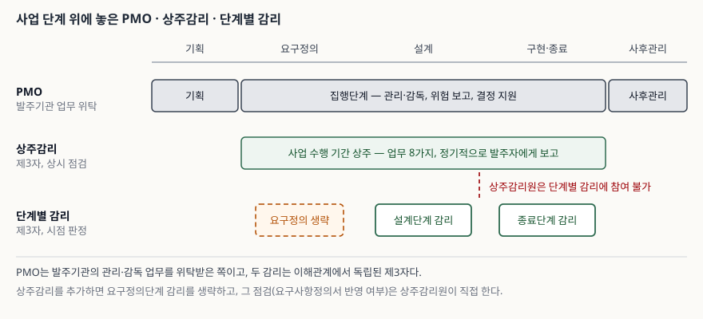

기출문제에서 공공 정보화사업을 관리하는 두 장치, 정보시스템 감리와 PMO(전자정부사업관리
위탁)를 함께 묻는다. 감리의 법적 근거, PMO의 정의와 역할, PMO 대상 사업의 범위를 차례로
쓰고, 마지막에 PMO와 상주감리를 비교하라는 문제다. 네 문항이 "가. 나. 다. 라."로 나뉘어
있으므로 그 순서대로 대항목을 세운다.

> 실행 검증 없음. 법령·행정규칙 조문을 근거로 정리한 답안이다. 조문은 2026년 11월
> 현재 시행 중인 판본을 국가법령정보센터와 법령 전재 사이트에서 확인했고,
> `environment`에 판본을 적었다. 수치는 조문에 적힌 금액·기간만 썼다.

---

## Ⅰ. 개요

공공 정보화사업에서 발주기관은 계약 당사자이면서 동시에 산출물을 검수하는 쪽이다.
그런데 정보시스템의 과업 이행 여부는 요구사항정의서·설계서·시험결과서 같은 산출물 안에만
남고, 그 산출물은 수행사업자가 만든다. 발주기관에 사업관리 인력과 기술 역량이 모자라면
요구사항 변경, 일정 지연, 품질 미달을 제때 잡아내지 못한다.

법은 이 공백을 **2가지 장치**로 메운다.

| 장치 | 근거 | 누구 편인가 |
|---|---|---|
| 정보시스템 감리 | 전자정부법 제57조 | 발주기관·사업자 양쪽에서 독립된 제3자 |
| 전자정부사업관리 위탁(PMO) | 전자정부법 제64조의2 | 발주기관의 관리·감독 업무를 위탁받은 자 |

둘은 대체 관계가 아니다. 감리는 **점검하고 판정**하고, PMO는 발주기관을 대신해
**관리하고 조정**한다. 그 사이에 사업 기간 내내 현장에 머무는 상주감리가 있어 PMO와 자주
혼동된다. 이 답안은 이 경계를 조문으로 가른다.

## Ⅱ. 정보시스템 감리의 법적 근거

### 가. 법·시행령·고시의 3계층 구조

| 계층 | 조문 | 정하는 것 |
|---|---|---|
| 법률 | 전자정부법 제2조제14호 | 정보시스템 감리의 정의 |
| 법률 | 제57조제1항~제7항 | 감리 의무, 개입 금지, 결과 반영 의무, 감리기준 고시 |
| 법률 | 제58조 · 제60조 | 감리법인 등록, 감리원 자격·교육·감리원증 |
| 시행령 | 제71조 | 감리 대상 3가지, PMO 위탁 시 감리 면제 범위 |
| 시행령 | 제72조 | 감리법인 업무범위, 감리 절차 7단계 |
| 고시 | 정보시스템 감리기준 | 감리 시기(3단계·2단계·상주), 인력 배치, 단계별 절차 |

### 나. 핵심 조문 5가지

① **정의(법 제2조제14호)** — 감리발주자와 피감리인의 이해관계로부터 독립된 자가
제3자의 관점에서 정보시스템의 구축·운영을 종합적으로 점검하고 문제점을 개선하도록 하는 것.

② **감리 의무(법 제57조제1항)** — 행정기관등의 장은 대통령령이 정한 기준에 해당하는
정보시스템에 대해 등록된 감리법인으로 하여금 감리를 **하게 하여야 한다.** 재량이 아니라
의무다.

③ **감리 대상 3가지(시행령 제71조제1항)**

- 대국민 행정·민원 업무용이거나 여러 중앙행정기관등이 공동으로 구축·사용하는 시스템
  (사업비 1억원 미만이고 비용 대비 효과가 낮다고 기관장이 인정하면 제외)
- 사업비 5억원 이상인 정보시스템 구축사업
- 정보기술아키텍처·정보화전략계획 수립 등 기관장이 감리가 필요하다고 인정한 사업

④ **양방향 의무(법 제57조제2항·제3항)** — 발주기관 직원과 사업자는 정당한 사유 없이
감리원 업무에 개입하지 못하고, 발주기관은 사업자가 **감리결과를 반영하게 하여야 한다.**

⑤ **감리기준 위임(법 제57조제5항)** — 행정안전부장관이 업무범위·절차·준수사항을
고시한다. 현행 고시는 감리 시기를 **3단계감리**(요구정의·설계·종료)로 두고, 사업비
20억원 미만이거나 사업기간 6개월 미만이면 **2단계감리**를 허용한다(감리기준 제3조제1항).

## Ⅲ. PMO의 정의와 역할

### 가. 정의

법 제64조의2제1항은 행정기관등의 장이 전자정부사업을 **관리·감독하는 업무**를
"전자정부사업관리"라 부르고, 그 전부 또는 일부를 **전문지식과 기술능력을 갖춘 자에게
위탁할 수 있다**고 정한다. 위탁받아 수행하는 자가 **전자정부사업관리자(PMO)**다
(같은 조 제2항).

답안 첫 줄은 이렇게 쓴다. **PMO는 발주기관이 전자정부사업의 관리·감독 업무를 전문 사업자에게
위탁해, 기획부터 사후관리까지 발주기관 편에서 사업을 관리하게 하는 제도다.** 감리와 달리
"할 수 있다"로 끝나는 선택 제도다.

### 나. 역할 — 위탁 단계 3가지와 단계별 업무

위탁은 **기획·집행·사후관리 3단계 전부**가 원칙이고, 사업 특성에 따라 기획단계나
사후관리단계를 뺄 수 있다(위탁 규정 제4조제1항). 단계별 업무는 위탁 규정 제14조제1항이
정한다.

| 단계 | 업무 | 정보시스템 관점에서 남기는 것 |
|---|---|---|
| 기획 | ① 사업계획 수립 지원 ② 성과목표 설정 등 성과관리 지원 | 요구사항 기준선, 성과지표 |
| 집행 | ① 관리·감독 ② 공정단계별 계획 검토·조정·이행 점검 ③ 쟁점·위험 식별·분석·보고와 대안 제시 ④ 보고·의사결정 지원 ⑤ 의사결정 사항 지시·관리와 이행 점검 | WBS 대비 실적, 위험·쟁점 대장, 의사결정 기록 |
| 사후관리 | ① 하자보수 등 안정화 지원 ② 교육·홍보 등 이용 활성화 지원 | 장애·하자 이력, 이용 현황 |

### 다. 수행조직 3역할과 지켜야 할 것

PMO 수행조직은 **수행책임자**(총괄·지휘, 이해관계자 의사소통), **관리지원인력**(일정·위험·
품질관리), **기술지원인력**(응용·DB·아키텍처·보안 분야 기술지원) **3역할**로 짠다
(위탁 규정 제13조제2항).

그리고 3가지를 지킨다.

- 자기나 계열회사가 그 사업을 도급받도록 조언하지 못한다(법 제64조의2제3항)
- PMO·수행사업자·감리법인 상호간에 독립성을 해칠 특수관계가 없어야 한다(위탁 규정 제6조)
- 계약 위반이나 고의·과실로 발주자에게 손해를 입히면 배상한다(법 제64조의3)

## Ⅳ. PMO 대상 사업의 범위

### 가. 법률이 정한 3가지(법 제64조의2제1항)

1. 대국민 서비스와 행정의 효율성에 미치는 영향이 큰 사업
2. 난이도가 높아 특별한 관리가 필요한 사업
3. 그 밖에 행정기관등의 장이 위탁이 필요하다고 인정하는 경우

### 나. 시행령이 구체화한 4가지(시행령 제78조의2제1항)

| 호 | 대상 | 조문이 든 예 |
|---|---|---|
| 1 | 국민생활의 편의와 안전에 필요한 정보시스템을 구축·고도화하는 사업 | 전자민원창구, 재난안전관리 시스템 |
| 2 | 여러 중앙행정기관등이 공통으로 써서 행정 효율성에 큰 영향을 주는 시스템을 구축·고도화하는 사업 | 행정기관 내 전자문서유통 시스템 |
| 3 | 둘 이상의 정보시스템이 통합·연계되어 고도의 사업관리 역량이 필요한 사업 | 행정정보 공동이용시스템 |
| 4 | 기관장이 위탁이 필요하다고 인정하는 사업 — 가) 기관의 경험·전문성·인력 부족, 나) 중요도·난이도가 1~3호에 준함 | — |

3호가 정보관리기술사 답안에서 가장 쓸 거리가 많다. 시스템 간 연계가 늘어나면 인터페이스
정의, 데이터 표준, 연계 시험 일정이 기관 경계를 넘나들고, 한 기관의 사업관리 인력으로는
조정이 안 된다. 그래서 연계·통합 자체를 위탁 사유로 둔다.

### 다. 범위와 맞물린 절차 2가지

- **추진계획 제출(시행령 제78조의2제2항)** — 매년 12월 31일까지 다음 해 위탁 추진계획을
  행정안전부장관에게 내고, 장관은 15일 이내에 정보통신망으로 공개한다.
- **감리 면제와의 연결(법 제57조제1항 단서, 시행령 제71조제2항)** — PMO를 위탁한 사업 중
  ① 대국민·공동 사용 시스템으로서 사업비 1억원 이상 5억원 미만인 사업, ② 사업기간 5개월
  미만 구축사업은 감리 의무에서 빠진다. 이때 PMO는 **검사 전에 과업내용 이행 여부를
  점검해야 한다**(위탁 규정 제14조제3항). 감리가 하던 이행 점검이 PMO로 넘어가는 것이다.

## Ⅴ. PMO와 상주감리의 비교

### 가. 상주감리의 위치

상주감리는 단계별 감리에 **추가로** 두는 감리다. 대기업 소프트웨어사업자의 참여가 제한되는
사업(소프트웨어 진흥법 제48조제2항)이거나 위험도·난이도가 높은 사업이 대상이다
(감리기준 제3조제2항). 상주감리를 추가하면 요구정의단계 감리는 생략하고, 요구사항정의서의
과업내용 반영 여부는 상주감리원이 직접 점검한다.

> **출처**: [전자정부사업관리 위탁에 관한 규정(행정안전부고시 제2024-54호) 제4조·제14조](https://www.law.go.kr/%ED%96%89%EC%A0%95%EA%B7%9C%EC%B9%99/%EC%A0%84%EC%9E%90%EC%A0%95%EB%B6%80%EC%82%AC%EC%97%85%EA%B4%80%EB%A6%AC%EC%9C%84%ED%83%81%EC%97%90%EA%B4%80%ED%95%9C%EA%B7%9C%EC%A0%95) · [정보시스템 감리기준(행정안전부고시 제2024-53호) 제3조·제10조의2](https://www.law.go.kr/%ED%96%89%EC%A0%95%EA%B7%9C%EC%B9%99/%EC%A0%95%EB%B3%B4%EC%8B%9C%EC%8A%A4%ED%85%9C%EA%B0%90%EB%A6%AC%EA%B8%B0%EC%A4%80)

### 나. 비교표

| 구분 | PMO(전자정부사업관리자) | 상주감리 |
|---|---|---|
| 근거 | 전자정부법 제64조의2, 위탁 규정 | 전자정부법 제57조, 감리기준 제3조제2항·제10조의2 |
| 제도 성격 | 선택("위탁할 수 있다") | 단계별 감리에 추가하는 감리 |
| 법적 지위 | 발주기관의 관리·감독 업무 **수탁자** | 이해관계에서 **독립된 제3자** |
| 투입 기간 | 기획·집행·사후관리 3단계 | 사업 수행 기간 |
| 핵심 업무 | 관리·감독, 공정 조정, 쟁점·위험 보고, 의사결정 사항 지시·이행 관리 | 업무 8가지 — 계획·WBS 검토, 요구사항 구체화·변경 검토, 실적 점검, 산출물 품질 검토, 위험 파악, 쟁점 기술검토, 의사결정 지원·자문, 기타 점검 |
| 사업자에 대한 행위 | 의사결정 사항을 **지시**하고 이행을 관리 | **점검·검토**하고 개선방안을 제시 |
| 보고 대상 | 발주기관 | 발주자에게 정기 보고 |
| 인력 요건 | 수행책임자·관리지원·기술지원 3역할 | 수석감리원 — 사업비 20억원 이상 감리 3회 이상, PM·QA 경력 3년 이상 등 |
| 독립성 제약 | 수행사업자·감리법인과 특수관계 금지, 도급 조언 금지 | 단계별 감리의 감리원으로 참여 금지 |
| 책임 | 계약 위반·고의·과실 손해배상(법 제64조의3) | 감리법인의 감리 책임 |

### 다. 갈라지는 지점 3가지

① **편에 서는가, 떨어져 있는가.** PMO는 발주기관의 일을 위탁받아 대신한다. 상주감리는
발주기관에도 사업자에도 속하지 않는다. 그래서 PMO는 "지시"할 수 있고, 상주감리는
"검토·제시"까지만 한다.

② **업무 목록이 겹친다.** 계획 검토, 실적 점검, 위험 식별, 의사결정 지원은 두 조문에 모두
있다. 그래서 둘을 한 사업에 함께 두면 같은 산출물을 두 번 보게 된다. 발주기관은 계약서에서
누가 무엇을 판단하는지를 항목 단위로 나눠야 한다.

③ **판정은 둘 다 하지 않는다.** 적합·부적합 판정은 단계별 감리의 몫이다. 상주감리원이
단계별 감리에 들어가지 못하게 한 것(감리기준 제10조의2제3항)과 PMO·감리법인의 특수관계를
막은 것(위탁 규정 제6조)은 같은 원칙이다. **자문하거나 관리한 사람이 그 결과를 판정하지
않는다.**

## Ⅵ. 결론

감리와 PMO는 공공 정보화사업의 관리 공백을 서로 다른 자리에서 메운다. 감리는 법 제57조의
의무 제도로 제3자 판정을 보장하고, PMO는 법 제64조의2의 선택 제도로 발주기관의 관리 역량을
보강한다. 상주감리는 감리 쪽에 서 있으면서 사업 기간 내내 현장에 머무는 형태다.

정보시스템 관점에서 이 셋이 남기는 것은 결국 **추적 가능한 기록**이다. 요구사항 기준선,
WBS 대비 실적, 쟁점·위험 대장, 의사결정 기록, 과업내용 대비표가 남아야 감리는 판정할 근거를,
PMO는 지시한 근거를, 발주기관은 사업 종료 후에도 운영·개선할 근거를 갖는다. 세 장치를 함께
쓸 때는 업무 목록이 겹치는 부분을 계약 단계에서 나누고, 관리·자문하는 자리와 판정하는 자리를
섞지 않는 것이 전제다.

> 개념 정리: [정보시스템 감리 — 제3자 점검이 법으로 자리 잡은 구조](../../it-management/2026-09-21-information-system-audit/index.md)
>
> 기출 답안: [기출문제 — PMC와 PMO 비교](../2026-09-21-pmc-pmo/index.md)

끝

## 답안 작성 메모

- **먼저 쓸 것**: Ⅰ의 2행 표. "감리는 독립된 제3자, PMO는 발주기관 업무의 수탁자"라는
  한 줄이 네 문항 전체의 축이다. 이것을 먼저 세우면 (라)의 비교가 저절로 따라온다.
- **점수가 갈리는 지점**:
  - (가)에서 조문 번호를 법·시행령·고시 **3계층**으로 대는 것. 제57조 하나만 쓰면 반쪽이다.
  - (다)에서 법률 **3가지**와 시행령 **4가지**를 구분하는 것. 시행령 3호(통합·연계)를
    정보시스템 관점으로 풀면 다른 답안과 차이가 난다.
  - (라)에서 상주감리가 **단계별 감리에 추가하는 것**이고 PMO와 업무 목록이 겹친다는 점,
    그리고 상주감리원은 단계별 감리에 참여할 수 없다는 점.
- **시간이 모자라면**: (가)의 3계층 표를 법 제57조·시행령 제71조·감리기준 3줄로 줄이고,
  (라) 비교표를 근거·지위·투입 기간·핵심 업무·독립성 5행만 남긴다. 모식도와 비교표는 버리지
  않는다.
- **빠지기 쉬운 함정**:
  - PMO 위탁 대상을 "대국민 서비스·고난이도 2가지"로만 쓰는 것. 법률은 기관장 인정을 포함해
    3가지를 들고, 시행령은 4호로 구체화한다.
  - 상주감리가 PMO를 대신한다고 쓰는 것. 근거 법조문이 다르고 지위가 반대다.
  - 감리 면제 범위를 "PMO를 쓰면 감리가 면제된다"로 뭉뚱그리는 것. 면제는 시행령
    제71조제2항의 두 경우뿐이다.
- 개수를 붙인다 — 장치 2가지, 감리 대상 3가지, 감리 시점 3단계, PMO 위탁 3단계, 수행조직
  3역할, 법률상 대상 3가지, 시행령상 대상 4가지, 상주감리 업무 8가지.

## 참고 자료

- [전자정부법(법률 제21394호, 2026.2.27.) 제2조제14호·제57조·제58조·제60조·제64조의2·제64조의3 — 국가법령정보센터](https://www.law.go.kr/%EB%B2%95%EB%A0%B9/%EC%A0%84%EC%9E%90%EC%A0%95%EB%B6%80%EB%B2%95) · [삼일 법령 조문 페이지 (제3자 전재)](https://www.samili.com/law/Content.asp?bcode=2082-1)
- [전자정부법 시행령(대통령령 제36605호, 2026.8.25.) 제71조·제72조·제78조의2 — 국가법령정보센터](https://www.law.go.kr/%EB%B2%95%EB%A0%B9/%EC%A0%84%EC%9E%90%EC%A0%95%EB%B6%80%EB%B2%95%EC%8B%9C%ED%96%89%EB%A0%B9) · [삼일 법령 조문 페이지 (제3자 전재)](https://www.samili.com/law/Content.asp?bcode=2082-2)
- [정보시스템 감리기준(행정안전부고시 제2024-53호, 2024.6.27.) 제3조·제5조·제10조의2 — 국가법령정보센터](https://www.law.go.kr/%ED%96%89%EC%A0%95%EA%B7%9C%EC%B9%99/%EC%A0%95%EB%B3%B4%EC%8B%9C%EC%8A%A4%ED%85%9C%EA%B0%90%EB%A6%AC%EA%B8%B0%EC%A4%80)
- [전자정부사업관리 위탁에 관한 규정(행정안전부고시 제2024-54호, 2024.6.27.) 제4조·제6조·제13조·제14조 — 국가법령정보센터](https://www.law.go.kr/%ED%96%89%EC%A0%95%EA%B7%9C%EC%B9%99/%EC%A0%84%EC%9E%90%EC%A0%95%EB%B6%80%EC%82%AC%EC%97%85%EA%B4%80%EB%A6%AC%EC%9C%84%ED%83%81%EC%97%90%EA%B4%80%ED%95%9C%EA%B7%9C%EC%A0%95)
