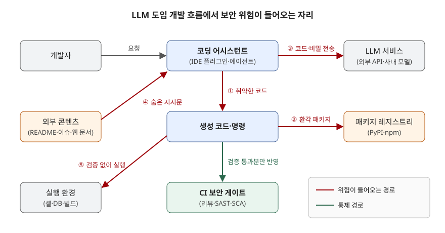

> 실행 검증 없음. OWASP Top 10 for LLM Applications 2025와 NIST AI 600-1(생성형 AI 프로필)을
> 뼈대로 쓰고, 수치는 원 논문 두 편(동료 심사를 거친 학회 논문)의 초록에 적힌 값만 옮겼다.

LLM을 소프트웨어 개발 과정에 들일 때 생기는 보안 위험을 셋 이상 들고, 위험마다 대응을 설명하라는
문제다. 두 가지를 물었다 — 위험과 대응. 문항이 "각 대응 방안"이라고 짝을 지어 물었으므로
Ⅱ에서 위험을 번호로 쓰고, Ⅲ에서 같은 번호로 대응을 맞춘다. 셋 이상을 요구했으니 다섯을 쓴다.

---

## Ⅰ. 개요

### 가. AI 기반 소프트웨어 개발에서 LLM이 들어오는 자리

AI 기반 소프트웨어 개발이란 **LLM이 코드 작성·설명·리뷰·테스트 생성·명령 실행 같은 개발 활동을
보조하거나 대신 수행하는 개발 방식**이다. LLM은 세 가지 형태로 들어온다.

| 형태 | 하는 일 | LLM이 쥐는 권한 |
|---|---|---|
| 코드 완성 | 편집 중인 파일의 다음 줄·함수 제안 | 없음 (사람이 받아들일 때만 반영) |
| 대화형 어시스턴트 | 질문에 답하며 코드·명령 제시 | 없음 (사람이 복사해 씀) |
| 코딩 에이전트 | 저장소를 읽고 파일 수정·셸 명령·패키지 설치 수행 | 개발자 계정 권한 그대로 |

### 나. 보안 위험이 새로 생기는 이유

NIST AI 600-1은 생성형 AI의 정보보안 위험을 **두 축**으로 정리한다. 공격자의 공격 능력을 끌어올리는
축과, **생성형 AI 자체가 프롬프트 인젝션·데이터 오염에 취약해 공격 표면을 넓히는 축**이다.
개발 조직이 LLM을 도입할 때 직접 떠안는 것은 둘째 축이다.

| 구분 | 기존 개발 | LLM 도입 개발 |
|---|---|---|
| 코드 작성 주체 | 사람 (의도를 설명할 수 있음) | 모델 (그럴듯하지만 근거 없는 코드도 냄) |
| 의존성 선택 | 개발자가 검색·평가 | 모델이 이름을 제안, 실재하지 않는 이름도 나옴 |
| 코드가 나가는 곳 | 사내 저장소 | 프롬프트로 LLM 서비스에 전송 |
| 지시가 들어오는 자리 | 개발자 | 개발자 + **모델이 읽는 모든 문서** |
| 명령 실행 | 사람이 판단 후 실행 | 에이전트가 생성 직후 실행 가능 |

---

## Ⅱ. LLM 도입 시 보안 위험

### 가. 위험이 들어오는 자리 — 5가지

> **출처**: [OWASP Top 10 for LLM Applications 2025 — LLM01·LLM02·LLM05·LLM06·LLM09](https://genai.owasp.org/llm-top-10/), [NIST AI 600-1 §2.9 Information Security (2024-07)](https://nvlpubs.nist.gov/nistpubs/ai/NIST.AI.600-1.pdf)

### 나. 위험별 설명

**① 취약한 코드 생성 (OWASP LLM09 Misinformation — Unsafe Code Generation)**
LLM은 학습 데이터에 섞인 취약한 코드 패턴을 그대로 재현한다. 문법상 맞고 동작도 하므로 리뷰에서
걸러지기 어렵다. Pearce 등은 고위험 CWE에 해당하는 89개 시나리오로 GitHub Copilot이 만든 프로그램
1,689개를 분석해 **약 40%가 취약**했다고 보고했다(IEEE S&P 2022). 2021년 모델을 대상으로 한
측정이므로 현재 모델의 비율로 읽으면 안 되지만, **생성 코드를 검증 없이 받아들이면 취약점이 함께
들어온다**는 근거로는 충분하다. OWASP는 여기에 사람이 출력을 확인하지 않는 **과신(overreliance)**
이 피해를 키운다고 덧붙인다.

**② 환각 패키지와 공급망 오염 (OWASP LLM09 공격 시나리오, LLM05 공격 시나리오)**
LLM은 **존재하지 않는 패키지 이름**을 자신 있게 제안한다. 공격자는 코딩 어시스턴트가 자주 지어내는
이름을 미리 찾아 그 이름으로 악성 패키지를 공개 레지스트리에 올리고, 제안을 믿은 개발자가 설치하게
만든다. Spracklen 등은 16개 모델이 만든 코드 576,000건에서 환각 패키지 비율이 상용 모델 평균
**5.2% 이상**, 공개 모델 평균 **21.7%**였고, 서로 다른 환각 이름이 **205,474개** 나왔다고
보고했다(USENIX Security 2025). 기존 타이포스쿼팅은 개발자의 오타를 노리지만, 이 공격은 **모델이
반복해서 내는 같은 이름**을 노리므로 미리 선점할 수 있다는 점이 다르다.

**③ 소스코드·비밀 정보 유출 (OWASP LLM02 Sensitive Information Disclosure)**
코드 문맥을 이해시키려면 프롬프트에 소스코드·설정 파일·로그를 넣게 된다. 그 안의 **API 키, DB
접속 정보, 개인정보, 영업비밀 알고리즘**이 외부 LLM 서비스로 넘어간다. 서비스가 입력을 보관하거나
학습에 쓰면 통제 범위를 벗어난다. OWASP는 대응으로 사용자 교육(민감 정보를 넣지 않기)과 **데이터
보관·이용 정책 명시 및 학습 제외(opt-out)** 를 든다. NIST AI 600-1의 데이터 프라이버시 위험도
민감 정보의 유출·무단 사용을 같은 축에 둔다.

**④ 간접 프롬프트 인젝션을 통한 개발 도구 탈취 (OWASP LLM01 + LLM06 Excessive Agency)**
코딩 에이전트는 저장소의 README·이슈·주석, 검색한 웹 문서를 읽는다. 그 안에 숨은 지시문이 있으면
모델이 이를 개발자의 지시와 구분하지 못하고 따른다. 에이전트가 셸 실행·파일 쓰기·푸시 권한을
쥐고 있으면 인젝션이 곧 **비밀 정보 반출, 악성 코드 삽입, 저장소 변조**가 된다. OWASP LLM06은 피해를
키우는 원인을 **과도한 기능·권한·자율** 셋으로 나눈다.

**⑤ LLM 출력의 무검증 실행 (OWASP LLM05 Improper Output Handling)**
LLM이 만든 셸 명령, SQL, 파일 경로를 검증 없이 실행 환경에 넘기면 원격 코드 실행, SQL 인젝션,
경로 조작이 된다. OWASP는 자연어로 코드를 생성하는 시스템을 별도 공격 시나리오로 들어 SQL 인젝션과
민감 정보 노출 위험을 적는다. ①이 **저장소에 남는 코드**의 문제라면 ⑤는 **즉시 실행되는 출력**의
문제다.

---

## Ⅲ. 위험별 대응 방안

### 가. 위험과 대응을 같은 번호로 맞춘다

| 번호 | 위험 | 대응 방안 | 근거 |
|---|---|---|---|
| ① | 취약한 코드 생성 | 생성 코드를 사람이 쓴 코드와 **같은 기준으로** 리뷰, CI에 정적 분석(SAST) 필수 적용, 시큐어 코딩 규칙을 프롬프트·리뷰 체크리스트에 반영 | OWASP LLM09 대응 — 시큐어 코딩 관행, 교차 검증·사람의 감독 |
| ② | 환각 패키지 | 설치 전 **패키지 실재·유지 이력 확인**, 사내 미러·허용 목록으로만 설치, 버전·해시 고정, 의존성 분석(SCA)과 SBOM | OWASP LLM05 시나리오 대응 — 코드 리뷰와 제안 패키지 검증 / LLM09 공격 시나리오 |
| ③ | 코드·비밀 유출 | 입력 보관·학습 제외 계약이 된 서비스나 사내 배치 모델만 허용, 프롬프트 전송 전 **비밀 탐지·마스킹**, 키는 코드에 두지 않고 비밀 저장소로 | OWASP LLM02 대응 — 정제(sanitization), 데이터 보관 정책·학습 제외, 토큰화·삭제 |
| ④ | 간접 인젝션·과도한 권한 | 에이전트에 **업무에 필요한 도구만**, 격리된 작업 공간(컨테이너)에서 실행, 푸시·배포·외부 전송은 사람 승인, 외부 문서는 신뢰하지 않는 입력으로 분리 | OWASP LLM01 외부 콘텐츠 분리, LLM06 기능·권한·자율 최소화 |
| ⑤ | 출력의 무검증 실행 | 모델을 **신뢰하지 않는 사용자로 취급**(제로 트러스트), SQL은 매개변수화, 명령은 허용 목록·샌드박스, 출력 인코딩 | OWASP LLM05 대응 1·4·5 |

### 나. 개발 단계별 통제 — 한 곳에서 다 막지 않는다

위 다섯 위험은 들어오는 단계가 다르다. 하나의 통제로 막으려 하면 빈틈이 생기므로 단계마다 통제를
나눠 둔다.

| 개발 단계 | 통제 | 겨냥하는 위험 |
|---|---|---|
| 도입 계획 | 사용 가능 서비스·모델 목록, 데이터 등급별 입력 허용 범위, 입력 보관·학습 조건 계약 | ③ |
| 코딩 | IDE 비밀 탐지, 에이전트 권한 최소화·격리, 생성 명령 실행 전 확인 | ③④⑤ |
| 의존성 추가 | 사내 미러·허용 목록, 신규 패키지 등록 심사 | ② |
| 빌드·검증 (CI) | SAST·SCA·비밀 스캔을 병합 조건으로, AI 생성 표시가 있는 변경도 동일 리뷰 | ①② |
| 운영·감사 | 프롬프트·도구 호출 기록, 에이전트 행위 감사 로그, 유출 사고 대응 절차 | ③④ |

### 다. 거버넌스 — 조직 차원의 대응

- **사용 정책**: 어떤 등급의 코드·데이터를 어떤 서비스에 넣을 수 있는지 명문화한다. 정책 없이
  개인이 서비스를 고르면 ③이 통제되지 않는다
- **교육**: OWASP는 LLM09·LLM02 대응 모두에 사용자 교육을 넣는다. LLM 출력은 **검증이 필요한
  초안**이라는 인식이 ①②를 막는 첫 단계다
- **AI 시스템을 직접 만드는 경우**: 사내 모델을 학습·배포한다면 NIST SP 800-218A(생성형 AI용
  SSDF 프로필, 2024-07)가 모델 생산자·시스템 생산자·도입 조직의 보안 개발 실무를 SSDF 위에 덧붙인다
- **지식재산**: NIST AI 600-1은 학습 데이터를 암기한 출력이 저작권을 침해할 수 있다고 적는다.
  생성 코드의 라이선스 확인을 SCA 범위에 넣는다

---

## Ⅳ. 결론

LLM 도입의 보안 위험은 모델의 결함 하나가 아니라 **개발 흐름의 다섯 자리**에서 들어온다 — 생성 코드,
제안 패키지, 프롬프트로 나가는 코드, 모델이 읽는 문서, 즉시 실행되는 출력. 공통된 원인은 **모델의
출력을 검증 없이 신뢰하는 것**과 **모델에 필요 이상의 권한을 주는 것**이다. 따라서 대응의 축은 둘이다.
LLM 출력을 신뢰하지 않는 입력으로 다뤄 기존 시큐어 코딩·공급망 통제(SAST·SCA·허용 목록)를 그대로
통과시키는 것, 그리고 에이전트의 기능·권한·자율을 최소화해 인젝션이 성공해도 피해가 번지지 않게 하는
것이다. 생산성 향상분의 일부를 이 검증 단계에 다시 쓰는 것이 LLM 도입의 전제 조건이다.

> 개념 정리: [프롬프트 인젝션 방어 설계 — 신뢰 경계와 최소권한](../../security/2026-11-02-prompt-injection-defense-design/index.md)
>
> 개념 정리: [과도한 에이전시(Excessive Agency) — 기능·권한·자율의 최소화](../../security/2026-11-12-excessive-agency-least-functionality-permission-autonomy/index.md)
>
> 개념 정리: [DevSecOps와 CI/CD 파이프라인 공급망 보안](../../security/2026-11-21-devsecops-cicd-supply-chain-security/index.md)
>
> 개념 정리: [소프트웨어 개발 보안 — 시큐어 코딩과 SDL](../../software-engineering/2026-10-23-secure-coding-and-sdl/index.md)
>
> 관련 답안: [기출문제 — 프롬프트 인젝션](../2026-10-27-prompt-injection/index.md)

끝

---

## 답안 작성 메모

- **"개발에 쓰는 LLM"과 "LLM을 넣은 서비스"를 구분한다.** 이 문제는 앞쪽이다. LLM 서비스의
  일반 위험(탈옥, 유해 콘텐츠)을 나열하면 문항에서 벗어난다. Ⅰ-가 표로 코드 완성·어시스턴트·에이전트를
  먼저 세우면 이후 위험이 전부 개발 흐름 위에 놓인다.
- **점수가 갈리는 곳은 ②환각 패키지다.** 프롬프트 인젝션과 정보 유출은 누구나 쓴다. 환각 이름을
  공격자가 선점하는 구조와 "타이포스쿼팅과 무엇이 다른가"까지 쓰면 이 주제를 아는 답안으로 보인다.
- **수치는 출처와 함께만 쓴다.** "약 40%"는 2021년 Copilot 측정이라는 단서를 붙인다. 숫자를 정확히
  못 외웠으면 "상당한 비율이 취약했다는 학회 연구가 있다"로 줄이고 숫자는 버린다.
- **위험과 대응을 같은 번호로 묶는다.** 문항이 "각 대응 방안"을 물었으므로 짝이 보이지 않으면
  감점된다. Ⅲ-가 표 하나가 이 문제의 뼈대다.
- 시간이 모자라면 Ⅲ-다 거버넌스를 두 줄로 줄이고 Ⅲ-가 표와 Ⅲ-나 단계별 통제를 지킨다. 셋 이상을
  요구했으므로 위험은 최소 셋(①②④)만 남겨도 요건은 채운다.
- 모식도는 상자 7개(개발자·어시스턴트·LLM 서비스·외부 콘텐츠·생성 코드·레지스트리·실행 환경)에
  CI 게이트 하나, 빨간 화살표 다섯 개다. 화살표 번호를 Ⅱ의 번호와 같게 매긴다.

---

## 참고 자료

- [OWASP Top 10 for LLM Applications 2025](https://genai.owasp.org/llm-top-10/) — 2025년판 위험 목록
- [OWASP LLM01:2025 Prompt Injection](https://genai.owasp.org/llmrisk/llm01-prompt-injection/) — 간접 프롬프트 인젝션, 외부 콘텐츠 분리
- [OWASP LLM02:2025 Sensitive Information Disclosure](https://genai.owasp.org/llmrisk/llm022025-sensitive-information-disclosure/) — 정제, 사용자 교육, 데이터 보관 정책과 학습 제외
- [OWASP LLM05:2025 Improper Output Handling](https://genai.owasp.org/llmrisk/llm052025-improper-output-handling/) — 제로 트러스트 출력 처리, 매개변수화 질의, 코드 생성 공격 시나리오
- [OWASP LLM06:2025 Excessive Agency](https://genai.owasp.org/llmrisk/llm062025-excessive-agency/) — 과도한 기능·권한·자율
- [OWASP LLM09:2025 Misinformation](https://genai.owasp.org/llmrisk/llm092025-misinformation/) — Unsafe Code Generation, 환각 패키지 공격 시나리오, 시큐어 코딩 관행
- [NIST AI 600-1, Artificial Intelligence Risk Management Framework: Generative Artificial Intelligence Profile (2024-07)](https://nvlpubs.nist.gov/nistpubs/ai/NIST.AI.600-1.pdf) — §2.4 Data Privacy, §2.9 Information Security, §2.10 Intellectual Property
- [NIST SP 800-218A, Secure Software Development Practices for Generative AI and Dual-Use Foundation Models (2024-07)](https://csrc.nist.gov/pubs/sp/800/218/a/final)
- [Pearce 외, Asleep at the Keyboard? Assessing the Security of GitHub Copilot's Code Contributions, IEEE S&P 2022 (arXiv:2108.09293v3, 2021-12)](https://arxiv.org/abs/2108.09293)
- [Spracklen 외, We Have a Package for You! A Comprehensive Analysis of Package Hallucinations by Code Generating LLMs, USENIX Security 2025 (arXiv:2406.10279v3, 2025-03)](https://arxiv.org/abs/2406.10279)
