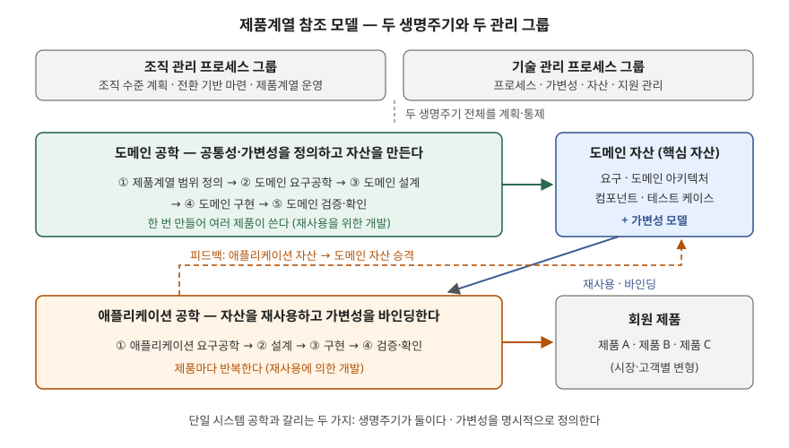

> 실행 검증 없음. ISO/IEC 26550:2015(제품계열 공학·관리 참조 모델)의 용어 정의와 참조 모델 구조를
> 뼈대로 쓰고, SEI 기술 노트와 원 논문으로 보강했다. 수치는 쓰지 않았다.

제품계열(Product Line) 방법론을 두 갈래로 물었다 — (가) 개념과 특징, (나) 활용 기술과 고려사항.
문항 순서대로 Ⅱ에 개념과 특징을, Ⅲ·Ⅳ에 활용 기술과 고려사항을 나눠 쓴다. 이 문제는 "재사용을
잘 하자"로 흐르기 쉬운데, 점수는 **두 생명주기**와 **가변성의 명시적 관리**를 정확히 짚는 데서 갈린다.

---

## Ⅰ. 개요

### 가. 왜 제품계열인가 — 단일 시스템 공학의 한계

같은 시장에 비슷한 제품을 여러 개 내는 조직이 제품마다 따로 개발하면 문제가 반복된다.
ISO/IEC 26550의 단일 시스템 공학 한계 절(4.1)은 이를 두 가지 대응으로 설명한다.

| 흔한 대응 | 결과 |
|---|---|
| 하나의 제품에 파라미터와 `if-then-else` 분기를 계속 추가 | 코드가 커지고 이해·유지보수가 어려워지며 시험 가능성과 성능이 떨어진다 |
| 고객마다 브랜치를 따서 고친 뒤 나중에 병합 (clone-and-own) | 병합 비용과 오류가 쌓이고, 최악에는 본선(main line) 없이 복제본만 남는다 |

표준은 고객 요구에 맞는 **변형(가변성)을 수용하는 일**을 단일 제품 공급자가 겪는 가장 큰 문제로 든다.

### 나. 제품계열 방법론의 위치

제품계열 방법론은 재사용을 우연에 맡기지 않고 **계획된 공통 플랫폼에서 제품군을 파생**시키는
개발 방식이다. 1990년대부터 주목받았고(ISO/IEC 26550 서문), SEI는 이를 관리 활동까지 포함한
실무 프레임워크로 정리했다. 국제 표준은 ISO/IEC 26550을 진입점으로 하는 제품계열 표준군이다.

---

## Ⅱ. 제품계열 방법론의 개념과 특징

### 가. 정의

- **ISO/IEC 26550 제품계열 정의(3.16)**: 명시적으로 정의·관리되는 **공통 피처와 가변 피처**를 공유하고,
  **같은 도메인 아키텍처**에 기반해 특정 시장의 공통·가변 요구를 충족하는 제품·서비스의 집합
- **SEI 정의(CMU/SEI-2003-TN-031이 인용한 Clements·Northrop 정의)**: 특정 시장 부문이나 임무의 요구를
  충족하는 **공통의 관리된 피처 집합**을 공유하며, **공통 핵심 자산으로부터 정해진 방식으로** 개발되는
  소프트웨어 중심 시스템의 집합

두 정의가 공통으로 요구하는 것은 셋이다 — **관리되는 공통성과 가변성**, **공유 아키텍처·자산**,
**특정 시장(범위)**. 제품계열 방법론은 이 셋을 만들고 쓰는 절차다.

### 나. 구조 — 두 생명주기와 두 관리 프로세스 그룹

> **출처**: [ISO/IEC 26550:2015 §5 Reference model, §6 Two life cycles and two process groups (iTeh 미리보기)](https://cdn.standards.iteh.ai/samples/69529/b9948cd0e7ae4b71aeff7cbd60fb44a5/ISO-IEC-26550-2015.pdf)

| 구성 | 하는 일 | 세부 프로세스 (ISO/IEC 26550 6절) |
|---|---|---|
| **도메인 공학** (6.1) | 제품계열의 공통성·가변성을 정의하고 도메인 자산을 만든다 | 범위 정의, 도메인 요구공학, 도메인 설계, 도메인 구현, 도메인 검증·확인 — **5개** |
| **애플리케이션 공학** (6.2) | 도메인 자산을 재사용하고 가변성을 바인딩해 회원 제품을 만든다 | 애플리케이션 요구공학, 설계, 구현, 검증·확인 — **4개** |
| **조직 관리** (6.3) | 조직 차원의 제품계열 계획과 운영 | 조직 수준 계획, 제품계열 전환 기반 관리, 제품계열 관리 — **3개** |
| **기술 관리** (6.4) | 두 생명주기를 기술적으로 지원 | 프로세스 관리, 가변성 관리, 자산 관리, 지원 관리 — **4개** |

SEI는 같은 구조를 **핵심 자산 개발 · 제품 개발 · 제품계열 관리**의 세 관리 영역으로 나눈다
(CMU/SEI-2003-TN-031 1.3). 이름은 달라도 "자산을 만드는 쪽 / 자산으로 제품을 만드는 쪽 / 둘을 통제하는 쪽"
이라는 분할은 같다.

### 다. 핵심 개념 4가지

| 개념 | 정의 (ISO/IEC 26550) |
|---|---|
| **공통성** (3.9) | 제품계열의 모든 애플리케이션이 공유하는 기능·비기능 특성 |
| **가변성** (3.23) | 제품계열 회원 간에 달라질 수 있는 특성. 기능·품질 속성·사용 환경·사용자·제약·내부 구현 관점에서 포착한다 |
| **가변점 / 변형** (3.29, 3.28) | 가변점은 무엇이 달라지는지를 나타내는 자리, 변형은 그 자리를 채우는 대안 하나. 가변점마다 변형이 하나 이상 있다 |
| **바인딩** (3.8) | 가변성 모델에 따라 도메인 자산에서 어느 변형을 쓸지 결정해 애플리케이션을 만드는 작업 |

### 라. 특징 — 단일 시스템 공학과의 비교

ISO/IEC 26550 서문은 제품계열 공학을 단일 시스템 공학과 가르는 특성을 **두 가지**로 든다.
**도메인·애플리케이션 두 생명주기가 필요하다**는 것과 **가변성을 명시적으로 정의해야 한다**는 것이다.

| 구분 | 단일 시스템 공학 | 기회적 재사용 (clone-and-own) | 제품계열 공학 |
|---|---|---|---|
| 개발 단위 | 제품 하나 | 기존 제품 복제 후 수정 | 제품군 (플랫폼 + 파생 제품) |
| 생명주기 | 1개 | 1개 (제품마다 복제) | **2개** (도메인 / 애플리케이션) |
| 재사용 | 개인·프로젝트 단위, 우연적 | 소스 복사, 이후 따로 진화 | **전략적·계획적**, 정해진 방식으로 |
| 가변성 | 파라미터·분기로 코드 안에 흩어짐 | 브랜치마다 암묵적 | **가변성 모델로 명시**, 추적 관리 |
| 아키텍처 | 제품별 | 원본 아키텍처를 복제 | **도메인 아키텍처를 공유** |
| 결함 수정 | 해당 제품만 | 복제본마다 따로 반영 | 자산 한 곳에서 고쳐 전 제품에 전파 |
| 초기 투자 | 작다 | 작다 | **크다** (자산·플랫폼 선투자) |

특징을 정리하면 **다섯 가지**다.

1. **재사용을 위한 개발과 재사용에 의한 개발의 분리** — 도메인 공학이 자산을 만들고, 애플리케이션 공학이 쓴다
2. **가변성의 명시적 관리** — 가변점·변형·의존·제약을 모델로 정의한다
3. **공유 도메인 아키텍처** — 모든 회원 제품이 같은 아키텍처의 공통부를 재사용하고 가변부를 바인딩한다
4. **범위 기반 경제성 판단** — 제품계열 범위 정의(3.20)에서 어떤 제품을 만들지와 그 경제성을 먼저 분석한다
5. **대량 맞춤(mass customization)** — 표준은 기대 효과로 비용·복잡도 감소, 생산성·품질 향상,
   출시 기간 단축, 대량 맞춤을 통한 고객 만족을 든다(4.1). 다만 **만병통치약이 아니며** 잘못 이해하고
   도입하면 투자만 하고 효과를 얻지 못할 수 있다고 같은 절이 경고한다

---

## Ⅲ. 제품계열 방법론의 활용 기술

활용 기술은 참조 모델의 흐름을 따라 **6가지**로 묶는다 — 범위를 정하고(①), 가변성을 모델로 적고(②),
아키텍처에 담고(③), 코드에 구현하고(④), 자산을 관리하고(⑤), 조직에 도입한다(⑥).

| 번호 | 기술 | 무엇을 하는가 | 근거 |
|---|---|---|---|
| ① | **제품계열 범위 정의 (scoping)** | 제품 범위(목표 시장·제품 로드맵) → 도메인 범위(재사용 가치가 있는 기능 영역) → 자산 범위(후보 자산과 투자 회수 추정) 순으로 좁힌다 | ISO/IEC 26550 3.7, 3.13, 3.20, 3.21 |
| ② | **피처 모델링 / 가변성 모델링** | 피처를 트리로 분해하고 필수(mandatory)·선택(optional)·대안(alternative) 관계와 요구·배제 제약을 적는다. 가변성 모델에는 가변점·변형·가변성 의존(필수/선택)·제약을 정의한다 | FODA (CMU/SEI-90-TR-21), ISO/IEC 26550 3.24~3.27 |
| ③ | **도메인(참조) 아키텍처** | 공통 구조와 규칙을 정하고 가변부의 자리를 아키텍처에 미리 둔다. 애플리케이션 아키텍처는 이것을 따르며 가변부만 바인딩한다 | ISO/IEC 26550 3.1, 3.10 |
| ④ | **가변성 구현과 바인딩 시점** | 빌드 시(전처리기·조건부 컴파일, 빌드 설정), 로드 시(설정 파일), 실행 시(파라미터, 플러그인·프레임워크 확장점)에 변형을 고른다. 코드 생성으로 제품을 파생하기도 한다 | Apel 외(2013), ISO/IEC 26550 3.2 주석(실행 시 바인딩) |
| ⑤ | **자산·가변성·형상 관리** | 도메인 자산과 애플리케이션 자산의 버전을 관리하고, 가변성 모델과 자산 사이의 추적 링크를 유지한다. 가변성 관리는 가변성 차원(모델 간 일관성)과 자산 차원(자산 안 어디가 달라지는가) 두 축이다 | ISO/IEC 26550 3.26, 6.4.2, 6.4.3 |
| ⑥ | **도입(전환) 모델** | 선행형(proactive) — 범위 전체를 먼저 분석·설계하고 구축. 대응형(reactive) — 필요가 생길 때마다 점진적으로 확장. 추출형(extractive) — 이미 있는 제품들에서 공통성을 뽑아 플랫폼화 | Krueger (PFE 2001) |

**④에서 점수가 갈린다.** ISO/IEC 26550이 비효율적인 대응으로 든 "파라미터와 분기 추가"와 ④의
실행 시 바인딩은 겉보기에 같다. 차이는 **그 파라미터가 가변성 모델에 정의된 가변점인가**다.
모델에 없는 분기는 흩어진 조건문이고, 모델에 있는 분기는 추적되는 가변점이다.

---

## Ⅳ. 제품계열 방법론 적용 시 고려사항

| 구분 | 고려사항 | 판단 기준 |
|---|---|---|
| **경제성** | 자산 선투자가 크고 회수는 제품 수가 늘어야 생긴다. 범위 정의 단계에서 자산 범위의 투자 회수를 추정하고 도입 여부를 결정한다(3.7 주석) | 같은 범위에서 낼 제품 수, 공통부 비율 |
| **범위 설정** | 범위가 넓으면 가변성이 폭증해 자산이 복잡해지고, 좁으면 재사용할 제품이 없다 | 범위 안 제품 간 공통성이 충분한가 |
| **조직 구조** | 도메인 팀(자산)과 제품 팀(애플리케이션)의 역할·책임을 나눈다. SEI는 제품계열·핵심 자산 개발·제품 개발 관리자 역할을 구분한다 | 자산 품질과 납기에 책임지는 조직이 있는가 |
| **가변성 폭증과 제약 관리** | 가변점이 늘면 조합 수가 기하급수로 늘고, 제약(요구·배제) 위반 조합이 생긴다 | 가변성 모델에 제약을 명시하고 도구로 검사하는가 |
| **검증 전략** | 모든 조합을 시험할 수 없으므로 도메인 V&V(자산 단위)와 애플리케이션 V&V(제품 단위)를 나누고, 대표 조합을 골라 시험한다 | 도메인 테스트 케이스를 재사용하는가 |
| **자산 진화와 추적성** | 제품 팀이 자산을 복제해 고치기 시작하면 clone-and-own으로 되돌아간다. 애플리케이션 자산을 도메인 자산으로 승격하는 경로(3.2)를 둔다 | 변경이 자산으로 환류되는가, 추적 링크가 유지되는가 |
| **측정** | 총 개발비, 출시 기간, 결함 밀도 추세, 핵심 자산 활용도, 자산 사용 비용을 측정해 효과를 입증한다 | CMU/SEI-2003-TN-031의 제품계열·자산 개발 관리 측정 항목 |

도입 모델 선택도 고려사항이다. 시장 요구를 멀리 내다볼 수 있고 개발 기간에 여유가 있으면
선행형, 기존 제품이 여럿 있고 빠른 전환이 필요하면 추출형, 요구 변화가 잦으면 대응형이 맞는다.
Krueger는 선투자 비용·노력·위험·지연이 많은 조직에 **진입 장벽**이 된다는 점을 들어, 선행형 하나가
아니라 세 가지 전환 모델을 제시했다.

---

## Ⅴ. 결론

제품계열 방법론은 비슷한 제품을 반복해 만드는 조직이 재사용을 **우연에서 계획으로** 바꾸는 방식이다.
ISO/IEC 26550이 정리한 핵심은 두 가지다 — 자산을 만드는 **도메인 공학**과 자산으로 제품을 만드는
**애플리케이션 공학**을 나누는 것, 그리고 제품 간 차이를 **가변성 모델로 명시해 관리하는 것**이다.
활용 기술은 범위 정의 → 피처·가변성 모델 → 도메인 아키텍처 → 가변성 구현·바인딩 → 자산 관리 →
도입 모델로 이어지고, 성패는 범위를 경제성 있게 잡는 것과 제품 팀의 변경이 자산으로 되돌아오는
체계를 유지하는 데 달려 있다. 표준이 대상으로 삼는 제품은 소프트웨어만이 아니라 하드웨어와
소프트웨어가 함께 있는 시스템 수준 제품까지 포함하므로(1절), 임베디드 제품군에도 같은 틀을 적용할 수 있다.

> 개념 정리: [형상관리 — 4대 활동과 베이스라인](../../software-engineering/2026-09-22-configuration-management-baseline/index.md)
>
> 개념 정리: [소프트웨어 아키텍처 4+1 뷰](../../software-engineering/2026-09-18-software-architecture-4plus1-views/index.md)
>
> 관련 답안: [기출문제 — 선도개발을 위한 개발방법론 테일러링](../2026-10-25-development-methodology-tailoring/index.md)

끝

---

## 답안 작성 메모

- **정의 다음에 바로 두 생명주기 도식을 그린다.** 도메인 공학 5단계와 애플리케이션 공학 4단계,
  그 사이의 자산 저장소, 위의 조직·기술 관리 두 줄 — 상자 6개라 3분이면 옮긴다. 이 그림 하나가
  (가)의 개념과 (나)의 활용 기술을 함께 받쳐 준다.
- **"특징"은 단일 시스템 공학과 비교해서 쓴다.** 비교표의 세 번째 열(clone-and-own)을 넣으면
  "재사용은 원래 하던 것 아니냐"는 반론을 미리 막는다. ISO가 든 두 가지 차별점(두 생명주기, 명시적
  가변성)을 표 위에 한 줄로 먼저 쓴다.
- **점수가 갈리는 곳은 가변점·변형·바인딩 용어와 바인딩 시점이다.** 피처 모델의 필수·선택·대안을
  작은 트리로 그려 두면 가산점을 노릴 수 있다. 시간이 있으면 Ⅲ 표 옆에 "자동차 — 변속기(대안: 수동/자동)"
  정도의 예를 붙인다.
- **"만병통치약이 아니다"를 꼭 넣는다.** 표준 스스로 쓴 경고라 고려사항의 첫 줄로 쓰기 좋다.
- 시간이 모자라면 Ⅳ 표를 경제성·범위·조직·가변성 폭증 네 줄로 줄이고, Ⅲ의 ⑥ 도입 모델은 이름 세 개만 남긴다.
- 수치(비용 절감률, 출시 기간 단축률)는 쓰지 않는다. SEI도 자릿수(order of magnitude)가 바뀌는 개선을 말하지만
  출처가 사례 보고라 답안에 숫자로 옮기면 근거를 묻는 채점자에게 약점이 된다.

---

## 참고 자료

- [ISO/IEC 26550:2015, Software and systems engineering — Reference model for product line engineering and management (iTeh 미리보기: 목차·서문·1~4절)](https://cdn.standards.iteh.ai/samples/69529/b9948cd0e7ae4b71aeff7cbd60fb44a5/ISO-IEC-26550-2015.pdf) — 3절 용어 정의, 4.1 단일 시스템 공학의 한계, 5절 참조 모델, 6절 두 생명주기와 두 관리 그룹
- [ISO/IEC 26550:2015 표준 카탈로그](https://www.iso.org/standard/69529.html) — 2판, 2013년 1판을 대체
- [Zubrow, Chastek, Measures for Software Product Lines, CMU/SEI-2003-TN-031 (2003-10)](https://www.sei.cmu.edu/library/file_redirect/2001_005_001_13853.pdf) — 제품계열 정의 인용, 세 관리 영역, 측정 항목
- [SEI, Software Product Lines Collection](https://www.sei.cmu.edu/library/software-product-lines-collection/) — 제품계열 정의, 기대 효과
- [Kang 외, Feature-Oriented Domain Analysis (FODA) Feasibility Study, CMU/SEI-90-TR-21 (1990-11)](https://sei.cmu.edu/library/feature-oriented-domain-analysis-foda-feasibility-study) — 피처 모델
- [Krueger, Easing the Transition to Software Mass Customization, PFE 2001, LNCS 2290, pp. 282–293 (Springer, 2002)](https://link.springer.com/chapter/10.1007/3-540-47833-7_25) — 선행형·대응형·추출형 도입 모델
- Apel, Batory, Kästner, Saake, *Feature-Oriented Software Product Lines: Concepts and Implementation* (Springer, 2013) — 가변성 구현 기법과 바인딩 시점
