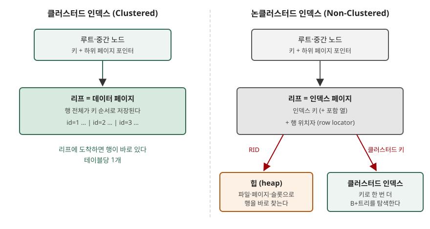

> 실행 검증 없음. SQL Server·MySQL InnoDB·Oracle·PostgreSQL 공식 문서에 적힌 구조와 동작만으로
> 정리했다. 성능 수치와 실행계획은 싣지 않았다.

인덱스가 무엇인지 설명하고, 클러스터드 인덱스와 논클러스터드 인덱스를 비교하라는 문제다.
문항이 두 갈래이므로 Ⅱ에 인덱스를, Ⅲ에 두 인덱스의 비교를 쓰고, Ⅳ에 제품별 구현과 설계
고려사항을 붙인다. 이 문제는 "클러스터드는 정렬돼 있고 빠르다"로 끝나기 쉬운데, 점수는
**리프에 무엇이 있는가**와 **논클러스터드의 행 위치자가 무엇을 가리키는가**를 짚는 데서 갈린다.

---

## Ⅰ. 개요

### 가. 인덱스가 필요한 이유

인덱스가 없는 테이블에서 조건에 맞는 행을 찾으려면 모든 페이지를 처음부터 끝까지 읽어야 한다(전체 스캔).
행이 늘수록 읽는 페이지 수도 비례해 늘어난다. 인덱스는 검색 키를 정렬된 별도 구조에 두어, 찾는 행이
있는 페이지까지 **트리 높이만큼만** 읽고 가게 만든다.

### 나. 클러스터드 구분이 생기는 이유

인덱스를 만들면 "행 자체는 어디에 어떤 순서로 두는가"라는 문제가 따라온다. 행을 **인덱스 키 순서대로
인덱스의 리프에 직접 저장**하면 클러스터드 인덱스이고, 행은 따로 두고 인덱스에는 **행을 찾아가는
주소만** 두면 논클러스터드 인덱스다. 행의 물리적 순서는 하나뿐이므로 클러스터드 인덱스는 테이블당 하나다.

---

## Ⅱ. 데이터베이스 인덱스

### 가. 정의

- **SQL Server 문서 정의**: 테이블이나 뷰에 연결된 디스크 구조로, 행 검색 속도를 높이기 위해 테이블·뷰의
  열에서 만든 키를 담는다. 행 저장소 인덱스의 키는 B+트리에 저장된다
- **Oracle 19c 개념 설명서**: 테이블 행에 대한 접근을 빠르게 할 수 있는, 테이블과 연관된 선택적 구조.
  B트리 인덱스의 리프 항목은 인덱스 값과 그 행을 가리키는 rowid로 이뤄진다

두 정의가 공통으로 말하는 것은 **세 가지**다 — 테이블과 별개로 존재할 수 있는 **선택적 구조**이고,
**키로 정렬**되어 있으며, 키에서 **행으로 가는 경로**를 제공한다.

### 나. 구성요소 4가지 (B+트리 인덱스 기준)

| 구성요소 | 담는 것 | 역할 |
|---|---|---|
| ① 루트 노드 | 키 구간과 하위 노드 포인터 | 탐색 시작점 |
| ② 중간(브랜치) 노드 | 키 구간과 하위 노드 포인터 | 탐색 범위를 좁힌다 |
| ③ 리프 노드 | 키 + 행 또는 행 위치자 | 탐색의 끝. 리프끼리 연결되어 범위 스캔을 받친다 |
| ④ 행 위치자 (논클러스터드만) | RID(파일·페이지·슬롯) 또는 클러스터드 키 | 리프에서 실제 행으로 간다 |

### 다. 동작 — 탐색 3단계

1. **루트에서 리프까지 내려간다** — 각 노드에서 찾는 키가 속한 구간의 포인터를 따라간다
2. **리프에서 키를 찾는다** — 범위 조건이면 연결된 리프를 옆으로 따라가며 읽는다
3. **행에 접근한다** — 클러스터드면 리프에 행이 이미 있다. 논클러스터드면 행 위치자로 한 번 더 간다
   (질의가 인덱스 열만 쓰면 이 단계를 건너뛴다 — 커버링)

### 라. 인덱스 분류

| 기준 | 종류 |
|---|---|
| 저장 구조 | B+트리, 해시, 비트맵, 역 인덱스(전문 검색) |
| 행 저장 방식 | **클러스터드** / **논클러스터드** — 이 문제의 축 |
| 키 성질 | 유일(unique) / 비유일, 단일 열 / 복합 열 |
| 범위 | 전역 / 파티션 로컬, 부분(필터) 인덱스 |

---

## Ⅲ. 클러스터드 인덱스와 논클러스터드 인덱스 비교

### 가. 구조

> **출처**: [Microsoft Learn — Clustered and Nonclustered Indexes (SQL Server)](https://learn.microsoft.com/en-us/sql/relational-databases/indexes/clustered-and-nonclustered-indexes-described), [Microsoft Learn — Index Architecture and Design Guide, Clustered/Nonclustered index architecture](https://learn.microsoft.com/en-us/sql/relational-databases/sql-server-index-design-guide)

- **클러스터드 인덱스**: 데이터 행을 키 값으로 정렬해 저장한다. 리프 노드가 곧 테이블의 **데이터 페이지**다.
  SQL Server 문서는 행이 한 가지 순서로만 저장될 수 있으므로 클러스터드 인덱스는 테이블당 하나라고 적는다
- **논클러스터드 인덱스**: 데이터 행과 분리된 구조다. 리프는 **인덱스 페이지**이고 키 열(과 포함 열)과
  **행 위치자**를 담는다. 테이블당 여러 개를 만들 수 있다
- **행 위치자는 테이블 형태에 따라 두 가지다.** 클러스터드 인덱스가 없는 테이블(힙)이면 파일 번호·페이지 번호·
  페이지 안 행 번호로 이뤄진 **RID**이고, 클러스터드 인덱스가 있으면 그 행의 **클러스터드 인덱스 키**다

### 나. 비교표

| 구분 | 클러스터드 인덱스 | 논클러스터드 인덱스 |
|---|---|---|
| 리프 노드 내용 | **데이터 행 전체** (데이터 페이지) | 인덱스 키 + 포함 열 + **행 위치자** |
| 테이블당 개수 | **1개** | 여러 개 |
| 행의 물리 순서 | 키 순서와 같다 | 키 순서와 무관 |
| 행 접근 단계 | 리프 도착 = 행 도착 | 리프 → 행 위치자 → 힙 또는 클러스터드 인덱스 |
| 범위 검색 | 연속 페이지를 읽는다 — 유리 | 행마다 다른 페이지로 갈 수 있다 — 범위가 넓으면 불리 |
| 저장 공간 | 별도 공간이 거의 없다 (테이블이 곧 인덱스) | 키·위치자만큼 추가 공간 |
| 삽입 영향 | 키 중간에 끼워 넣으면 페이지 분할 | 인덱스 페이지만 분할 |
| 키 변경 영향 | 행이 이동하고 **모든 논클러스터드 인덱스**의 위치자가 바뀐다 | 그 인덱스만 갱신 |
| 적합한 키 | 짧고·유일하고·변하지 않고·증가하는 열 (보통 기본키) | 자주 검색·조인·정렬되는 열 |

### 다. 비교의 핵심 — 행 위치자가 무엇이냐

같은 "논클러스터드 인덱스"라도 **밑에 클러스터드 인덱스가 있느냐**에 따라 비용이 다르다.

| 테이블 형태 | 위치자 | 장점 | 비용 |
|---|---|---|---|
| 힙 + 논클러스터드 | 물리 주소(RID) | 행으로 한 번에 간다 | 행이 옮겨지면 주소가 깨진다 |
| 클러스터드 + 논클러스터드 | 논리 주소(클러스터드 키) | 행이 페이지를 옮겨도 위치자는 그대로다 | 클러스터드 B+트리를 **한 번 더 탐색**한다 |

그래서 클러스터드 키가 길면 모든 논클러스터드 인덱스가 커진다. SQL Server 설계 지침과 MySQL InnoDB
문서가 **짧은 클러스터드 키(기본키)**를 권하는 이유가 이것이다.

---

## Ⅳ. 제품별 구현과 적용 시 고려사항

### 가. 제품별 구현 4가지

| 제품 | 클러스터드에 해당하는 것 | 보조 인덱스의 위치자 |
|---|---|---|
| **SQL Server** | `CLUSTERED` 인덱스 (선택). 없으면 힙 | 힙이면 RID, 클러스터드면 클러스터드 키. 비유일 키에는 4바이트 내부 열(uniqueifier)을 붙여 유일하게 만든다 |
| **MySQL InnoDB** | **항상 있다.** 기본키 → 없으면 첫 번째 NOT NULL 유일 인덱스 → 그것도 없으면 숨은 `GEN_CLUST_INDEX`(6바이트 행 ID) | 기본키 열 |
| **Oracle** | 인덱스 구성 테이블(IOT, 선택). 기본은 힙 구성 테이블 | 힙이면 물리 rowid, IOT면 논리 rowid(기본키 + 블록 위치 추정값 physical guess) |
| **PostgreSQL** | **없다.** 모든 인덱스가 힙과 분리된 보조 인덱스 | 힙의 튜플 위치. `CLUSTER` 명령은 한 번 재정렬할 뿐 이후 변경에는 순서를 유지하지 않는다 |

**PostgreSQL을 클러스터드 인덱스가 있는 제품으로 쓰면 틀린다.** `CLUSTER`는 그 시점에 테이블을 인덱스
순서로 다시 쓰는 일회성 작업이고, 수행 중에는 테이블 전체에 읽기·쓰기를 막는 잠금(ACCESS EXCLUSIVE)을 건다.

### 나. 적용 시 고려사항 5가지

| 구분 | 고려사항 | 근거 |
|---|---|---|
| ① 클러스터드 키 선정 | 짧고, 유일하고, 증가하고, 바뀌지 않고, NULL이 아닌 고정 길이 열을 고른다. 각 성질이 위치자 크기·uniqueifier·페이지 분할·연쇄 갱신을 막는다 | SQL Server 클러스터드 설계 지침 |
| ② 무작위 키 주의 | UUID처럼 무작위로 생성되는 키는 넓고 증가하지 않아, 삽입이 트리 곳곳에 흩어지며 중간 페이지 분할이 생긴다 | SQL Server 설계 지침 (`uniqueidentifier` 항목) |
| ③ 논클러스터드 개수 | 인덱스는 조회를 빠르게 하지만 삽입·갱신·삭제마다 모든 인덱스를 고친다. 쓰기 비중이 높은 테이블은 개수를 줄인다 | SQL Server 일반 설계 지침 |
| ④ 커버링 설계 | 자주 쓰는 질의의 열을 포함 열(`INCLUDE`)로 리프에 두면 행 위치자를 따라가는 단계가 사라진다. 대신 리프가 커진다 | SQL Server 포함 열 절, PostgreSQL 인덱스 전용 스캔 절 |
| ⑤ 범위 대 단건 | 넓은 범위를 키 순서로 읽는 질의는 클러스터드가, 선택도가 높은 단건 조회는 논클러스터드로도 충분하다. 넓은 범위를 논클러스터드로 읽으면 행 위치자 탐색이 행 수만큼 반복된다 | SQL Server 질의 고려사항 |

PostgreSQL의 인덱스 전용 스캔은 행 가시성 정보가 힙에만 있으므로, 힙 페이지가 "모두 보임"으로 표시된
경우에만 힙 방문을 건너뛴다. 커버링 인덱스를 만들어도 갱신이 잦은 테이블에서는 기대만큼 줄지 않는다는
점까지 쓰면 제품 차이를 아는 답안이 된다.

---

## Ⅴ. 결론

인덱스는 키로 정렬된 별도 구조로 행까지 가는 경로를 줄이는 장치이고, 클러스터드와 논클러스터드는
**행을 인덱스 리프에 직접 두느냐, 행 위치자만 두느냐**의 차이다. 클러스터드는 테이블당 하나이며 범위
검색과 키 순서 읽기에 유리하고, 논클러스터드는 여럿 둘 수 있지만 행 위치자를 따라가는 단계가 붙는다.
두 구조는 서로를 대체하지 않고 겹쳐 쓰인다 — 클러스터드 키가 모든 논클러스터드 인덱스의 위치자가 되므로,
클러스터드 키를 짧고 안정적으로 잡는 것이 테이블 전체 인덱스 설계의 출발점이다. 제품마다 기본 구조가
다르므로(InnoDB는 항상 클러스터드, PostgreSQL은 항상 힙) 설계 전에 대상 DBMS의 저장 방식부터 확인한다.

> 개념 정리: [인덱스 구조 비교 — B+트리, 해시, 비트맵](../../database/2026-10-26-index-structure-comparison/index.md)
>
> 관련 글: [커버링 인덱스 — 테이블을 안 보고 끝내기](../../../Database/sql-basics/2026-10-14-covering-index-no-table-lookup/index.md)
>
> 관련 글: [UUID v4와 v7을 기본키로 넣으면 — 무작위 키가 B-Tree에 남기는 흔적](../../../Database/sqlite/2026-11-06-uuid-v4-v7-primary-key-btree/index.md)

끝

---

## 답안 작성 메모

- **Ⅲ의 도식을 가장 먼저 그린다.** 좌우 두 트리를 그리고, 왼쪽 리프에 "데이터 행", 오른쪽 리프에
  "키 + 행 위치자"를 쓴 뒤 오른쪽 아래로 RID / 클러스터드 키 두 갈래를 뻗는다. 상자 6개라 3분이면 옮긴다.
- **점수가 갈리는 지점은 행 위치자다.** "논클러스터드는 포인터를 가진다"에서 멈추지 말고, 그 포인터가 힙이면
  RID, 클러스터드 테이블이면 클러스터드 키라는 것과 그 결과(키 길이가 모든 보조 인덱스 크기를 정한다)를 쓴다.
- **제품별 표는 가산점 영역이다.** 특히 "InnoDB는 항상 클러스터드, PostgreSQL은 클러스터드가 없다"는 대비는
  한 줄로도 차별화가 된다. 시간이 모자라면 Ⅳ-가를 이 한 줄로 줄이고 Ⅳ-나의 ①·③·④만 남긴다.
- **"클러스터드가 무조건 빠르다"고 쓰지 않는다.** 단건 조회는 클러스터드 탐색 한 번이 더 붙는 논클러스터드와
  큰 차이가 없고, 키 중간 삽입이 잦으면 페이지 분할 비용이 생긴다. 트레이드오프로 쓴다.
- 구체적인 키 개수 한도·바이트 한도 같은 제품 수치는 쓰지 않는다. 버전마다 다르고 채점 포인트도 아니다.

---

## 참고 자료

- [Microsoft Learn, Clustered and Nonclustered Indexes (SQL Server 2022, 2026-10 갱신)](https://learn.microsoft.com/en-us/sql/relational-databases/indexes/clustered-and-nonclustered-indexes-described) — 인덱스·클러스터드·논클러스터드 정의, 테이블당 클러스터드 1개, 힙
- [Microsoft Learn, Index Architecture and Design Guide (SQL Server 2022, 2026-10 갱신)](https://learn.microsoft.com/en-us/sql/relational-databases/sql-server-index-design-guide) — 클러스터드·논클러스터드 아키텍처, 행 위치자(RID·클러스터드 키·uniqueifier), 클러스터드 키 설계 지침, 포함 열
- [MySQL 8.0 Reference Manual, 17.6.2.1 Clustered and Secondary Indexes](https://dev.mysql.com/doc/refman/8.0/en/innodb-index-types.html) — InnoDB 클러스터드 인덱스 선정 순서, 보조 인덱스의 기본키 열
- [Oracle Database 19c Concepts, 3 Indexes and Index-Organized Tables](https://docs.oracle.com/en/database/oracle/oracle-database/19/cncpt/indexes-and-index-organized-tables.html) — B트리 인덱스 리프의 rowid, 인덱스 구성 테이블, 논리 rowid와 physical guess
- [PostgreSQL 16 Documentation, CLUSTER](https://www.postgresql.org/docs/16/sql-cluster.html) — 일회성 재정렬, ACCESS EXCLUSIVE 잠금
- [PostgreSQL 16 Documentation, 11.9 Index-Only Scans and Covering Indexes](https://www.postgresql.org/docs/16/indexes-index-only-scans.html) — 모든 인덱스가 보조 인덱스, 가시성 맵, `INCLUDE`
