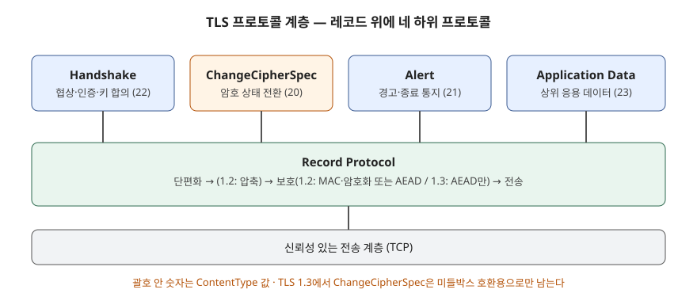
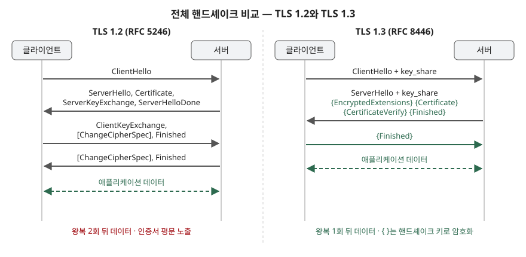

> 실행 검증 없음. TLS 1.2 명세(RFC 5246)와 TLS 1.3 명세(RFC 8446), 알려진 공격 정리(RFC 7457),
> 보안 사용 권고(RFC 9325, BCP 195)를 근거로 썼다. 성능 수치는 쓰지 않았다.
>
> RFC 8446은 2026년 7월 RFC 9846으로 대체됐다. 9846은 **버전 번호를 그대로 둔 TLS 1.3의 개정판**이고
> 절 번호가 일부 바뀌었다. 이 답안의 절 번호는 시험 교재가 따르는 RFC 8446 기준이다.

TLS를 두 갈래로 물었다 — (가) 프로토콜 구조와 핸드셰이크 과정, (나) TLS 1.2의 보안 취약점과 TLS 1.3의 개선 사항.
(가)를 Ⅱ에, (나)를 Ⅲ(취약점)과 Ⅳ(개선 사항)로 나눠 쓴다. 점수는 **취약점 하나하나를 1.3의 어떤 변경이
막았는지 짝지어 보이는 것**에서 갈린다. 공격 이름만 늘어놓으면 절반만 받는다.

---

## Ⅰ. 개요

### 가. TLS의 정의와 목적

TLS(Transport Layer Security)는 **신뢰성 있는 전송 계층 위에서 두 통신 당사자 사이에 기밀성·무결성·인증을
제공하는 암호 프로토콜**이다. TLS 1.3 명세의 서론은 목표를 세 가지로 든다(RFC 8446 §1).

| 보안 속성 | 무엇을 보장하는가 |
|---|---|
| **인증** | 서버는 항상 인증되고, 클라이언트 인증은 선택이다 |
| **기밀성** | 채널을 지나는 데이터는 양 끝점만 볼 수 있다 |
| **무결성** | 공격자가 데이터를 바꾸면 탐지된다 |

### 나. 왜 1.3으로 옮기라고 하는가

TLS 1.2는 2008년 명세다. 이후 BEAST·Lucky Thirteen·CRIME·재협상 공격·트리플 핸드셰이크 같은 공격이
이어졌고, 대부분은 **1.2가 허용하는 옛 알고리즘과 선택지**를 파고들었다. 확장 규격을 덧대 막아 왔지만
선택지가 남아 있는 한 설정 실수로 다시 열린다. TLS 1.3은 그 선택지를 **명세에서 지웠다.**
IETF의 보안 사용 권고(RFC 9325)는 TLS 1.2를 반드시 지원하되 TLS 1.3을 지원하면 1.3을 우선하라고 정하고,
TLS 1.0·1.1은 RFC 8996으로 폐기됐다.

---

## Ⅱ. TLS 프로토콜 구조와 핸드셰이크 과정

### 가. 프로토콜 구조 — 2계층, 하위 프로토콜 4개

> **출처**: [RFC 5246 §1 Introduction, §6 The TLS Record Protocol](https://www.rfc-editor.org/rfc/rfc5246#section-6), [RFC 8446 §5.1 Record Layer](https://www.rfc-editor.org/rfc/rfc8446#section-5.1)

TLS는 **아래쪽의 레코드 프로토콜**과 **그 위에 올라가는 하위 프로토콜 4개**로 이뤄진다.
레코드 계층은 위에서 받은 데이터를 레코드 단위로 쪼개 보호해 전송하고, 레코드 머리의
ContentType 값으로 어느 하위 프로토콜의 데이터인지 구분한다.

| 구성 | ContentType | 하는 일 | TLS 1.3에서 |
|---|---|---|---|
| **Handshake** | 22 | 버전·암호 스위트 협상, 서버(선택적으로 클라이언트) 인증, 키 합의 | 유지. ServerHello 이후 메시지는 암호화 |
| **ChangeCipherSpec** | 20 | 협상한 암호 상태로 전환한다고 알림 | 제거. 미들박스 호환용 1바이트 레코드로만 허용 |
| **Alert** | 21 | 오류·경고와 연결 종료(close_notify) 통지 | 유지 |
| **Application Data** | 23 | 상위 응용(HTTP 등) 데이터 운반 | 유지. 암호화 레코드의 바깥 타입은 항상 23 |
| **Record Protocol** | — | 단편화, (1.2) 압축, MAC·암호화 또는 AEAD 보호 | AEAD만 남고 압축 제거 |

TLS 1.2 레코드 보호 방식은 **3가지**다 — 스트림 암호, CBC 블록 암호, AEAD(RFC 5246 §6.2.3).
CBC는 평문에 MAC을 먼저 붙이고 암호화하는 **MAC-then-Encrypt** 순서를 쓴다. 이 순서가 Ⅲ의 패딩 오라클로 이어진다.

### 나. TLS 1.2 핸드셰이크 — 4단계

> **출처**: [RFC 5246 §7.3 Handshake Protocol Overview (Figure 1)](https://www.rfc-editor.org/rfc/rfc5246#section-7.3), [RFC 8446 §2 Protocol Overview (Figure 1)](https://www.rfc-editor.org/rfc/rfc8446#section-2)

| 단계 | 방향 | 메시지 (`*`는 선택) | 하는 일 |
|---|---|---|---|
| ① 협상 시작 | C → S | ClientHello | 지원 버전, 클라이언트 난수, 암호 스위트·압축 방식 목록, 세션 ID, 확장 |
| ② 서버 파라미터·인증 | S → C | ServerHello, Certificate\*, ServerKeyExchange\*, CertificateRequest\*, ServerHelloDone | 버전·스위트 선택, 서버 난수, 인증서, (EC)DHE 공개값과 그 서명 |
| ③ 키 교환·클라이언트 완료 | C → S | Certificate\*, ClientKeyExchange, CertificateVerify\*, [ChangeCipherSpec], Finished | 사전 마스터 시크릿 전달(RSA 암호화 또는 DH 공개값) → 마스터 시크릿 유도 → 암호 전환 후 Finished |
| ④ 서버 완료 | S → C | [ChangeCipherSpec], Finished | 암호 전환, 핸드셰이크 전체에 대한 검증값 |

Finished는 지금까지 오간 핸드셰이크 메시지 전체를 키로 검증한 값이라, 중간자가 협상 메시지를 바꿨으면
여기서 드러난다. RFC 그림의 흐름을 세면 응용 데이터를 보내기까지 **왕복 2회**가 든다.
세션을 재개할 때는 세션 ID로 ClientHello → ServerHello·Finished → Finished만 오가는 **단축 핸드셰이크**를 쓴다.

여기서 눈여겨볼 점은 두 가지다. **인증서까지 전부 평문으로 오가고**, ClientKeyExchange에 **정적 RSA 키 전송**을
고르면 서버 개인키 하나로 사전 마스터 시크릿을 풀 수 있다.

### 다. TLS 1.3 핸드셰이크 — 3단계, 키 교환 모드 3가지

TLS 1.3 명세의 프로토콜 개요는 핸드셰이크를 **3단계**로 나눈다(RFC 8446 §2).

| 단계 | 메시지 | 하는 일 |
|---|---|---|
| ① **키 교환** (Key Exchange) | ClientHello + key_share, ServerHello + key_share | 클라이언트가 (EC)DHE 공개값을 **첫 메시지에 미리** 실어 보낸다. 서버가 하나를 골라 응답하면 그 즉시 핸드셰이크 키가 나온다. 이후는 전부 암호화 |
| ② **서버 파라미터** (Server Parameters) | {EncryptedExtensions}, {CertificateRequest\*} | 키 결정과 무관한 나머지 확장을 암호화해 보낸다 |
| ③ **인증** (Authentication) | {Certificate\*}, {CertificateVerify\*}, {Finished} — 서버, 이어서 클라이언트 | 인증서, 핸드셰이크 전체에 대한 서명, 키 확인 |

`{ }`는 핸드셰이크 키로 암호화된 메시지다. 클라이언트가 키 공유값을 미리 보내므로 서버의 첫 응답에
인증과 Finished까지 실리고, 응용 데이터는 **왕복 1회** 뒤부터 보낸다. 클라이언트가 고른 그룹을 서버가
지원하지 않으면 HelloRetryRequest로 한 번 더 왕복한다.

키 교환 모드는 **3가지**다.

| 모드 | 키 합의 | 전방 비밀성 | 쓰임 |
|---|---|---|---|
| (EC)DHE | 임시 DH | 있음 | 첫 연결 |
| PSK 단독 | 사전 공유 키 | 없음 | 재개, 외부에서 미리 나눈 키 |
| PSK + (EC)DHE | 사전 공유 키 + 임시 DH | 있음 | 재개 시 권장 |

재개용 PSK는 이전 연결에서 서버가 NewSessionTicket으로 건넨다. 이 PSK로 **0-RTT 조기 데이터**를
첫 메시지와 함께 보낼 수 있지만, 조기 데이터는 PSK에서 나온 키로만 보호되어 **전방 비밀성이 없고
연결 사이의 재전송(replay)을 막지 못한다**(RFC 8446 §2.3).

---

## Ⅲ. TLS 1.2의 보안 취약점

RFC 7457은 TLS·DTLS에 대해 알려진 공격을 정리한 문서다. 그중 **TLS 1.2가 허용하는 선택지 때문에 성립하는
것**을 원인별로 묶으면 **3갈래 8가지**다.

| 갈래 | 취약점 | 원인 | 1.2에서의 대응 |
|---|---|---|---|
| **키 교환** | ① 개인키 탈취 시 과거 트래픽 복호화 | 정적 RSA 키 전송은 서버 개인키로 사전 마스터 시크릿이 풀린다 — **전방 비밀성 없음** | (EC)DHE 스위트만 쓰도록 설정 |
| | ② RSA 패딩 오라클 (Bleichenbacher) | RSA PKCS#1 v1.5 암호화의 패딩 검사 결과가 응답 차이로 새어 나간다 | 구현에서 오류를 구분하지 않게 처리 |
| | ③ 취약한 DH 파라미터 | 서버가 임의 DH 그룹을 보내도 클라이언트가 검증하도록 강제되지 않는다 | 미리 정한 그룹 사용 |
| **레코드 보호** | ④ CBC 패딩 오라클 (Lucky Thirteen) | MAC-then-Encrypt 순서라 복호화 뒤 패딩·MAC 검사 시간 차가 생긴다 | AEAD(GCM) 또는 Encrypt-then-MAC 확장(RFC 7366) |
| | ⑤ RC4 키스트림 편향 | RC4 출력의 통계적 편향으로 반복 전송된 평문(쿠키 등)을 복원한다 | RC4 금지 |
| | ⑥ 압축 기반 공격 (CRIME) | 압축 후 길이가 비밀 값과 공격자 입력의 일치 정도를 드러낸다 | TLS 압축 비활성화 |
| **핸드셰이크 설계** | ⑦ 재협상·트리플 핸드셰이크 | 재협상 전후 연결이 묶이지 않아 중간자가 자기 요청을 앞에 끼운다(CVE-2009-3555). 서로 다른 두 연결이 같은 마스터 시크릿을 갖게 만들 수 있다 | renegotiation_info(RFC 5746), 확장 마스터 시크릿(RFC 7627) |
| | ⑧ 평문 핸드셰이크·다운그레이드 | 인증서와 협상 내용이 평문으로 노출된다. 약한 버전·스위트로 끌어내리는 공격 여지가 있다 | 구버전 비활성화, 폴백 SCSV(RFC 7507) |

공통점은 **"1.2 명세가 허용하는 선택지"**라는 것이다. 1.2의 대응은 모두 **설정이나 확장**이라
빠뜨리면 다시 열린다. BEAST(TLS 1.0의 예측 가능한 IV)와 POODLE(SSL 3.0)은 1.2 자체의 결함은 아니지만,
1.2 서버가 구버전 폴백을 허용하면 같은 연결에서 노출된다.

---

## Ⅳ. TLS 1.3의 개선 사항

### 가. 변경 사항 — 보안 5가지, 성능 2가지

TLS 1.3 명세에는 TLS 1.2와의 주요 차이를 모은 절이 있다(RFC 8446 §1.2). 거기 든 변경을 성격별로 묶는다.

| 구분 | 개선 사항 | 무엇이 바뀌었나 | 막는 취약점 (Ⅲ) |
|---|---|---|---|
| **보안** | ⑴ 정적 키 교환 제거 | 정적 RSA·정적 DH 스위트 삭제. 공개키 기반 키 교환은 **모두 전방 비밀성**을 제공 | ①, ② |
| | ⑵ 레코드 보호를 AEAD로 일원화 | 스트림·CBC 삭제, RC4 삭제, 압축 삭제. 암호 스위트는 AEAD와 HKDF 해시만 정한다 (5개) | ④, ⑤, ⑥ |
| | ⑶ 핸드셰이크 암호화 | ServerHello 이후 메시지 전부 암호화, EncryptedExtensions 신설. 인증서가 도청자에게 보이지 않는다 | ⑧ |
| | ⑷ 협상 범위 축소 | 임의 DH 그룹·DSA·압축 협상 삭제. 그룹은 정해진 목록에서만 고른다. RSA 서명은 RSASSA-PSS | ③, ② |
| | ⑸ 키 스케줄 재설계·재협상 제거 | HKDF 기반 키 유도, 핸드셰이크 전체 기록(transcript)에 키를 묶는다. 재협상 삭제(키 갱신은 KeyUpdate) | ⑦ |
| | 다운그레이드 보호 | 1.3 서버가 1.2 이하로 협상하면 ServerHello 난수 끝 8바이트에 `DOWNGRD` 표식을 넣고, 클라이언트가 이를 보면 중단 (§4.1.3) | ⑧ |
| **성능** | ⑹ 1-RTT 핸드셰이크 | 첫 메시지에 key_share를 실어 왕복 1회로 줄였다 | — |
| | ⑺ 0-RTT 재개 | PSK로 첫 메시지에 응용 데이터를 실을 수 있다. 재전송 위험이 있어 멱등 요청에만 쓴다 | — |

버전 협상 방식도 바뀌었다. 1.3은 레코드·ClientHello의 버전 필드를 1.2 값으로 고정해 두고 실제 버전은
supported_versions 확장으로 협상한다. 옛 중간 장비가 모르는 버전 값을 보고 연결을 끊는 일을 피하려는 것이고,
같은 이유로 암호화 레코드의 바깥 타입을 항상 Application Data(23)로 둔다.

암호 스위트는 5개로 줄었다 — `TLS_AES_128_GCM_SHA256`(필수 구현), `TLS_AES_256_GCM_SHA384`,
`TLS_CHACHA20_POLY1305_SHA256`, `TLS_AES_128_CCM_SHA256`, `TLS_AES_128_CCM_8_SHA256`.
키 교환 그룹은 secp256r1이 필수, X25519가 권장이다(RFC 8446 §9.1).

### 나. TLS 1.2와 TLS 1.3 비교

| 항목 | TLS 1.2 | TLS 1.3 |
|---|---|---|
| 핸드셰이크 왕복 | 2회 (재개 1회) | 1회 (재개 시 0-RTT 가능) |
| 키 교환 | RSA 키 전송, 정적·임시 DH, 임시 ECDH | (EC)DHE, PSK, PSK + (EC)DHE |
| 전방 비밀성 | 스위트에 따라 다름 | 공개키 키 교환은 항상 제공 |
| 레코드 보호 | 스트림, CBC(MAC-then-Encrypt), AEAD | AEAD만 |
| 압축 | 허용 | 삭제 |
| 핸드셰이크 기밀성 | 평문 (인증서 노출) | ServerHello 이후 암호화 |
| 키 유도 | PRF (스위트별 해시) | HKDF, 단계별 시크릿 |
| 재협상 | 허용 (확장으로 보호) | 삭제, KeyUpdate로 대체 |
| 세션 재개 | 세션 ID, 세션 티켓 | PSK 하나로 통합 |
| RSA 서명 | PKCS#1 v1.5 | RSASSA-PSS (인증서 서명은 v1.5 허용) |
| 버전 협상 | ClientHello.version | supported_versions 확장 |

### 다. 전환 시 고려사항 — 4가지

| 고려사항 | 판단할 것 |
|---|---|
| **1.2 병행 운영** | RFC 9325는 1.2를 반드시 지원하라고 한다. 1.2를 남기면 권고 스위트 4개(ECDHE + AES-GCM)만 열고, 확장 마스터 시크릿·renegotiation_info를 켜고, 압축을 끈다. 1.0·1.1은 협상하지 않는다(RFC 8996) |
| **0-RTT 사용 범위** | 재전송 가능한 데이터라 응용 프로토콜이 허용할 때만 쓴다(RFC 9325 §3.10). HTTP라면 상태를 바꾸지 않는 요청으로 제한한다 |
| **중간 장비·가시성** | 핸드셰이크가 암호화되고 정적 RSA가 사라져, 서버 개인키로 트래픽을 복호화하던 수동 감시 장비는 더 이상 동작하지 않는다. 검사가 필요하면 프록시 종단 방식으로 구조를 바꾼다 |
| **인증서·키 관리** | 전방 비밀성으로 키 유출의 과거 피해는 줄지만 위장 위험은 남는다. RSA 2048비트 이상, SHA-1 서명 금지(RFC 9325 §4.5)를 인증서 발급 기준에 넣는다 |

---

## Ⅴ. 결론

TLS는 레코드 프로토콜 위에 Handshake·ChangeCipherSpec·Alert·Application Data 네 하위 프로토콜을 얹은 구조이고,
핸드셰이크에서 협상·인증·키 합의를 끝낸 뒤 레코드 계층이 그 키로 데이터를 보호한다.
TLS 1.2의 취약점은 대부분 **명세가 남겨 둔 선택지** — 정적 RSA, CBC MAC-then-Encrypt, RC4, 압축, 재협상, 평문 핸드셰이크 —
에서 나왔고, 1.2는 이를 확장과 설정으로 막았다. TLS 1.3은 같은 문제를 **선택지 자체를 지우는 방식**으로 풀었고,
그 결과 왕복도 2회에서 1회로 줄었다. 실무에서는 1.3을 우선하되 1.2를 권고 스위트로 좁혀 병행하고,
0-RTT는 재전송 위험을 감당할 수 있는 요청에만 연다. 2026년 7월 RFC 9846이 같은 버전 번호로 1.3 명세를 개정해
키 공유값 재사용 금지, TLS 1.0·1.1 협상 금지 등을 명세 본문에 넣었다.

> 관련 실습: [TLS 핸드셰이크에서 실제로 오가는 것](../../../Infra/tls/2026-09-21-tls-handshake-openssl/index.md)
>
> 관련 실습: [인증서 체인을 직접 만들어 보면 검증 실패가 읽힌다](../../../Security/tls/2026-11-01-x509-chain-build-and-verify-failures/index.md)
>
> 개념 정리: [TCP 3-way 핸드셰이크와 흐름·혼잡 제어](../../network/2026-09-28-tcp-handshake-flow-congestion-control/index.md)
>
> 개념 정리: [전방 비밀성(Forward Secrecy) — 임시 키 교환과 키 유출 피해 범위](../../security/2026-11-26-forward-secrecy-ephemeral-key-exchange/index.md)
>
> 개념 정리: [AEAD 인증 암호 — MAC-then-Encrypt의 패딩 오라클에서 GCM까지](../../security/2026-11-26-aead-generic-composition-padding-oracle-gcm/index.md)

끝

---

## 답안 작성 메모

- **도식 두 개를 먼저 그린다.** 계층도(상자 6개)는 2분, 핸드셰이크 비교도(좌우 두 칸, 화살표 4개·3개)는
  3분이면 옮긴다. 비교도 하나로 "왕복 2회 → 1회"와 "ServerHello 이후 암호화"가 동시에 보인다.
- **Ⅲ과 Ⅳ는 번호로 짝을 맞춘다.** 취약점 ①~⑧을 쓰고 개선 표의 마지막 열에 그 번호를 적으면 채점자가
  "취약점 → 개선"의 대응을 바로 센다. 이 문제에서 점수가 갈리는 곳이 여기다.
- **"1.2의 결함"과 "1.2가 허용하는 선택지"를 구분해서 쓴다.** BEAST·POODLE을 1.2 취약점으로 적으면
  감점 요인이다. 그 둘은 구버전 폴백을 통해 노출된다고만 쓴다.
- **0-RTT의 한계를 꼭 쓴다.** 개선 사항만 늘어놓으면 장점 나열이 된다. 0-RTT의 재전송 위험과 전방 비밀성 부재를
  한 줄 넣으면 "트레이드오프를 안다"는 신호가 된다.
- 시간이 모자라면 Ⅳ 다(전환 고려사항)를 1.2 병행 운영·0-RTT 두 줄로 줄이고, Ⅱ 다의 키 교환 모드 표를 문장 한 줄로 바꾼다.
- 핸드셰이크 지연 감소율 같은 수치는 쓰지 않는다. 왕복 횟수는 명세 그림에서 셀 수 있지만 실제 지연은 망마다 다르다.

---

## 참고 자료

- [RFC 8446, The Transport Layer Security (TLS) Protocol Version 1.3 (2018-08)](https://www.rfc-editor.org/rfc/rfc8446) — §1 구성, §1.2 TLS 1.2와의 주요 차이, §2 프로토콜 개요(3단계·3가지 키 교환 모드), §2.3 0-RTT, §4.1.3 다운그레이드 보호, §4.2.3 서명 방식, §5 레코드 계층, §9.1 필수 구현, 부록 B.4 암호 스위트
- [RFC 9846, The Transport Layer Security (TLS) Protocol Version 1.3 (2026-07)](https://www.rfc-editor.org/rfc/rfc9846) — RFC 8446을 대체하는 1.3 개정판, §1.2 변경 사항
- [RFC 5246, The Transport Layer Security (TLS) Protocol Version 1.2 (2008-08)](https://www.rfc-editor.org/rfc/rfc5246) — §1 계층 구조, §6 레코드 프로토콜, §6.2.3 레코드 보호 방식, §7.3 핸드셰이크 개요
- [RFC 7457, Summarizing Known Attacks on TLS and DTLS (2015-02)](https://www.rfc-editor.org/rfc/rfc7457) — §2 공격 목록
- [RFC 9325, Recommendations for Secure Use of TLS and DTLS, BCP 195 (2022-11)](https://www.rfc-editor.org/rfc/rfc9325) — §3.1.1 버전, §3.10 0-RTT, §4.1~4.2 암호 스위트, §4.5 키 길이
- [RFC 8996, Deprecating TLS 1.0 and TLS 1.1 (2021-03)](https://www.rfc-editor.org/rfc/rfc8996) — 구버전 폐기
- [RFC 5746, TLS Renegotiation Indication Extension (2010-02)](https://www.rfc-editor.org/rfc/rfc5746) — 재협상 공격 대응
- [RFC 7627, TLS Session Hash and Extended Master Secret Extension (2015-09)](https://www.rfc-editor.org/rfc/rfc7627) — 트리플 핸드셰이크 대응
