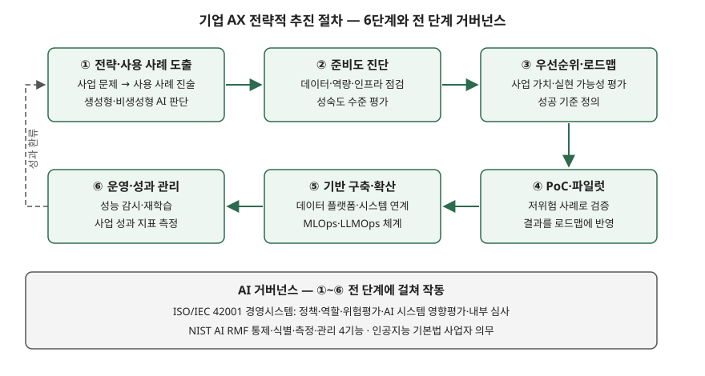

> 실행 검증 없음. 추진 절차는 Microsoft Cloud Adoption Framework의 AI 도입 지침(벤더 공식 문서)을,
> 거버넌스는 ISO/IEC 42001과 NIST AI RMF를, 장애 요인의 수치는 Eurostat의 2025년 기업 ICT 이용
> 통계(공공 통계, EU 기준)를 근거로 썼다. AX라는 용어 자체는 표준 정의가 없어 Ⅰ에서 그 사실을 밝혔다.

기업의 AI 전환(AX)에 대해 세 가지를 묻는다 — (가) 왜 중요한가, (나) 어떤 절차로 추진하고 무엇을
고려하는가, (다) 무엇이 가로막고 어떻게 대응하는가. 문항이 가·나·다로 나눠 물었으므로 Ⅱ·Ⅲ·Ⅳ를
그 순서 그대로 쓴다. (다)는 "3가지 이상"과 "각 대응방안"을 요구하므로 장애 요인과 대응을 같은
번호로 짝지어 다섯을 쓴다.

---

## Ⅰ. 개요

### 가. AX의 정의

AX(AI Transformation, AI 전환)는 **AI를 업무 프로세스·의사결정·제품과 서비스에 내재화해 기업의
일하는 방식과 사업 모델을 바꾸는 활동**이다. 국제 표준이나 법령에 정의된 용어는 아니며, 정부 정책
문서와 업계에서 "디지털 전환(DX) 다음 단계"라는 뜻으로 쓰인다. 따라서 답안에서는 정의가 정립되는
중인 용어임을 밝히고, AI 시스템 자체는 표준 용어(ISO/IEC 22989의 AI 시스템)로 받친다.

### 나. DX와 AX의 차이

| 구분 | DX (디지털 전환) | AX (AI 전환) |
|---|---|---|
| 바꾸는 대상 | 아날로그 업무를 디지털 시스템으로 | 디지털화된 업무의 **판단과 생성**을 AI로 |
| 핵심 기술 | 클라우드, 모바일, ERP, 데이터 수집 | 기계학습, 생성형 AI, AI 에이전트 |
| 자동화 범위 | 규칙이 정해진 정형 업무 | 문서 작성·요약·분류 같은 **비정형 업무까지** |
| 시스템의 성질 | 같은 입력에 같은 출력 (결정적) | 확률적 출력, 운영 중 성능이 변함 |
| 관리 체계 | IT 거버넌스, 정보보호 | 여기에 **AI 거버넌스**(편향·설명성·영향평가)가 더해짐 |
| 관계 | 선행 조건 | DX가 만든 데이터·클라우드 위에서 성립 |

마지막 줄이 이 문제의 출발점이다. **AX는 DX를 대체하지 않고 DX의 결과물 위에 올라간다.** 데이터가
시스템에 쌓여 있지 않은 조직은 AX를 시작할 재료가 없다.

---

## Ⅱ. (가) 기업에서 AX가 중요한 이유

### 가. 중요성 4가지

| 번호 | 이유 | 내용 | 근거 |
|---|---|---|---|
| ① | **도입 격차가 경쟁 격차로** | EU 기업 중 AI를 쓰는 비율이 2025년 약 20%(10인 이상 기업 19.95%)로 한 해 사이 6.47%p 늘었고, 대기업은 55.03%, 소기업은 17%다. 같은 업종 안에서도 쓰는 기업과 안 쓰는 기업이 갈리고 있다 | Eurostat 2025 |
| ② | **자동화 범위의 확장** | DX가 정형 업무를 자동화했다면, 생성형 AI와 에이전트는 문서·상담·코드 같은 비정형 업무와 판단 보조까지 범위를 넓힌다 | Ⅰ-나 |
| ③ | **데이터 자산의 가치화** | DX로 쌓은 데이터는 조회·보고에 머물렀다. AI는 그 데이터를 예측·추천·생성의 입력으로 써서 투자 회수 경로를 만든다 | — |
| ④ | **규제 대응의 필요** | 인공지능 기본법(2026-01-22 시행)은 생성형 AI 고지·표시(제31조), 고영향 AI 사업자의 안전성·신뢰성 확보 조치(제34조)를 둔다. 통제 체계 없이 개별 부서가 AI를 쓰면 법적 위험이 쌓인다 | 인공지능 기본법 |

### 나. 정보시스템 관점의 정리

①~④는 결국 정보시스템에 세 가지를 요구한다. **데이터가 AI가 쓸 수 있는 형태로 통합돼 있을 것**,
**AI를 기존 업무 시스템에 연계할 아키텍처가 있을 것**, **AI의 동작을 기록하고 통제할 거버넌스가
있을 것**이다. AX가 중요하다는 말은 이 세 가지를 갖추지 않은 조직이 뒤처진다는 말과 같다.

---

## Ⅲ. (나) AX의 전략적 추진 절차와 고려사항

### 가. 추진 절차 — 6단계와 전 단계 거버넌스

> **출처**: [Microsoft Cloud Adoption Framework — AI adoption (2026-11-14 갱신)](https://learn.microsoft.com/en-us/azure/cloud-adoption-framework/scenarios/ai/strategy), [Microsoft Cloud Adoption Framework — Plan for AI adoption (2026-10-15 갱신)](https://learn.microsoft.com/en-us/azure/cloud-adoption-framework/ai/plan), [ISO/IEC 42001:2023](https://www.iso.org/standard/81230.html), [NIST AI 100-1 AI RMF 1.0 §5 Core (2023-01)](https://doi.org/10.6028/NIST.AI.100-1)

Microsoft의 AI 도입 지침은 계획(Plan) → 준비(Ready) → 통제·보안·관리(Govern·Secure·Manage)의
흐름을 두고, 계획 안에서 사용 사례 도출 → 역량 진단 → 우선순위 → 개념 검증(PoC) 순서를 정한다.
위 6단계는 이 흐름을 기업 추진 단계로 펼치고, 거버넌스를 마지막 단계가 아니라 **전 단계에 걸치는
띠**로 둔 것이다. 거버넌스를 마지막에 붙이면 이미 퍼진 AI를 사후에 걷어 내야 하기 때문이다.

### 나. 단계별 활동과 고려사항

| 단계 | 주요 활동 | 고려사항 |
|---|---|---|
| ① 전략·사용 사례 도출 | 경영 목표에서 **사업 문제**를 먼저 꺼내 사용 사례 진술로 바꾼다. 개인 생산성 보조인지, 업무 자동화인지 나눈다 | 기술에서 출발하지 않는다. "생성형 AI로 무엇을 할까"가 아니라 "어떤 문제를 줄일까"에서 시작한다. 경영진 후원과 책임자 지정 |
| ② 준비도 진단 | 데이터 자산 목록, 인프라, 인력 역량을 성숙도 수준으로 평가한다 | 데이터가 어디에 어떤 품질로 있는지 모르면 ③의 실현 가능성 평가가 성립하지 않는다. 역량 부족분은 교육·채용·외부 협력 중 무엇으로 채울지 정한다 |
| ③ 우선순위·로드맵 | 사업 가치와 실현 가능성으로 사용 사례 순위를 매기고 성공 기준을 정한다 | 성공 기준을 **PoC 전에** 숫자로 정한다(처리 시간, 오류율, 비용). 정하지 않으면 PoC가 끝나도 확산 여부를 판단할 수 없다 |
| ④ PoC·파일럿 | 위험이 낮은 사례로 먼저 검증하고 결과를 우선순위·일정에 반영한다 | Microsoft 지침은 PoC 결과를 반영한 일정에 20~30%의 예비 기간을 두라고 한다. 실제 업무 데이터와 사용자로 검증해야 운영 결과와 어긋나지 않는다 |
| ⑤ 기반 구축·확산 | 데이터 플랫폼, 기존 시스템(ERP·CRM 등)과의 연계, MLOps·LLMOps 파이프라인을 갖추고 다른 부서로 넓힌다 | **구매(SaaS)·플랫폼(PaaS)·직접 구축** 중 선택. Microsoft 지침은 직접 인프라 구축을 기본값으로 두지 말라고 한다. 사례마다 따로 만들지 않고 공통 기반을 재사용한다 |
| ⑥ 운영·성과 관리 | 모델 성능 감시, 재학습, 사업 성과 지표 측정, 결과를 ①로 환류 | AI는 운영 중 입력 데이터가 바뀌면 성능이 변한다. 기술 지표(정확도)와 사업 지표(비용·매출)를 함께 본다 |

여섯 단계 중 가장 자주 끊기는 자리는 ④에서 ⑤로 넘어가는 관문이다. PoC는 정제된 표본 데이터와
의욕 있는 소수 사용자로 돌기 때문에 대개 성공하지만, 확산 단계에서는 실제 업무 시스템과의 연계,
권한 관리, 장애 대응, 비용 통제가 한꺼번에 요구된다. 그래서 ③에서 정한 성공 기준을 관문 판정
기준으로 쓰고, 기준을 넘지 못한 사례는 확산하지 않고 ①로 돌려보내 다시 다듬는다.

### 다. 전 단계에 걸친 거버넌스 — 고려사항

| 축 | 할 일 | 근거 |
|---|---|---|
| 경영시스템 | AI 정책, 역할과 책임, 위험평가·처리, **AI 시스템 영향평가**, 내부 심사와 개선 | ISO/IEC 42001:2023 (본문 4~10절, 부속서 A 통제 38개) |
| 위험관리 기능 | 통제(GOVERN) → 식별(MAP) → 측정(MEASURE) → 관리(MANAGE) 4기능을 사용 사례마다 적용 | NIST AI RMF 1.0 |
| 생성형 AI 위험 | 그럴듯한 오답(confabulation), 데이터 프라이버시, 정보보안, 지식재산 위험을 사용 사례별로 식별 | NIST AI 600-1 |
| 법적 의무 | 생성형 AI 고지·표시, 고영향 AI 해당 여부 검토와 확보 조치, 근거 문서 보관 | 인공지능 기본법 제31조·제33조·제34조 |

---

## Ⅳ. (다) AX 추진 시 장애 요인과 대응방안

### 가. 장애 요인 5가지와 대응

Eurostat의 2025년 조사에서 **AI 도입을 검토했지만 쓰지 않은 EU 기업**이 꼽은 사유는 관련 전문성
부족(70.89%), 법적 결과에 대한 불명확성(52.52%), 데이터 보호·프라이버시 침해 우려(48.83%)가 상위
셋이다. ①~③은 이 순위를 그대로 따르고, ④·⑤는 도입 이후 단계의 장애다.

| 번호 | 장애 요인 | 왜 막히는가 | 대응방안 |
|---|---|---|---|
| ① | **AI 전문성·역량 부족** | 사용 사례를 고르고, 결과를 평가하고, 운영할 사람이 없다. 미도입 사유 1위 | 역할별 교육(경영진·현업·개발자 각각), 핵심 인력 채용, 외부 협력으로 초기 공백 보완, 현업이 직접 쓰는 SaaS부터 시작해 학습 곡선을 낮춤 |
| ② | **법적 불확실성** | 어떤 AI가 규제 대상인지, 사고 시 책임이 누구에게 있는지 불명확해 결정이 미뤄진다 | 고영향 AI 해당 여부를 ① 단계에서 사전 검토, 법무·준법 부서를 거버넌스 위원회에 포함, ISO/IEC 42001 체계로 근거 문서를 남김 |
| ③ | **데이터 보호·프라이버시 우려** | 개인정보·영업비밀이 외부 AI 서비스로 넘어가거나 학습에 쓰일 수 있다 | 데이터 등급별 입력 허용 범위 정책, 입력 보관·학습 제외 조건을 계약에 명시, 가명처리·마스킹, 민감 업무는 사내 배치 모델 |
| ④ | **데이터 품질·통합 미비** | 데이터가 부서별 시스템에 흩어져 있고 형식·품질이 제각각이라 학습·검색에 쓸 수 없다 | ② 준비도 진단에서 데이터 자산 목록화, 데이터 거버넌스(소유자·품질 기준) 수립, 공통 데이터 플랫폼으로 통합 |
| ⑤ | **PoC 이후 운영 전환 실패** | 확률적 출력과 운영 중 성능 변화 때문에 기존 소프트웨어 시험·운영 방식이 그대로 통하지 않고, 그럴듯한 오답이 신뢰를 떨어뜨린다 | 성공 기준을 PoC 전에 수치로 정의, MLOps·LLMOps로 감시·재학습 자동화, 사람 검토 지점(Human-in-the-loop) 설계, 사용 사례별 성과 지표 측정 |

### 나. 장애 요인의 성격 — 기술보다 조직이 먼저다

다섯 가지 중 순수한 기술 문제는 ⑤의 일부뿐이다. ①은 인력, ②·③은 제도와 정책, ④는 데이터 관리
체계의 문제다. Eurostat 조사에서 "AI가 기업에 쓸모없다"는 사유는 20.68%로 가장 적었다. 즉 기업은
AI의 쓸모를 의심해서가 아니라 **쓸 준비가 안 돼서** 멈춘다. 대응이 기술 도입보다 **역량·정책·
데이터 거버넌스**에 먼저 가야 하는 이유다.

---

## Ⅴ. 결론

AX는 DX가 만든 데이터와 시스템 위에서 업무의 판단과 생성을 AI로 바꾸는 활동이다. 도입 격차가
이미 벌어지고 있고 규제도 시행됐으므로, 미루는 것 자체가 위험이 된다. 추진은 사업 문제에서 출발해
준비도 진단 → 우선순위 → PoC → 기반 구축 → 운영으로 이어 가되, 거버넌스를 마지막에 붙이지 않고
처음부터 전 단계에 건다. 장애의 대부분은 역량·법·데이터라는 조직 쪽에 있으므로, 정보관리 조직의
역할은 AI 모델을 고르는 것보다 **데이터를 통합하고, AI를 업무 시스템에 연계하고, 그 동작을 통제할
체계를 먼저 갖추는 것**이다.

> 개념 정리: [ISO/IEC 42001:2023 인공지능 경영시스템](../2026-10-25-iso-iec-42001-ai-management-system/index.md)
>
> 개념 정리: [MLOps 파이프라인과 모델 드리프트 대응](../../emerging-tech/2026-10-15-mlops-pipeline-model-drift/index.md)
>
> 개념 정리: [데이터 거버넌스와 데이터 품질 관리 체계](../../database/2026-10-06-data-governance-quality-dimensions-roles/index.md)
>
> 개념 정리: [업무 프로세스 재설계(BPR) — 원안과 AI 도입 이후](../../it-management/2026-09-21-bpr-reengineering-and-ai/index.md)
>
> 관련 답안: [기출문제 — NIST AI RMF의 핵심구조 4가지와 신뢰 가능한 AI 특성 7가지](../2026-10-24-nist-ai-rmf-core-and-trustworthy-characteristics/index.md)
>
> 관련 답안: [기출문제 — 인공지능 기본법의 고영향 인공지능](../2026-10-05-high-impact-ai-basic-act/index.md)

끝

---

## 답안 작성 메모

- **Ⅰ-나의 DX·AX 비교표를 먼저 쓴다.** "AX는 DX 위에 올라간다"는 한 줄이 이후 (가)의 데이터 자산,
  (나)의 준비도 진단, (다)의 데이터 통합 미비를 전부 한 줄로 꿴다. 이 표가 없으면 답안이 AI 일반론으로
  흐른다.
- **점수가 갈리는 곳은 (나)에서 거버넌스의 위치다.** 절차를 나열하고 마지막에 "거버넌스 수립"을 붙이는
  답안이 많다. 거버넌스를 전 단계에 걸친 띠로 그리고 ISO/IEC 42001·NIST AI RMF를 이름으로 대면
  관리체계를 아는 답안으로 보인다.
- **(다)는 근거 있는 순위로 시작한다.** "역량 부족이 미도입 사유 1위"는 공공 통계에서 나온 사실이다.
  수치를 정확히 못 외웠으면 "EU 공식 통계에서 전문성 부족·법적 불확실성·프라이버시 우려가 상위
  사유"로 쓰고 숫자는 버린다. EU 통계라는 단서는 남긴다.
- **장애 요인과 대응은 같은 번호로 짝짓는다.** 문항이 "각 대응방안"을 물었으므로 짝이 보이지 않으면
  감점된다. Ⅳ-가 표 하나가 (다)의 뼈대다.
- **시간이 모자라면** Ⅲ-다 거버넌스 표를 두 줄(42001, AI RMF)로 줄이고, Ⅳ-나를 한 문장으로 줄인다.
  (다)는 3가지 이상이므로 ①②③만 남겨도 요건은 채운다.
- 모식도는 상자 6개를 두 줄로 뱀처럼 잇고 아래에 거버넌스 띠 하나, ⑥에서 ①로 환류 점선 하나다.
  상자 안에는 단계 이름만 써도 된다.
- 개수를 붙인다 — 중요성 **4가지**, 추진 절차 **6단계**, 거버넌스 축 **4가지**, 장애 요인 **5가지**.

---

## 참고 자료

- [Eurostat, Use of artificial intelligence in enterprises — Statistics Explained (2025 자료, 2025-12 추출)](https://ec.europa.eu/eurostat/statistics-explained/index.php?title=Use_of_artificial_intelligence_in_enterprises) — 기업 규모별 AI 이용률, 미도입 사유
- [Microsoft Cloud Adoption Framework, AI adoption (2026-11-14 갱신)](https://learn.microsoft.com/en-us/azure/cloud-adoption-framework/scenarios/ai/strategy) — 계획·준비·통제·보안·관리 흐름, SaaS·PaaS·인프라 선택
- [Microsoft Cloud Adoption Framework, Plan for AI adoption (2026-10-15 갱신)](https://learn.microsoft.com/en-us/azure/cloud-adoption-framework/ai/plan) — 사용 사례 도출, 역량 진단, 우선순위, PoC와 예비 기간
- [ISO/IEC 42001:2023 Information technology — Artificial intelligence — Management system](https://www.iso.org/standard/81230.html)
- [NIST AI 100-1, Artificial Intelligence Risk Management Framework (AI RMF 1.0), 2023-01](https://doi.org/10.6028/NIST.AI.100-1) — Core 4가지 기능
- [NIST AI 600-1, Generative Artificial Intelligence Profile (2024-07)](https://nvlpubs.nist.gov/nistpubs/ai/NIST.AI.600-1.pdf) — 생성형 AI 고유 위험
- 인공지능 발전과 신뢰 기반 조성 등에 관한 기본법 (법률 제21311호, 2026-01-20 일부개정, 2026-01-22 시행) — 제31조·제33조·제34조. 조문 근거는 관련 답안(고영향 인공지능)에 정리
