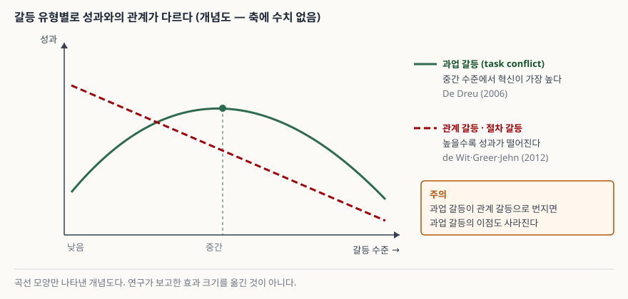
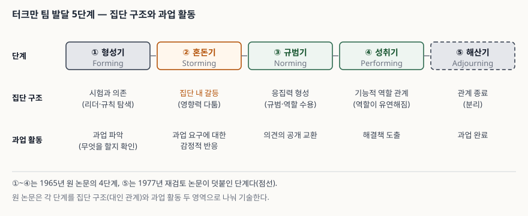

기출문제에서 IT 프로젝트를 이끄는 PM의 입장으로 갈등 관리를 묻는다. 세 가지를 차례로
요구한다. 갈등이 프로젝트 성과와 어떤 관계에 있는지, 갈등이 어디서 생기고 어떻게 푸는지,
그리고 터크만(Tuckman)의 팀 발달 5단계 모델이다. 문항이 "가. 나. 다."로 나뉘어 있으므로
그 순서대로 대항목을 세운다.

> 실행 검증 없음. 원 논문과 PMBOK Guide를 근거로 정리한 답안이다. 연구가 보고한 상관의
> 방향과 조건만 옮겼고, 효과 크기 같은 수치는 쓰지 않았다.

---

## Ⅰ. 개요

IT 프로젝트의 갈등은 사람 사이의 감정 문제로만 생기지 않는다. 요구사항 범위, 아키텍처 선택,
결함의 책임 소재, 발주자·수행사·감리의 역할 경계처럼 **정보시스템을 만드는 과정 자체가
의견 충돌을 만든다.** 이해관계자가 많고, 결과물이 눈에 보이지 않아 진척을 해석하는 방식이
사람마다 갈린다.

그래서 PM의 과제는 갈등을 없애는 것이 아니다. **성과에 도움이 되는 갈등(과업 갈등)은
드러내 다루고, 성과를 깎는 갈등(관계·절차 갈등)은 초기에 막는 것**이다. 이 답안은
① 유형별로 다른 갈등–성과 관계, ② 갈등 요인 7가지와 해결 모드 5가지, ③ 팀이 발달하며
갈등이 몰리는 시점을 보여주는 터크만 5단계를 차례로 쓴다.

## Ⅱ. 갈등과 프로젝트 성과의 관계

### 가. 갈등의 3유형

| 유형 | 무엇에 대한 불일치인가 | IT 프로젝트의 예 |
|---|---|---|
| 과업 갈등 (task) | 과업 내용·판단에 대한 의견 차이 | 요구사항 해석, DB 설계안, 기술 스택 선택 |
| 관계 갈등 (relationship) | 개인 간 감정·성격 충돌 | 특정 개발자와 현업 담당자 간 반감 |
| 절차 갈등 (process) | 누가 무엇을 어떻게 맡는지 | 결함 귀속, 개발·운영 경계, 산출물 작성 주체 |

과업·관계 갈등의 구분은 Jehn(1995)이, 절차 갈등은 이후 연구가 더했다. 메타분석(de Wit·Greer·
Jehn, 2012)은 116개 연구를 묶어 세 유형을 함께 비교했다.

### 나. 유형별로 관계가 다르다

> **출처**: [De Dreu (2006), When too little or too much hurts, Journal of Management 32(1)](https://doi.org/10.1177/0149206305277795) · [de Wit, Greer & Jehn (2012), The paradox of intragroup conflict: A meta-analysis, Journal of Applied Psychology 97(2)](https://doi.org/10.1037/a0024844)

① **관계·절차 갈등은 성과를 깎는다.** 메타분석에서 두 유형은 팀 성과와 일관되게 음의 관계를
보였다(de Wit 외, 2012). 감정 소모와 책임 회피가 과업에 쓸 주의를 빼앗기 때문이다.

② **과업 갈등은 조건에 따라 다르다.** 앞선 메타분석(De Dreu·Weingart, 2003)은 과업 갈등도
성과와 음의 관계라고 보고했지만, 2012년 메타분석은 일관된 음의 관계를 찾지 못했다. 과업 갈등이
관계 갈등과 약하게 얽혀 있을 때, 의사결정 품질이 성과 기준일 때 긍정적 효과가 나타났다.

③ **과업 갈등은 중간 수준에서 혁신이 가장 높다.** 과업 갈등이 너무 적으면 대안 검토가 없고,
너무 많으면 인지 부담이 커진다. De Dreu(2006)는 팀 혁신과 과업 갈등 사이에서 역U자 관계를
확인했고, 관계 갈등에서는 이 곡선이 나타나지 않았다.

④ **업무가 정형적이면 과업 갈등도 해롭다.** Jehn(1995)은 반복적인 업무를 하는 팀에서는
과업에 대한 이견이 집단 기능을 해친다고 보고했다. 운영 이관 이후의 정형 업무와 설계 단계의
비정형 업무에서 PM이 갈등을 다루는 방식이 달라야 하는 이유다.

### 다. PM에게 주는 시사점 3가지

| 시사점 | PM의 행동 | 정보시스템으로 남기는 것 |
|---|---|---|
| 과업 갈등은 드러낸다 | 설계 검토·기술 검토 회의에서 반대 의견을 공식 안건으로 다룬다 | 아키텍처 결정 기록(ADR), 검토 회의록 |
| 과업 갈등이 관계 갈등으로 번지지 않게 한다 | 사람이 아니라 데이터·기준으로 논쟁한다 | 요구사항 추적표, 결함 이력, 성능 측정 결과 |
| 절차 갈등은 구조로 막는다 | 역할·책임을 착수 시점에 확정한다 | 책임 배정표(RACI), 변경 통제 절차, 이슈 대장 |

## Ⅲ. 갈등의 요인과 해결 전략

### 가. 갈등 요인 7가지 (Thamhain·Wilemon, 1975)

프로젝트 생애주기 단계별로 갈등 강도를 조사한 연구가 든 7가지 원천이다.

| 원천 | IT 프로젝트에서 드러나는 모습 |
|---|---|
| ① 일정 | 오픈 일정 고정, 단계 간 일정 전가 |
| ② 우선순위 | 요구사항 우선순위, 여러 사업이 같은 인력을 원함 |
| ③ 인력 자원 | 핵심 아키텍트·DBA의 중복 투입 |
| ④ 기술적 의견 | 설계 대안, 성능과 기능의 상충, 기술 부채 처리 |
| ⑤ 관리 절차 | 보고 체계, 산출물 양식, 승인 권한 |
| ⑥ 비용 | 추가 요구에 대한 비용 부담 주체 |
| ⑦ 개인 성향 | 개인 간 작업 방식·성격 차이 |

이 연구는 원천별 중요도가 단계마다 달라지고, 평균 갈등 강도는 **생애주기 초기에 크다**고
보고했다. PMBOK Guide 6판(2017)은 프로젝트 팀 관리 절의 갈등 관리 항목(§9.5.2.1)에서 갈등
원천으로 부족한 자원, 일정 우선순위, 개인 작업 방식을 든다. 둘을 겹쳐 보면 **①~⑥은
관리 대상이고 ⑦만 사람의 문제**다. 대부분의 갈등이 구조에서 나온다는 뜻이다.

정보시스템 관점에서 요인을 하나 더 짚는다. IT 프로젝트에서는 **같은 사실을 서로 다른 데이터로
보는 것**이 갈등을 키운다. 발주자는 화면 수로, 수행사는 기능 점수로, 감리는 산출물 반영률로
진척을 말하면 같은 일정 갈등이 세 갈래로 갈린다.

### 나. 해결 전략 — 갈등 처리 모드 5가지

Thomas·Kilmann은 **자기 관심사를 추구하는 정도(주장성)** 와 **상대 관심사를 채워주는 정도(협조성)**
두 축으로 갈등 처리 행동을 5가지로 나눴다(Kilmann·Thomas, 1977). PMBOK 6판의 갈등 해결 기법
5가지도 같은 틀이다.

| 모드 (TKI) | PMBOK 6판 명칭 | 주장성·협조성 | IT 프로젝트에서 맞는 상황 | 한계 |
|---|---|---|---|---|
| 경쟁 | 강요·지시 (force/direct) | 높음·낮음 | 보안·법규 위반, 장애 대응처럼 즉시 결정이 필요할 때 | 반복하면 관계 갈등이 쌓인다 |
| 협력 | 협업·문제 해결 (collaborate/problem solve) | 높음·높음 | 아키텍처·요구사항처럼 양쪽 관심사가 모두 중요할 때 | 시간이 든다 |
| 타협 | 타협·조정 (compromise/reconcile) | 중간·중간 | 일정과 범위를 맞바꿀 때 | 양쪽 모두 일부를 잃는다 |
| 회피 | 철수·회피 (withdraw/avoid) | 낮음·낮음 | 사안이 사소하거나 정보가 더 모여야 할 때 | 덮어 두면 커진다 |
| 수용 | 완화·수용 (smooth/accommodate) | 낮음·높음 | 관계 유지가 더 중요하고 쟁점이 작을 때 | 반대 의견이 묻힌다 |

TKI 자체는 **모든 모드가 상황에 따라 쓸모가 있다**는 입장이다. 그래서 답안에서 "협력이
최선"으로 끝내지 않고, 상황별로 모드를 고르는 기준을 쓰는 것이 점수가 된다.

### 다. PM의 해결 전략 — 단계 3가지

① **예방 (구조로 막기)** — 착수 시점에 책임 배정표, 변경 통제 절차, 의사결정 권한을 확정한다.
요인 ②·⑤·⑥은 대부분 여기서 걸러진다.

② **조기 식별 (데이터로 드러내기)** — 이슈 대장과 위험 대장에 갈등 징후를 올리고, 진척을 하나의
기준(요구사항 추적표 대비 실적)으로 통일한다. 과업 갈등이 감정 문제로 번지기 전에 공식 안건이 된다.

③ **해소 (모드 선택과 기록)** — 사안의 긴급성·중요도·관계 영향을 보고 위 5가지 모드를 고른다.
결정은 아키텍처 결정 기록이나 회의록으로 남겨, 같은 논쟁이 다시 열리지 않게 한다.

## Ⅳ. 터크만의 팀 발달 5단계 모델

### 가. 모델의 출처

Tuckman(1965)은 소집단 연구를 검토해 팀이 **형성기 → 혼돈기 → 규범기 → 성취기** 4단계를
거친다고 정리했다. Tuckman·Jensen(1977)이 그 뒤의 연구를 재검토해 **해산기**를 더했다.
PMBOK 7판(2021)도 팀 발달 모델 항목(§4.2.6.1)에서 이 모델을 다룬다.

> **출처**: [Tuckman (1965), Developmental sequence in small groups, Psychological Bulletin 63(6)](https://doi.org/10.1037/h0022100) · [Tuckman & Jensen (1977), Stages of small-group development revisited, Group & Organization Studies 2(4)](https://doi.org/10.1177/105960117700200404)

### 나. 단계별 특징과 PM의 대응

| 단계 | 팀의 상태 | 갈등 양상 | PM의 대응 | 정보시스템으로 남기는 것 |
|---|---|---|---|---|
| ① 형성기 | 리더·규칙을 탐색하고 의존한다 | 드러나지 않음 | 목표·범위·역할을 명확히 제시 | 프로젝트 헌장, 책임 배정표 |
| ② 혼돈기 | 영향력 다툼, 과업 요구에 대한 반발 | **가장 많이 드러난다** | 과업 갈등은 공식 안건으로, 관계 갈등은 조기 개입 | 이슈 대장, 설계 검토 기록 |
| ③ 규범기 | 응집력이 생기고 의견을 공개적으로 교환 | 합의된 절차 안에서 해소 | 합의한 규칙을 문서로 고정 | 개발 표준, 코드 리뷰 규칙 |
| ④ 성취기 | 역할이 유연해지고 해결책이 나온다 | 과업 갈등이 생산적으로 작동 | 권한 위임, 장애물 제거 | 의사결정 기록, 성과 지표 |
| ⑤ 해산기 | 과업 완료, 관계 종료 | 이관·책임 경계 갈등 | 산출물 이관, 교훈 정리 | 운영 이관 문서, 교훈 기록 |

### 다. IT 프로젝트에 적용할 때 짚을 점 3가지

① **단계는 거꾸로도 간다.** 핵심 인력 교체, 수행사 추가, 큰 범위 변경이 생기면 팀이 다시
혼돈기를 겪는다. 다단계 SI 사업에서 단계마다 인력이 바뀌면 혼돈기가 반복된다.

② **혼돈기를 건너뛰는 팀은 없다고 보고 일정에 반영한다.** 착수 직후 설계 단계가 혼돈기와
겹치므로, 이 시기의 기술 검토 회의를 일정에 명시해 과업 갈등이 드러날 자리를 만든다.

③ **해산기는 IT 프로젝트에서 따로 관리해야 한다.** 개발팀이 해산될 때 운영팀과의 책임 경계
갈등이 생긴다. 4단계 모델만 쓰면 이 구간이 빠진다. PMBOK 7판이 처음 이 단계를 "덧붙이는
사람이 많다"는 식으로 적었다가 지적을 받은 일이 있으므로, 답안에서는 **1977년 원저자가
더한 공식 단계**로 쓴다.

## Ⅴ. 결론

갈등은 성과와 단일한 관계를 갖지 않는다. 과업 갈등은 적정 수준에서 의사결정 품질과 혁신을
높이고, 관계·절차 갈등은 성과를 깎는다. PM이 할 일은 세 가지다. 요인 7가지 중 구조에서 나오는
것은 착수 시점에 역할·권한·변경 절차로 막고, 과업 갈등은 데이터와 기준 위에서 공식 안건으로
다루며, 해결 모드 5가지는 사안의 긴급성과 관계 영향을 보고 고른다.

터크만 모델은 이 판단에 **시점**을 더한다. 혼돈기에 갈등이 몰리고, 인력이 바뀌면 그 단계가
되돌아온다. 정보시스템 관점에서 이 모든 조치는 추적 가능한 기록으로 남아야 한다. 이슈 대장,
결정 기록, 책임 배정표가 있어야 같은 갈등이 반복되지 않고, 해산기에 운영 조직으로 넘어갈 근거도
생긴다.

> 개념 정리: [아키텍처 결정 기록(ADR) — 배경·결정·상태·결과 네 칸이 설계 문서와 갈리는 지점](../../software-engineering/2026-11-03-architecture-decision-record/index.md)

끝

## 답안 작성 메모

- **먼저 쓸 것**: Ⅱ의 갈등 3유형 표. "유형에 따라 성과와의 관계가 다르다"가 세 문항 전체의
  축이다. 이것이 서면 (나)의 해결 전략은 "과업 갈등은 살리고 관계·절차 갈등은 막는다"로,
  (다)의 터크만 모델은 "혼돈기에 무엇을 살리고 무엇을 막는가"로 이어진다.
- **점수가 갈리는 지점**:
  - (가)에서 "갈등은 적당히 있으면 좋다"로 끝내지 않고 **유형별로 관계가 다르다**는 것을
    연구 근거로 쓰는 것. 역U자 곡선은 과업 갈등과 혁신 사이의 관계다.
  - (나)에서 요인 **7가지**와 해결 모드 **5가지**를 개수와 함께 쓰고, 모드를 주장성·협조성 두
    축으로 설명하는 것. 모드마다 맞는 상황을 IT 사례로 붙이면 다른 답안과 차이가 난다.
  - (다)에서 **5단계**의 출처를 1965년·1977년으로 나눠 쓰고, 단계가 거꾸로 갈 수 있다는 점과
    해산기의 운영 이관 문제를 IT 프로젝트에 맞춰 쓰는 것.
- **시간이 모자라면**: Ⅱ의 시사점 표와 Ⅳ-다를 버린다. 갈등–성과 모식도, 해결 모드 비교표,
  터크만 단계 표는 남긴다.
- **빠지기 쉬운 함정**:
  - 협력(collaborating)을 항상 최선이라고 쓰는 것. TKI는 상황 의존을 전제로 한다.
  - 터크만 모델을 4단계로 쓰는 것. 문항이 5단계를 지정했다.
  - 갈등 요인을 성격 차이 위주로 쓰는 것. 7가지 중 6가지가 관리 대상이다.
- 개수를 붙인다 — 갈등 3유형, 시사점 3가지, 요인 7가지, 해결 모드 5가지, 전략 3단계,
  팀 발달 5단계, 적용 시 짚을 점 3가지.

## 참고 자료

- [Tuckman, B. W. (1965). Developmental sequence in small groups. Psychological Bulletin, 63(6), 384–399.](https://doi.org/10.1037/h0022100)
- [Tuckman, B. W., & Jensen, M. A. C. (1977). Stages of small-group development revisited. Group & Organization Studies, 2(4), 419–427.](https://doi.org/10.1177/105960117700200404)
- [Jehn, K. A. (1995). A multimethod examination of the benefits and detriments of intragroup conflict. Administrative Science Quarterly, 40(2), 256–282.](https://doi.org/10.2307/2393638)
- [De Dreu, C. K. W., & Weingart, L. R. (2003). Task versus relationship conflict, team performance, and team member satisfaction: A meta-analysis. Journal of Applied Psychology, 88(4), 741–749.](https://doi.org/10.1037/0021-9010.88.4.741)
- [De Dreu, C. K. W. (2006). When too little or too much hurts: Evidence for a curvilinear relationship between task conflict and innovation in teams. Journal of Management, 32(1), 83–107.](https://doi.org/10.1177/0149206305277795)
- [de Wit, F. R. C., Greer, L. L., & Jehn, K. A. (2012). The paradox of intragroup conflict: A meta-analysis. Journal of Applied Psychology, 97(2), 360–390.](https://doi.org/10.1037/a0024844)
- [Thamhain, H. J., & Wilemon, D. L. (1975). Conflict management in project life cycles. Sloan Management Review, 16(3), 31–50.](https://econbiz.de/Record/conflict-management-in-project-life-cycles-thamhain-hans/10002894638) · [Praxis Framework 요약 (2차)](https://www.praxisframework.org/en/library/thamhain-and-wilemon)
- [Kilmann, R. H., & Thomas, K. W. (1977). Developing a forced-choice measure of conflict-handling behavior: The "MODE" instrument. Educational and Psychological Measurement, 37(2), 309–325.](https://doi.org/10.1177/001316447703700204)
- Project Management Institute. (2017). A Guide to the Project Management Body of Knowledge (PMBOK Guide), 6th ed. §9.5.2.1 Conflict Management.
- Project Management Institute. (2021). The Standard for Project Management and A Guide to the Project Management Body of Knowledge (PMBOK Guide), 7th ed. §4.2.6.1 Tuckman Ladder. · [Graffius (2021-11-10), 7판의 터크만 모델 서술 오류 지적 (2차)](https://scottgraffius.com/blog/files/pmbok7.html)
