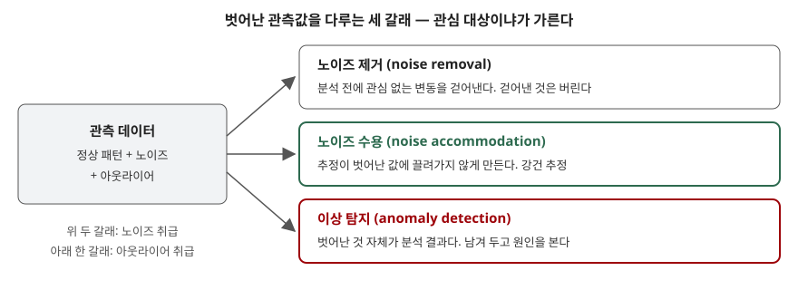
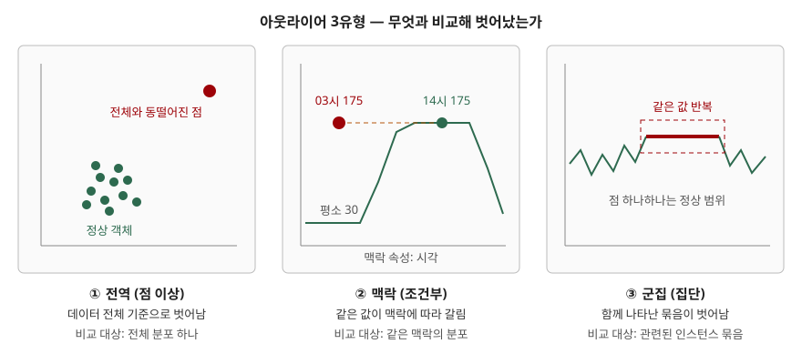

> Ⅲ-다와 Ⅳ-라에 실은 결과는 직접 계산해 확인했다. 데이터는 가상이고, 계산 코드와
> 실행 기록은 `code/` 아래에 있다. 정의와 유형 분류는 Chandola 외(ACM CSUR 2009) 본문에서
> 확인했다. Han 외 교재 12장은 본문을 직접 열람하지 못해 **그 장을 옮긴 강의 슬라이드로
> 해당 절의 내용을 확인**했고, 교재 문장을 인용하지 않았다.

아웃라이어 하나를 놓고 개념, 노이즈와의 구분, 세 유형을 차례로 묻는 문제다. 문항이
"가. 나. 다."로 나눠 물었으므로 그 순서를 그대로 Ⅱ~Ⅳ에 둔다. 통계 교과서 요약이 되지
않도록, 유형마다 **어떤 데이터 구조가 있어야 그 유형이 성립하고, 검출 시스템이 무엇을
비교해야 하는가**로 내려 쓴다.

---

## Ⅰ. 개요

모니터링 대시보드에 경보가 하루 수백 건 울리는데 정작 장애는 하나도 못 잡는 일이 생긴다.
기준선 하나를 전체 데이터에 그어 놓고 그 밖으로 나간 점만 세기 때문이다. 새벽 3시에 낮
수준의 요청이 들어오는 것도, 수집기가 멈춰 같은 값을 여섯 시간째 보내는 것도 그 기준선
안쪽에 있다.

아웃라이어는 **정상 데이터를 만든 메커니즘과 다른 메커니즘에서 나온 것으로 보이는
데이터**다. 노이즈도 정상에서 벗어난 값이지만 **분석자가 관심을 두지 않는 변동**이라는 점이
다르다. 그리고 아웃라이어는 **무엇과 비교해 벗어났는가**에 따라 전역·맥락·군집 세 유형으로
나뉜다. 유형마다 비교 대상이 다르므로, 검출 시스템도 유형마다 다르게 설계해야 한다.

---

## Ⅱ. 아웃라이어의 개념

### 가. 정의 — 출처 3곳

| 출처 | 정의의 요지 | 강조점 |
|---|---|---|
| NIST/SEMATECH *e-Handbook* (§1.3.5.17) | 표본의 나머지 관측값에서 **현저히 벗어난 것으로 보이는** 관측값 | 판정 기준을 정해야 확정된다 |
| Han·Kamber·Pei 교재 (12장) | 정상 객체에서 크게 벗어나 **다른 메커니즘이 만든 것처럼 보이는** 데이터 객체 | 생성 메커니즘의 차이 |
| Chandola 외 (§1.1) | **잘 정의된 정상 행태 개념에 들어맞지 않는** 데이터 속 패턴 | 정상 모델이 먼저다 |

세 정의는 서로 모순되지 않는다. 공통점을 묶으면 답안 첫 줄이 된다. **아웃라이어는
정상 데이터를 생성한 메커니즘과 다른 원인에서 나온 것으로 판단되는 관측값 또는 관측값의
묶음이다.** Chandola 외는 이상(anomaly)과 아웃라이어를 **흔히 같은 뜻으로 섞어 쓴다**고
적는다. 이 답안도 두 말을 같은 것으로 쓴다.

### 나. 성질 — 3가지

① **상대적이다** — "정상"을 먼저 정의해야 벗어남이 정해진다. 같은 값이 정상 모델에 따라
   아웃라이어가 되기도, 안 되기도 한다.

② **관심 대상이다** — Chandola 외는 아웃라이어를 만든 원인이 사기·침입·고장처럼 다양해도
   모두 **분석자에게 흥미롭다**는 공통점이 있다고 짚는다. Han 교재 12장도 아웃라이어가
   흥미로운 이유를 **정상 데이터를 만든 메커니즘을 위반하기 때문**이라고 든다. 이 성질이
   Ⅲ절의 노이즈 구분으로 이어진다.

③ **정상과의 경계가 흐리다** — Chandola 외가 꼽은 이상 탐지의 어려움 중 하나다. 경계 근처의
   관측값은 정상일 수도 아웃라이어일 수도 있고, 데이터에 섞인 노이즈가 실제 아웃라이어와
   비슷해 **가려내고 제거하기 어렵다.**

### 다. 신규성 탐지와의 관계

인접 개념으로 신규성 탐지(novelty detection)가 있다. 전에 없던 패턴을 찾는다는 점은 같지만,
**신규 패턴은 검출된 뒤 정상 모델에 편입된다**는 것이 차이다(Chandola 외 §1.1). 뉴스그룹에
새 토론 주제가 생긴 것은 처음엔 벗어남이지만 곧 정상이 된다. 검출 시스템 관점에서는
**검출 결과가 정상 모델을 갱신하느냐, 경보로 끝나느냐**의 차이다.

---

## Ⅲ. 아웃라이어와 노이즈의 차이점

### 가. 노이즈의 정의와 처리 방식 2가지

Chandola 외는 노이즈를 **분석자가 관심을 두지 않지만 분석을 방해하는 데이터 속 현상**으로
정의하고, 이를 다루는 방식을 둘로 나눈다(§1.1).

- **노이즈 제거(noise removal)** — 분석을 하기 전에 원치 않는 객체를 걷어낸다
- **노이즈 수용(noise accommodation)** — 통계 모형의 추정이 벗어난 관측값에 흔들리지 않게
  만든다. 중앙값·MAD·강건 회귀 같은 강건 추정이 여기에 속한다

그리고 이상 탐지는 이 둘과 **관련되지만 구별되는** 문제라고 적는다. 노이즈 처리는 벗어난
값을 **없애거나 무시하는 것이 목표**이고, 이상 탐지는 벗어난 값을 **찾아내는 것이 목표**다.



> **출처**: [Chandola, Banerjee & Kumar, Anomaly Detection: A Survey, ACM Computing Surveys 41(3), Article 15, 2009 §1.1 What are Anomalies?](https://doi.org/10.1145/1541880.1541882)

### 나. 비교

| 구분 | 아웃라이어 | 노이즈 |
|---|---|---|
| 정의 | 정상과 **다른 메커니즘**에서 나온 관측값 | 측정·수집 과정의 **무작위 변동** |
| 분석자의 관심 | 있다. 그 자체가 결과물 | 없다. 분석을 방해할 뿐 |
| 발생 범위 | 드물게, 특정 관측값·구간에 | 모든 관측값에 조금씩 |
| 원인 | 사기, 침입, 장비 고장, 다른 모집단 혼입 | 설치 환경·통신 채널의 간섭, 측정 해상도, 반올림 |
| 처리 목표 | **찾아내고 남긴다**, 원인을 조사한다 | **걷어내거나 둔감하게 만든다** |
| 대표 기법 | 통계·근접·군집·분류 기반 탐지 | 평활화 필터, 강건 추정 |
| 정상 모델과 관계 | 정상 모델 **밖** | 정상 모델의 **일부**(오차항) |

마지막 줄이 핵심이다. 노이즈는 "정상 패턴 + 오차"의 오차항으로 정상 모델 안에 들어 있고,
아웃라이어는 그 모델 바깥에 있다. 측정학 용어로 옮기면 노이즈는 **예측할 수 없는 방식으로
변하는 우연오차**(JCGM 200 §2.19)에 가깝다. 다만 이 대응은 답안 작성자의 해석이고, 앞의
두 자료가 그렇게 정의한 것은 아니다.

### 다. 둘을 섞으면 생기는 일 — 직접 계산

가상의 시간대별 요청 수 56일치(1,344점)에 표준편차 5의 노이즈를 섞고, Ⅳ절의 세 유형을
하나씩 심었다. 그다음 **흔히 쓰는 노이즈 제거(이웃 3점 중앙값 필터)를 먼저 하고** 같은
검출을 돌렸다. 코드는 [`code/outlier_types.py`](code/outlier_types.py), 기록은
[`code/output.txt`](code/output.txt)에 있다.

```text
[노이즈 제거(이웃 3점 중앙값 필터) 후 검출 적용]
  전역 기준 (전체 중앙값=100.5, MAD=69.4): 0건
  맥락 기준 (시간대별 수정 Z): 3건
    18일차 10시  값= 163.8  [노이즈]  수정Z=-3.74
    21일차 09시  값= 135.9  [노이즈]  수정Z=-3.64
    26일차 17시  값= 164.6  [노이즈]  수정Z=-3.55
  군집 기준 (6시간 창 표준편차 < 0.1): 2구간 13점
    10일차 10시  값= 183.4  [멈추기 직전 실측]  ~  16시  (7점)
    20일차 11시  값= 182.8  [노이즈]  ~  16시  (6점)
      필터 전: 184.5 182.8 176.8 189.8 183.0 182.3
      필터 후: 182.8 182.8 182.8 183.0 183.0 183.0
```

세 가지가 동시에 일어났다.

① **심어 둔 전역·맥락 아웃라이어가 사라졌다.** 원본에서는 잡혔던 600과 새벽 3시의 175가
   한 점짜리 튐이라 이웃 중앙값으로 덮였다. 필터는 노이즈와 아웃라이어를 구분하지 않는다.
② **노이즈 쪽 오탐은 그대로 남았다.** 18·21·26일차의 세 점은 심은 것이 아니라 노이즈의
   꼬리다.
③ **필터가 없던 군집 아웃라이어를 만들었다.** 20일차 11~16시는 원래 176.8~189.8로 흔들리던
   값인데, 중앙값 필터를 거치며 182.8과 183.0이 이어지는 평탄한 구간이 됐다.

**노이즈 제거를 이상 탐지 앞에 두면, 찾으려던 것을 지우고 없던 것을 만든다.** 둘을
구분해야 하는 이유가 이것이고, 파이프라인 설계에서 순서가 갈리는 지점이다.

---

## Ⅳ. 아웃라이어의 3가지 유형



> **출처**: [Chandola, Banerjee & Kumar, Anomaly Detection: A Survey, ACM Computing Surveys 41(3), 2009 §2.2 Type of Anomaly, Fig. 3, Fig. 4](https://doi.org/10.1145/1541880.1541882), [Han, Kamber & Pei, Data Mining: Concepts and Techniques 3rd ed., Ch.12 §12.1 Outliers and Outlier Analysis](https://hanj.cs.illinois.edu/bk3/bk3_slidesindex.htm)

### 가. 전역 아웃라이어 (global outlier, point anomaly)

- **정의** — 데이터셋의 나머지 전체에서 크게 벗어난 개별 객체. Chandola 외는 점 이상(point
  anomaly)이라 부르고, **가장 단순하며 이상 탐지 연구 대부분이 다루는 유형**이라 적는다
- **예** — 한 사람의 카드 거래에서 평소 지출 범위보다 훨씬 큰 단건 결제
- **성립 조건** — **어떤 데이터셋에서도** 나타날 수 있다. 관측값 사이에 관계가 없어도 된다
- **검출의 쟁점** — Han 교재가 짚는 대로 **벗어남을 재는 적절한 척도**를 고르는 것이다.
  평균·표준편차는 아웃라이어에 끌려가므로 중앙값·MAD 기반 척도를 쓴다

### 나. 맥락 아웃라이어 (contextual outlier, conditional outlier)

- **정의** — 특정 맥락 안에서만 벗어나고, 맥락을 떼면 정상인 객체. 조건부 아웃라이어라고도
  부른다
- **속성의 분리 — 2가지** — 맥락 아웃라이어를 다루려면 속성을 둘로 나눠야 한다(Chandola 외
  §2.2.2, Han 교재 12장)
  ① **맥락 속성** — 비교할 이웃을 정한다. 시각, 위도·경도
  ② **행동 속성** — 벗어났는지를 잰다. 기온, 강수량, 요청 수
- **예** — 같은 35°F가 겨울에는 정상이고 여름에는 이상이다(Chandola 외 Fig. 3). 평소 주
  100달러를 쓰는 사람이 크리스마스 주에 1,000달러를 쓰면 정상이지만 7월에 쓰면 이상이다
- **성립 조건** — 데이터에 **맥락 속성이 있어야** 한다. 맥락을 의미 있게 정의하는 것 자체가
  쟁점이다. Han 교재는 이 유형을 **국소(local) 아웃라이어의 일반화**로 본다

### 다. 군집 아웃라이어 (collective outlier)

- **정의** — 관련된 객체들의 묶음이 전체에 비해 벗어난 것. **개별 객체는 아웃라이어가 아닐
  수 있고, 함께 나타난 것이 이상하다**
- **예** — 심전도에서 낮은 값 자체는 정상인데 그 값이 비정상적으로 오래 이어진 구간(Chandola
  외 Fig. 4). 시스템 이벤트 열에서 각각은 흔한 `buffer-overflow`, `ssh`, `ftp`가 그 순서로
  이어지면 원격 공격 뒤 자료 반출의 흔적이 된다
- **성립 조건** — **관측값 사이에 관계가 있는 데이터**(시퀀스·공간·그래프)에서만 나타난다.
  Han 교재는 검출에 **객체 간 관계에 대한 배경지식**(거리·유사도 척도)이 필요하다고 짚는다

### 라. 세 유형 비교와 직접 계산

| 구분 | 전역 | 맥락 | 군집 |
|---|---|---|---|
| 판정 단위 | 개별 객체 | 개별 객체 | **객체의 묶음** |
| 비교 대상 | 전체 분포 | **같은 맥락**의 분포 | 관련된 객체 묶음의 정상 패턴 |
| 데이터 전제 | 없음 | 맥락 속성 존재 | 객체 간 관계 존재 |
| 개별 값은 정상 범위인가 | 아니다 | 전체 기준으론 그렇다 | 그렇다 |
| 검출 설계 | 전체 척도 하나 | 맥락별로 묶어 척도 계산 | 창·시퀀스·그래프 단위 비교 |

같은 데이터에 세 기준을 적용한 결과다. 심은 점은 4일차 14시 600(전역), 6일차 03시 175(맥락),
10일차 11~16시에 10시 값 183.4를 되풀이한 구간(군집)이다. 새벽 3시의 나머지 55일은 중앙값
31.6, 최댓값 44.0이고, 낮 10~17시 중앙값은 180.2다.

```text
[원본에 검출 적용]
  전역 기준 (전체 중앙값=101.3, MAD=70.0): 1건
     4일차 14시  값= 600.0  [심은 전역]  수정Z=+4.80
  맥락 기준 (시간대별 수정 Z): 4건
     4일차 14시  값= 600.0  [심은 전역]  수정Z=+72.47
     6일차 03시  값= 175.0  [심은 맥락]  수정Z=+27.23
    21일차 09시  값= 135.9  [노이즈]  수정Z=-3.64
    26일차 17시  값= 164.6  [노이즈]  수정Z=-3.51
  군집 기준 (6시간 창 표준편차 < 0.1): 1구간 7점
    10일차 10시  값= 183.4  [멈추기 직전 실측]  ~  16시  (7점)
```

① **전역 기준은 전역 아웃라이어만 잡았다.** 새벽 3시의 175는 전체 중앙값 101.3 근처라
   수정 Z 점수가 작다. 낮과 밤이 섞인 전체 분포 안에서는 평범한 값이다.
② **맥락 기준은 175를 +27.23으로 잡았다.** 같은 값을 03시끼리만 비교했기 때문이다. 전역
   아웃라이어 600도 함께 잡혔다. Han 교재가 적은 대로 **한 객체가 여러 유형에 동시에 속할 수
   있다.** 대신 맥락을 시간대로 쪼개 비교 표본이 줄자 노이즈 꼬리 두 점이 임계값 3.5를 겨우
   넘었다. 맥락을 잘게 나눌수록 노이즈가 아웃라이어로 보일 위험이 커진다.
③ **점 단위 기준 둘은 군집 구간을 하나도 못 잡았다.** 183.4는 낮 시간대의 정상값이다.
   6시간 창의 변동을 본 군집 기준만 그 구간을 잡았다.

**어떤 기준도 세 유형을 다 잡지 못했다.** 유형이 비교 대상의 차이라는 것이 숫자로 드러난다.
Chandola 외는 맥락 정보를 넣으면 **점·군집 아웃라이어 문제도 맥락 문제로 바꿀 수 있다**고
적는다. 유형이 데이터의 고정된 성질이 아니라 **분석을 거는 방식**에 따라 달라진다는 뜻이다.

### 마. 정보시스템 설계에 주는 요구 — 4가지

① **맥락 속성을 버리지 않고 적재한다** — 시각·위치·사용자 군이 정제 단계에서 빠지면 맥락
   아웃라이어는 원리적으로 검출할 수 없다.
② **순서와 관계를 보존한다** — 집계 테이블만 남기면 시퀀스가 사라져 군집 아웃라이어를 못
   찾는다. 원시 이벤트 열이나 그래프 구조를 보관 기간 안에 유지한다.
③ **노이즈 처리와 이상 탐지를 분리한다** — 탐지는 원본에서 돌리고, 평활화한 값은 보고·추세
   분석에만 쓴다. Ⅲ-다의 결과가 그 근거다.
④ **유형별 검출기를 병행하고 근거를 남긴다** — 전역·맥락·군집 검출기를 따로 두고, 경보마다
   어느 기준으로 잡혔는지와 비교 대상(전체·맥락·창)을 기록한다. 분석자가 노이즈인지
   아웃라이어인지 판정하려면 그 근거가 필요하다.

---

## Ⅴ. 결론

아웃라이어는 정상과 다른 메커니즘에서 나온 관측값이고, 노이즈는 정상 모델 안의 무작위
변동이다. 둘은 **얼마나 벗어났느냐가 아니라 분석자가 그것을 찾으려 하느냐**로 갈린다. 그래서
노이즈 처리는 걷어내거나 둔감하게 만드는 쪽으로, 이상 탐지는 찾아서 남기는 쪽으로 간다.

세 유형은 **무엇과 비교하느냐**의 차이다. 전역은 전체와, 맥락은 같은 맥락과, 군집은 관련된
묶음의 정상 패턴과 비교한다. 직접 계산한 대로 기준 하나로는 세 유형을 다 잡을 수 없고,
노이즈 제거를 앞에 두면 잡을 것을 지운다. 따라서 이상 탐지 체계는 기법 선택 이전에
**맥락 속성과 순서를 보존하는 데이터 설계, 그리고 노이즈 처리와 탐지의 분리**에서 출발해야
한다.

> 개념 정리: [강건 통계량 — 중앙값, MAD, 절사평균의 붕괴점](../../data-analysis/2026-10-23-robust-statistics-breakdown-point/index.md)
>
> 개념 정리: [Isolation Forest — 고립에 필요한 분할 횟수로 이상치를 찾는 원리](../../data-analysis/2026-10-07-isolation-forest-path-length/index.md)
>
> 개념 정리: [오토인코더 기반 이상 탐지 — 재구성 오차로 정상에서 벗어난 것을 찾는 원리](../../data-analysis/2026-10-07-autoencoder-reconstruction-anomaly-detection/index.md)
>
> 관련 기출: [기출문제 — 데이터분석에서 이상치와 편향](../2026-10-16-outlier-and-bias-in-data-analysis/index.md)

끝

---

## 답안 작성 메모

**무엇부터 쓰는가.** Ⅳ-라의 세 유형 비교표를 먼저 그린다. 문항 (다)가 유형 이름을 이미
알려 주었으므로 이름만 나열하면 점수가 없다. **"비교 대상"과 "데이터 전제"** 두 줄이 있어야
유형을 이해했다는 것이 드러난다. 특히 맥락 유형의 **맥락 속성·행동 속성 2가지 분리**는 반드시
쓴다. 이 문항에서 가장 자주 묻는 세부 사항이다.

**점수가 갈리는 지점.** 문항 (나)의 노이즈 구분이다. 대부분 "노이즈는 오류, 아웃라이어는 의미
있는 값"으로 한 줄 쓰고 끝낸다. **노이즈 제거·노이즈 수용·이상 탐지 세 갈래**를 들고, 노이즈
제거를 탐지 앞에 두면 아웃라이어가 지워진다는 순서 문제까지 쓰면 정보시스템 답안이 된다.
수치를 외우지 못해도 "평활화 필터는 한 점짜리 아웃라이어를 이웃 값으로 덮는다"는 문장은 쓸
수 있다.

**시간이 모자라면 무엇을 버리는가.** 버리는 순서는 ① Ⅳ-라의 실행 결과 블록(문장으로 "전역
기준은 새벽 3시 값을 못 잡는다"로 대체), ② Ⅱ-다의 신규성 탐지, ③ Ⅱ-가의 정의 3출처 표(한
줄 정의로 줄인다)다. **절대 버리지 않는 것**은 Ⅲ-나 비교표, Ⅳ의 세 유형 정의와 예, Ⅳ-마의
설계 요구다. 마지막 것이 빠지면 데이터마이닝 교재 요약이 된다.

**모식도 선택.** 하나만 그린다면 세 유형 도식이다. 칸 세 개에 점 하나, 같은 높이의 두 점,
평탄한 구간 하나를 그리면 2분 안에 끝나고 비교표를 그림으로 한 번 더 말해 준다.

**쓰지 말아야 할 것.** "아웃라이어는 제거해야 할 오류"라는 단정. 문항 (나)의 답과 정면으로
충돌한다. 제거 대상은 노이즈이고, 아웃라이어는 원인을 확인하기 전까지 남긴다.

## 참고 자료

- [Chandola, Banerjee & Kumar, Anomaly Detection: A Survey, ACM Computing Surveys 41(3), Article 15, July 2009](https://doi.org/10.1145/1541880.1541882) — §1.1 What are Anomalies?(노이즈 제거·노이즈 수용·신규성 탐지), §1.2 Challenges, §2.2 Type of Anomaly(점·맥락·집단 이상, Fig. 3·4)
- [Han, Kamber & Pei, Data Mining: Concepts and Techniques, 3rd ed., Morgan Kaufmann, 2011 — Ch.12 Outlier Detection](https://hanj.cs.illinois.edu/bk3/bk3_slidesindex.htm) — §12.1 아웃라이어 정의, 노이즈와의 구분, 전역·맥락·군집 유형. 저자 공개 슬라이드 목록
- [Zhu, Outlier Detection — Chapter 12 of Data Mining: Concepts and Techniques, York University EECS6412 강의 슬라이드 (2017-03)](https://www.eecs.yorku.ca/course_archive/2016-17/W/6412/reading/slides/OutlierDetection_SherryZhu.pdf) — 교재 12장 내용 확인에 썼다
- [NIST/SEMATECH e-Handbook of Statistical Methods §1.3.5.17 Detection of Outliers](https://www.itl.nist.gov/div898/handbook/eda/section3/eda35h.htm) — 이상치 정의, 수정 Z 점수와 임계값 3.5
- [JCGM 200:2012, International vocabulary of metrology (VIM), 3rd edition](https://www.bipm.org/documents/20126/2071204/JCGM_200_2012.pdf) — §2.19 random measurement error
