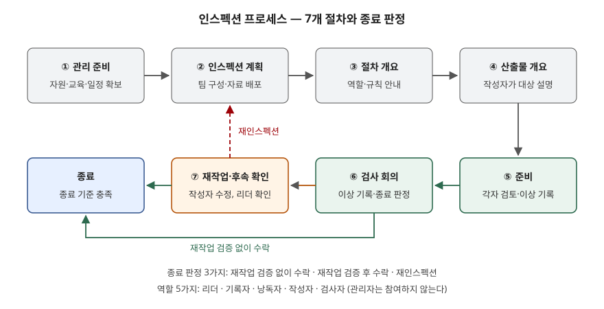

> 실행 검증 없음. IEEE 730-2014(소프트웨어 품질보증 프로세스)와 IEEE 1028-2008(소프트웨어 리뷰와 감사)의
> 용어 정의·절 구성을 뼈대로 쓰고, ISO/IEC 25010과 Fagan의 1976년 논문으로 보강했다.
> 결함 검출률 같은 수치는 쓰지 않았다.

소프트웨어 품질보증을 세 갈래로 물었다 — (가) 소프트웨어 품질의 의미, (나) 품질보증의 목적과 기능,
(다) 인스펙션과 인스펙션 프로세스. 문항 순서대로 Ⅱ·Ⅲ·Ⅳ에 나눠 쓴다. 세 항목은 따로 떨어진 것이
아니라 **"품질이 무엇인지 정하고(가) → 그것이 지켜지는지 확인하는 체계를 세우고(나) → 그 체계가 쓰는
대표 기법 하나를 절차까지 적는다(다)"** 로 이어진다. 이 연결을 개요에 한 줄로 밝혀 두면 답안 전체가 한 덩어리로 읽힌다.

---

## Ⅰ. 개요

### 가. 품질보증이 필요한 이유

소프트웨어는 눈에 보이지 않고, 결함은 만든 단계에서 멀어질수록 고치는 범위가 넓어진다. 요구사항
명세의 오류가 설계·코드·테스트 케이스로 옮겨 간 뒤에 발견되면 그 산출물을 전부 다시 손봐야 한다.
그래서 "다 만든 뒤 테스트로 걸러낸다"만으로는 부족하고, **개발 과정 전체에서 프로세스와 산출물이
기준에 맞는지를 확인하는 활동**이 따로 있어야 한다. 이것이 소프트웨어 품질보증(SQA)이다.

### 나. 세 항목의 관계

| 항목 | 답하는 질문 | 근거 표준 |
|---|---|---|
| 소프트웨어 품질 | 무엇을 "좋다"고 볼 것인가 | IEEE 730-2014, ISO/IEC 25010 |
| 품질보증(SQA) | 그 기준이 지켜지고 있다는 확신을 어떻게 만드는가 | IEEE 730-2014 |
| 인스펙션 | 실행하지 않고 산출물의 결함을 어떻게 찾는가 | IEEE 1028-2008 |

---

## Ⅱ. 소프트웨어 품질의 의미

### 가. 정의

IEEE 730-2014는 소프트웨어 품질을 **소프트웨어 제품이 수립된 요구사항을 충족하는 정도**로 정의한다
(용어 정의 3절, ISO/IEC/IEEE 24765에서 각색). 같은 정의에 단서가 붙는다. 품질은 **그 요구사항이
이해관계자의 요구와 기대를 얼마나 정확히 반영하는가**에 좌우된다는 것이다.

이 정의에서 품질의 두 측면이 나온다.

| 측면 | 뜻 | 어긋나면 |
|---|---|---|
| **요구사항 적합성** | 만든 것이 명세와 일치하는가 | 결함 — 명세대로 동작하지 않는다 |
| **요구의 충족** | 명세가 이해관계자가 실제로 원하는 것을 담았는가 | 명세대로 만들었는데 쓸 수 없는 제품이 나온다 |

앞의 것은 검증(verification), 뒤의 것은 확인(validation)이 다루는 대상이다. 품질을 "결함이 없는 것"
으로만 쓰면 뒤쪽이 빠진다.

### 나. 품질을 나누어 보는 틀 — ISO/IEC 25010 품질 모델

"좋다"를 측정하려면 품질을 특성으로 쪼개야 한다. ISO/IEC 25010:2011은 품질 모델을 **둘**로 둔다.

| 모델 | 무엇을 보는가 | 특성 수 (2011판) |
|---|---|---|
| **제품 품질 모델** | 소프트웨어 자체의 정적·동적 속성 | 8개 |
| **사용 품질 모델** | 특정 사용자가 특정 맥락에서 제품을 쓴 결과 | 5개 |

2023년 개정판(2판)은 제품 품질 특성을 **9개**로 늘렸다 — 기능 적합성, 성능 효율성, 호환성,
상호작용 능력, 신뢰성, 보안성, 유지보수성, 유연성, 안전성. 안전성(Safety)이 새로 들어왔고
사용성은 상호작용 능력으로, 이식성은 유연성으로 이름이 바뀌었다. 사용 품질 모델은 ISO/IEC 25019로 옮겨졌다.

### 다. 소프트웨어 품질의 의미 정리

1. **요구사항 대비 충족 정도**다 — 절대적인 "좋음"이 아니라 기준이 있어야 판단된다
2. **이해관계자에 따라 달라진다** — 사용자는 사용 품질을, 개발·운영자는 유지보수성 같은 제품 품질을 본다
3. **특성으로 분해해 측정한다** — 품질 모델의 특성·부특성에 측정 지표를 붙여야 목표로 관리할 수 있다
4. **제품만이 아니라 프로세스에서 만들어진다** — 품질보증이 프로세스를 함께 보는 이유다

---

## Ⅲ. 소프트웨어 품질보증의 목적과 기능

### 가. 정의와 목적

IEEE 730-2014는 소프트웨어 품질보증을 **소프트웨어 프로세스의 적정성을 정의하고 평가하는 활동의
집합**으로 정의한다(3절). 그 활동이 내놓는 것은 "프로세스가 적절하고, 그 프로세스가 용도에 맞는 품질의
제품을 만든다"는 **확신을 뒷받침하는 증거**다. 정의는 SQA 기능이 **프로젝트로부터 객관성**을 가져야
한다는 점을 핵심 속성으로 든다.

목적은 **네 가지**로 정리한다.

| 목적 | 내용 |
|---|---|
| **확신의 제공** | 제품이 요구사항을 충족할 것이라는 근거를 발주자·경영진·규제 기관에 증거로 보인다 |
| **결함의 예방과 조기 발견** | 프로세스 이탈과 산출물 결함을 만든 단계 가까이에서 찾아 재작업 범위를 줄인다 |
| **적합성 확인** | 계획·산출물·프로세스가 계약, 표준, 규제 요구에 맞는지 평가한다 |
| **프로세스 개선의 근거 확보** | 측정 데이터와 부적합 기록을 쌓아 개선 대상을 정한다 |

품질보증(QA)과 품질통제(QC)는 구분해서 쓴다. 테스트로 제품의 결함을 찾는 일은 품질통제이고,
품질보증은 **그런 활동이 계획대로, 맞는 방식으로 수행되는지를 독립적으로 평가**하는 일이다.

### 나. 기능 — IEEE 730-2014의 3개 그룹 16개 활동

IEEE 730-2014는 SQA 활동을 **3개 그룹, 16개**로 나눈다(5.3~5.5).

| 그룹 | 수 | 활동 |
|---|---|---|
| **SQA 프로세스 구현** (5.3) | 6 | SQA 프로세스 수립 / 관련 소프트웨어 프로세스와 조정 / SQA 계획 문서화 / SQA 계획 실행 / SQA 기록 관리 / 조직의 독립성과 객관성 평가 |
| **제품 보증** (5.4) | 5 | 계획의 계약·표준·규제 적합성 평가 / 제품의 요구사항 적합성 평가 / 제품의 수용 가능성 평가 / 제품 생명주기 지원의 적합성 평가 / 제품 측정 |
| **프로세스 보증** (5.5) | 5 | 생명주기 프로세스와 계획의 적합성 평가 / 개발·시험 환경의 적합성 평가 / 하도급자 프로세스의 적합성 평가 / 프로세스 측정 / 인력의 기술과 지식 평가 |

기능을 답안에 옮길 때는 세 그룹을 이렇게 읽는다.

- **SQA 프로세스 구현** — 품질보증 자체를 세우는 기능이다. 무엇을 언제 누가 평가할지를 SQA 계획서로
  정하고, 평가 기록을 남기며, 평가 조직이 프로젝트 일정·예산 압력에서 독립해 있는지를 스스로 점검한다
- **제품 보증** — 산출물을 본다. 요구사항 명세, 설계서, 코드, 테스트 결과가 요구사항과 기준에 맞는지
  평가하고 측정한다. **리뷰·인스펙션·테스트 결과 검토**가 여기서 쓰이는 수단이다
- **프로세스 보증** — 일하는 방식을 본다. 정해 둔 생명주기 프로세스를 실제로 따르는지, 개발 환경과
  하도급자의 프로세스가 기준에 맞는지, 인력이 필요한 역량을 갖췄는지를 평가한다

### 다. 정보시스템으로 구현되는 지점

품질보증의 기능은 문서 활동으로만 끝나지 않고 개발 인프라에 자리를 잡는다.

| 기능 | 정보시스템에서의 구현 |
|---|---|
| 제품 적합성 평가 | 코드 리뷰 도구의 승인 절차, 정적 분석과 품질 게이트를 빌드 파이프라인에 연결 |
| 제품·프로세스 측정 | 결함 추적 시스템의 결함 분류·발견 단계 데이터, 커버리지·복잡도 지표 수집 |
| 기록 관리 | 리뷰 결과, 부적합 사항, 조치 이력을 형상관리·이슈 관리 시스템에 추적 가능하게 보관 |
| 독립성 | 평가 결과 보고 경로를 프로젝트 관리자와 분리 |

---

## Ⅳ. 인스펙션과 인스펙션 프로세스

### 가. 인스펙션의 정의와 특징

IEEE 1028-2008은 리뷰를 **5가지**로 나눈다 — 관리 리뷰, 기술 리뷰, 인스펙션, 워크스루, 감사(1.1).
이 가운데 인스펙션은 **소프트웨어 제품을 눈으로 검사해 오류와 표준·명세 이탈을 포함한 이상(anomaly)을
탐지하고 식별하는 것**이다(3.3). 정의의 주석은 두 가지를 덧붙인다. **훈련된 중립적 진행자가 이끄는
동료 검사**라는 것, 그리고 **해결책은 회의에서 정하지 않는다**는 것이다.

인스펙션은 M. E. Fagan이 1976년 IBM에서 설계·코드 인스펙션으로 발표한 데서 시작했다. 원 논문은
절차를 개요(Overview) → 준비(Preparation) → 인스펙션(Inspection) → 재작업(Rework) → 후속 확인(Follow-up)의
**5개 작업**으로 제시했고, IEEE 1028은 이를 관리 준비와 계획을 포함한 절차로 표준화했다.

특징은 **다섯 가지**다.

1. **정적 기법** — 실행하지 않고 산출물을 읽어 결함을 찾는다. 요구사항 명세·설계서처럼 실행할 수 없는 산출물에도 쓴다
2. **가장 공식적인 리뷰** — 역할, 진입 기준, 절차, 종료 기준, 산출물이 모두 정해져 있다
3. **발견과 해결의 분리** — 회의는 이상을 찾아 기록하는 데까지만 한다. 고치는 일은 회의 뒤 작성자가 한다
4. **작성자가 진행하지 않는다** — 작성자는 낭독자·기록자를 맡을 수 없고, 리더도 맡지 않도록 권고한다(6.2)
5. **데이터 수집이 필수** — 이상의 분류와 수를 기록해 프로세스 개선과 체크리스트 갱신에 쓴다(6.8, 6.9)

### 나. 역할 5가지

| 역할 | 책임 (IEEE 1028-2008 6.2) |
|---|---|
| **리더** (Inspection leader) | 인스펙션을 계획하고 진행한다. 진입·종료 기준 충족을 확인하고 후속 조치를 검증한다 |
| **기록자** (Recorder) | 회의에서 나온 이상, 조치 항목, 결정을 기록한다 |
| **낭독자** (Reader) | 산출물을 구간별로 풀어 읽으며 회의를 대상 산출물 순서대로 이끈다 |
| **작성자** (Author) | 진입 기준에 맞게 산출물을 준비하고, 회의 뒤 재작업을 수행한다 |
| **검사자** (Inspector) | 이상을 찾아낸다. **참가자 전원이 검사자**다 |

팀원의 관리자는 참여하지 않는다. 인스펙션 결과가 인사 평가에 쓰이면 참가자가 결함을 드러내지 않게 되기 때문이다.

### 다. 인스펙션 프로세스 — 7개 절차

> **출처**: [IEEE 1028-2008, IEEE Standard for Software Reviews and Audits §6.5 Procedures, §6.6 Exit criteria](https://ieeexplore.ieee.org/document/4601584)

IEEE 1028-2008의 인스펙션 장은 **입력(6.3) → 진입 기준(6.4) → 절차(6.5) → 종료 기준(6.6) → 출력(6.7)**
순으로 구성된다. 절차는 **7개**다.

| 순서 | 절차 | 누가 무엇을 하는가 |
|---|---|---|
| ① | **관리 준비** (Management preparation) | 관리자가 인스펙션에 필요한 시간·인력·교육을 확보하고 프로젝트 계획에 반영한다 |
| ② | **인스펙션 계획** (Planning the inspection) | 작성자가 대상 자료를 모으고, 리더가 팀을 구성해 역할을 배정하고 일정을 잡아 자료를 배포한다 |
| ③ | **절차 개요** (Overview of inspection procedures) | 리더가 인스펙션 절차와 역할, 진행 규칙을 팀에 안내한다 |
| ④ | **산출물 개요** (Overview of inspection product) | 작성자가 대상 산출물의 배경과 구조를 설명한다 |
| ⑤ | **준비** (Preparation) | 검사자가 **회의 전에 각자** 산출물을 검토하고 찾은 이상을 적어 둔다 |
| ⑥ | **검사** (Examination) | 회의를 연다 — 회의 소개 → 일반 사항 검토 → 산출물 검토와 이상 기록 → 이상 목록 검토 → **종료 판정** |
| ⑦ | **재작업·후속 확인** (Rework/follow-up) | 작성자가 이상을 수정하고, 리더가 조치 항목이 모두 종결됐는지 확인한다 |

⑥의 종료 판정은 **3가지** 중 하나다.

| 판정 | 뜻 | 다음 |
|---|---|---|
| 재작업 검증 없이 수락 | 그대로, 또는 사소한 수정만으로 받아들인다 | 종료 |
| 재작업 검증 후 수락 | 작성자가 고친 것을 리더(또는 지정된 사람)가 확인한 뒤 받아들인다 | ⑦ → 종료 |
| 재인스펙션 | 수정 범위가 커서 재작업 뒤 인스펙션을 다시 연다 | ⑦ → ②부터 다시 |

진입 기준과 종료 기준이 인스펙션을 다른 리뷰와 가른다. **진입 기준**(6.4)은 승인, 전제 조건, 최소 진입
기준의 세 갈래로, 산출물이 검토할 수 있는 상태가 아니면 회의를 열지 않는다. **종료 기준**(6.6)은 절차의
활동이 모두 끝나고 출력(이상 목록·이상 요약·인스펙션 문서)이 존재하는 것이다.

### 라. 다른 리뷰와의 비교

IEEE 1028-2008 부록 A의 리뷰 비교표(Table A.1)를 옮기면 다음과 같다.

| 구분 | 기술 리뷰 | **인스펙션** | 워크스루 |
|---|---|---|---|
| 목적 | 명세·계획 적합성 평가, 변경의 무결성 평가 | **이상 발견, 해결 검증, 제품 품질 검증** | 이상 발견, 대안 검토, 제품 개선, 학습 |
| 진행자 | 보통 수석 엔지니어 | **훈련된 진행자** | 진행자 또는 작성자 |
| 산출물을 설명하는 사람 | 리더가 지정 | **낭독자** | 작성자 |
| 체크리스트 | 선택 | **사용** | 선택 |
| 데이터 수집 | 공식 요구 아님 | **필수** | 권고 |
| 권장 인원 | 3명 이상 | **3~6명** | 2~7명 |
| 관리자 참여 | 필요할 때 | **참여하지 않음** | 참여하지 않음 |
| 출력 | 기술 리뷰 문서, 조치 항목 | **이상 목록, 이상 요약, 인스펙션 문서** | 이상 목록, 조치 항목, 결정, 후속 제안 |

워크스루는 작성자가 산출물을 설명하며 진행할 수 있어 준비 부담이 적고, 인스펙션은 작성자가 아닌
낭독자가 읽으므로 **작성자가 의도한 뜻이 아니라 문서에 적힌 뜻**이 검토된다. 공식성이 높은 만큼
인력과 시간이 더 든다.

ISO/IEC 20246:2017은 리뷰 유형과 무관한 일반 리뷰 프로세스를 **5개 활동** — 계획, 리뷰 착수, 개별 리뷰,
이슈 전달과 분석, 수정과 보고 — 로 정의한다(6.4). IEEE 1028의 7개 절차는 이 다섯 활동에 대응시킬 수 있고,
표준 부록에 IEEE 1028-2008과의 대응표가 있다.

### 마. 적용 시 고려사항

| 고려사항 | 판단 기준 |
|---|---|
| **대상 선별** | 모든 산출물에 인스펙션을 걸 수 없다. 요구사항 명세, 인터페이스 설계, 보안·안전 관련 코드처럼 결함의 파급이 큰 산출물에 쓰고 나머지는 워크스루나 도구 기반 코드 리뷰로 돌린다 |
| **진입 기준 준수** | 컴파일 오류나 정적 분석 경고가 남은 코드를 올리면 회의 시간이 도구가 잡을 결함에 쓰인다. 기계가 찾을 수 있는 것은 먼저 걸러 낸다 |
| **개별 준비 시간** | 준비 없이 회의에 오면 회의가 첫 읽기 시간이 된다. 준비 시간을 일정에 잡고 준비 여부를 리더가 확인한다 |
| **데이터의 용도 제한** | 이상 데이터를 개인 평가에 쓰지 않는다. 쓰이는 순간 결함이 보고되지 않는다 |
| **결과의 환류** | 자주 나오는 이상 유형을 체크리스트와 코딩 표준, 정적 분석 규칙에 반영해야 같은 결함이 줄어든다 |

---

## Ⅴ. 결론

소프트웨어 품질은 제품이 수립된 요구사항을 충족하는 정도이고, 그 요구사항이 이해관계자의 기대를
제대로 담았는지까지 포함한다. 품질보증은 이 품질이 달성될 것이라는 확신을 **독립적인 평가와 증거**로
만드는 활동으로, IEEE 730-2014는 이를 SQA 프로세스 구현·제품 보증·프로세스 보증의 3개 그룹 16개
활동으로 정리했다. 인스펙션은 제품 보증이 쓰는 가장 공식적인 정적 검토 기법이며, 5개 역할과 7개 절차,
진입·종료 기준, 필수 데이터 수집이 다른 리뷰와 구분되는 지점이다. 정적 분석 도구와 코드 리뷰 시스템이
보급된 지금도 인스펙션의 원칙 — 회의 전 개별 준비, 발견과 해결의 분리, 작성자가 아닌 사람의 진행,
데이터 축적 — 은 그대로 쓰이며, 도구가 찾지 못하는 요구사항·설계 수준의 결함에 사람의 검토를 집중시키는
방향으로 적용한다.

> 개념 정리: [소프트웨어 품질 비용(COQ)과 결함 제거 효율](../../software-engineering/2026-10-03-cost-of-quality-defect-removal-efficiency/index.md)
>
> 개념 정리: [SQuaRE 표준군 구조 — 5개 부문과 확장 부문, 그리고 품질 모델 4종](../../software-engineering/2026-09-22-square-standard-family-structure/index.md)
>
> 개념 정리: [소프트웨어 리뷰 유형 — IEEE 1028의 관리 리뷰·기술 리뷰·인스펙션·워크스루·감사](../../software-engineering/2026-11-27-ieee-1028-software-review-types/index.md)
>
> 관련 답안: [기출문제 — ISO/IEC 25010 제품 품질 모델의 주특성과 부특성](../2026-09-22-iso-iec-25010-product-quality-model/index.md)

끝

---

## 답안 작성 메모

- **(다)에 지면의 절반을 쓴다.** (가)와 (나)는 정의와 표로 반 장씩, (다)는 역할표·절차 도식·비교표로
  한 장 반을 잡는다. 인스펙션 "과" 인스펙션 프로세스를 나눠 물었으므로 정의·특징과 절차를 소항목으로 분리한다.
- **품질의 의미는 정의 한 줄 + 두 측면으로 쓴다.** "요구사항 충족 정도"만 쓰고 끝내면 다른 답안과
  구별되지 않는다. "그 요구사항이 이해관계자의 기대를 담았는가"라는 단서를 붙여 검증과 확인으로 잇는다.
- **품질보증의 기능은 3개 그룹으로 묶는다.** 16개 활동을 다 외울 필요는 없고, 그룹 이름 셋과 그룹마다
  활동 두세 개를 쓴다. "독립성과 객관성 평가"는 꼭 넣는다 — 품질보증이 품질통제와 갈리는 지점이다.
- **도식은 상자 8개다.** 윗줄에 회의 전 절차 넷, 아랫줄에 준비·검사 회의·재작업·종료를 놓고
  재인스펙션 되돌이 화살표 하나를 그린다. 3분이면 옮긴다.
- **점수가 갈리는 곳은 인스펙션과 워크스루의 차이다.** 진행자(훈련된 진행자 대 작성자), 설명하는 사람
  (낭독자 대 작성자), 데이터 수집(필수 대 권고) 세 줄은 시간이 없어도 남긴다.
- 절차를 Fagan의 5개 작업으로 외웠다면 그대로 써도 된다. 다만 출처를 Fagan(1976)으로 밝히고,
  IEEE 1028은 앞에 관리 준비와 계획이 붙는다는 점을 한 줄 덧붙인다. 계획을 앞에 둔 6단계로 인용하는
  자료도 많은데, 이 답안은 원문으로 확인한 두 가지(Fagan 5개, IEEE 1028 7개)만 썼다.
- 시간이 모자라면 Ⅲ의 "정보시스템으로 구현되는 지점"과 Ⅳ의 ISO/IEC 20246 문단을 버린다.
- 결함 검출률이나 비용 절감 배수는 쓰지 않는다. 사례 보고마다 값이 다르고 조건이 붙는다.

---

## 참고 자료

- [IEEE 730-2014, IEEE Standard for Software Quality Assurance Processes](https://standards.ieee.org/ieee/730/5284/) — 3절 소프트웨어 품질·품질보증 정의, 5.3~5.5 SQA 활동 3개 그룹 16개
- [IEEE 1028-2008, IEEE Standard for Software Reviews and Audits](https://ieeexplore.ieee.org/document/4601584) — 1.1 리뷰 5가지, 3.3 인스펙션 정의, 6절 인스펙션(역할·진입 기준·절차·종료 기준·출력), 부록 A 리뷰 비교표
- [M. E. Fagan, Design and code inspections to reduce errors in program development, IBM Systems Journal 15(3), pp. 182–211 (1976)](https://doi.org/10.1147/sj.153.0182) — 인스펙션의 5개 작업
- [ISO/IEC 25010:2011, Systems and software Quality Requirements and Evaluation (SQuaRE) — System and software quality models (VDE 미리보기)](https://assets.vde-verlag.de/iec-normen/preview-pdf/info_isoiec25010%7Bed1.0%7Den.pdf) — 1절 제품 품질 8개·사용 품질 5개 특성
- [ISO/IEC 25010:2023, SQuaRE — Product quality model (iTeh 미리보기)](https://cdn.standards.iteh.ai/samples/78176/13ff8ea97048443f99318920757df124/ISO-IEC-25010-2023.pdf) — 서문·1절 제품 품질 9개 특성과 개정 내용
- [ISO/IEC 20246:2017, Software and systems engineering — Work product reviews (VDE 미리보기)](https://assets.vde-verlag.de/iec-normen/preview-pdf/info_isoiec20246%7Bed1.0%7Den.pdf) — 6.4 일반 리뷰 프로세스의 5개 활동, 부록 E IEEE 1028-2008 대응
- [ISTQB Certified Tester Foundation Level Syllabus v4.0.1 (2024-09-15)](https://www.istqb.org/wp-content/uploads/2024/11/ISTQB_CTFL_Syllabus_v4.0.1.pdf) — 3.2 리뷰 프로세스, 리뷰 유형별 차이
