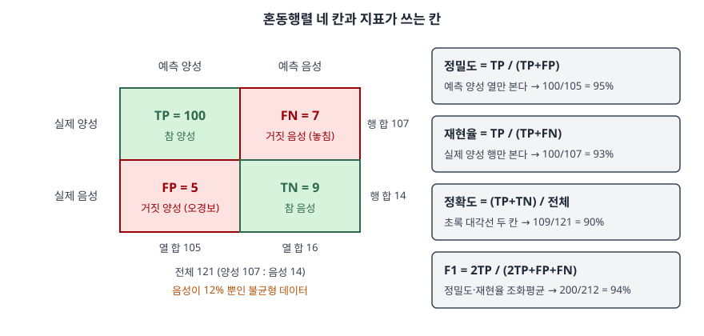

기출문제에서 혼동행렬 네 칸의 값을 주고 정확도·정밀도·재현율·F1을 계산해 해석하라고 묻는다.
문항은 세 갈래(가·나·다)로 나뉘고, 결과는 %로 쓰되 소수점 아래를 버리라는 조건이 붙는다.
계산 자체는 1분이면 끝난다. 점수가 갈리는 곳은 **"모든 지표가 90%를 넘는다"에서 멈추지 않는 해석**이다.
아래 수치는 전부 [`code/metrics.py`](code/metrics.py)를 분수로 계산해 [`code/output.txt`](code/output.txt)에
남긴 값이다. 공식은 계산으로 검산했고, 지표의 정의와 해석은 아래 참고 자료의 문서 근거다.

---

## Ⅰ. 개요

**혼동행렬(Confusion Matrix)** 은 **분류 모델의 예측 결과를 실제 클래스와 예측 클래스의 조합별 건수로
집계한 표**다. 이진 분류에서는 2×2 표가 되고, 네 칸이 참 양성(TP)·거짓 양성(FP)·거짓 음성(FN)·참 음성(TN)이다.
정확도 하나만으로는 **어느 쪽으로 틀렸는지**가 보이지 않으므로, 오류를 두 종류로 갈라 세는 이 표가
모델 평가의 출발점이 된다.

주어진 결과는 전체 121건, 실제 양성 107건, 실제 음성 14건이다. **음성이 12%뿐인 불균형 데이터**라는 점이
이후 해석 전체를 좌우한다.

## Ⅱ. (가) 혼동행렬을 사용한 성능 평가 원리

### 가. 네 칸의 구성 — 4가지



> **출처**: [Google MLCC — Classification: Accuracy, recall, precision, and related metrics](https://developers.google.com/machine-learning/crash-course/classification/accuracy-precision-recall) · [scikit-learn 1.9.1 — Metrics and scoring: Confusion matrix](https://scikit-learn.org/stable/modules/model_evaluation.html#confusion-matrix)

| 칸 | 실제 | 예측 | 뜻 | 이 문제 |
|---|---|---|---|---|
| ① **TP** 참 양성 | 양성 | 양성 | 맞게 찾음 | 100 |
| ② **FN** 거짓 음성 | 양성 | 음성 | 놓침 (2종 오류) | 7 |
| ③ **FP** 거짓 양성 | 음성 | 양성 | 오경보 (1종 오류) | 5 |
| ④ **TN** 참 음성 | 음성 | 음성 | 맞게 거름 | 9 |

### 나. 평가 원리 — 3가지

① **오류를 두 방향으로 나눠 센다.** 같은 12건의 오류라도 놓친 것(FN 7)과 잘못 경보한 것(FP 5)은 업무상
비용이 다르다. 혼동행렬은 이 둘을 다른 칸에 둔다.

② **지표마다 보는 칸의 범위가 다르다.** 정밀도는 **예측 양성 열**(TP+FP)만, 재현율은 **실제 양성 행**(TP+FN)만,
정확도는 **표 전체**를 분모로 쓴다. 분모가 다르므로 같은 표에서 지표가 서로 다른 질문에 답한다.
정밀도는 "양성이라고 한 것 중 몇 개가 맞나", 재현율은 "실제 양성 중 몇 개를 찾았나"다.

③ **표는 임계값 하나의 결과다.** 모델이 확률을 내고 임계값으로 자르면, 임계값을 올릴수록 FP가 줄어
정밀도가 오르고 FN이 늘어 재현율이 내려가는 경향이 있다. 그래서 정밀도와 재현율은 함께 보고,
임계값 전체에 걸친 평가는 ROC·PR 곡선으로 따로 한다.

## Ⅲ. (나) 정확도·정밀도·재현율 계산 결과와 해석

### 가. 계산 — 3가지

| 지표 | 공식 | 대입 | 값 | 버림 |
|---|---|---|---|---|
| 정확도 Accuracy | (TP+TN) / 전체 | 109 / 121 | 0.90083 | **90%** |
| 정밀도 Precision | TP / (TP+FP) | 100 / 105 | 0.95238 | **95%** |
| 재현율 Recall | TP / (TP+FN) | 100 / 107 | 0.93458 | **93%** |

```text
[문항이 묻는 지표]
정확도           (TP+TN)/전체                  109/121 = 0.90083 -> 90%
정밀도           TP/(TP+FP)                    20/21 = 0.95238 -> 95%
재현율           TP/(TP+FN)                  100/107 = 0.93458 -> 93%
```

### 나. 해석 — 3가지

① **정밀도 95%** — 모델이 양성이라고 판정한 105건 중 100건이 실제 양성이다. 양성 판정 20건 중 1건꼴로
오경보다. 양성 판정 뒤에 비싼 조치(정밀 검사·계정 차단)가 따르는 업무라면 이 값이 중요하다.

② **재현율 93%** — 실제 양성 107건 중 7건을 놓쳤다. 놓친 건이 사고로 이어지는 업무(질병 선별·사기 탐지)에서는
이 7건이 정밀도의 5건보다 무겁다. 정밀도가 재현율보다 높으므로, 이 모델은 **오경보보다 놓침이 조금 더 많은**
쪽으로 기울어 있다.

③ **정확도 90%는 그대로 믿을 수 없다.** 같은 데이터에서 **무조건 양성이라고 답하는 모델**도 정확도가
107/121 = 88%다. 이 모델이 그 기준선보다 나은 것은 2%p뿐이다. 음성 쪽만 떼어 보면 실제 음성 14건 중
9건만 맞혀 **특이도(TN/(TN+FP))는 64%** 이고, 음성이라고 판정한 16건 중 맞은 것은 9건으로
음성 예측도는 56%다. 양성 클래스 기준의 지표가 모두 90%를 넘는 동안 **음성 클래스는 사실상 절반 가까이 틀린다.**

```text
[해석을 위한 보조 지표]
특이도           TN/(TN+FP)                     9/14 = 0.64286 -> 64%
음성 예측도        TN/(TN+FN)                     9/16 = 0.56250 -> 56%
전부 양성 기준선     (TP+FN)/전체                  107/121 = 0.88430 -> 88%
균형 정확도        (재현율+특이도)/2               2363/2996 = 0.78872 -> 78%
MCC           (TP*TN-FP*FN)/sqrt(...)     865/1586.4 = 0.54526
```

클래스별 재현율을 평균한 **균형 정확도는 78%** 로, 정확도 90%와 12%p 차이가 난다. 이 차이가 곧
불균형 데이터에서 정확도가 부풀려지는 폭이다.

## Ⅳ. (다) F1-score 계산 결과와 해석

### 가. 계산

F1은 정밀도와 재현율의 **조화평균**이다. 칸으로 풀면 TN이 빠진 식이 된다.

```
F1 = 2 × P × R / (P + R) = 2TP / (2TP + FP + FN) = 200 / 212 = 0.94340 → 94%
```

```text
F1            2PR/(P+R)                     50/53 = 0.94340 -> 94%
F1 (칸으로)      2TP/(2TP+FP+FN)               50/53 = 0.94340 -> 94%

[버린 값을 다시 넣으면]
F1 (95%,93%)  2*0.95*0.93/1.88          1767/1880 = 0.93989 -> 93%
```

**버림은 마지막에 한 번만 한다.** 앞에서 버린 95%와 93%를 다시 넣으면 0.9399가 되어 93%로 떨어진다.
문항이 "계산 결과는 소수점을 버린다"고 했으므로 원래 분수로 계산한 뒤 버린 94%가 맞다.
답안에는 2TP/(2TP+FP+FN) 식을 쓰면 중간 반올림 없이 정수만으로 끝난다.

### 나. 해석 — 3가지

① **F1 94%는 정밀도와 재현율이 고르게 높다는 뜻이다.** 조화평균은 둘 중 작은 값에 끌려가므로,
한쪽만 높은 모델은 F1이 낮게 나온다. 이 모델은 95%와 93%로 균형이 맞아 F1이 산술평균(94.3%)과 거의 같다.

② **F1에는 TN이 없다.** 위 식에서 TN 9가 어디에도 들어가지 않는다. TN이 0이든 900이든 F1은 94%로 같다.
그래서 F1은 양성 클래스를 잘 찾는지에 대한 지표이고, 이 데이터처럼 **음성 쪽 성능이 나쁜 것은 드러내지 못한다.**

③ **양성과 음성 중 무엇이 중요한지에 따라 다른 지표를 같이 낸다.** 음성 클래스도 중요하면 F1과 함께
특이도·균형 정확도를 내거나, 네 칸을 모두 쓰는 **매튜스 상관계수(MCC)** 를 쓴다. 이 문제의 MCC는 0.545로,
네 칸 전체로 보면 상관이 중간 정도에 머문다. 재현율과 정밀도 중 한쪽이 더 중요하면 가중치 β를 둔
F_β(β>1이면 재현율 쪽)를 쓴다.

### 다. 지표 비교

| 지표 | 쓰는 칸 | 이 문제 | 질문 | 불균형에서 | 맞는 상황 |
|---|---|---|---|---|---|
| 정확도 | 4칸 전부 | 90% | 전체 중 몇 개 맞혔나 | 다수 클래스에 끌려 **부풀려짐** | 클래스가 고를 때 |
| 정밀도 | TP·FP | 95% | 양성 판정 중 몇 개가 진짜인가 | 양성 쪽만 봄 | 오경보 비용이 클 때 |
| 재현율 | TP·FN | 93% | 실제 양성 중 몇 개 찾았나 | 양성 쪽만 봄 | 놓침 비용이 클 때 |
| F1 | TP·FP·FN | 94% | 정밀도·재현율이 고른가 | **TN 무시** | 양성 탐지가 목적일 때 |
| 특이도 | TN·FP | 64% | 실제 음성 중 몇 개 걸렀나 | 음성 쪽만 봄 | 음성 판별도 중요할 때 |
| MCC | 4칸 전부 | 0.545 | 예측과 실제의 상관 | 두 클래스를 함께 반영 | 불균형 데이터 종합 평가 |

## Ⅴ. 결론

주어진 모델은 정확도 90%, 정밀도 95%, 재현율 93%, F1 94%로 **양성 클래스를 찾는 성능은 높다.**
그러나 실제 음성이 14건뿐이라 정확도는 무조건 양성 기준선 88%보다 2%p 높을 뿐이고, 특이도는 64%에 그친다.
따라서 이 모델을 평가 보고할 때는 ① 클래스 분포와 기준선을 함께 적고, ② 양성 지표(F1)와 음성 지표(특이도)를
나란히 내며, ③ 업무에서 FN과 FP 중 무엇이 비싼지를 정해 임계값을 조정해야 한다. 혼동행렬은 이 세 판단을
하나의 표에서 가능하게 하는 도구이고, 지표 한 개로 결론짓지 않는 것이 핵심이다.

> 개념 정리: [머신러닝 모델 평가 지표 — 혼동행렬에서 정밀도와 재현율이 갈리는 곳](../../emerging-tech/2026-09-30-ml-evaluation-metrics-confusion-matrix/index.md)

> 함께 보기: [기출문제 — 과적합과 과소적합의 원인과 해결](../2026-10-10-overfitting-underfitting-causes-remedies/index.md)

끝

## 답안 작성 메모

- **먼저 쓸 것**: 2×2 표에 숫자를 채우고 행 합(107·14)·열 합(105·16)·전체(121)를 바깥에 적는다.
  이 다섯 숫자가 있으면 모든 지표가 분수 하나로 끝난다.
- **버림 함정**: F1을 버린 95%·93%로 계산하면 93%가 나와 정답 94%와 어긋난다. **2TP/(2TP+FP+FN) = 200/212**로
  쓰면 중간값 없이 바로 94%다. 채점자가 이 차이를 보는지는 알 수 없지만, 식을 정수로 쓰면 시비가 없다.
- **점수가 갈리는 지점**: ① 전부 양성 기준선 88%를 계산해 정확도 90%의 의미를 깎아 보는가,
  ② 특이도 64%로 음성 쪽 약점을 드러내는가, ③ F1에 TN이 없다는 구조를 짚는가. 계산만 맞히면 절반이다.
- **개수를 붙인다**: 네 칸 **4가지**, 평가 원리 **3가지**, 해석 각 **3가지**. 비교표는 최소 정확도·정밀도·재현율·F1
  네 줄이면 된다.
- **시간이 모자라면**: MCC와 F_β를 버린다. 기준선 88%와 특이도 64% 두 줄은 남긴다 — 이 문제가 TN 9를
  일부러 작게 준 이유가 그것이다.
- **쓰지 말 것**: "F1이 94%이므로 우수한 모델이다"처럼 수치 하나로 결론 내는 문장, 근거 없는
  "F1 0.9 이상이면 양호" 같은 기준선.

## 참고 자료

- [Google Machine Learning Crash Course — Classification: Accuracy, recall, precision, and related metrics](https://developers.google.com/machine-learning/crash-course/classification/accuracy-precision-recall) — 정확도·재현율·정밀도·특이도(FPR)·F1 정의, 불균형 데이터에서 정확도의 한계
- [Google Machine Learning Crash Course — Classification: ROC and AUC](https://developers.google.com/machine-learning/crash-course/classification/roc-and-auc) — 임계값 전체에 걸친 평가
- [scikit-learn 1.9.1 — Metrics and scoring: quantifying the quality of predictions](https://scikit-learn.org/stable/modules/model_evaluation.html) — 혼동행렬 칸 배치, F_β, 균형 정확도, MCC 정의
- [D. Chicco, G. Jurman, "The advantages of the Matthews correlation coefficient (MCC) over F1 score and accuracy in binary classification evaluation", *BMC Genomics* 21:6 (2020)](https://doi.org/10.1186/s12864-019-6413-7) — F1이 TN을 쓰지 않는 문제와 불균형 데이터에서 MCC의 장점
- [T. Fawcett, "An introduction to ROC analysis", *Pattern Recognition Letters* 27(8), 861–874 (2006)](https://doi.org/10.1016/j.patrec.2005.10.010) — 혼동행렬과 그로부터 나오는 지표의 정의
- 전체 소스: [`code/metrics.py`](code/metrics.py) · 실행 기록: [`code/output.txt`](code/output.txt)
