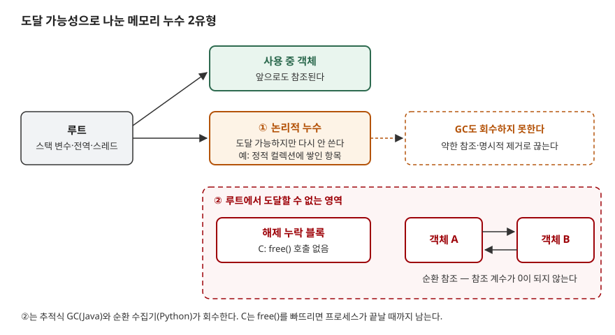

기출문제가 동적 메모리 할당에 대해 세 가지를 차례로 묻는다. 왜 필요한가, 누수가 생기면 무엇이
문제인가, 그리고 Java·Python 같은 언어는 누수를 어떻게 막는가. 세 물음은 한 줄로 이어진다.
**동적 할당은 객체의 수명을 프로그램이 정하게 해 주는 대신, 그 수명을 끝내는 책임도 프로그램에
넘긴다.** 그 책임을 놓친 결과가 누수이고, 언어들은 그 책임을 런타임·타입 시스템·구문으로 나눠
가져간다. 이 답안은 누수를 **"도달할 수 없는데 해제되지 않은 것"과 "도달할 수 있지만 다시 쓰지
않는 것"** 두 유형으로 나눠, 다(해결 방안)에서 어느 장치가 어느 유형을 막는지 짝지어 쓴다.

> 실행 검증 없음. 개념 문제이므로 표준 문서와 공식 매뉴얼 근거만으로 정리했다. 할당 저장소의
> 수명은 C 표준 작업초안(N2310)에서, 누수의 정의와 피해는 MITRE CWE-401·772에서, Java의 GC·참조
> 강도·자원 해제는 Oracle Java SE 21 API·JLS·문제 해결 가이드와 JDK 25 GC 튜닝 가이드에서, Python의
> 참조 계수·순환 수집기·약한 참조는 Python 3.13 공식 문서와 CPython 내부 설계 문서에서, Rust의
> 소유권은 공식 교재에서 확인했다. 수치는 쓰지 않았다.

---

## Ⅰ. 개요

### 가. 동적 메모리 할당의 정의

동적 메모리 할당은 **실행 중에 필요한 크기만큼 힙에서 메모리를 받아 쓰고, 다 쓰면 돌려주는
할당 방식**이다. C 표준의 메모리 관리 함수 절(N2310 §7.22.3)은 이렇게 받은 객체의 수명을
**할당부터 해제까지**로 정한다. 함수가 끝나면 사라지는 자동 저장 기간이나, 프로그램 내내 살아 있는
정적 저장 기간과 달리 **끝나는 시점을 프로그램이 정한다.**

### 나. 할당 방식 3가지 비교

| 구분 | 정적 할당 | 스택(자동) 할당 | 동적(힙) 할당 |
|---|---|---|---|
| 크기 결정 | 컴파일 시점 | 컴파일 시점 (대개) | 실행 시점 |
| 수명 | 프로그램 전체 | 선언된 블록 안 | 할당 ~ 해제 |
| 해제 주체 | 없음 (종료 시) | 블록을 나갈 때 자동 | 프로그래머 또는 런타임 |
| 실패 형태 | 링크·적재 실패 | 스택 넘침 | 할당 실패, **누수**, 해제 후 사용 |

## Ⅱ. 동적 메모리 할당의 필요성 — 4가지

① **크기를 실행해 봐야 안다.** 읽어 들일 레코드 수, 사용자가 입력할 문자열 길이, 네트워크로
들어올 패킷 크기는 컴파일 시점에 정해지지 않는다. 최대치로 잡아 두면 대부분의 실행에서 메모리를
낭비하고, 작게 잡으면 넘친다.

② **수명이 함수 범위를 넘는다.** 스택 객체는 선언된 블록을 나가면 끝난다. 요청을 받은 함수가
만든 세션 객체를 다른 스레드가 이어 쓰는 것처럼, **만든 함수보다 오래 살아야 하는 객체**는 힙에
둬야 한다.

③ **개수가 실행 중에 늘고 준다.** 연결 리스트·트리·해시 테이블·그래프는 노드를 하나씩 붙이고
떼는 구조다. 노드마다 따로 할당하고 따로 돌려줄 수 있어야 이런 자료구조가 성립한다.

④ **필요한 동안만 점유한다.** 쓰는 동안만 받아 쓰고 돌려주면 같은 물리 메모리를 여러 작업이
번갈아 쓸 수 있다. 장시간 도는 서버가 요청마다 버퍼를 받고 돌려주는 이유다.

이 네 가지는 모두 **수명을 코드 구조가 아니라 실행 흐름이 정한다**는 한 가지 사실에서 나온다.
그래서 동적 할당은 해제 시점을 누군가 판단해야 하고, 그 판단이 틀리면 Ⅲ의 문제가 된다.

## Ⅲ. 메모리 누수(Memory Leak)로 인한 문제

### 가. 정의

MITRE CWE-401(Missing Release of Memory after Effective Lifetime)은 메모리 누수를 **할당한 메모리를
쓴 뒤 추적해 해제하지 않아 다시 쓸 수 없게 되는 약점**으로 정의한다. 상위 항목인 CWE-772는 같은
문제를 메모리에 한정하지 않고 **유효 수명이 끝난 자원을 해제하지 않는 것**으로 넓혀 다룬다. 파일
핸들·소켓·DB 커넥션을 닫지 않는 것도 같은 계열의 누수다.

### 나. 누수의 2유형 — 도달 가능성으로 나눈다

> **출처**: 도달 불가 객체를 쓰레기로 보는 기준은 [Oracle JDK 25 HotSpot Virtual Machine Garbage Collection Tuning Guide — 3 Garbage Collector Implementation, Generational Garbage Collection](https://docs.oracle.com/en/java/javase/25/gctuning/garbage-collector-implementation.html), 의도치 않게 붙잡힌 객체를 Java의 누수로 보는 것은 [Oracle Java SE 21 Troubleshooting Guide — Troubleshoot Memory Leaks, The java.lang.OutOfMemoryError Error](https://docs.oracle.com/en/java/javase/21/troubleshoot/troubleshooting-memory-leaks.html), 순환 참조가 참조 계수만으로 해제되지 않는 것은 [CPython InternalDocs — Garbage collector design, Abstract](https://github.com/python/cpython/blob/main/InternalDocs/garbage_collector.md) 근거다.

| 구분 | ① 논리적 누수 | ② 해제 누락 (도달 불가) |
|---|---|---|
| 상태 | 루트에서 **도달 가능**하지만 다시 쓰지 않음 | 루트에서 **도달 불가**인데 해제되지 않음 |
| 주로 생기는 언어 | Java·Python 등 GC 언어 | C·C++, 참조 계수만 쓰는 구조의 순환 |
| 전형적 원인 | 정적 컬렉션·캐시에 계속 추가, 해제 안 한 리스너 | `free()`/`delete` 누락, 예외 경로에서 해제 건너뜀, 순환 참조 |
| GC가 회수하는가 | **못 한다** — 살아 있는 참조가 있으므로 | 추적식 GC는 회수한다 |

Oracle 문제 해결 가이드는 Java에서 `OutOfMemoryError: Java heap space`가 난다고 바로 누수는
아니며 힙을 작게 잡은 탓일 수도 있다고 먼저 짚는다. 그러나 **오래 도는 애플리케이션이라면 객체를
의도치 않게 붙잡고 있는 것이 원인일 수 있고, 이것이 Java에서의 누수**라고 적는다. 애플리케이션이
부르는 API가 참조를 쥐고 있는 경우도 든다. 즉 GC가 있는 언어에서도 ①은 남는다.

### 다. 누수가 일으키는 문제 — 4가지

① **가용성 상실(서비스 거부).** CWE-401은 결과로 프로세스의 충돌·종료·재시작, 불안정, 메모리 자원
소모를 든다. 할당이 끝내 실패하면 C에서는 `malloc()`이 널을 돌려주고, Java에서는
`OutOfMemoryError`가 난다.

② **성능 저하.** CWE-401은 가용성과 별도로 성능 저하를 결과로 적는다. 물리 메모리를 넘기면 운영체제가
페이지를 내보내기 시작하고, GC 언어는 회수할 것이 없는 힙을 반복해 훑는다. Oracle 가이드가 `OutOfMemoryError`의 한 갈래로 따로 드는
`GC overhead limit exceeded`가 이 상태에서 난다.

③ **장시간 운영에서 누적된다.** 요청 한 건마다 조금씩 새는 누수는 짧은 테스트로는 드러나지 않고 며칠
뒤 장애로 나타난다. 재시작하면 사라지므로 원인 추적이 늦어지고, **주기적 재시작이 운영 절차로 굳는**
결과를 낳는다.

④ **공격 수단이 된다.** CWE-401은 누수를 일으킬 수 있는 공격자가 서비스 거부를 노릴 수 있다고 적고,
악용 가능성을 중간(Medium)으로 매긴다. 외부 입력 한 번에 일정량이 새는 경로가 있으면 그 입력을
반복하는 것만으로 서버를 멈출 수 있다.

## Ⅳ. 프로그래밍 언어에서 지원하는 메모리 누수 해결방안

해결 장치는 **누가 수명을 판단하느냐**로 나뉜다. 런타임이 판단하면 GC, 프로그래머가 참조의 강도를
고르면 약한 참조, 구문이 판단하면 자원 수명 구문, 컴파일러가 판단하면 소유권이다. 여기에 남은 누수를
찾아내는 탐지 도구가 더해진다.

### 가. 런타임 자동 회수 (GC) — ②를 막는다

**(1) Java — 추적식 세대별 GC.** Oracle GC 튜닝 가이드는 GC의 일을 **운영체제에서 메모리를 얻어
애플리케이션에 나눠 주고, 어느 부분이 아직 쓰이는지 판단해 나머지를 회수하는 것**으로 정의한다. 실행
중인 프로그램의 살아 있는 객체 어디에서도 참조로 닿을 수 없는 객체가 쓰레기다. 대부분의 객체가 짧게
산다는 **약한 세대 가설**에 따라 힙을 young(eden + survivor 2개)과 old로 나누고, young만 훑는 minor
수집을 자주, 힙 전체를 훑는 major 수집을 드물게 수행한다. 도달 가능성으로 판단하므로 **순환 참조도
회수된다.**

**(2) Python — 참조 계수 + 순환 수집기.** Python 언어 참조의 객체 절은 CPython이 **참조 계수 방식에
순환 쓰레기의 (선택적) 지연 탐지를 더해** 쓴다고 적는다. 대부분의 객체는 도달 불가가 되는 즉시
해제되지만, 순환 쓰레기는 회수가 보장되지 않는다. `gc` 모듈 문서는 순환 수집기를 참조 계수의
**보충**이라 부르고, 순환을 만들지 않는다고 확신할 때만 끌 수 있다고 적는다. CPython 설계 문서가
밝히는 탐지 절차는 다음과 같다.

| 단계 | 동작 |
|---|---|
| 1 | 추적 대상(리스트·딕셔너리·인스턴스 같은 컨테이너)의 참조 계수를 `gc_ref`로 복사 |
| 2 | 각 객체가 가리키는 대상의 `gc_ref`를 1씩 뺀다 — 집합 **안쪽**에서 온 참조를 지운다 |
| 3 | `gc_ref > 0`인 객체는 바깥에서 참조되므로 도달 가능 |
| 4 | `gc_ref == 0`인 객체는 "잠정 도달 불가"로 옮긴다 |
| 5 | 도달 가능한 객체가 닿는 객체를 다시 도달 가능으로 되돌리고, 남은 것을 회수 |

기본 빌드는 3세대(0·1·2)로 나눠 새 객체를 0세대에 두고 살아남으면 올린다. Python 3.4부터는
`__del__`이 있는 객체도 순환 수집을 막지 않는다(PEP 442).

### 나. 참조 강도 조절 (약한 참조) — ①을 막는다

GC는 ①을 회수하지 못한다. 그래서 언어는 **"이 참조만으로는 객체를 살려 두지 말라"** 고 표시하는
수단을 준다.

- **Java**: `java.lang.ref` 패키지는 도달 가능성을 강·소프트·약·팬텀·도달 불가 다섯 단계로 정의한다.
  약한 참조로만 닿는 객체는 그 참조가 지워지고 회수 대상이 된다. `WeakHashMap`은 키가 더 이상 일반적으로
  쓰이지 않으면 항목이 자동으로 빠지는 맵이다
- **Python**: `weakref` 모듈 문서는 약한 참조의 주된 용도로 **큰 객체를 담는 캐시와 매핑**을 들고,
  캐시에 들어 있다는 이유만으로 객체가 살아 있지 않게 한다고 적는다. `WeakValueDictionary`는 값에 대한
  강한 참조가 사라지면 항목을 버린다

### 다. 자원 수명 구문 — CWE-772 계열을 막는다

메모리가 아닌 자원은 GC 시점에 맡기면 언제 닫힐지 모른다. 그래서 **블록을 나가는 순간 닫히게 하는
구문**을 쓴다.

- **Java**: JLS의 try-with-resources 절(§14.20.3)은 자원을 블록 시작 전에 초기화하고 블록이 끝나면
  **초기화의 역순으로 자동으로 닫는다**고 정한다. 자원은 `AutoCloseable`을 구현한다.
  `Object.finalize()`는 Java 9부터 폐기(deprecated)됐고, Java SE 21 API에는 제거 예정(`forRemoval=true`)으로
  표시돼 있다. API 문서는 호출이 무기한 늦어지거나 아예 안 될 수 있고, 객체를 되살릴 수 있다는 점을
  들고, 대안으로 try-with-resources와 `Cleaner`를 권한다
- **Python**: 언어 참조의 객체 절은 즉시 정리에 기대지 말고 `close()`로 **명시적으로 닫기를 강하게
  권하며**, `try`…`finally`와 `with` 문을 그 수단으로 든다. 객체가 회수될 때 정리 함수를 부르려면
  `weakref.finalize`를 쓴다

### 라. 컴파일 시점 소유권 — GC 없이 ②를 막는다

Java·Python 밖의 대안도 답안에 한 줄 넣으면 비교가 선다.

- **C++ RAII**: 자원의 수명을 객체의 수명에 묶어 객체가 소멸할 때 자원을 돌려준다. 힙 메모리는
  `std::unique_ptr`·`std::shared_ptr`로 감싼다. CWE-401도 완화책으로 C++ 스마트 포인터를 든다
- **Rust 소유권**: 공식 교재는 세 규칙을 든다. 값마다 소유자가 있고, 소유자는 한 번에 하나이며,
  **소유자가 범위를 벗어나면 값이 해제(drop)된다.** 같은 교재의 참조 순환 장(15.6)은 이 보장이 누수를
  **어렵게 할 뿐 불가능하게 하지는 않는다**고 밝히고, `Rc<T>` 순환이 새는 예와 `Weak<T>`로 끊는 법을 보인다

### 마. 탐지 도구 — 남은 누수를 찾는다

| 언어 | 도구 | 방식 |
|---|---|---|
| Java | `jcmd <pid> GC.class_histogram`, `GC.heap_dump`, `-XX:+HeapDumpOnOutOfMemoryError` | 클래스별 객체 수·힙 덤프로 붙잡힌 객체 추적 |
| Java | JFR `OldObjectSample` 이벤트 | 오래 살아남은 객체와 할당 위치 표본 |
| Python | `tracemalloc` `take_snapshot()`·`compare_to()` | 두 시점의 할당을 파일·줄 단위로 비교 |
| C·C++ | 동적 분석, 정적 분석, 퍼징 | CWE-401의 탐지 방법 항목 |

### 바. 해결 방안 비교

| 비교 항목 | C | C++ | Java | Python | Rust |
|---|---|---|---|---|---|
| 해제 판단 주체 | 프로그래머 | 소멸자(RAII) | 추적식 GC | 참조 계수 + 순환 수집기 | 컴파일러(소유권) |
| 해제 시점 | `free()` 호출 시 | 범위 종료 시 | GC 수행 시 | 대부분 즉시, 순환은 수집 시 | 범위 종료 시 |
| 순환 참조 | 직접 처리 | 설계로 끊는다 | 회수 | 수집기가 회수 | `Rc` 순환은 샘 → `Weak` |
| 논리적 누수(①) 대책 | 없음 | 설계로 해결 | `WeakReference`·`WeakHashMap` | `weakref`·`WeakValueDictionary` | `Weak<T>` |
| 비메모리 자원 | 직접 닫기 | RAII | try-with-resources, `Cleaner` | `with`, `weakref.finalize` | `Drop` |
| 비용 | 실수 위험 | 설계 규율 | GC 일시 정지·메모리 여유분 | 계수 갱신·수집 주기 | 학습·설계 제약 |

## Ⅴ. 결론

동적 할당이 필요한 이유는 **크기·수명·개수·점유 기간**을 실행 흐름이 정하기 때문이고, 그 대가로
해제 시점의 판단을 누군가 맡아야 한다. 판단이 틀리면 **도달 불가인데 해제되지 않은 블록(②)** 이나
**도달 가능하지만 다시 쓰지 않는 객체(①)** 가 쌓여 서비스 거부·성능 저하·장시간 운영 장애·공격
수단이라는 4가지 문제를 낳는다. Java와 Python은 GC로 ②를 대부분 없애지만 ①은 남기므로, **약한 참조와
자원 수명 구문(try-with-resources, `with`)** 을 함께 써야 한다. 어느 언어도 누수를 원천 봉쇄하지는
못한다. 따라서 언어가 주는 장치로 누수의 범위를 좁히고, **힙 덤프·`tracemalloc` 같은 탐지 도구를 운영
절차에 넣어** 남은 누수를 찾아내는 것이 실무의 답이다.

> 관련 기출 답안: [기출문제 — 프로그램 실행 시 메모리 4영역: 코드·데이터·힙·스택](../2026-10-30-process-memory-layout-code-data-heap-stack/index.md)
>
> 관련 개념 정리: [동적 메모리 할당기의 구조 — brk·mmap과 아레나](../../system/2026-11-04-dynamic-memory-allocator-brk-mmap-arena/index.md)

끝

## 답안 작성 메모

**무엇부터 쓰는가.** Ⅲ-나의 누수 2유형 도식부터 세운다. 루트 박스 하나, 도달 가능한 객체 둘, 도달
불가 영역 하나면 3분 안에 그린다. 이 도식이 있으면 Ⅳ의 해결 방안을 "어느 유형을 막는가"로 정렬할 수
있어 답안 전체가 한 축으로 묶인다.

**점수가 갈리는 지점은 셋이다.**

- **"GC가 있으면 누수가 없다"고 쓰지 않는가.** 문항이 Java·Python을 콕 집어 물은 이유가 여기에 있다.
  GC 언어에도 논리적 누수가 남는다는 것을 Oracle 가이드의 "의도치 않게 붙잡힌 객체"로 쓰면 변별된다.
- **Python을 Java와 같은 GC로 쓰지 않는가.** CPython은 참조 계수가 주력이고 순환 수집기가 보충이다.
  `gc_ref` 빼기 절차를 표 한 줄이라도 쓰면 깊이가 드러난다.
- **비메모리 자원까지 가는가.** try-with-resources와 `with`는 메모리보다 파일·커넥션 누수를 막는
  장치다. CWE-772를 한 줄 걸면 범위가 넓어진다.

**시간이 모자라면 무엇을 버리는가.** 버리는 순서는 ① Ⅳ-라 C++·Rust, ② Ⅳ-마 탐지 도구 표, ③ Python
순환 탐지 5단계 표다. **절대 버리지 않을 것**은 Ⅱ의 4가지, Ⅲ-나 2유형 표, Ⅳ-바 비교표다.

**빠지기 쉬운 함정.** `finalize()`를 해결 방안으로 쓰면 감점이다. Java SE 21에서 제거 예정으로 표시돼
있고 API 문서가 직접 대안을 권한다. 또 `gc.disable()`을 성능 튜닝 팁처럼 쓰지 않는다. 문서는 순환을
만들지 않는다고 **확신할 때만** 끄라고 적는다.

## 참고 자료

- [ISO/IEC 9899 작업초안 N2310 (2018-11-06) — §6.2.4 Storage durations of objects, §7.22.3 Memory management functions](https://www.open-std.org/jtc1/sc22/wg14/www/docs/n2310.pdf)
- [MITRE CWE-401: Missing Release of Memory after Effective Lifetime (CWE 5.0, 2026-10-28 갱신) — Description, Common Consequences, Potential Mitigations, Detection Methods](https://cwe.mitre.org/data/definitions/401.html)
- [MITRE CWE-772: Missing Release of Resource after Effective Lifetime (CWE 5.0)](https://cwe.mitre.org/data/definitions/772.html)
- [Oracle JDK 25 HotSpot Virtual Machine Garbage Collection Tuning Guide — 3 Garbage Collector Implementation (Generational Garbage Collection, Generations)](https://docs.oracle.com/en/java/javase/25/gctuning/garbage-collector-implementation.html)
- [Oracle Java SE 21 HotSpot Virtual Machine Garbage Collection Tuning Guide — Introduction to Garbage Collection Tuning (What Is a Garbage Collector?)](https://docs.oracle.com/en/java/javase/21/gctuning/introduction-garbage-collection-tuning.html)
- [Oracle Java SE 21 Troubleshooting Guide — Troubleshoot Memory Leaks](https://docs.oracle.com/en/java/javase/21/troubleshoot/troubleshooting-memory-leaks.html)
- [Java SE 21 API — java.lang.ref 패키지 (Reachability)](https://docs.oracle.com/en/java/javase/21/docs/api/java.base/java/lang/ref/package-summary.html)
- [Java SE 21 API — java.lang.ref.Cleaner](https://docs.oracle.com/en/java/javase/21/docs/api/java.base/java/lang/ref/Cleaner.html)
- [Java SE 21 API — java.lang.Object, Method Details의 finalize()](https://docs.oracle.com/en/java/javase/21/docs/api/java.base/java/lang/Object.html)
- [Java SE 21 API — java.util.WeakHashMap](https://docs.oracle.com/en/java/javase/21/docs/api/java.base/java/util/WeakHashMap.html)
- [The Java Language Specification, Java SE 21 — §14.20.3 try-with-resources](https://docs.oracle.com/javase/specs/jls/se21/html/jls-14.html#jls-14.20.3)
- [Python 3.13 Language Reference — 3.1 Objects, values and types](https://docs.python.org/3.13/reference/datamodel.html#objects-values-and-types)
- [Python 3.13 Library — gc: Garbage Collector interface](https://docs.python.org/3.13/library/gc.html)
- [Python 3.13 Library — weakref: Weak references](https://docs.python.org/3.13/library/weakref.html)
- [Python 3.13 Library — tracemalloc: Trace memory allocations](https://docs.python.org/3.13/library/tracemalloc.html)
- [CPython InternalDocs — Garbage collector design (main 브랜치)](https://github.com/python/cpython/blob/main/InternalDocs/garbage_collector.md)
- [The Rust Programming Language — 4.1 What Is Ownership?](https://doc.rust-lang.org/book/ch04-01-what-is-ownership.html)
- [The Rust Programming Language — 15.6 Reference Cycles Can Leak Memory](https://doc.rust-lang.org/book/ch15-06-reference-cycles.html)
- [cppreference — RAII](https://en.cppreference.com/w/cpp/language/raii) (2차 자료, 보조)
