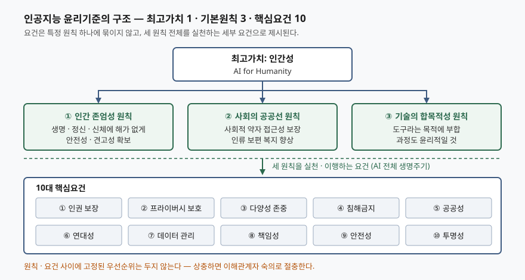
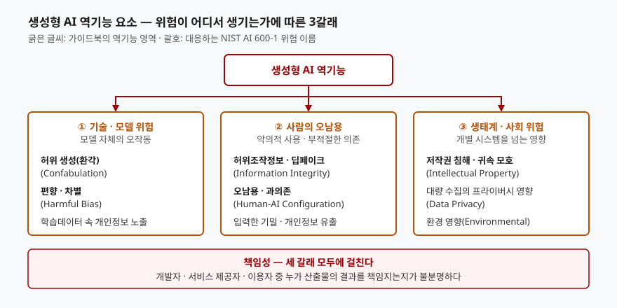

> 실행 검증 없음. 윤리기준의 원칙·요건 이름과 설명은 과학기술정보통신부 보도자료에 붙은
> 윤리기준 본문에서, 생성형 AI의 역기능은 방송통신위원회·한국지능정보사회진흥원의 가이드북과
> NIST AI 600-1 본문에서 옮겼다. 가이드북이 인용한 시장 규모 같은 2차 인용 수치는 쓰지 않았다.

문항은 두 갈래로 묻는다. 국내 인공지능 윤리기준이 내세운 기본 원칙 세 가지와 핵심 요건
열 가지가 무엇인지, 그리고 윤리의 눈으로 봤을 때 생성형 AI가 어떤 역기능을 갖는지다.
물은 순서 그대로 (가)를 Ⅱ, (나)를 Ⅲ으로 쓰고, 두 답을 잇는 대응 방안을 Ⅳ에 둔다.

---

## Ⅰ. 개요

과학기술정보통신부와 정보통신정책연구원은 2020년 12월 23일 대통령 직속
4차산업혁명위원회 전체회의에서 「사람이 중심이 되는 인공지능(AI) 윤리기준」을 내놓았다.
11월 27일 초안 발표 뒤 12월 7일 공개 공청회로 의견을 받아 확정했고, 본문 표지에는
**관계부처 합동**으로 적혀 있다.

구조는 **최고가치 1 · 기본원칙 3 · 핵심요건 10**이다. 최고가치를 **인간성(Humanity)**으로
두고, 그것을 구현하려고 개발·활용 과정에서 지킬 원칙 3가지와 AI 전체 생명주기에서 충족할
요건 10가지를 제시한다. 성격은 **구속력 있는 법이나 지침이 아닌 도덕적 규범이자
자율규범**이다.

이 기준은 생성형 AI가 대중화되기(2022년 11월) 전에 만들어졌다. 그래서 (나)의 답은
"생성형 AI에 새 원칙이 필요하다"가 아니라 **"생성형 AI의 구조가 기존 10대 요건 중
어느 것을 더 쉽게 깨뜨리는가"**로 써야 두 문항이 이어진다. 그리고 정보관리기술사
답안이라면 각 요건이 **시스템에 무엇을 구현하라는 요구인지**까지 내려가야 한다.

---

## Ⅱ. 인공지능 윤리기준의 3대 기본원칙과 10대 핵심요건 (가)

> **출처**: [사람이 중심이 되는 인공지능(AI) 윤리기준 — Ⅱ. 3대 기본원칙·10대 핵심요건 (과학기술정보통신부 보도자료 붙임, 2020.12.23., 제3자 게재본)](https://www.smallake.kr/wp-content/uploads/2021/07/%EC%82%AC%EB%9E%8C%EC%9D%B4-%EC%A4%91%EC%8B%AC%EC%9D%B4-%EB%90%98%EB%8A%94-%EC%9D%B8%EA%B3%B5%EC%A7%80%EB%8A%A5AI-%EC%9C%A4%EB%A6%AC%EA%B8%B0%EC%A4%80.pdf)

### 가. 최고가치 — 인간성

윤리기준은 사람 중심의 AI가 지향할 최고가치를 **인간성**으로 정하고, 모든 AI가
**인간성을 위한 인공지능(AI for Humanity)**을 지향해야 한다고 적는다. 인간에게 유용한
데서 그치지 않고 인간 고유의 성품을 훼손하지 않고 보존·함양하는 방향이어야 한다는 뜻이다.

부록은 이 표현의 범위를 두 가지로 좁힌다. 하나, AI가 인간을 위한 수단임을 밝힐 뿐
**인간 종 중심주의를 표방하지는 않는다.** 둘, 스스로를 인식하는 강인공지능이나
독립된 인격으로서의 AI를 **전제하지 않는다.** 답안에서 "AI의 권리"로 논지를 넓히지 않는
근거가 이 문장이다.

### 나. 3대 기본원칙

| 원칙 | 윤리기준이 적은 내용 | 시스템 관점의 해석 |
|---|---|---|
| ① 인간 존엄성 원칙 | 인간은 기계와 교환할 수 없는 가치를 가진다. AI는 생명과 정신·신체 건강에 해가 되지 않는 범위에서 개발·활용하고, **안전성과 견고성**을 갖춰야 한다 | 유해 출력 차단, 오작동 시 안전한 실패 |
| ② 사회의 공공선 원칙 | 가능한 한 많은 사람의 안녕과 행복을 추구한다. **사회적 약자와 취약 계층의 접근성**을 보장하고, 공익을 위한 AI는 인류의 보편적 복지를 높여야 한다 | 접근성 설계, 혜택의 고른 분배 |
| ③ 기술의 합목적성 원칙 | AI는 인류의 삶에 필요한 **도구라는 목적과 의도에 부합**하게 개발·활용하며, **그 과정도 윤리적**이어야 한다. 삶과 번영을 위한 AI는 장려한다 | 목적 외 사용 통제, 진흥과의 균형 |

### 다. 10대 핵심요건

윤리기준은 10대 요건을 **3대 원칙을 실천·이행하기 위해 AI 전체 생명주기에 걸쳐 충족해야
하는 세부 요건**으로 둔다. 요건마다 특정 원칙 하나에 대응시키지 않는다는 점에 주의한다.

| 요건 | 윤리기준이 적은 내용 | 정보시스템에 요구하는 것 |
|---|---|---|
| ① 인권 보장 | 모든 인간에게 동등한 권리를 존중하고 국제 인권법 등이 명시한 권리를 보장한다 | 권리 침해 산출물 탐지·차단 |
| ② 프라이버시 보호 | 전 과정에서 프라이버시를 보호하고 개인정보 오용을 최소화한다 | 수집 최소화, 가명처리, 접근 통제 |
| ③ 다양성 존중 | 사용자의 다양성·대표성을 반영하고 성별·연령·장애·지역·인종·종교·국가 등에 따른 편향과 차별을 최소화한다. 약자의 접근성을 보장한다 | 학습데이터 대표성 점검, 집단별 성능 차이 측정 |
| ④ 침해금지 | AI를 사람에게 직간접적 해를 입히는 목적으로 쓰지 않고, 위험과 부정적 결과에 대응 방안을 마련한다 | 용도 제한 정책, 오남용 탐지 |
| ⑤ 공공성 | 사회적 공공성 증진과 인류 공동 이익에 쓰고, 순기능 극대화·역기능 최소화 교육을 시행한다 | 이용자 교육·안내 기능 |
| ⑥ 연대성 | 집단 간 연대성을 유지하고 미래세대를 배려하며, 전 주기에 다양한 주체의 공정한 참여를 보장한다 | 이해관계자 의견 수렴 절차 |
| ⑦ 데이터 관리 | 데이터를 목적에 맞게만 쓰고, 수집·활용 전 과정에서 **데이터 편향성이 최소화되도록 품질과 위험을 관리**한다 | 목적 외 이용 차단, 데이터 계보·품질 관리 |
| ⑧ 책임성 | 책임주체를 설정해 피해를 최소화하고, **설계·개발자, 서비스 제공자, 사용자 간 책임소재**를 명확히 한다 | 역할별 책임 정의, 감사 로그 |
| ⑨ 안전성 | 잠재적 위험을 방지하고, 명백한 오류나 침해가 생기면 **사용자가 작동을 제어할 수 있는 기능**을 갖춘다 | 중지·무효화 기능, 위험 평가 |
| ⑩ 투명성 | 상충관계를 고려해 상황에 맞는 수준으로 투명성과 설명 가능성을 높이고, **AI 활용 내용과 위험 등의 유의사항을 사전에 고지**한다 | AI 사용 고지, 설명 기능 |

### 라. 기준의 성격 — 답안에서 함께 쓸 네 가지

보도자료는 기준의 지향점을 네 가지로 적는다. **① 모든 사회 구성원**(정부·공공기관,
기업, 이용자)이 개발부터 활용까지 전 단계에서 참조한다. **② 모든 분야**에 쓰는 범용
원칙이며 영역별 세부 규범의 근거가 된다. **③ 자율적으로 준수**하는 자율규범이다.
**④ 지속 발전**하는 윤리 플랫폼으로, 새로 제기되는 쟁점을 반영해 고쳐 나간다.

서문은 하나를 더 밝힌다. 원칙과 요건은 상황에 따라 **서로 상충할 수 있고**, 그래서
**고정된 우선순위를 두지 않으며** 이해관계자가 토론과 숙의로 절충점을 찾도록 권한다.
투명성 요건이 "타 원칙과의 상충관계를 고려하여"라는 단서를 단 것이 그 예다 — 설명을
늘리면 프라이버시나 영업비밀과 부딪힌다.

---

## Ⅲ. 인공지능 윤리 관점에서 생성형 AI의 역기능 요소 (나)

> **출처**: [NIST AI 600-1 §2 Overview of Risks Unique to or Exacerbated by GAI, 각주 5 (2024-07)](https://doi.org/10.6028/NIST.AI.600-1), [생성형 AI윤리 가이드북 PART 1 「생성형 AI의 역기능은 무엇인가요?」 (방송통신위원회·한국지능정보사회진흥원, 2023.12, 제3자 게재본)](https://files-scs.pstatic.net/2024/12/02/Qc1KPwrTsz/%EC%83%9D%EC%84%B1%ED%98%95_AI%EC%9C%A4%EB%A6%AC_%EA%B0%80%EC%9D%B4%EB%93%9C%EB%B6%81.pdf)

### 가. 분류의 틀 — 위험이 생기는 자리 3갈래

국내 1차 자료인 방송통신위원회·NIA의 생성형 AI윤리 가이드북(2023.12)은 역기능을
**5개 영역** — 저작권, 책임성, 허위조작정보, 개인정보·인격권, 오남용 — 으로 나눠 다룬다.
NIST AI 600-1은 생성형 AI가 새로 만들거나 키우는 위험을 **12가지**로 정의하고, 각주에서
이것을 **기술·모델 위험, 사람의 오남용, 생태계·사회 위험**의 세 갈래로 묶을 수 있다고
적는다.

두 자료를 겹치면 답안의 뼈대가 선다. 5개 영역은 "무엇이 문제인가"를, 3갈래는 "그 문제가
**모델에서 오는가, 사람에게서 오는가, 생태계에서 오는가**"를 말한다. 대응 수단이 갈래마다
다르므로 이 구분이 Ⅳ의 대응 방안으로 그대로 이어진다.

### 나. 역기능 요소 6가지와 침해되는 핵심요건

가이드북의 5개 영역을 기준으로 하되, 허위조작정보 영역에 섞여 있는 **편향**을 따로 뗀다.
편향은 모델에서 오는 위험이고 허위조작정보는 사람이 쓰는 방식에서 오는 위험이라 대응
수단이 다르기 때문이다.

| 역기능 요소 | 생성형 AI에서 커지는 이유 | 침해되는 핵심요건 | 갈래 |
|---|---|---|---|
| ① 허위 생성(환각) | 사실이 아닌데도 그럴듯한 답을 확신 있게 내놓는다. NIST는 이를 Confabulation으로 부른다 | ⑨ 안전성, ⑩ 투명성 | 기술·모델 |
| ② 편향·차별 | 학습데이터의 사회적 편견을 그대로 출력하고, 비대표적 데이터로 집단·언어 간 성능 차이가 생긴다 | ③ 다양성 존중, ⑦ 데이터 관리 | 기술·모델 |
| ③ 허위조작정보·딥페이크 | 진짜와 구별하기 어려운 가짜 콘텐츠를 누구나 낮은 비용으로 대량 생성한다. 음성 조작은 보이스피싱으로 이어진다 | ④ 침해금지, ① 인권 보장 | 사람의 오남용 |
| ④ 개인정보·인격권 침해 | 학습한 개인정보가 여과 없이 노출되고, 이용자가 **입력한** 텍스트·파일이 학습돼 타인에게 보일 수 있다. 특정인을 비난하는 산출물도 나온다 | ② 프라이버시 보호, ⑦ 데이터 관리, ① 인권 보장 | 세 갈래 모두 |
| ⑤ 저작권 침해·귀속 모호 | 기존 저작물을 학습해 결과를 만들므로 원저작권 침해 소지가 있고, 산출물의 소유권 판단 기준이 명확하지 않다 | ⑧ 책임성, ① 인권 보장(창작자의 권리) | 생태계·사회 |
| ⑥ 오남용·과의존 | 무엇이든 먼저 AI에 묻게 되면서 사고력·표현 역량이 떨어지고, AI를 사람처럼 느끼는 정서적 의존이 생긴다 | ⑤ 공공성 (상위의 기술의 합목적성 원칙) | 사람의 오남용 |

"침해되는 핵심요건" 열은 윤리기준 원문이 직접 적은 대응이 아니다. 각 역기능의 내용을
요건 정의에 비춰 답안 작성자가 짝지은 것이므로 답안에서도 그렇게 밝힌다.

### 다. 세 갈래 모두에 걸친 문제 — 책임성

가이드북은 책임성을 별도 영역으로 둔다. 과제·업무에 생성형 AI 결과를 그대로 쓰거나,
대화 중 회사 기밀을 올려 노출시킨 경우처럼 **산출물의 결과를 누가 지는가**의 문제다.
윤리기준의 책임성 요건은 설계·개발자, 서비스 제공자, 사용자 간 책임소재를 명확히 하라고
요구하는데, 생성형 AI는 **이용자의 프롬프트가 산출물에 직접 작용**하므로 이 셋의 경계가
기존 AI보다 흐려진다. 표의 여섯 요소 어디에서 피해가 나든 결국 이 질문으로 돌아온다.

### 라. 생성형 AI가 기존 AI와 다른 지점

역기능이 "커지는" 이유를 한 줄로 묶으면 세 가지다.

1. **산출물이 판단이 아니라 콘텐츠다.** 분류·추천 AI의 오류는 잘못된 결정 하나로 끝나지만,
   생성형 AI의 오류는 그럴듯한 글·이미지·음성으로 유통돼 다시 퍼진다
2. **누구나 쓴다.** 진입장벽이 낮아져 허위조작정보와 딥페이크 생산 비용이 낮아진다
   (NIST의 Information Integrity 위험 정의가 "진입장벽 하락"을 명시한다)
3. **입력이 곧 데이터다.** 이용자가 넣은 대화가 저장·학습되므로, 프라이버시 위험이
   학습 단계에만 있지 않고 **이용 단계마다** 생긴다

---

## Ⅳ. 윤리기준을 생성형 AI에 적용할 때의 대응 방안

Ⅲ의 3갈래를 따라 대응 수단을 나눈다. 같은 윤리 요건도 위험이 어디서 오느냐에 따라
시스템에 들어가는 통제가 다르다.

| 갈래 | 대표 역기능 | 기술적 통제 | 관리적 통제 |
|---|---|---|---|
| 기술·모델 | 환각, 편향 | 근거 문서를 붙인 답변(검색 증강), 출처 표시, 집단별 성능 측정, 배포 전 레드팀 시험 | 학습데이터 대표성 점검, 모델 변경 이력 관리 |
| 사람의 오남용 | 딥페이크, 과의존, 기밀 입력 | AI 생성물 표시·워터마크, 입력 단계 민감정보 필터, 이용 정책 위반 탐지 | 이용자 교육, 사내 생성형 AI 사용 지침 |
| 생태계·사회 | 저작권, 대량 수집 | 학습데이터 출처 기록, 학습 거부 신호 반영 | 라이선스 검토, 분쟁 시 책임 분담 계약 |

적용할 때 판단이 갈리는 지점은 세 가지다.

**① 자율규범과 법적 의무를 구분한다.** 윤리기준은 자율규범이지만, 생성형 AI 산출물의
표시처럼 인공지능 기본법이 의무로 정한 것이 있다. 같은 항목이라도 **법이 정한 것은
의무로, 윤리기준만 권하는 것은 자율로** 나눠 내부 정책을 설계해야 의무 사항이 자율
수준으로 내려앉지 않는다.

**② 요건 사이의 상충을 기록으로 남긴다.** 윤리기준은 고정된 우선순위를 두지 않는다.
설명 가능성(투명성)과 개인정보 보호, 유해 출력 차단(침해금지)과 표현의 범위가 부딪히는
지점에서 **무엇을 왜 우선했는지를 결정 기록으로 남기는 것**이 책임성 요건을 지키는
실무 방법이다.

**③ 생명주기 전 단계에 통제를 둔다.** 윤리기준은 요건을 "AI 전체 생명주기"에 걸쳐
충족하라고 한다. 생성형 AI는 학습 → 미세조정 → 서비스 → 이용자 입력 → 산출물 유통까지
단계가 길고, 프라이버시 위험처럼 **이용 단계마다 새로 생기는 위험**이 있다. 출시 전 한 번의
점검으로 끝내지 말고 운영 중 모니터링과 신고·조치 절차까지 갖춰야 한다.

---

## Ⅴ. 결론

국가 인공지능 윤리기준은 **인간성을 최고가치로, 인간 존엄성·사회의 공공선·기술의
합목적성을 3대 원칙으로, 인권 보장부터 투명성까지 10대 요건을** 둔 자율규범이다.
원칙 사이에 우선순위를 두지 않고 숙의로 절충하게 한 점, 계속 고쳐 나가는 플랫폼을
표방한 점이 법령과 다르다.

생성형 AI는 새로운 윤리 원칙을 요구한다기보다 **기존 요건을 더 쉽게, 더 넓게 깨뜨린다.**
환각과 편향은 모델에서, 딥페이크와 과의존은 사람의 쓰임에서, 저작권과 대량 수집은
생태계에서 생기며, 어느 쪽이든 피해가 나면 책임소재 문제로 모인다.

그래서 대응의 요점은 윤리기준을 선언으로 두지 않고 **갈래별 통제로 내리는 것**이다.
모델에는 측정과 출처 표시를, 이용에는 표시·필터·교육을, 생태계에는 데이터 출처 기록과
책임 분담을 둔다. 자율규범의 실효성은 그것이 시스템에 얼마나 구현됐는지로 확인된다.

> 개념 정리: [기출문제 — 생성형 인공지능 서비스 이용자 보호 가이드라인의 제정 배경과 실행방식](../2026-10-31-generative-ai-user-protection-guideline/index.md)
> 개념 정리: [인공지능 기본법과 EU AI법 — 위험 기반 규제 구조 비교](../../it-management/2026-10-05-korea-ai-basic-act-vs-eu-ai-act/index.md)
> 개념 정리: [AI 편향의 3가지 범주 — 체계적·계산통계적·인간인지적](../../ai/2026-10-29-nist-ai-bias-three-categories/index.md)
> 개념 정리: [AI 생성물 표시와 콘텐츠 출처·이력(C2PA)](../../emerging-tech/2026-11-05-c2pa-ai-content-provenance-labeling/index.md)

끝

---

## 답안 작성 메모

**무엇부터 쓰는가.** 개요 첫 문단에 발표 주체(과기정통부·관계부처 합동), 발표일(2020.12.23.),
구조(최고가치 1 · 원칙 3 · 요건 10), 성격(자율규범)을 한 번에 넣는다. 개수가 곧 점수이므로
1·3·10을 숫자로 적는다. 최고가치 "인간성"을 빠뜨리는 답안이 많은데, 세 원칙이 무엇을 위해
있는지를 설명하는 출발점이라 반드시 쓴다.

**(가)에서 점수가 갈리는 지점.** 10대 요건을 이름만 나열하면 절반이다. 원문 순서
(인권 보장 → 프라이버시 → 다양성 → 침해금지 → 공공성 → 연대성 → 데이터 관리 → 책임성 →
안전성 → 투명성)를 지키고 각각 한 줄 설명을 붙인다. 정보관리기술사 답안이라면 표에
**시스템에 요구하는 것** 열을 하나 더 두는 것만으로 다른 답안과 구분된다. 암기 단서는
"권·프·다·침·공 / 연·데·책·안·투".

**(나)에서 점수가 갈리는 지점.** 역기능 이름만 늘어놓지 말고 **윤리기준 요건과 짝지어야**
(가)와 (나)가 한 답안이 된다. 또 "생성형 AI라서 왜 더 심해지는가"를 한 줄씩 붙인다 —
산출물이 콘텐츠라 퍼진다, 누구나 쓴다, 입력이 곧 데이터다. 짝짓기는 원문에 없는 해석이므로
"요건에 비춰 대응시키면"처럼 표현해 단정하지 않는다.

**시간이 모자라면 무엇을 버리는가.** Ⅳ의 판단 지점 ③(생명주기)을 먼저 버리고, 다음으로
Ⅲ의 라(기존 AI와 다른 지점)를 표 아래 한 줄로 줄인다. Ⅳ의 통제 표는 남긴다 — 윤리 문항을
정보시스템 답안으로 만드는 자리다. Ⅱ의 10대 요건 표는 어떤 경우에도 버리지 않는다.

**모식도 전략.** 한 장만 그린다면 Ⅱ의 구조도다. 위에 "인간성" 상자 하나, 가운데 원칙 상자
셋, 아래에 요건 열 칸을 두 줄로 적으면 2분 안에 옮겨 그릴 수 있고 (가)의 답 전체가 들어간다.
Ⅲ의 3갈래 그림은 시간이 남을 때 그린다.

**빠지기 쉬운 함정.** 이 윤리기준을 법령처럼 쓰면 감점 요인이다. "구속력 있는 법이나
지침이 아닌 자율규범"이라는 성격을 개요에서 한 번 짚는다. 또 방송통신위원회의 생성형 AI
이용자 보호 가이드라인(2025)과 섞지 않는다 — 그쪽은 기본원칙 4가지·실행방식 6가지로
구조가 다르고, 이 문항이 묻는 것은 과기정통부 윤리기준이다.

---

## 참고 자료

- [사람이 중심이 되는 인공지능(AI) 윤리기준 (과학기술정보통신부 보도자료 및 붙임 본문, 2020.12.23., 제3자 게재본)](https://www.smallake.kr/wp-content/uploads/2021/07/%EC%82%AC%EB%9E%8C%EC%9D%B4-%EC%A4%91%EC%8B%AC%EC%9D%B4-%EB%90%98%EB%8A%94-%EC%9D%B8%EA%B3%B5%EC%A7%80%EB%8A%A5AI-%EC%9C%A4%EB%A6%AC%EA%B8%B0%EC%A4%80.pdf) — 발표 경위, 지향점 4가지, 최고가치, 3대 원칙·10대 요건, 부록(AI의 지위·적용 범위·실현방안)
- [정부, '사람이 중심되는 신뢰할 수 있는 AI 실현전략' 마련 (대한민국 정책브리핑, 2021.5.13.)](https://www.korea.kr/news/policyNewsView.do?newsId=148887381) — 윤리기준 후속으로 자율점검 체크리스트 개발·보급 계획
- [생성형 AI윤리 가이드북 (방송통신위원회·한국지능정보사회진흥원, 2023.12, 제3자 게재본)](https://files-scs.pstatic.net/2024/12/02/Qc1KPwrTsz/%EC%83%9D%EC%84%B1%ED%98%95_AI%EC%9C%A4%EB%A6%AC_%EA%B0%80%EC%9D%B4%EB%93%9C%EB%B6%81.pdf) — PART 1 역기능 개관, PART 2~6 저작권·책임성·허위조작정보·개인정보·인격권·오남용
- [NIST AI 600-1, Artificial Intelligence Risk Management Framework: Generative Artificial Intelligence Profile (NIST, 2024-07)](https://doi.org/10.6028/NIST.AI.600-1) — §2 생성형 AI 위험 12가지와 3갈래 분류(각주 5)
