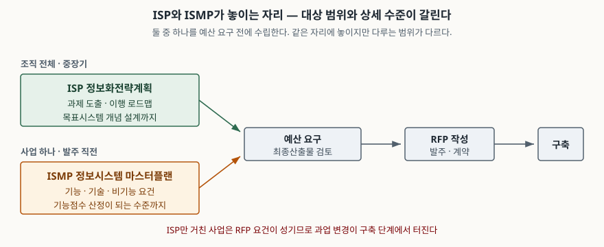

> 실행 검증 없음. 제도 개념이라 실행할 예제가 없다. 정의와 제도 근거는 NIA 공지와
> 2012년 경영정보학연구 논문을 썼고, ISMP 5단계 명칭은 2차 자료(한국어 위키백과)에서
> 가져와 그 사실을 본문에 밝혔다. 사업 건수·비용 절감률 같은 수치는 원 출처를
> 확인하지 못해 쓰지 않았다.

## 들어가며

ISP와 ISMP는 IT경영·정보화사업 과목에서 묶여 나온다. 답안에서 가장 흔히 무너지는 곳은
두 개를 "정보화 계획 수립"이라는 한 덩어리로 보고 비슷하게 서술하는 것이다. 그러면
채점자 입장에서는 둘을 구분하지 못한다고 읽힌다.

실무에서 이 구분은 분쟁 지점과 바로 이어진다. 제안요청서에 "민원 처리 시스템 구축"
정도만 적혀 있으면, 수행사는 자기 해석대로 범위를 잡고 발주자는 다른 범위를 기대한다.
구축 단계에 들어가서야 어긋난 것이 드러나고, 그때부터 과업 변경 협의가 시작된다.
ISMP는 그 어긋남을 발주 **전으로** 당기려고 만든 제도다.

## 정의

답안 첫 줄에 그대로 쓸 수 있는 형태로 끊는다.

- **ISP(정보화전략계획)** 는 조직의 경영 전략을 정보화 관점으로 옮겨, 중장기 정보화
  과제와 이행 로드맵, 목표시스템 개념 설계를 도출하는 계획 수립 활동이다.
- **ISMP(정보시스템 마스터플랜)** 는 특정 소프트웨어 구축 사업 하나를 대상으로,
  제안요청서의 요구사항을 기능점수 산정이 가능한 수준까지 상세화하는 활동이다.

ISMP의 정의는 2012년 경영정보학연구에 실린 사례연구가 한 문장으로 적는다 —
**ISMP는 정보시스템 구축 사업 제안요청서의 요구사항을 명확하게 작성하는 활동이다.**
정의의 주어가 "계획"이 아니라 "제안요청서의 요구사항"이라는 점이 ISP와 갈리는 자리다.

## 등장 배경

같은 논문이 드는 문제는 세 가지다. ① 발주자와 수행사 사이의 오해와 갈등,
② 요구사항의 빈번한 변경, ③ 개발자의 과중한 업무. 뿌리는 하나다. 재래식 제안요청서가
목표시스템을 **개략적으로만** 기술하기 때문이다.

ISP를 거쳤다고 이 문제가 풀리지 않는다. ISP의 산출물은 과제 목록과 로드맵, 목표시스템의
개념 설계까지다. 조직 전체를 보는 계획이므로 사업 하나의 화면·기능·인터페이스까지
내려가지 않는다. 그 간극을 메우려고 사업 단위의 상세 분석 단계를 따로 세운 것이 ISMP다.

제도 근거는 예산 쪽에 있다. NIA 공지는 정보시스템 구축·재구축 예산요구를 하려면
공통가이드에 따라 **ISP 또는 ISMP를 사전에 수립해야 한다**고 적는다. 기획재정부와
한국지능정보원이 「ISP·ISMP 수립 공통가이드」를 매년 개정해 배포하고, 2025년 개정본이
제9판이다. 근거 지침은 「예산안 편성 및 기금운용계획안 작성 세부지침」과
「예산 및 기금운용계획 집행지침」이다.

## 구성요소 — ISMP 수립 5단계

ISMP는 **5단계**로 구성되며, 반복 순환이 아니라 **한 사이클만** 수행하도록 설계됐다.

| 단계 | 이름 | 핵심 산출물 |
|---|---|---|
| 1 | 프로젝트 착수 및 참여자 결정 | 의사결정권자·수행조직 역할 정의서, 프로젝트 계획서 |
| 2 | 정보시스템 방향성 수립 | 구축 범위·사용자 그룹 정의, 추진 방향과 목표 |
| 3 | 비즈니스 및 정보기술 요건 분석 | 업무 요구사항 분석서, 정보기술 요구사항 분석서 |
| 4 | 정보시스템 구조 및 요건 정의 | 기능·기술·비기능 요건 정의서, 목표 구성도 |
| 5 | 정보시스템 구축사업 이행방안 수립 | 사업 추진 계획, 연차별 투자 소요 |

> 단계 명칭은 한국어 위키백과 「정보시스템 마스터플랜」 항목에서 가져왔다. 2차 자료이므로
> 실제 수립 시에는 공통가이드 제9판의 단계명과 대조해야 한다.

3단계에서 요건을 뽑고 4단계에서 그것을 **검증 기준이 붙은 형태로** 정의하는 것이
ISMP의 핵심이다. 입력·출력·처리 절차와 확인 기준까지 적어야 기능점수 산정이 되고,
그래야 제안요청서가 분쟁을 견딘다.

## 도식

> **출처**: [NIA, ISP·ISMP 수립 공통가이드(제9판) 배포 공지 (2025.05.19)](https://nia.or.kr/site/nia_kor/ex/bbs/View.do?cbIdx=99835&bcIdx=28088&parentSeq=28088) · [한국어 위키백과 「정보시스템 마스터플랜」 — ISP와의 차이 4가지](https://ko.wikipedia.org/wiki/%EC%A0%95%EB%B3%B4%EC%8B%9C%EC%8A%A4%ED%85%9C_%EB%A7%88%EC%8A%A4%ED%84%B0%ED%94%8C%EB%9E%9C) (2차 자료 기반)

## 비교 — 네 축으로 갈린다

| 축 | ISP | ISMP |
|---|---|---|
| 대상 범위 | 조직 전체 또는 기능 영역 | 소프트웨어 구축 사업 1건 |
| 환경 분석 | 조직의 경영 환경을 분석한다 | 필수가 아니다. 이미 선 ISP의 전략을 검토한다 |
| 분석 초점 | 경영 목표 대비 문제점과 개선 방향 | 사업 범위 안의 현황 조사와 사용자 요구사항 도출 |
| 설계 대상 | 정보화 전략·업무 프로세스·시스템 구조·IT 조직 | 사업 1건의 기능·기술·비기능 요건 |
| 상세 수준 | 목표시스템과 적용 기술을 제안요청서에 정의 | 입력·출력·절차·확인 기준까지, 기능점수 산정 수준 |
| 수행 시점 | 중장기 계획 수립기 | 발주 직전 |

> 위 여섯 줄 중 환경 분석·분석 초점·설계 대상·상세 수준 네 줄은 위키백과가 정리한
> 차이 4가지를 옮긴 것이다. 2차 자료다.

답안에서 비교표를 쓸 때는 **"ISMP가 더 낫다"로 쓰지 않는다.** 둘은 대체재가 아니라
적용 단위가 다른 도구다. 조직 전체의 정보화 방향이 없는 상태에서 사업 하나만
상세화하면, 요건은 또렷한데 그 사업이 왜 필요한지가 비어 있는 계획이 된다.

## 적용 시 고려사항

1. **무엇을 먼저 정해야 하는가로 고른다.** 사업 단위가 아직 안 정해졌으면 ISP다.
   사업이 정해졌고 남은 일이 "무엇을 만들지 적는 것"이면 ISMP다. 사업 규모만으로
   가르면 틀린다.
2. **ISMP 산출물은 그대로 제안요청서로 간다.** 그래서 요건마다 **확인 기준**이 붙어야
   한다. "성능이 우수할 것" 같은 문장은 분쟁을 막지 못한다. 측정 가능한 값으로 적는다.
3. **ISP가 ISMP를 대신하지 못하고, 그 반대도 아니다.** ISP를 아무리 상세히 써도
   조직 전체를 보는 문서라 사업 한 건의 인터페이스 명세까지 내려가지 않는다.
4. **비기능 요건을 빠뜨리지 않는다.** 성능·품질·보안·사업 지원 요건은 기능 요건보다
   늦게 드러나고, 늦게 드러날수록 비싸다. ISMP 4단계가 이것을 같이 다루는 이유다.
5. **수립 제외 대상을 확인한다.** 공통가이드는 수립 제외 유형을 따로 둔다.
   단순 물품 구매처럼 수립 실익이 낮은 사업까지 ISMP를 돌리면 비용만 든다.

## 정리

암기 단서는 **"범위 · 시점 · 깊이"** 세 글자다.

- **범위** — ISP는 조직, ISMP는 사업 1건.
- **시점** — ISP는 중장기 계획 수립기, ISMP는 발주 직전.
- **깊이** — ISP는 개념 설계까지, ISMP는 기능점수 산정 수준까지.
- ISMP는 **5단계**, 한 사이클만 수행한다. 착수 → 방향성 → 요건 분석 → 요건 정의 → 이행방안.
- 제도 근거는 예산 지침이다. 구축·재구축 예산을 요구하려면 둘 중 하나를 먼저 수립한다.

## 참고 자료

- [NIA, ISP·ISMP 수립 공통가이드(제9판) 배포 (2025.05.19)](https://nia.or.kr/site/nia_kor/ex/bbs/View.do?cbIdx=99835&bcIdx=28088&parentSeq=28088)
- [NIA, ISP·ISMP 수립 공통가이드(제7판) 배포](https://www.nia.or.kr/site/nia_kor/ex/bbs/View.do?cbIdx=99835&bcIdx=25566)
- 박소현·구본재·김민석·이국희, [정보시스템 마스터플랜(ISMP) 수행 성과와 성공요인에 관한 사례연구](https://www.koreascience.kr/article/JAKO201219565296036.page?lang=ko), 경영정보학연구 14권 1호, 2012, 85–103쪽
- [한국어 위키백과 — 정보시스템 마스터플랜](https://ko.wikipedia.org/wiki/%EC%A0%95%EB%B3%B4%EC%8B%9C%EC%8A%A4%ED%85%9C_%EB%A7%88%EC%8A%A4%ED%84%B0%ED%94%8C%EB%9E%9C) (2차 자료)
