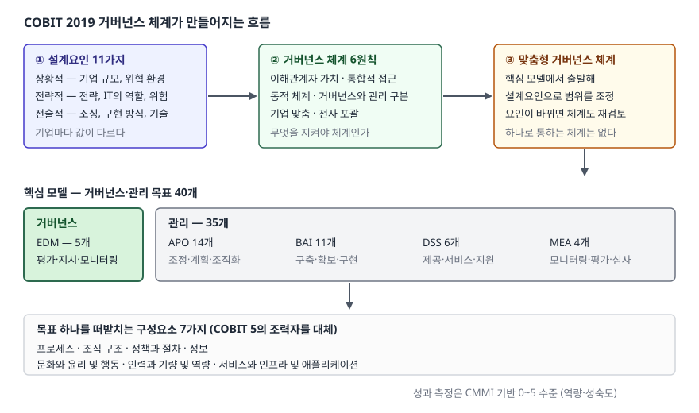

> **실행 검증 없음.** 이 글은 ISACA가 공개한 COBIT 2019 자료를 근거로 정리한
> 개념 글이다. 실행 가능한 예제가 없으므로 측정값이나 결과표를 싣지 않는다.

## 들어가며

IT 거버넌스는 시험에서 이름만 외워 가면 반드시 막히는 주제다. "거버넌스는 무엇인가"는
한 줄로 쓸 수 있는데, "거버넌스와 관리는 어떻게 다른가", "COBIT 2019는 COBIT 5에서
무엇이 바뀌었는가"로 들어가면 답안이 나열로 끝난다. 실무에서도 같다. CIO가
"우리 IT 거버넌스 체계를 잡자"고 하면 대부분 프로세스 문서부터 만드는데, COBIT는
그 앞에 **무엇을 왜 그 범위로 잡을지 정하는 단계**를 둔다. 그 단계가 COBIT 2019에서
새로 들어온 설계요인이다. 이 글은 그 흐름을 답안 순서대로 정리한다.

## 정의

> COBIT는 기업 정보기술(I&T)의 거버넌스를 위한 프레임워크로, 거버넌스 체계가
> 갖춰야 할 원칙과 구성요소, 그리고 거버넌스·관리 목표 40개로 이루어진 핵심 모델을
> 제시한다.

ISACA는 COBIT 2019의 핵심 간행물을 넷으로 나누고, 그중 **프레임워크: 서론과 방법론**을
"확장된 거버넌스 정의를 담고 COBIT 원칙을 갱신하며 전체 프레임워크 구조를 제시하는
문서"로 설명한다. 정의를 쓸 때 **"IT 관리 프레임워크"라고 쓰면 감점이다.** COBIT는
관리만이 아니라 **거버넌스와 관리를 구분해 함께 다루는** 프레임워크다.

## 등장 배경 — 왜 거버넌스와 관리를 갈랐는가

COBIT 5에서 이미 둘을 구분했고, COBIT 2019는 그 구분을 6원칙 중 하나로 명시했다.
ISACA는 둘의 차이를 이렇게 적는다.

| 구분 | 거버넌스 | 관리 |
|---|---|---|
| 하는 일 | 이해관계자 요구를 **평가**하고, 방향을 **지시**하고, 성과를 **모니터링** | 목표 달성을 위해 **계획·구축·운영·모니터링** |
| 주체 | 이사회(BoD) 중심 | 경영진 중심 |
| 도메인 | EDM | APO · BAI · DSS · MEA |

가른 이유는 **책임이 섞이면 둘 다 안 되기 때문**이다. 방향을 정하는 쪽과 그 방향대로
실행하는 쪽이 같으면 자기가 정한 목표를 자기가 평가하게 된다. 감리·내부통제가
성립하지 않는다. COBIT 5가 조직 구조로 이것을 다뤘다면, COBIT 2019는 원칙으로
올려 체계 설계 단계부터 갈라 놓도록 했다.

## 구성요소 — 네 묶음으로 센다

답안에서 개수가 곧 점수다. COBIT 2019는 **6 + 3 + 7 + 11** 네 개의 숫자로 묶인다.

### ① 거버넌스 체계 6원칙

ISACA는 "COBIT 2019는 거버넌스 체계에 대해 6원칙을 제시한다"고 적고, COBIT 5의
5원칙과 대비한다. 각 원칙의 요지는 다음과 같다.

| # | 원칙 | 요지 |
|---|---|---|
| 1 | 이해관계자 가치 제공 | 이해관계자 요구를 충족하고 I&T 사용에서 가치를 창출한다 |
| 2 | 통합적 접근 | 여러 구성요소가 모여 체계를 이루며, 종류가 달라도 함께 작동해야 한다 |
| 3 | 동적 거버넌스 체계 | 설계요인이 바뀌면 체계에 미치는 영향을 다시 본다 |
| 4 | 거버넌스와 관리의 구분 | 거버넌스 활동·구조와 관리 활동·구조는 다르다 |
| 5 | 기업 맞춤 | 기업의 필요를 기준으로 체계를 재단한다 |
| 6 | 전사 포괄 | IT 기능만이 아니라 기업의 모든 기능과 기술을 포함한다 |

### ② 거버넌스 프레임워크 3원칙

체계(system)가 아니라 **프레임워크 자체**가 갖춰야 할 성질이다. 둘을 섞어 쓰면
6원칙과 3원칙을 합쳐 9개라고 쓰게 되므로 구분해 외운다.

1. **개념 모델 기반** — 핵심 구성요소와 그 관계가 개념 모델로 정의돼 있을 것
2. **개방성과 유연성** — 새 내용을 더하거나 조정할 수 있을 것
3. **주요 표준과의 정렬** — 주요 표준·프레임워크·규제와 맞물릴 것

### ③ 거버넌스 체계 구성요소 7가지

COBIT 5의 **조력자(enabler)** 를 이름만 바꾼 것이 아니라, 목표 하나하나를 떠받치는
단위로 재배치했다.

1. 프로세스
2. 조직 구조
3. 정보 흐름과 항목
4. 인력, 기량, 역량
5. 문화, 윤리, 행동
6. 정책과 절차
7. 서비스, 인프라, 애플리케이션

### ④ 설계요인 11가지

COBIT 2019에서 새로 들어온 축이다. ISACA는 설계요인을 11가지로 두고 세 갈래로 묶는다.

| 갈래 | 뜻 | 예 |
|---|---|---|
| 상황적(contextual) | 기업이 통제할 수 없는 조건 | 기업 규모, 지정학적 상황, 위협 환경 |
| 전략적(strategic) | 기업이 내리는 결정 | 기업 전략, IT의 역할, 위험 성향 |
| 전술적(tactical) | 구현 선택 | 소싱 모델(아웃소싱·클라우드), 구현 방식(애자일·데브옵스), 기술 도입 전략 |

ISACA가 명시한 개별 요인은 기업 전략, 기업 목표, 위험 프로파일, I&T 관련 이슈,
위협 환경, 준거 요구사항, IT의 역할, IT 소싱 모델, IT 구현 방식, 기술 도입 전략,
그리고 기업 규모다.

## 도식 — 설계요인에서 목표까지

> **출처**: [ISACA — COBIT Design Factors (2019)](https://www.isaca.org/resources/news-and-trends/industry-news/2019/cobit-design-factors) · [ISACA — A New COBIT Is in Town (2018)](https://www.isaca.org/resources/news-and-trends/industry-news/2018/a-new-cobit-is-in-town-and-i-really-like-how-it-looks)

읽는 순서가 곧 답안 순서다. **설계요인으로 기업의 조건을 읽고 → 6원칙을 지키며 →
핵심 모델을 재단해 맞춤형 체계를 만들고 → 목표 하나하나를 7가지 구성요소로 떠받친다.**
ISACA가 "모든 기업에 통하는 하나의 거버넌스 체계는 없다"고 적는 자리가 세 번째다.

핵심 모델은 **거버넌스·관리 목표 40개**이고, 각 목표는 프로세스 하나와 짝을 이룬다.
도메인별로는 거버넌스가 EDM 5개, 관리가 APO 14개·BAI 11개·DSS 6개·MEA 4개로
합쳐서 35개다. COBIT 5의 프로세스 37개에서 40개로 늘었다.

## 비교 — COBIT 5와 무엇이 달라졌나

| 항목 | COBIT 5 | COBIT 2019 |
|---|---|---|
| 원칙 | 5원칙 | 거버넌스 체계 6원칙 + 프레임워크 3원칙 |
| 구성 단위 | 조력자(enabler) 7가지 | 구성요소(component) 7가지로 개명·재배치 |
| 핵심 모델 | 프로세스 37개 | 거버넌스·관리 목표 40개 |
| 재단 방식 | 별도 축 없음 | 설계요인 11가지로 범위·중요도 조정 |
| 성과 측정 | ISO/IEC 33000 기반 0~5 척도 | CMMI 성과관리 체계 기반, 역량·성숙도 0~5 |
| 갱신 방식 | 판 단위 개정 | 개방·유연 원칙에 따라 점진 갱신 |

COBIT 5가 "무엇을 해야 하는가"의 목록이었다면, COBIT 2019는 **"우리 기업은 그중
무엇을 어느 깊이까지 해야 하는가"를 정하는 절차**를 앞에 붙였다고 읽으면 맞다.

## 적용 시 고려사항

**① 설계요인 평가를 생략하면 COBIT 2019를 쓰는 의미가 없다.** 목표 40개를 전부
같은 깊이로 적용하려다 중도에 멈추는 것이 전형적인 실패다. 설계요인은 범위를 줄이는
근거이지 추가 서류 작업이 아니다.

**② 성숙도와 역량을 구분해 보고한다.** ISACA는 COBIT 2019의 성과 측정이 CMMI
성과관리 체계를 따르며 **역량과 성숙도를 모두 0~5로 잰다**고 적는다. 두 척도가
같은 숫자 범위를 쓰므로, 보고서에 "3단계"라고만 쓰면 무엇의 3단계인지 통하지 않는다.
어느 척도로 잰 값인지를 숫자 옆에 반드시 붙인다.

**③ 거버넌스 목표(EDM)에는 이사회가 실제로 참여해야 한다.** EDM을 IT 부서가 자기
손으로 작성하면 4번 원칙을 정면으로 어기는 것이고, 감리에서 가장 먼저 지적된다.

**④ 다른 표준과의 정렬을 먼저 확인한다.** 프레임워크 3원칙의 세 번째가 주요 표준과의
정렬이다. ISO/IEC 27001, ITIL, 내부통제 체계를 이미 쓰고 있다면 COBIT로 갈아타는 것이
아니라 **겹치는 자리를 매핑해 중복 통제를 걷어내는** 쪽이 맞다.

**⑤ 설계요인이 바뀌면 재검토한다.** 3번 원칙이 동적 체계인 이유다. 클라우드 전환이나
조직 개편처럼 소싱 모델·기업 규모가 달라지는 사건이 있으면 체계를 다시 본다.

## 정리 — 암기 단서

- 숫자는 **6-3-7-11-40**이다. 체계 6원칙, 프레임워크 3원칙, 구성요소 7가지,
  설계요인 11가지, 거버넌스·관리 목표 40개
- 도메인은 **1 + 4**다. 거버넌스 EDM 하나, 관리 APO·BAI·DSS·MEA 넷.
  개수로는 **5 + 14 + 11 + 6 + 4 = 40**
- 거버넌스는 **평가·지시·모니터링**(EDM 세 글자가 그대로 단서다), 관리는 **계획·구축·운영·모니터링**
- COBIT 5와의 차이는 **원칙 5→6, 조력자→구성요소, 프로세스 37→목표 40, 설계요인 신설,
  측정 기준 ISO/IEC 33000→CMMI**
- 답안 흐름은 **설계요인 → 원칙 → 맞춤 체계 → 핵심 모델 → 구성요소** 순으로 내려간다

## 참고 자료

- [ISACA — COBIT 2019 and COBIT 5 Comparison (2020)](https://www.isaca.org/resources/news-and-trends/industry-news/2020/cobit-2019-and-cobit-5-comparison)
- [ISACA — COBIT 2019 and the IIA 2019 Guiding Principles of Corporate Governance (2020)](https://www.isaca.org/resources/news-and-trends/industry-news/2020/cobit-2019-and-the-iia-2019-guiding-principles-of-corporate-governance)
- [ISACA — COBIT Design Factors (2019)](https://www.isaca.org/resources/news-and-trends/industry-news/2019/cobit-design-factors)
- [ISACA — A New COBIT Is in Town (2018)](https://www.isaca.org/resources/news-and-trends/industry-news/2018/a-new-cobit-is-in-town-and-i-really-like-how-it-looks)
- [ISACA — Leveraging COBIT for Effective AI System Governance (백서, 2025)](https://www.isaca.org/resources/white-papers/2025/leveraging-cobit-for-effective-ai-system-governance) — 도메인별 목표 코드(EDM01~05, APO01~14, BAI01~11, DSS01~06, MEA01~04) 확인에 썼다
- [ISACA — COBIT 자료 안내](https://www.isaca.org/resources/cobit) — 핵심 간행물 4종의 범위
