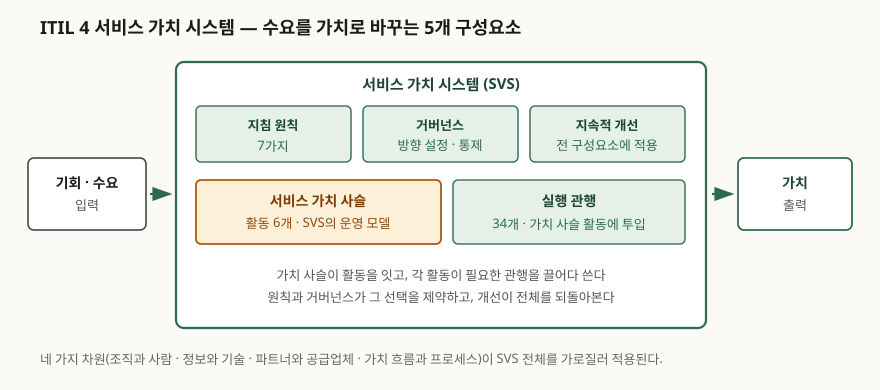
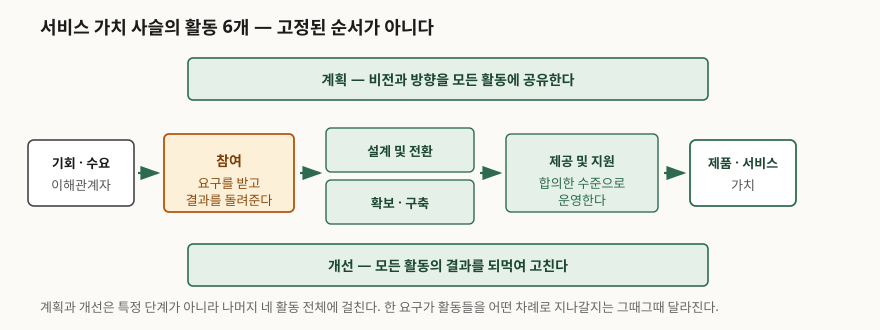

> **실행 검증 없음.** 실행 가능한 예제가 없는 개념 글이므로 측정값이나 결과표를 싣지 않는다.
>
> **출처 등급.** ISO/IEC 20000-1:2018은 공개된 미리보기에서 범위·목차·서문을 직접
> 확인했다. ITIL 4는 유료 간행물(*ITIL Foundation: ITIL 4 Edition*, AXELOS, 2019)이라
> 원문을 열 수 없어, **구성요소 수와 명칭은 독립된 2차 자료 3건을 교차 확인해** 적었다.
> 교차 확인한 출처와 발행일은 참고 자료에 적었다.

## 들어가며

장애 전화가 오면 아는 담당자에게 돌리고, 변경은 메일로 승인받는 조직이 있다. 티켓
시스템을 도입하면 정리될 것 같아 깔아 두지만, 반년 뒤에는 티켓만 쌓이고 장애 건수는
그대로다. 처리 시간과 준수율 보고서는 매달 나오는데 "그래서 서비스가 나아졌는가"에는
아무도 답하지 못한다. 측정하던 것이 **절차를 지켰는지**였지 **이용자에게 무엇이
닿았는지**가 아니었기 때문이다. ITIL 4가 프로세스 묶음을 걷어내고 가치 시스템이라는
틀로 다시 짠 이유가 여기에 있다.

## 정의

**IT 서비스 관리(ITSM)** 는 서비스의 기획·설계·전환·제공·개선을 하나의 관리 체계로
묶어 운영하는 활동이다. 국제 표준은 이 체계를 **서비스 관리 시스템(SMS)** 이라
부르고, ISO/IEC 20000-1:2018은 그 요구사항을 정한다. 표준의 범위 조항은 이 문서의
목적을 이렇게 적는다.

> establish, implement, maintain and continually improve a service management system

**ITIL 4의 서비스 가치 시스템(SVS)** 은 조직의 모든 구성요소와 활동이 어떻게 함께
움직여 가치를 만드는지를 기술한 모델이다. 입력은 **기회와 수요**, 출력은 **가치**이고,
그 사이를 구성요소 5개가 채운다.

두 가지의 성격이 다르다는 점이 답안에서 자주 갈리는 지점이다. **ISO/IEC 20000-1은
"무엇을 갖춰야 하는가"를 정한 요구사항 표준(인증 대상)이고, ITIL 4는 "어떻게 할
것인가"를 제시하는 모범사례 프레임워크(인증 대상 아님)다.**

## 등장 배경

ITIL v3(2011년판)는 서비스 생애주기 **5단계**(전략·설계·전환·운영·지속적 서비스 개선)
아래 **26개 프로세스**와 **4개 기능**(서비스 데스크, 운영 관리, 기술 관리, 애플리케이션
관리)을 뒀다. 이 구조가 세 가지 문제를 낳았다.

1. **단계가 순서로 읽혔다.** 생애주기는 원래 동시에 도는 것인데 전략→설계→전환→운영이
   폭포수 공정처럼 운영돼, 운영 중에 발견한 것이 설계로 돌아가는 경로가 약했다.
2. **프로세스마다 산출물이 붙었다.** 26개를 다 세우려면 절차서와 승인 단계가 그만큼
   늘어난다. 주 단위로 배포하는 조직에서 변경 자문 위원회가 병목이 됐다.
3. **측정이 준수율로 쏠렸다.** 프로세스 수행 여부는 세기 쉬우나 그것이 이용자 가치와
   이어지는지는 따로 묻지 않았다.

표준 쪽에서도 같은 시기에 구조가 바뀌었다. ISO/IEC 20000-1은 2018년 제3판에서 모든
경영시스템 표준이 공유하는 **고수준 구조(HLS, Annex SL)** 를 채택했다. 서문이 밝힌
주요 변경에는 조항 재배치 외에 **"고객에게 서비스의 가치를 판단할 필요"** 가 커졌다는
점과, 무엇을 할지에 집중하고 **어떻게 할지는 조직의 자유로 남겼다**는 점이 들어 있다.
ITIL 4의 방향과 같은 쪽이다.

## 구성요소

### 서비스 가치 시스템 — 구성요소 5개

| # | 구성요소 | 하는 일 |
|---|---|---|
| 1 | 지침 원칙 (7가지) | 상황과 무관하게 적용되는 의사결정 지침 |
| 2 | 거버넌스 | 조직의 방향을 정하고 통제한다 |
| 3 | 서비스 가치 사슬 (활동 6개) | 수요를 받아 제품·서비스로 바꾸는 운영 모델 |
| 4 | 실행 관행 (34개) | 가치 사슬 활동에 투입되는 자원·역량 묶음 |
| 5 | 지속적 개선 | 나머지 네 구성요소 전체에 걸쳐 되먹인다 |

> **출처**: *ITIL Foundation: ITIL 4 Edition* (AXELOS, 2019) 기술 내용을 [ManageEngine — The ITIL 4 Service Value System](https://www.manageengine.com/products/service-desk/itsm/itil-4-service-value-system.html), [Purple Griffon — ITIL Service Value System (2024-09-03)](https://purplegriffon.com/blog/itil-service-value-system), [IONOS — What is ITIL v4 (2021-08-23)](https://www.ionos.com/digitalguide/online-marketing/online-sales/what-is-itil-v4/) 3건으로 교차 확인해 그린 관계도 (2차 자료 기반)

### 서비스 가치 사슬 — 활동 6개

| # | 활동 | 하는 일 |
|---|---|---|
| 1 | 계획 | 비전·현황·개선 방향을 모든 활동에 공유한다 |
| 2 | 개선 | 제품·서비스와 활동 자체를 지속적으로 고친다 |
| 3 | 참여 | 이해관계자의 요구를 받고 결과를 돌려준다 |
| 4 | 설계 및 전환 | 품질·비용·출시 시점을 맞춰 설계하고 전환한다 |
| 5 | 확보·구축 | 필요한 구성요소를 조달하거나 만든다 |
| 6 | 제공 및 지원 | 합의한 수준으로 제공하고 지원한다 |

> **출처**: 같은 3건 교차 확인 — [ManageEngine — The ITIL 4 Service Value System](https://www.manageengine.com/products/service-desk/itsm/itil-4-service-value-system.html), [Purple Griffon — ITIL Service Value System (2024-09-03)](https://purplegriffon.com/blog/itil-service-value-system), [IONOS — What is ITIL v4 (2021-08-23)](https://www.ionos.com/digitalguide/online-marketing/online-sales/what-is-itil-v4/) (2차 자료 기반)

**이 활동들은 고정된 순서가 아니다.** 한 요구가 어느 활동을 어떤 차례로 지나갈지는
그때그때 다르고, 그 경로를 **가치 흐름(value stream)** 이라 부른다. 장애 복구는
참여→제공 및 지원→개선으로 짧게 끝나고, 신규 기능은 참여→설계 및 전환→확보·구축
→제공 및 지원을 돈다. v3의 5단계와 가장 크게 갈리는 지점이 여기다.

### 실행 관행 34개

| 범주 | 개수 | 예 |
|---|---|---|
| 일반 관리 관행 | 14 | 지속적 개선, 정보보안 관리, 위험 관리 |
| 서비스 관리 관행 | 17 | 사건 관리, 문제 관리, 변경 활성화, 서비스 데스크 |
| 기술 관리 관행 | 3 | 배포 관리, 인프라·플랫폼 관리, 소프트웨어 개발·관리 |

v3의 **프로세스 26개 + 기능 4개** 구분이 ITIL 4에서는 **관행 34개**로 합쳐졌다.
프로세스는 절차이고 기능은 조직 단위라 둘을 나눠 두면 "사람 따로 절차 따로"가 되는데,
관행은 **그 일을 하는 데 필요한 자원 일체**를 묶은 단위라 구분이 필요 없다.

### 지침 원칙 7가지와 네 가지 차원

지침 원칙은 **①가치에 집중 ②있는 곳에서 시작 ③피드백과 함께 반복적으로 진행
④협업하고 가시성을 높임 ⑤전체적으로 사고하고 일함 ⑥단순하고 실용적으로 유지
⑦최적화하고 자동화**의 7가지다. 네 가지 차원은 **조직과 사람 · 정보와 기술 ·
파트너와 공급업체 · 가치 흐름과 프로세스**이고, SVS 전체를 가로질러 적용된다.
도구만 바꾸고 조직·계약·일하는 방식을 그대로 두면 네 차원 중 하나만 건드린 것이다.

## 비교

### ITIL v3(2011)와 ITIL 4

| 구분 | ITIL v3 (2011년판) | ITIL 4 (2019년판) |
|---|---|---|
| 중심 모델 | 서비스 생애주기 5단계 | 서비스 가치 시스템 |
| 일 단위 | 프로세스 26 + 기능 4 | 실행 관행 34 |
| 흐름 | 단계 순서로 읽히기 쉬움 | 가치 흐름 — 경로가 매번 다름 |
| 지침 | 단계별 지침서 | 지침 원칙 7가지 (전 상황 공통) |
| 측정의 초점 | 프로세스 준수 | 이해관계자에게 닿은 가치 |

### ITIL 4와 ISO/IEC 20000-1:2018

| 구분 | ITIL 4 | ISO/IEC 20000-1:2018 |
|---|---|---|
| 성격 | 모범사례 프레임워크 | 요구사항 표준 |
| 발행 | AXELOS (현 PeopleCert) | ISO/IEC JTC 1/SC 40 |
| 인증 대상 | 개인 자격만 | **조직 인증** 가능 |
| 서술 방식 | 어떻게 할 것인가 | 무엇을 갖춰야 하는가 |
| 핵심 구조 | SVS — 구성요소 5개 | SMS — 조항 4~10 (상황·리더십·기획·지원·운영·성과평가·개선) |

둘은 대체재가 아니다. **표준이 요구하는 칸을 프레임워크가 채우는 관계**로 쓰는 것이
일반적이고, ISO/IEC 20000-1 서문도 조직이 "일반적으로 인정되는 프레임워크와 자체
경험을 조합해" 쓸 수 있다고 적어 특정 지침과 독립임을 밝힌다.

## 적용 시 고려사항

1. **34개를 한꺼번에 세우지 않는다.** 지침 원칙의 "있는 곳에서 시작하라"가 이 말이다.
   현재 가장 자주 깨지는 가치 흐름 하나를 골라 그 경로에 걸리는 관행만 손본다.
   전면 도입은 v3에서 26개 프로세스를 세우다 멈췄던 실패를 이름만 바꿔 반복한다.
2. **가치 사슬을 순서로 그리지 않는다.** 여섯 활동을 좌우로 한 줄 세워 공정표로
   만들면 결국 폭포수다. 서비스 유형별로 가치 흐름을 따로 그려 **어느 활동을 몇 번
   도는지**를 드러내야 병목이 보인다.
3. **측정 지표를 함께 바꾼다.** 티켓 처리 건수와 SLA 준수율만 남겨 두면 모델만 바뀌고
   행동은 그대로다. 이용자 쪽 결과(복구까지 걸린 시간, 재발률, 요청의 자가 해결 비율)를
   같이 둬야 "가치에 집중"이 보고서에 나타난다.
4. **인증이 목표라면 매핑이 따로 필요하다.** ITIL 4를 도입했다는 사실이 ISO/IEC
   20000-1 적합을 보장하지 않는다. 표준은 조항 4~10의 요구사항을 빠짐없이 충족할 것을
   요구하고, 조직의 SMS가 **그중 어느 것도 제외할 수 없다**고 못 박는다.
5. **아웃소싱 범위를 먼저 정리한다.** 2018년 제3판은 여러 공급자를 묶는 서비스
   통합자의 관리를 다루도록 바뀌었다. 운영을 위탁했다면 공급자 관리 관행과 표준의
   관련 조항을 같은 자리에서 설계한다.

## 정리

- **SVS 구성요소 5개**: 지침 **원**칙 · **거**버넌스 · 가치 **사**슬 · 실행 **관**행 ·
  지속적 **개**선 → **"원거사관개"**
- **가치 사슬 활동 6개**: **계**획 · **개**선 · **참**여 · **설**계 및 전환 ·
  **확**보 구축 · **제**공 및 지원 → **"계개참설확제"**
- **숫자로 묶기**: 원칙 **7** · 차원 **4** · 활동 **6** · 관행 **34**(14+17+3) ·
  입력은 기회와 수요, 출력은 가치
- **v3 대비**: 5단계 26프로세스 4기능 → 가치 시스템 1개, 관행 34개. 바뀐 것은
  개수가 아니라 **순서를 고정하지 않는다**는 점이다
- **표준과의 관계**: ISO/IEC 20000-1:2018은 요구사항(조직 인증), ITIL 4는 모범사례
  (개인 자격). 표준이 칸을 정하고 프레임워크가 채운다

> 함께 읽기: [IT 거버넌스 — COBIT 2019 구성요소](../2026-10-16-it-governance-cobit-2019/index.md) —
> 거버넌스와 관리를 가르는 쪽에서 같은 문제를 다룬다.

## 참고 자료

**1차 자료**

- [ISO/IEC 20000-1:2018 — Information technology — Service management — Part 1: Service management system requirements](https://www.iso.org/standard/70636.html) (제3판, 2018-09. 범위·목차·서문은 [VDE Verlag 공개 미리보기 PDF](https://www.vde-verlag.de/iec-normen/preview-pdf/info_isoiec20000-1%7Bed3.0%7Den.pdf)로 확인)
- *ITIL Foundation: ITIL 4 Edition*, AXELOS, 2019 (ISBN 9780113316076) — 유료 간행물이라 원문 미확인

**2차 자료 (ITIL 4 구성요소 교차 확인, §10 절차에 따름)**

- [ManageEngine — The ITIL 4 Service Value System](https://www.manageengine.com/products/service-desk/itsm/itil-4-service-value-system.html) (발행일 미표기)
- [Purple Griffon — ITIL Service Value System](https://purplegriffon.com/blog/itil-service-value-system) (2024-09-03 갱신)
- [IONOS Digital Guide — What is ITIL v4?](https://www.ionos.com/digitalguide/online-marketing/online-sales/what-is-itil-v4/) (2021-08-23)
- [University of Utah — ITIL](https://it.utah.edu/itil/) (SVS·지침 원칙·가치 사슬 용어 사용 확인)
