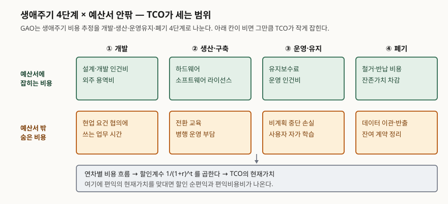

## 들어가며

시스템 교체 안건이 올라오면 비교표의 맨 아랫줄은 대개 "도입 비용"이다. 라이선스와
하드웨어, 구축 용역비를 더한 숫자다. 그 숫자로 고른 대안이 3년쯤 지나 "처음 계산보다
훨씬 비싸다"는 말을 듣는 일은 흔하다. 유지보수료가 매년 붙고, 전환 교육에 현업 시간이
들어가고, 중단이 날 때마다 업무가 멈춘다. 이 비용들은 어느 예산 항목에도 없었다.

시험에서 TCO와 ROI가 자주 묶여 나오는 이유가 여기 있다. TCO는 **비용을 어디까지
세는가**를 묻고, ROI는 **그 비용으로 무엇을 얻었는가**를 묻는다. 두 질문은 다르고,
둘 다 답해야 투자 판단이 선다.

## 정의

**총소유비용(TCO)은 정보시스템을 취득·운영·폐기하는 전 생애주기에 걸쳐 발생하는 모든
비용의 합이다.** 구매가뿐 아니라 운영·유지·교육·중단 손실·폐기까지 포함한다.

여기서 답안에 꼭 덧붙일 것이 하나 있다. **TCO는 국제표준이 정의한 용어가 아니라 시장
분석기관에서 나온 말이다.** 공공·정부 영역에서 같은 일을 하는 표준 용어는
**생애주기비용(LCC)** 이고, 미국 감사원(GAO)의 원가 추정 가이드는 생애주기비용
추정(LCCE)을 "인력·자재를 비롯한 모든 노력에 대한 구조화된 회계"로 규정하면서,
개발·생산·운영유지·폐기에 드는 전부를 대상으로 삼는다. 과거의 매몰 비용과 현재·미래
비용을 모두 포함하고, **재원이 어디서 나오든 상관하지 않는다**는 단서가 붙는다.
제외한 항목이 있으면 기록하고 사유를 남기라는 조건도 같이 있다.

ROI 쪽은 식이 단순하다. 투자로 얻은 순이익을 투자액으로 나눈 비율이다.

```
ROI = (총편익 − 총비용) / 총비용
```

다만 이 식에는 **시점이 들어 있지 않다.** 그래서 공공 투자 평가에서는 할인을 거친
지표를 기준으로 삼는다. 미국 OMB 예규 A-94는 정부 사업의 경제성 판단 기준을
**할인 순편익**(편익의 현재가치 − 비용의 현재가치)으로 명시하고, 할인계수를
`1/(1+r)^t` 로 정의한다. **편익비용비**는 편익 현재가치를 비용 현재가치로 나눈 값이다.

## 등장 배경

구매가만 비교하던 방식의 문제는 둘이다.

첫째, **비용이 시간에 흩어져 있다.** 라이선스를 한 번 사면 끝이 아니라 유지보수료가
매년 붙고, 몇 해 뒤에는 이관과 폐기 비용이 또 든다. 한 시점의 금액으로는 이것이
안 보인다.

둘째, **비용의 상당 부분이 예산서 밖에 있다.** 전환 기간에 현업이 쏟는 시간,
사용자가 혼자 익히느라 흘려보내는 시간, 계획에 없던 중단으로 멈춘 업무는 어느
회계 계정에도 잡히지 않는다. 잡히지 않으니 비교표에도 없고, 비교표에 없으니 판단에
들어가지 않는다.

TCO는 이 둘을 한 숫자로 모으자는 제안이고, 할인은 첫 번째 문제를 다루는 장치다.

## 구성요소 — 생애주기 4단계와 비용 2갈래

GAO 가이드는 생애주기를 **4단계**로 잡는다. 개발, 생산(구축·도입), 운영·유지, 폐기다.
여기에 예산서에 잡히는 비용과 잡히지 않는 비용 **2갈래**를 곱하면 **8칸**이 나오고,
TCO를 세는 일은 이 여덟 칸을 빠짐없이 채우는 일이다.

같은 가이드는 믿을 만한 원가 추정이 갖춰야 할 성질을 **4가지**로 든다. 포괄성,
문서화, 정확성, 신뢰성이다. 그리고 추정 절차를 **12단계**로 나눠 놓았는데, 목적 정의로
시작해 민감도 분석(8단계), 위험·불확실성 분석(9단계), 문서화(10단계), 보고(11단계),
실적 반영을 통한 갱신(12단계)으로 끝난다. **추정은 한 번 내고 끝나는 산출물이 아니라
갱신 단계를 가진 절차**라는 점이 답안에서 점수가 되는 자리다.

## 도식



> **출처**: [GAO-20-195G, Cost Estimating and Assessment Guide — Ch.2 Life Cycle Cost Estimate, Ch.4 Including All Costs in a Life Cycle Cost Estimate](https://www.gao.gov/products/gao-20-195g) · [OMB Circular A-94 (2023), Appendix B 할인계수 정의](https://www.whitehouse.gov/wp-content/uploads/2023/11/CircularA-94.pdf)

## 직접 계산해 본 결과

가상 사업 두 대안의 5년치 비용을 놓고 계산했다. 숫자는 설명을 위해 만든 값이고 실제
시세가 아니다. 전체 소스는 [`code/`](code/), 돌린 기록은
[`code/output.txt`](code/output.txt)에 있다.

**숨은 비용을 넣는 순간 순위가 뒤집혔다.**

```
  대안       | 가시 비용 | 숨은 비용 | TCO
  ---------+-------+-------+------
  A. 자체 구축 | 2,300 |   400 | 2,700
  B. 구독 이용 | 2,400 |   145 | 2,545
```

가시 비용만 보면 A가 100 싸고, 숨은 비용까지 넣으면 B가 155 싸다. 비교표에서 여덟
칸 중 아랫줄 네 칸을 비워 두면 고르는 대안 자체가 달라진다는 뜻이다.

**할인율을 올리면 격차가 더 벌어졌다.**

```
  할인율  | A 현재가치 | B 현재가치 | A - B
  -----+--------+--------+------
  0.0% |  2,700 |  2,545 |  +155
  3.1% |  2,553 |  2,347 |  +207
  5.0% |  2,473 |  2,238 |  +235
  7.0% |  2,396 |  2,133 |  +262
```

A는 지출이 앞쪽(초기 구축)에 몰려 있고 B는 뒤쪽(매년 구독료)에 흩어져 있다. 할인은
**미래의 금액만 깎으므로**, 지출이 뒤에 있는 쪽이 현재가치에서 더 많이 줄어든다.
그래서 할인율을 올릴수록 초기 투자형인 A의 불리함이 커진다. 할인율을 몇으로 잡느냐가
결론을 바꾸므로, **할인율은 가정이고 민감도 분석의 대상**이다.

**단순 ROI는 시점을 구분하지 못했다.** 비용과 총편익이 똑같고 편익이 들어오는 시기만
다른 두 대안을 놓고 보면 이렇게 나온다.

```
  대안            | 비용    | 총편익   | 단순 ROI | 편익 현재가치 | 할인 순편익 | 편익비용비 | 회수기간
  --------------+-------+-------+--------+---------+--------+-------+-----
  C. 편익이 앞에 몰린다 | 1,000 | 1,500 |  50.0% | 1,433.0 | +433.0 | 1.433 |   2년
  D. 편익이 뒤에 몰린다 | 1,000 | 1,500 |  50.0% | 1,307.6 | +307.6 | 1.308 |   5년
```

단순 ROI는 둘 다 50%로 같고, 할인 순편익은 125.4만큼 갈린다. **ROI만 적어 낸 보고서는
이 차이를 숨긴다.**

## 비교 — 다섯 지표가 각각 무엇을 못 보는가

| 지표 | 계산 | 시점 반영 | 규모 반영 | 못 보는 것 |
|---|---|---|---|---|
| TCO | 생애주기 비용 합 | 할인하면 반영 | — | 편익. 비용만 센다 |
| 단순 ROI | (편익−비용)/비용 | 없음 | 없음 | 편익이 언제 오는가, 사업 규모 |
| 할인 순편익 | 편익 현재가치 − 비용 현재가치 | 있음 | 있음 | 투자 규모 대비 효율 |
| 편익비용비 | 편익 현재가치 ÷ 비용 현재가치 | 있음 | 없음 | 절대 금액. 작은 사업이 유리해 보인다 |
| 회수기간 | 누적 편익이 비용을 넘는 시점 | 없음(할인하면 반영) | 없음 | 회수 이후의 편익 전부 |

답안에서는 **"한 지표로 결론짓지 않는다"**를 명시하는 쪽이 안전하다. TCO로 비용을
세고, 할인 순편익으로 경제성을 보고, 편익비용비와 회수기간을 보조로 붙이는 조합이
흔한 권고다.

## 적용 시 고려사항

**첫째, 제외한 항목을 기록한다.** 모든 숨은 비용을 금액으로 환산할 수는 없다. GAO
가이드는 제외한 항목이 있으면 그 사실과 사유를 문서로 남기라고 요구한다. 빠뜨린
것과 의도적으로 뺀 것은 다르고, 나중에 "왜 안 넣었나"를 답할 수 있어야 한다.

**둘째, 할인율과 분석 기간을 먼저 합의한다.** 위 계산에서 보듯 둘 다 결론을 바꾼다.
분석 기간을 짧게 잡으면 초기 투자형이 불리해지고, 길게 잡으면 운영비가 큰 쪽이
불리해진다. 대안마다 다른 기간을 쓰면 비교 자체가 성립하지 않는다.

**셋째, 비용과 편익의 측정 주체를 맞춘다.** 전산 부서 예산으로만 비용을 세고 편익은
전사 기준으로 세면 ROI가 부풀려진다. 반대로 현업이 쓰는 시간을 비용에 넣었다면
그 시간이 줄어든 만큼도 편익에 넣어야 한다.

**넷째, 금액으로 환산되지 않는 효과를 억지로 환산하지 않는다.** A-94는 화폐화할 수
없는 편익·비용이 있으면 할인 순편익이 완전하지 않다고 보고, 그 항목을 빠짐없이
열거하도록 한다. 결론이 바뀔 만큼 크다고 보이면 **임계값 분석**을 붙여 "이 효과가
얼마 이상이면 사업이 정당화되는가"를 보이라고 권한다. 숫자를 지어내는 것보다
"환산 불가" 항목을 드러내는 쪽이 평가에 낫다.

## 정리

- **TCO는 비용, ROI는 성과.** 묻는 것이 다르므로 둘을 같이 쓴다.
- 암기 단서는 **4-2-8**이다. 생애주기 **4**단계 × 예산서 안팎 **2**갈래 = 채워야 할 **8**칸.
- 추정의 품질 조건은 **4**가지(포괄·문서화·정확·신뢰), 추정 절차는 **12**단계이며
  마지막 단계가 실적 반영을 통한 **갱신**이다.
- 시점을 보는 지표는 할인 순편익·편익비용비이고, 단순 ROI와 회수기간은 시점을 놓친다.
  할인계수는 `1/(1+r)^t`.
- 할인율과 분석 기간은 **가정**이다. 가정이 결론을 바꾸므로 민감도 분석을 함께 낸다.

## 참고 자료

- [GAO-20-195G, Cost Estimating and Assessment Guide (2020)](https://www.gao.gov/products/gao-20-195g) — 생애주기비용 추정 정의, 4단계, 신뢰성 4특성, 12단계 절차
- [OMB Circular A-94, Guidelines and Discount Rates for Benefit-Cost Analysis of Federal Programs (2023 개정)](https://www.whitehouse.gov/wp-content/uploads/2023/11/CircularA-94.pdf) — 할인 순편익, 할인계수, 편익비용비, 생애주기비용 정의
- [OMB Circulars 목록](https://www.whitehouse.gov/omb/information-for-agencies/circulars/) — A-94의 현행본과 부록 D(할인율) 확인 경로
