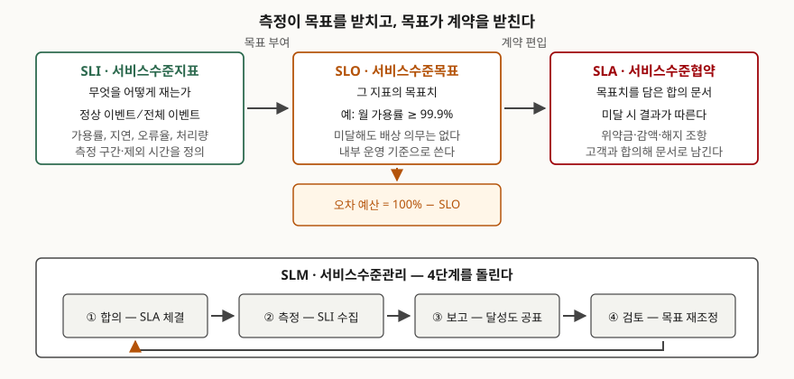

> 실행 검증 없음. 용어 정의는 공개된 원 출처(구글 SRE 서적 본문, 법령·고시 원문)를
> 그대로 근거로 했다. ISO/IEC 20000-1:2018은 유료 표준이라 **조항 번호와 제목·배치만**
> 공개 목차에서 확인해 인용했고, 조항 본문을 옮기지 않았다.

## 들어가며

운영 보고서에 "지난달 가용률 99.95% 달성"이라고 적혀 있는데, 정작 그달에 결제가 30분
멈췄던 일을 고객은 기억한다. 분모에 무엇을 넣었는지, 계획 정지를 뺐는지, 장애 시작
시각을 누가 정했는지가 합의되지 않으면 같은 달이 서로 다른 숫자로 적힌다. 세 글자짜리
용어 셋을 구분하는 문제가 시험에 반복해 나오는 이유가 여기 있다. 기술사 답안에서는
SLA를 "서비스 수준을 약속한 문서" 정도로 쓰면 점수가 붙지 않는다. **세 용어의 포함
관계와 각각을 누가 정하는지**까지 끊어 써야 한다.

## 정의

**SLI(서비스수준지표)는 제공되는 서비스 수준의 한 측면을 정량적으로 재는 척도이고,
SLO(서비스수준목표)는 그 SLI의 목표치 또는 목표 구간이며, SLA(서비스수준협약)는
목표치를 담되 달성·미달에 따른 결과가 뒤따르는 합의 문서다.** 구글 SRE 서적은 SLI를
"서비스 수준의 어떤 측면을 신중하게 정의한 정량적 척도"로 두고, SLO를 그 지표에
대한 목표값 또는 구간으로, SLA를 "사용자와 맺는 명시적이거나 묵시적인 계약"으로
구분한다.

셋을 가르는 것은 **결과(consequence)의 유무**다. 같은 서적이 제시한 판별법이 명쾌하다.
목표를 못 지키면 무슨 일이 일어나는지 물어 보라는 것이다. 명시된 결과가 없으면 SLO이고,
감액·배상·해지 같은 결과가 따르면 SLA다. 숫자가 같아도 결과가 다르면 다른 물건이다.

ISO/IEC 20000-1:2018은 이 문서를 다루는 관리 활동을 **서비스수준관리(SLM)**로 두고,
"관계 및 합의(8.3)" 아래 "서비스수준관리(8.3.3)" 조항에 요구사항을 둔다. 같은 조항
묶음에 사업관계관리(8.3.2)와 공급자관리(8.3.4)가 나란히 있다. **SLM이 품질 관리가
아니라 관계 관리 쪽에 놓여 있다**는 배치 자체가 답안에 쓸 거리다.

## 등장 배경

SLA라는 말이 먼저 자리를 잡은 탓에, 한동안 운영 조직은 **계약서의 숫자 하나만** 들고
일했다. 그 숫자는 법무·영업이 협상으로 정하므로 보통 보수적이고 기준 기간이 월·연
단위라 거칠다. 월 99.9%라는 한 줄로는 "어제 오후에 느렸다"는 신고에 답할 수 없다.

SRE가 SLI와 SLO를 따로 떼어 놓은 것은 이 간극을 메우기 위해서다. 내부 목표(SLO)를
계약(SLA)보다 엄하게 잡아 두면, 내부 목표를 깨는 시점에 조치가 시작되므로 계약
위반에 도달하기 전에 멈출 수 있다. 여기서 **오차 예산(error budget)** 개념이 나온다.
구글 SRE 워크북은 오차 예산을 100%에서 SLO를 뺀 값으로 정의한다. SLO가 99.9%면
허용되는 실패가 0.1%이고, 그만큼은 배포·실험에 써도 되는 예산으로 본다.

## 구성요소 — 3계층과 SLM 4단계

용어 체계는 **3계층**이다.

1. **SLI** — 재는 것. 정상 이벤트 수를 전체 이벤트 수로 나눈 비율 형태가 기본이다
2. **SLO** — 그 지표의 목표치. 내부 운영 기준이며 미달에 배상 의무가 없다
3. **SLA** — 목표치를 담은 합의 문서. 미달에 결과가 따른다

관리 활동인 SLM은 **4단계**를 돌린다. 합의(SLA 체결) → 측정(SLI 수집) → 보고(달성도
공표) → 검토(목표 재조정)이며, 검토에서 나온 변경이 다시 합의로 돌아간다.

지표를 고르는 기준은 시스템 유형별로 갈린다. 구글 SRE 서적은 **4가지 묶음**을 든다.
사용자 대면 서비스는 가용성·지연·처리량, 저장 시스템은 지연·가용성·내구성, 대규모
데이터 처리는 처리량과 종단 간 지연을 보고, **모든 시스템이 정확성을 함께 본다.**
같은 책은 잴 수 있는 지표를 다 넣지 말라고 경고한다. 지표가 많으면 중요한 것에
집중하지 못하고, 적으면 중요한 동작이 측정 밖에 남는다.

클라우드 서비스는 정량화되지 않는 약속도 있다. ISO/IEC 19086-1:2016은 클라우드 SLA의
구성 요소를 정리하면서 정량적 목표인 SLO와 정성적 목표인 **SQO(서비스정성목표)**를
나란히 두고, 다만 모든 서비스에 공통으로 적용할 표준 구조나 표준 목표 집합은 제시하지
않는다고 밝힌다.

## 구조

> **출처**: [Google SRE Book, ch.4 Service Level Objectives](https://sre.google/sre-book/service-level-objectives/) — 지표·목표·협약의 구분과 결과 유무 판별법, [Google SRE Workbook, ch.2 Implementing SLOs](https://sre.google/workbook/implementing-slos/) — 오차 예산 = 100% − SLO, [ISO/IEC 20000-1:2018](https://www.iso.org/standard/70636.html) — 8.3 관계 및 합의 / 8.3.3 서비스수준관리 (공개 목차 기준)

## 측정 가능한 형태로 적는다는 것

협약에 숫자를 적기 전에 **그 숫자를 만드는 식**을 먼저 적어야 한다. 가용률 하나만 해도
합의해야 할 것이 네 가지다. 측정 주기(월·분기), 분모에서 빼는 시간(계획 정지·사전
공지된 작업), 장애의 시작과 종료를 정하는 기준(감시 도구의 첫 경보인가 신고 접수인가),
그리고 측정 주체(제공자 도구인가 제3자 감시인가)다. 이 네 가지가 비어 있으면 같은
달에 서로 다른 가용률이 나오고, 협약은 분쟁의 근거가 아니라 분쟁의 소재가 된다.

국내 행정·공공 영역은 이 부분을 제도로 끌어올렸다. 전자정부법이 정보시스템 장애관리와
등급 관리를 규정하고, 「행정기관 및 공공기관 정보시스템 안정성 고시」가 등급과 관리
기준을 정한다. 행정안전부는 2025년 8월 보도자료에서 가용률·장애시간 표준안을 마련해
디지털정부서비스 품질을 높이겠다고 밝혔고, 2026년 6월 「행정·공공기관 정보시스템
서비스수준협약 및 표준운영절차 가이드」를 발간했다. **표준 지표와 표준 측정 방법을
먼저 정하고 그 위에 협약을 올리는 순서**가 제도의 뼈대다.

## 비교 — 세 용어와 인접 개념

| 항목 | SLI | SLO | SLA | OLA·UC |
|---|---|---|---|---|
| 성격 | 척도(측정값) | 목표치 | 합의 문서 | 내부·외주 합의 |
| 정하는 주체 | 운영·개발 | 운영·개발 | 고객과 협상(법무·영업 참여) | 내부 부서·공급자 |
| 미달 시 결과 | 없음(사실 기록) | 없음(내부 조치 촉발) | 있음(감액·배상·해지) | 계약에 따라 다름 |
| 표현 형태 | 비율·시간·건수 | 부등식 또는 구간 | 조항과 부속 지표 정의서 | 조항 |
| 바뀌는 주기 | 계측 체계 변경 시 | 검토 주기마다 | 계약 갱신 시 | 계약 갱신 시 |
| 대상 | 시스템 동작 | 그 지표 | 고객과의 서비스 | 내부 지원·공급자 |

마지막 열의 OLA(운영수준협약)와 UC(기초계약)는 SLA를 받치는 뒷단이다. 고객과 월
99.9%를 약속했는데 회선 공급자와는 아무 약속이 없으면, 그 약속은 **지킬 수단 없이
적힌 숫자**다. ISO/IEC 20000-1:2018이 공급자관리를 서비스수준관리 바로 옆(8.3.4)에
둔 것도 같은 맥락으로 읽힌다.

## 적용 시 고려사항 — 5가지

1. **내부 목표를 계약보다 엄하게 잡는다.** SLO를 SLA와 같은 값으로 두면 내부 목표를
   깨는 순간이 곧 계약 위반이라 조치할 시간이 없다. 둘 사이에 여유를 두는 것이
   오차 예산 운영의 전제다
2. **지표 정의서를 협약의 부속으로 붙인다.** 본문에 숫자만 적고 식을 안 적으면
   측정 주기·제외 시간·장애 판정 시점이 매달 재협상 대상이 된다
3. **측정 체계를 먼저 세운다.** 로그 수집, 시각 동기화, 장애 기록이 없으면 달성도를
   재는 일 자체가 불가능하다. 측정되지 않는 목표치는 협약서에만 남는다
4. **지표 개수를 제한한다.** 잴 수 있는 것을 다 넣으면 어느 것이 나빠졌을 때 무엇을
   해야 하는지가 흐려진다. 사용자가 체감하는 것부터 소수로 고른다
5. **위약금이 목적이 아니다.** 감액 조항이 세질수록 제공자는 보수적인 목표치를
   제시하고, 장애 보고를 늦게 올릴 유인이 생긴다. 결과 조항과 함께 **보고 의무와
   개선 조치 절차**를 같이 넣어야 제도가 품질 쪽으로 작동한다

## 정리

암기 단서는 **"재고(SLI) → 겨누고(SLO) → 약속한다(SLA), 그리고 돌린다(SLM)"** 다.

- 3계층: SLI는 척도, SLO는 그 목표치, SLA는 결과가 따르는 합의 문서
- 가르는 기준 1가지: **결과(consequence)의 유무.** 못 지키면 무슨 일이 생기는가
- SLM 4단계: 합의 → 측정 → 보고 → 검토, 검토가 다시 합의로 돌아간다
- 오차 예산 = 100% − SLO (구글 SRE 워크북)
- 지표 선정 4가지 묶음: 사용자 대면(가용성·지연·처리량), 저장(지연·가용성·내구성),
  대규모 데이터(처리량·종단 간 지연), 공통(정확성)
- 표준 배치: ISO/IEC 20000-1:2018은 8.3 관계 및 합의 아래 8.3.3에 서비스수준관리를 둔다
- 고려사항 5가지: 내부 목표를 더 엄하게, 지표 정의서 부속, 측정 체계 선행,
  지표 수 제한, 위약금만으로 품질이 오르지 않는다

> 기출 답안: [기출문제 — 공공 SLA와 정보시스템 등급제](../../exam/2026-10-14-public-sla-and-system-grade/index.md)

## 참고 자료

- [ISO/IEC 20000-1:2018, Information technology — Service management — Part 1: Service management system requirements](https://www.iso.org/standard/70636.html) — 제3판. 8.3 Relationship and agreement / 8.3.2 Business relationship management / 8.3.3 Service level management / 8.3.4 Supplier management, 3.2 Terms specific to service management (조항 번호·제목은 발행처가 공개한 목차 기준, 본문은 유료)
- [Google, "Service Level Objectives", Site Reliability Engineering, ch.4 (O'Reilly, 2016)](https://sre.google/sre-book/service-level-objectives/) — SLI·SLO·SLA 구분, 결과 유무 판별법, 시스템 유형별 지표 선정
- [Google, "Implementing SLOs", The Site Reliability Workbook, ch.2 (O'Reilly, 2018)](https://sre.google/workbook/implementing-slos/) — SLI를 정상/전체 이벤트 비율로 두는 형식, 오차 예산 = 100% − SLO
- [ISO/IEC 19086-1:2016, Cloud computing — Service level agreement (SLA) framework — Part 1: Overview and concepts](https://www.iso.org/standard/67545.html) — 클라우드 SLA의 SLO·SQO 구분, 공통 표준 구조를 제시하지 않는다는 범위 선언
- [행정기관 및 공공기관 정보시스템 안정성 고시](https://www.law.go.kr/admRulInfoP.do?admRulSeq=2100000277792) — 행정안전부고시 제2026-23호, 2026.4.13. 제정·시행. 국가법령정보센터
- [전자정부법](https://www.law.go.kr/LSW/lsRvsDocListP.do?lsId=009199&chrClsCd=010202&lsRvsGubun=all) — 제56조의2~제56조의5(정보시스템 장애관리·등급 관리·현황조사 및 점검·장애상황 및 사후관리), 법률 제20654호, 2025.1.7. 일부개정
- [행정·공공기관 정보시스템 서비스수준협약 및 표준운영절차 가이드](https://www.mois.go.kr/frt/bbs/type001/commonSelectBoardArticle.do?bbsId=BBSMSTR_000000000045&nttId=127434) — 행정안전부, 2026.6.30.
- [정보시스템 가용률, 장애시간 표준안 등으로 디지털정부서비스 품질 높인다](https://www.mois.go.kr/frt/bbs/type010/commonSelectBoardArticle.do?bbsId=BBSMSTR_000000000008&nttId=120101) — 행정안전부 보도자료, 2025.8.28.
