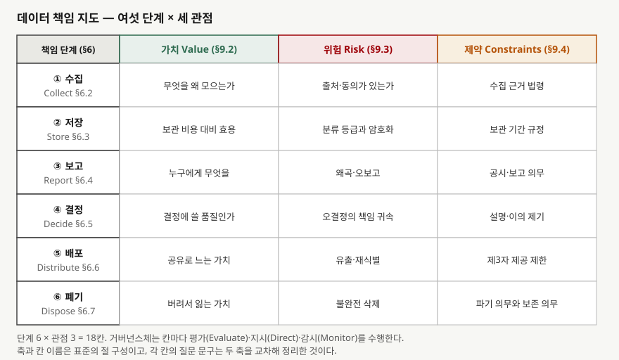

> **실행 검증 없음.** 표준 본문은 유료라 열지 못했다. 공개 미리보기(표지·목차·머리말·서문)로
> 확인되는 **판과 발행일, 절 번호와 절 제목, 머리말이 밝힌 개정 사유, 서문 본문**까지만 근거로
> 썼고 각 절의 지침 문언은 인용하지 않았다. 절 제목만으로는 알 수 없는 부분은 본문에 그렇게 밝혔다.

## 들어가며

데이터 거버넌스는 데이터 품질, 데이터 레이크, 데이터 자산화 문제에 반복해서 따라붙는다.
답안에서 점수가 갈리는 지점은 "거버넌스가 중요하다"를 길게 쓰는 쪽이 아니라 **누가 무엇을
언제 판단하는지를 체계로 적는 쪽**이다. ISO/IEC 38505-1은 그 체계를 국제표준 한 건으로 주며,
IT 거버넌스 표준의 원칙과 모델을 데이터에 옮겨 적용한다. 2026년 8월 제2판이 나와 제1판을
대체했으므로, 답안에 번호만 쓰고 판을 빼면 지금은 틀린 구조를 적게 될 수 있다.

## 정의

한 문장으로 끊으면 이렇다.

> **데이터 거버넌스는 데이터를 저장·검색·관리하는 실무가 아니라, 조직의 거버넌스체(governing
> body)가 데이터의 취급과 사용을 평가·지시·감시하는 활동이다.**

이 문장의 근거는 ISO/IEC 38505-1:2026 서문 두 군데다. 서문은 이 문서의 목적을 거버넌스체가
조직 안의 데이터 취급과 사용을 **평가(evaluating)·지시(directing)·감시(monitoring)** 할 때 쓸
원칙·정의·모델을 제공하는 것으로 적는다. 그리고 거버넌스는 경영(management)과 구별되며,
데이터를 저장·검색·관리하는 기전이 아니라 데이터의 **사용**을 평가·지시·감시하는 일이라고
한 번 더 못박는다.

표준의 제목 자체가 적용 관계를 밝힌다. 정식 명칭은 *Information technology — Governance of
data — Part 1: Application of ISO/IEC 38500 to the governance of data*로, 독립된 거버넌스
프레임워크가 아니라 **IT 거버넌스 표준(ISO/IEC 38500)을 데이터라는 대상에 적용한 판**이다.
답안에서 이 관계를 뒤집어 "38505가 38500을 포함한다"로 쓰면 바로 감점이다.

## 등장 배경

서문이 배경을 직접 적는다. 모든 조직이 데이터를 쓰고 그 대부분이 IT 시스템에 전자적으로
저장돼 있는데, 클라우드·사물인터넷·빅데이터 분석·인공지능이 퍼지면서 데이터를 생성하고
모으고 저장하고 캐내기가 쉬워졌다. 서문은 이 범람이 거버넌스체에 **기회를 살릴 책임과 민감
데이터를 보호할 책임**을 동시에 지운다고 본다. 법과 규제가 기술을 뒤따라오지 못하는 영역이
있으므로 데이터의 윤리적 사용은 조직이 스스로 보장해야 한다는 문장도 서문에 있다.

기술 쪽 배경은 한 줄로 정리된다. IT 거버넌스 표준은 **IT의 사용**을 대상으로 삼았고, 데이터는
그 안에서 시스템의 부속물로 다뤄졌다. 데이터가 그 자체로 가치와 위험을 갖는 대상이 되면
IT 자산 관점의 질문("이 시스템을 도입할 것인가")으로는 필요한 판단이 나오지 않는다. 같은
원칙과 모델을 **데이터**에 다시 적용한 별도 파트가 필요했던 이유다.

범위에는 분명한 선이 있다. 서문은 이 문서의 원칙이 데이터 교환 네트워크·플랫폼·데이터
스페이스의 거버넌스체에도 관련될 수 있다고 하면서도, **조직 간(inter-organizational) 데이터
거버넌스는 이 문서의 범위 밖**이라고 명시한다. 데이터 생태계나 기관 간 공유 과제를 이 표준만
근거로 풀면 범위를 넘어선 서술이 된다.

## 구성요소 — 세 묶음

표준은 데이터를 **단계(무엇을 하는 중인가)** 와 **관점(무엇을 볼 것인가)** 으로 갈라 놓고,
그 둘을 모델(어떻게 판단하는가)로 잇는다.

### 가. 데이터 책임 지도 — 여섯 단계

책임 절(§6 Data accountability)의 하위 절이 그대로 단계다. **여섯 가지**다.

| 단계 | 절 | 무엇을 하는 중인가 |
|---|---|---|
| ① 수집 Collect | §6.2 | 데이터를 조직 안으로 들인다 |
| ② 저장 Store | §6.3 | 들인 데이터를 보관한다 |
| ③ 보고 Report | §6.4 | 보관된 데이터를 가공해 사람에게 보인다 |
| ④ 결정 Decide | §6.5 | 그 데이터로 판단한다 |
| ⑤ 배포 Distribute | §6.6 | 조직 안팎의 다른 주체에게 넘긴다 |
| ⑥ 폐기 Dispose | §6.7 | 더 들고 있지 않는다 |

여기서 눈여겨볼 것은 **보고와 결정이 단계로 들어와 있다**는 점이다. 흔히 쓰는 데이터 생애주기
모형은 생성·저장·활용·폐기처럼 데이터가 놓인 상태를 따라가는데, 이 지도는 그 사이에 **사람이
무엇을 보고 무엇을 결정했는가**를 끼워 넣는다. 책임을 묻는 지점이 데이터가 아니라 그 데이터로
한 행위에 있다는 뜻으로 읽힌다. 다만 각 절이 무엇을 요구하는지는 유료 본문이라 확인하지
못했으므로, 여기서는 절 제목이 드러내는 구성까지만 쓴다.

### 나. 데이터 특유 관점 — 셋

관점 절(§9 Data-specific aspects)이 드는 축은 **세 가지**이고, 각각 하위 항목을 갖는다.

| 관점 | 절 | 하위 항목 | 개수 |
|---|---|---|---|
| 가치 Value | §9.2 | 품질, 적시성, 맥락, 양 | 4 |
| 위험 Risk | §9.3 | 관리, 데이터 분류체계, 보안 | 3 |
| 제약 Constraints | §9.4 | 규제와 법률, 사회적, 조직 정책 | 3 |

가치가 **품질·적시성·맥락·양** 넷으로 쪼개져 있다는 사실은 답안에서 쓸모가 크다. 데이터의
가치를 금액으로만 말하면 네 항목 중 한 칸도 채우지 못한다. 제약도 법령만이 아니라 **사회적
제약**과 **조직 자체 정책**을 따로 세운다. 법에 걸리지 않아도 하지 않을 일이 있다는 구분이다.

### 다. 거버넌스 모델 — 네 활동 (제2판 기준)

모델 절(§8)의 하위 절은 제2판에서 **네 가지**다. 이해관계자 참여(§8.3 Engage stakeholders),
평가(§8.4 Evaluate), 지시(§8.5 Direct), 감시(§8.6 Monitor). 제1판은 평가·지시·감시 셋에
내부 요구사항(§8.2)과 외부 압력(§8.3)을 입력으로 두는 구성이었다. 즉 **외부를 압력으로 받던
자리가 이해관계자를 참여시키는 활동으로 바뀌었다.** 받아들이는 쪽에서 끌어들이는 쪽으로 옮겨
간 것이고, 머리말이 밝힌 개정 사유와 맞물린다.

### 라. 지도와 관점이 만나는 행렬

단계 여섯과 관점 셋이 교차해 **18칸**의 행렬이 된다. 같은 계열 기술보고서인 ISO/IEC TR
38505-2는 독자가 "ISO/IEC 38505-1에 제시된 데이터 책임 지도와 그에 딸린 고려사항 행렬"에
익숙하다고 전제한다고 적는다. 지도를 표 한 장으로 보는 방식이 표준 계열 안에서 쓰이고 있다는
근거다. 적용 절(§10 Application of the data accountability map)은 제1판·제2판 모두 번호와
제목이 같다.

## 도식

> **출처**: [ISO/IEC 38505-1:2026 §6 Data accountability(6.2~6.7), §9 Data-specific aspects(9.2~9.4), §10 Application of the data accountability map — 공개 미리보기 목차](https://www.iso.org/standard/87195.html) · [ISO/IEC TR 38505-2:2018 — 데이터 책임 지도와 고려사항 행렬을 전제로 한다는 적용 범위 기술](https://standards.nimonik.com/products/iso/iso-iec-rpt-38505-2/) (제3자 전재). 가로·세로 축과 칸 이름은 표준의 절 구성이고, 각 칸에 적힌 질문 문구는 표준 문언이 아니라 두 축을 교차해 정리한 것이다.

답안지에 옮길 때는 표 하나를 그리고 세로에 여섯, 가로에 셋을 적으면 끝난다. 칸을 다 채울
시간이 없으면 비워 두고 **충돌이 생기는 칸 두세 개만** 적는다. 그 칸이 거버넌스체가 실제로
결정할 지점이기 때문이다.

## 비교

### 가. 제1판(2017)과 제2판(2026) — 목차 대조

머리말은 개정 사유를 한 줄로 적는다. **ISO/IEC 38500:2024와의 정렬이며, 그 38500:2024는
다시 ISO 37000에 정렬돼 있다**는 것이다. 목차에서 달라진 자리는 셋이다.

| 절 | 제1판 (2017) | 제2판 (2026) | 달라진 것 |
|---|---|---|---|
| §4 좋은 데이터 거버넌스 | 편익, 거버넌스체 책임, 감독 기전 (3개 절) | 일반, **효과적 성과**, **책임 있는 수탁**, **윤리적 행동**, 편익, 거버넌스체 책임, 감독 기전 (7개 절) | 성과·수탁·윤리 세 절 신설 |
| §7 원칙 | 7.2~7.7에 책임·전략·획득·성과·적합·인간 행동 여섯 원칙을 절로 세움 | 하위 절 없음 (한 쪽 분량) | 여섯 원칙을 절로 열거하던 구성이 목차에서 사라짐 |
| §8 모델 | 적용, **내부 요구사항**, **외부 압력**, 평가·지시·감시 | 일반, 모델, **이해관계자 참여**, 평가·지시·감시 | 내부·외부 구분이 이해관계자 참여로 대체 |
| §6 책임 지도 / §9 관점 / §10 적용 | 6.1~6.7 / 9.1~9.4.4 / 10 | 동일 | 번호·제목 변화 없음 |

표에서 §7 줄은 조심해서 읽어야 한다. **목차에 번호가 붙은 하위 절이 없다는 뜻이지, 본문에서
여섯 원칙이 없어졌다는 뜻이 아니다.** 본문을 열지 못했으므로 확인할 수 있는 선까지만 적는다.
답안에 "제2판에서 여섯 원칙이 폐지됐다"고 쓰면 근거 없는 단정이 된다.

신설된 세 절의 이름(효과적 성과·책임 있는 수탁·윤리적 행동)은 상위 거버넌스 표준의 어휘다.
데이터 거버넌스를 **IT 투자 판단의 하위 주제**로 두던 틀에서 **조직 거버넌스의 한 갈래**로
옮기는 방향으로 읽힌다.

### 나. 인접 표준·체계와의 대비

| | ISO/IEC 38500 | ISO/IEC 38505-1 | DAMA-DMBOK2 데이터 거버넌스 | ISO/IEC 25012 |
|---|---|---|---|---|
| 대상 | IT의 사용 | 데이터의 사용 | 데이터 자산 관리 | 데이터 품질 |
| 독자 | 거버넌스체 | 거버넌스체 | 데이터 관리 실무·조직 | 설계·평가 실무 |
| 성격 | 원칙·모델 | 원칙·모델의 데이터 적용 | 지식 체계·실무 지침 | 품질 특성 모형 |
| 핵심 산출 | 평가·지시·감시 | 책임 지도 + 가치·위험·제약 | 역할·정책·프로세스 | 품질 특성 분류 |
| 답안에서의 쓸모 | 상위 근거 | 구조와 개수 | 역할과 실행 | 품질 측정 축 |

세 자료는 경쟁 관계가 아니다. 답안에 쓸 때는 **38505-1로 구조와 개수를 세우고, DMBOK2로
역할과 실행을 채우고, 25012로 품질 축을 붙이는** 순서가 겹치지 않는다.

## 적용 시 고려사항

**① 거버넌스와 관리의 선을 문서에 그어 둔다.** 표준이 서문에서 둘을 가른 이유는 현장에서 이
선이 가장 자주 무너지기 때문이다. 데이터 거버넌스 위원회를 만들어 놓고 안건이 전부 적재 실패와
스키마 변경이면, 운영 회의에 이름만 바꿔 붙인 것이다. 거버넌스체에 올릴 안건은 **평가·지시·감시
가 필요한 결정**이어야 한다.

**② 여섯 단계를 조직의 실제 단계 이름으로 다시 적는다.** 수집·저장·보고·결정·배포·폐기는 추상
이름이고, 조직에는 수집에 해당하는 경로가 여러 개 있다. 지도를 표로만 걸어 두면 아무도 자기
업무가 어느 칸인지 모른다. 칸마다 담당 시스템과 책임 부서를 붙여야 지도가 된다.

**③ 같은 칸에서 세 관점이 충돌한다는 것을 전제로 설계한다.** 배포 단계에서 가치는 "더 열면
가치가 는다"고 하고 제약은 "제3자 제공 제한이 있다"고 한다. 둘을 동시에 만족시키는 답은 대개
없다. 어느 쪽으로 기울일지를 정하는 것이 거버넌스체의 일이고, 이 판단을 실무 조직에 떠넘기면
지도는 종이로 남는다.

**④ 감시는 측정 체계가 있어야 성립한다.** 평가와 지시는 회의로 되지만 감시는 안 된다. 같은
계열 기술보고서(TR 38505-2)가 데이터의 성과와 사용을 감시할 측정 체계를 식별하는 일을 적용
범위에 넣은 것도 이 때문이다. 지표 없이 "감시한다"고 적은 거버넌스 체계는 작동하지 않는다.

**⑤ 조직 간 데이터 거버넌스에는 이 표준만으로 답하지 않는다.** 범위 밖임을 서문이 명시한다.
데이터 생태계·기관 간 공유 과제에서는 이 표준을 조직 내부 체계의 근거로만 쓰고, 조직 간
영역은 다른 근거를 세워야 한다.

## 정리

- **책임 지도 6단계 — 수·저·보·결·배·폐** (수집·저장·보고·결정·배포·폐기, §6.2~6.7).
  생애주기 모형과 달리 **보고·결정**이 단계로 들어간 것이 이 표준의 특징이다
- **관점 3 — 가·위·제** (가치·위험·제약, §9.2~9.4). 가치 하위 4(품질·적시성·맥락·양),
  위험 하위 3(관리·분류체계·보안), 제약 하위 3(규제와 법률·사회적·조직 정책)
- **6 × 3 = 18칸**이 데이터 책임 지도의 고려사항 행렬이다. 칸마다 평가·지시·감시를 돌린다
- **모델 4 — 참·평·지·감** (이해관계자 참여·평가·지시·감시, 제2판 §8.3~8.6).
  제1판은 내부 요구사항과 외부 압력을 입력으로 둔 평가·지시·감시 셋이었다
- **정의 한 줄** — 거버넌스는 데이터를 다루는 일이 아니라 데이터의 **사용**을 평가·지시·감시하는 일
- **판 표기** — 제2판 2026-08이 제1판 2017을 취소·대체했고, 개정 사유는 ISO/IEC 38500:2024 정렬이다

> 기출 답안: [기출문제 — 데이터 가치평가와 데이터 자산화](../../exam/2026-10-15-data-valuation-and-assetization/index.md)

> 함께 읽기: [데이터 거버넌스와 데이터 품질 관리 체계](../../database/2026-10-06-data-governance-quality-dimensions-roles/index.md) — 역할 4계층과 품질 차원 6가지

## 참고 자료

- [ISO/IEC 38505-1:2026, *Information technology — Governance of data — Part 1: Application of ISO/IEC 38500 to the governance of data*](https://www.iso.org/standard/87195.html) — 제2판 2026-08. 유료 표준이라 공개 미리보기(표지·목차·머리말·서문)만 참조했다
- [ISO/IEC 38505-1:2026 공개 미리보기 PDF](https://www.technickenormy.cz/publicdoc/iec_previews/4311698.pdf) — 목차 전체, 머리말의 개정 사유, 서문 본문 (제3자 전재)
- [ISO/IEC 38505-1:2017 공개 미리보기 PDF (제1판)](https://assets.vde-verlag.de/iec-normen/preview-pdf/info_isoiec38505-1%7Bed1.0%7Den.pdf) — 제1판 목차. 판 대조의 근거 (제3자 전재)
- [ISO/IEC TR 38505-2:2018, *Implications of ISO/IEC 38505-1 for data management*](https://standards.nimonik.com/products/iso/iso-iec-rpt-38505-2/) — 데이터 책임 지도와 고려사항 행렬을 전제로 한다는 적용 범위 기술 (제3자 전재)
- [ISO/IEC 38500:2024, *Governance of IT for the organization*](https://www.iso.org/standard/81684.html) — 제2판이 정렬 대상으로 삼은 상위 표준
