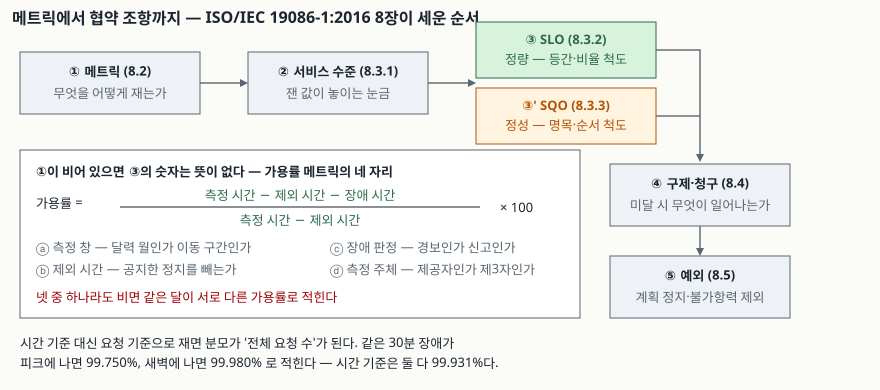

## 들어가며

계약서에 "월 가용률 99.9% 이상"이라고 한 줄이 들어간다. 그 한 줄이 허용하는 중단 시간이
몇 분인지 바로 답할 수 있는 사람은 많지 않고, 더 나쁜 것은 **같은 달을 두고 제공자와 고객이
다른 숫자를 들고 오는 경우**다. 장애가 30분이었다는 데는 둘 다 동의하는데, 한쪽은 99.93%,
다른 쪽은 99.75%라고 적는다. 분모와 분자를 다르게 잡았기 때문이다.

세 글자 용어의 뜻과 포함 관계는 [SLA·SLO·SLI와 서비스수준관리(SLM)](../2026-10-19-sla-slo-sli-service-level-management/index.md)에서
따로 정리했다. 이 글은 그 다음 자리, **지표를 숫자로 만드는 산술**을 다룬다. 아래 숫자는
전부 [`code/sla_math.py`](code/sla_math.py)로 직접 계산했고 기록은
[`code/output.txt`](code/output.txt)에 있다.

## 정의

**서비스수준목표(SLO)는 서비스의 특정한 정량적 특성에 대해 제공자가 하는 약속이며, 그 값은
등간 척도 또는 비율 척도를 따른다.** ISO/IEC 19086-1:2016은 이 정의를 3.5에 두고, 약속을
구간으로 표현할 수 있다는 주석을 붙인다. 같은 표준의 **서비스정성목표(SQO) 정의(3.6)** 는
정성적 특성에 대한 약속으로, 값이 명목 척도나 순서 척도를 따른다고 적는다.

여기서 답안에 쓸 거리는 **척도(scale)** 라는 말이다. 가용률·응답시간은 비율 척도라 "99.9%의
두 배"가 뜻을 갖지만, 지원 등급 같은 값은 순서만 있을 뿐 간격이 없다. 지표를 설계할 때
가장 먼저 가르는 것이 이 구분이고, 척도를 잘못 잡으면 평균을 낼 수 없는 값의 평균을 내게 된다.

## 등장 배경

목표치만 합의하고 측정 방법을 비워 두는 관행이 오래갔다. 측정 방법은 기술 문서로 보였고,
협상 자리에서는 숫자만 오갔기 때문이다. 그 결과가 매달 반복되는 해석 다툼이다.

ISO/IEC 19086-1:2016이 8장의 제목을 "클라우드 SLA에서 SLO·SQO·메트릭·구제·예외가 맡는
역할"로 잡고 **메트릭(8.2)을 목표(8.3)보다 앞에** 둔 것은 이 순서를 바로잡으려는 배치다.
무엇을 어떻게 재는지가 먼저 정해져야 목표치가 뜻을 갖는다.

## 구성요소 — 가용률 메트릭이 합의해야 할 4가지

목표 가용률 하나를 적기 위해 먼저 정해야 할 것이 **4가지**다.

1. **측정 창** — 달력 월인가, 30일 이동 구간인가. 달력 월은 2월과 7월의 분모가 다르다
2. **제외 시간** — 사전 공지한 정기 점검을 분모에서 빼는가. 빼면 가용률이 올라간다
3. **장애 판정 기준** — 감시 도구의 첫 경보 시각인가, 고객 신고 접수 시각인가
4. **측정 주체** — 제공자 도구의 기록인가, 제3자 감시 서비스의 기록인가

넷 중 하나라도 비면 같은 달이 서로 다른 가용률로 적힌다.

## 도식



> **출처**: [ISO/IEC 19086-1:2016, Cloud computing — SLA framework — Part 1](https://www.iso.org/standard/67545.html) — 8.2 Metrics / 8.3.1 Service levels / 8.3.2 Cloud service level objectives / 8.3.3 Cloud service qualitative objectives / 8.4 Remedies and claims / 8.5 Exceptions, 3.5·3.6 정의(발행처 공개 미리보기 기준)

## 숫자로 확인한 것 넷

### 99.9%가 허용하는 중단 시간

```text
    가용률 |       하루 |      한 주 |       30일 |      365일
  ------------------------------------------------------------
     99.0% |     14.40분 |     1.68시간 |     7.20시간 |      3.65일
     99.9% |      1.44분 |     10.08분 |     43.20분 |     8.76시간
    99.99% |      8.64초 |      1.01분 |      4.32분 |     52.56분
   99.999% |   864.00ms |      6.05초 |     25.92초 |      5.26분
```

같은 99.9%라도 **기준 기간이 붙어야 뜻이 생긴다.** 30일 기준은 43.2분을 허용하지만, 하루
기준이면 1.44분이다. 후자는 재기동 한 번으로 깨진다. 협약에 기간을 안 적고 "99.9%"만 쓰면
제공자는 긴 기간을, 고객은 짧은 기간을 가정한다.

### 같은 30분 장애가 두 숫자로 적히는 이유

```text
  측정 창 30일 = 43,200분 · 장애 30분
  시간 기준 가용률 : 99.93056%  (장애가 언제 났든 같다)
  요청 기준 가용률 (피크 시간대) : 99.75000%  — 실패 요청 150,000건
  요청 기준 가용률 (새벽 시간대) : 99.98000%  — 실패 요청 12,000건
```

시간을 분모로 두면 장애 시각과 무관하게 한 값이 나온다. 요청 수를 분모로 두면 **같은 길이의
장애가 난 시각에 따라 갈린다.** 사용자가 겪은 피해는 요청 기준이 더 가깝게 담고, 계산의
재현성은 시간 기준이 낫다. 어느 쪽을 쓸지와 요청 분포를 누가 집계할지가 합의 대상이다.
(위 요청 분포는 가정값이고, 그 가정에서 나온 계산은 실제 값이다.)

### 직렬 구성은 곱이므로 목표가 저절로 내려간다

```text
  웹 2중화         99.999900%
  WAS 2중화        99.999900%
  DB 단일          99.900000%
  외부 결제 연동   99.950000%
  전체             99.849850%  ·  30일 허용 중단 1.08시간
```

구간을 직렬로 이으면 전체 가용성은 각 구간의 곱이다. 위 구성의 전체 값은 **가장 약한 구간인
DB 단일(99.9%)보다도 낮다.** 99.9%짜리 구간 10개를 직렬로 이으면 99.0045%까지 내려간다.
반대로 같은 부품을 2중화하면 99.9%가 99.99999%가 된다(고장이 서로 독립이라고 볼 때).
구성에서 나오는 상한을 먼저 계산하지 않고 목표치를 약속하면, **아키텍처가 못 내는 숫자를
계약서에 적게 된다.** 신뢰성 블록도로 이 계산을 체계화한 것이 IEC 61078:2016이고,
직렬 구조(9.1)와 병렬 구조(9.2)를 나눠 다룬다.

### 응답시간은 평균으로 재지 않는다

```text
  표본 100,000건 · 목표 '응답시간 300 ms 이하'
    평균      :    111.1 ms  -> 목표 충족
    p95       :    187.2 ms  -> 목표 충족
    p99       :   1011.8 ms  -> 목표 미달
    p99.9     :   2616.3 ms  -> 목표 미달
  목표를 넘긴 요청 : 2,186건 (2.19%)
```

응답시간 분포는 한쪽으로 긴 꼬리를 갖는다. 평균 111 ms로는 목표를 여유 있게 지키는데
p99는 목표의 세 배를 넘는다. **협약에 백분위를 적지 않으면 "평균 기준"이라는 해석이
끼어든다.** 답안에서는 "응답시간 SLO는 백분위와 측정 창을 함께 적는다"까지 써야 한다.

## 비교 — 가용률을 재는 두 방식

| 항목 | 시간 기준(time-based) | 요청 기준(request-based) |
|---|---|---|
| 분모 | 측정 시간 − 제외 시간 | 전체 요청 수 |
| 분자 | 정상 가동 시간 | 성공 요청 수 |
| 장애 시각의 영향 | 없음 | 큼(피크 99.750% / 새벽 99.980%) |
| 부분 장애 반영 | 어렵다(가동/정지 이분법) | 쉽다(실패 비율이 그대로) |
| 집계 난이도 | 낮다(감시 로그) | 높다(요청 단위 집계 체계 필요) |
| 분쟁 소지 | 장애 시작·종료 시각 | 요청 분포와 집계 주체 |

어느 쪽이 우월한 것이 아니라 **재는 대상이 다르다.** 배치·전송 같은 비대화형 서비스는 시간
기준이, 사용자 대면 API는 요청 기준이 체감에 가깝다. 둘을 함께 적고 각각 목표를 다는
방식도 쓴다.

## 적용 시 고려사항 — 5가지

1. **구성에서 나오는 상한을 먼저 계산한다.** 직렬 구간의 곱이 목표치보다 낮으면 그 목표는
   운영으로 달성할 수 없고 이중화·구성 변경이 전제다. 계약 협상 전에 할 계산이다
2. **기준 기간과 측정 창을 숫자로 적는다.** "월 99.9%"의 월이 달력 월인지 30일 이동
   구간인지에 따라 허용 중단 시간과 위반 판정 시점이 둘 다 달라진다
3. **제외 시간의 범위를 열거한다.** 정기 점검, 긴급 패치, 고객 요청 작업, 불가항력을
   각각 적는다. ISO/IEC 19086-1:2016이 예외를 8.5로 따로 떼어 둔 자리가 이것이다
4. **백분위를 쓰고 집계 단위를 적는다.** p99을 1분 단위로 집계한 값과 월 전체로 집계한
   값은 다르다. 짧은 구간의 악화가 긴 집계에 묻히는 것도 같은 이유다
5. **목표를 올리는 비용은 선형이 아니다.** 30일 기준으로 99.9%는 43.2분을 허용하지만
   99.99%는 4.32분이다. 한 자리를 올리면 허용 시간이 10분의 1이 되고, 그 차이를 메우는
   것은 운영 노력이 아니라 구성 변경이다

## 정리

암기 단서는 **"재는 법(메트릭) → 눈금(서비스 수준) → 약속(SLO·SQO) → 결과(구제) → 예외"**
다섯 단계다. ISO/IEC 19086-1:2016 8장의 순서 그대로다.

- SLO 정의(3.5): 정량적 특성에 대한 약속, 값이 등간·비율 척도를 따른다. SQO(3.6)는
  정성적 특성이며 명목·순서 척도다
- 가용률 메트릭이 합의해야 할 **4가지**: 측정 창 · 제외 시간 · 장애 판정 기준 · 측정 주체
- 30일 기준 허용 중단: 99.0% 7.20시간 / 99.9% 43.20분 / 99.99% 4.32분 / 99.999% 25.92초
- 분모를 요청 수로 두면 같은 30분 장애가 피크 99.750%, 새벽 99.980%로 갈린다
  (시간 기준은 둘 다 99.931%)
- 직렬 구성은 곱이다. 99.9% 구간 10개면 99.0045%. 2중화는 99.9% → 99.99999%
- 응답시간은 평균이 아니라 백분위다. 평균 111 ms가 통과해도 p99 1,011.8 ms는 목표 미달
- 고려사항 **5가지**: 구성 상한 선계산 · 기준 기간 명시 · 제외 범위 열거 · 백분위와
  집계 단위 · 목표 한 자리의 비용

## 참고 자료

- [ISO/IEC 19086-1:2016, Information technology — Cloud computing — Service level agreement (SLA) framework — Part 1: Overview and concepts](https://www.iso.org/standard/67545.html) — 3.4 cloud service level agreement / 3.5 cloud service level objective / 3.6 cloud service qualitative objective, 8.2 Metrics / 8.3 SLOs and SQOs / 8.4 Remedies and claims / 8.5 Exceptions, 9장 SLA 구성요소 4개. 정의 본문과 조항 구성은 발행처가 공개한 미리보기에서 확인했고, 그 밖의 본문은 유료다
- [IEC 61078:2016, Reliability block diagrams](https://webstore.iec.ch/publication/25647) — 제3판. 7.2 Series structures / 9.1 Series structures / 9.2 Parallel structures / 10.3.1 Availability calculations (조항 번호·제목은 발행처 공개 미리보기 기준, 본문은 유료)
- [Google, "Implementing SLOs", The Site Reliability Workbook, ch.2 (O'Reilly, 2018)](https://sre.google/workbook/implementing-slos/) — SLI를 정상/전체 이벤트 비율로 두는 형식, 오차 예산 = 100% − SLO
- [ISO/IEC 20000-1:2018, Service management — Part 1: Service management system requirements](https://www.iso.org/standard/70636.html) — 8.3.3 Service level management (조항 번호·제목은 공개 목차 기준)
