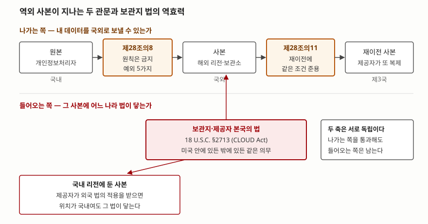

> **실행 검증 없음.** 이 글의 조문과 수치는 국가법령정보센터의 현행 법령 본문, EUR-Lex의
> GDPR 원문, 미국 연방법전(govinfo), 유럽연합 집행위원회의 적정성 결정 안내, NIST SP
> 800-34 Rev.1에서 확인한 것이다. 법령은 **이 글에 적은 시행일 기준**이며, 적정성 결정과
> 고시는 바뀌므로 설계 시점의 현행본을 다시 확인해야 한다. 이 글은 법률 자문이 아니다.

## 들어가며

재해복구 설계에서 가장 강한 수단은 단순하다. **사본을 멀리 두는 것**이다. 같은 전력
계통, 같은 하천 유역, 같은 지진대 안에 두 벌을 두면 한 사건이 두 벌을 동시에 지운다.
그래서 거리를 벌리다 보면 결국 국경을 넘자는 선택지가 올라온다. 그런데 여기서 기술적
판단과 전혀 다른 축이 끼어든다. **사본이 놓인 자리가 바뀌면 그 사본에 적용되는 법이
바뀐다.** 시험에서는 재해복구·클라우드·개인정보 문항의 뒷부분에 "데이터 주권"이나
"국외 이전 시 고려사항"으로 붙고, 실무에서는 백업 대상 목록을 짜다가 "이 테이블은
해외 리전에 못 둔다"는 한 줄로 설계를 되돌리게 만든다.

## 정의

**데이터 주권은 데이터가 놓인 곳의 법이 그 데이터에 미치는 규율 권한과, 그에 맞서
자국민의 데이터가 국경을 넘는 것을 제한하거나 조건을 붙이는 국가의 권한을 함께
가리키는 말이다.**

이 용어는 **ISO·IEEE·NIST 어느 쪽에서도 표준 정의를 찾지 못했다.** 미국 NIST의 용어집에는
`data sovereignty`도 `data residency`도 등재되어 있지 않다. 그래서 이 글은 용어의 정의를
해설서에서 빌리지 않고 **그 권한이 실제로 쓰인 조문에서** 끌어낸다. 위 정의의 앞쪽은
미국 CLOUD Act가 만든 18 U.S.C. §2713이고, 뒤쪽은 개인정보 보호법 제4절(개인정보의 국외
이전)과 GDPR 제5장이다. 답안에 쓸 때도 **"표준 정의가 정립되는 중인 용어이며, 각국
법령에서는 다음 두 방향으로 구체화된다"**로 열고 조문을 드는 편이 안전하다.

두 방향을 조문으로 보면 이렇다.

| 방향 | 무엇을 정하는가 | 대표 조문 |
|---|---|---|
| 들어오는 쪽 | 자국 법이 **국외에 있는 데이터**에까지 미치는가 | 18 U.S.C. §2713 (CLOUD Act) |
| 나가는 쪽 | 자국 데이터가 **국외로 나가는 것**을 허용할 것인가 | 개인정보 보호법 제28조의8, GDPR 제44조~제49조 |

## 등장 배경

예전에는 이 문제가 거의 생기지 않았다. 데이터는 자기 전산실에 있었고, 사본은 테이프에
담겨 같은 나라 안의 보관소로 갔다. NIST SP 800-34 Rev.1은 지금도 백업 매체에 대해
**안전하고 환경이 통제된 외부 장소에 보관하라**고만 적고, 장소를 고를 때 볼 것으로
**운영 시간, 매체 접근 용이성, 물리적 보관 한계, 계약 조건** 네 가지를 든다. 국경은
고려 항목에 없다.

세 가지가 겹치면서 상황이 바뀌었다.

**① 사본의 위치가 추상화됐다.** 클라우드 리전과 복제 설정 한 줄이 사본의 물리적 위치를
정하게 되면서, 담당자가 **사본이 어느 나라에 있는지 모르는 상태**가 가능해졌다. 한국의
클라우드컴퓨팅법이 제26조 제1항에서 **이용자가 제공자에게 자기 정보가 저장되는 국가의
명칭을 알려 달라고 요구할 수 있다**고 정한 것은 이 간극을 메우려는 장치다. 같은 조
제2항은 정보통신서비스 이용자에게도 같은 요구권을 준다.

**② 보관지 법의 역외 효력이 명문화됐다.** 미국은 2018년 3월 23일 시행된 CLOUD Act로
18 U.S.C. §2713을 신설해, 전자통신·원격컴퓨팅 서비스 제공자가 자신의 점유·보관·통제
아래 있는 통신 내용과 가입자 기록을 보존·백업·공개할 의무를 **그 데이터가 미국 안에
있든 밖에 있든 똑같이** 지도록 했다. 사본을 해외 리전에 두어도 **제공자가 미국 법의
적용을 받으면 그 사본에 미국 법이 닿는다**는 뜻이다.

**③ 나가는 쪽 규제가 체계를 갖췄다.** GDPR 제44조는 제3국·국제기구로의 이전이 **제5장의
조건을 지켜야만** 이뤄질 수 있다고 정하면서, 그 제3국에서 다시 또 다른 제3국으로 넘어가는
**재이전(onward transfer)까지** 같은 조건에 묶는다. 한국은 2023년 3월 14일 신설된 제4절로
같은 구조를 들였다.

## 구성요소와 절차

### 가. 역외 사본이 법에 걸리는 지점 — "보관"도 이전이다

이 글에서 가장 중요한 한 줄이 개인정보 보호법 제28조의8 제1항 본문에 있다. 이 조항은
개인정보처리자가 개인정보를 국외로 **제공·처리위탁·보관**하는 것을 "이전"으로 묶어
정의하고, 그 제공에는 **조회되는 경우를 포함한다**고 괄호로 못 박는다.

세 가지가 따라 나온다.

1. **백업만 두어도 이전이다.** 아무에게도 보여 주지 않고 암호화해 보관만 해도, 그 보관
   장소가 국외면 제28조의8이 적용된다
2. **읽기만 해도 이전이다.** 국내에 둔 데이터를 해외 지사가 조회하는 구성도 제공에 포함된다
3. **재해복구 목적이라는 사정은 별도의 허용 사유가 아니다.** 같은 항의 각 호 중 하나에
   들어가야 한다

### 나. 국외 이전이 허용되는 근거 — 5가지

제28조의8 제1항 단서는 다섯 가지를 든다. **원칙은 금지이고 이 다섯이 예외**라는 구조를
답안에 먼저 쓴다.

| # | 근거 | 요점 |
|---|---|---|
| 1 | 정보주체의 **별도 동의** | 국외 이전에 관한 별도의 동의 |
| 2 | **법률·조약·국제협정**의 특별 규정 | 대한민국이 당사자인 조약 포함 |
| 3 | **계약의 체결·이행**을 위한 처리위탁·보관 | 제2항 각 호를 **개인정보 처리방침에 공개**하거나 **전자우편 등으로 통지**해야 한다 |
| 4 | 이전받는 자의 **인증** | 보호위원회가 정하여 고시하는 인증 + 안전조치·권리보장 조치 + 인증사항을 그 국가에서 이행할 조치 |
| 5 | **동등성 인정** | 이전되는 국가·국제기구의 보호체계, 권리보장 범위, 피해구제 절차가 이 법의 수준과 실질적으로 동등하다고 보호위원회가 인정한 경우 |

역외 백업이 실제로 타는 길은 보통 **3호**다. 자체 시스템의 사본을 해외 리전에 두는 것은
클라우드 제공자에 대한 처리위탁·보관이고, 정보주체와의 계약을 이행하기 위한 것이기
때문이다. 3호를 타려면 **가목(처리방침 공개)이나 나목(개별 통지) 중 하나를 반드시
수행해야 한다.** 둘 중 아무것도 하지 않으면 3호가 성립하지 않는다.

### 다. 동의·공개 시 알려야 하는 항목 — 5가지

제28조의8 제2항은 1호 동의를 받을 때 미리 알릴 사항을 다섯으로 정하고, 3호 가목·나목은
**이 다섯 항목을 그대로** 처리방침에 공개하거나 통지하게 한다. 그래서 이 다섯은 동의
경로와 계약 경로 양쪽에서 쓰인다.

| # | 항목 |
|---|---|
| 1 | 이전되는 개인정보 항목 |
| 2 | 개인정보가 이전되는 **국가, 시기 및 방법** |
| 3 | 이전받는 자의 성명(법인이면 명칭과 연락처) |
| 4 | 이전받는 자의 이용목적 및 보유·이용 기간 |
| 5 | 이전을 거부하는 방법, 절차 및 거부의 효과 |

2번이 역외 백업 설계와 바로 닿는다. **리전을 바꾸면 "이전되는 국가"가 바뀌므로** 제3항에
따라 다시 알리고 동의를 받아야 한다. 복제 토폴로지 변경이 공지 사안이 되는 지점이다.

### 라. 이전 이후에 남는 의무 — 4가지

| # | 조문 | 의무 |
|---|---|---|
| 1 | 제28조의8 제4항 | 국외 이전 시에도 제17조~제19조와 제5장(정보주체의 권리)을 준수하고, **대통령령으로 정하는 보호조치**를 해야 한다 |
| 2 | 제28조의8 제5항 | **이 법을 위반하는 내용의 국외 이전 계약을 체결해서는 안 된다** |
| 3 | 제28조의11 | 이전받은 자가 **제3국으로 다시 이전**하는 경우에 제28조의8·제28조의9를 준용한다 |
| 4 | 제28조의9 | 보호위원회는 일정 사유에 해당하면 **국외 이전 중지를 명할 수 있다** |

4번의 사유는 둘이다. ① 제28조의8 제1항·제4항·제5항 위반, ② 이전받는 자나 그 국가·국제기구가
이 법에 따른 보호 수준에 비해 개인정보를 적정하게 보호하지 않아 **정보주체에게 피해가
발생했거나 발생할 우려가 현저한 경우**다. 중지 명령을 받으면 **받은 날부터 7일 이내에**
보호위원회에 이의를 제기할 수 있다. 제28조의10은 국외 이전을 제한하는 국가의 처리자에
대해 **그 국가 수준에 상응하는 제한**을 둘 수 있다는 상호주의 조항이다.

실무에서 가장 과소평가되는 것이 3번이다. 해외 리전에 둔 사본을 그 제공자가 다시 다른
나라의 설비로 복제하면 그것도 이전이고, 같은 조건을 다시 충족해야 한다. **계약에서
재이전 범위를 묶지 않으면 통제할 수단이 없다.**

### 마. GDPR의 이전 근거 — 3층 구조

| 층 | 조문 | 내용 |
|---|---|---|
| 1 | 제45조 | **적정성 결정.** 집행위원회가 그 제3국·영역·부문 또는 국제기구가 적정한 보호 수준을 보장한다고 결정하면, 그 이전에는 **별도의 승인이 필요 없다** |
| 2 | 제46조 | **적절한 안전조치.** 적정성 결정이 없을 때, 집행 가능한 정보주체의 권리와 실효적인 구제수단이 있다는 조건에서 안전조치를 제공해 이전한다 |
| 3 | 제49조 | **특정 상황에 대한 예외.** 위 둘이 모두 없을 때의 개별 사유 |

제46조 제2항은 감독기관의 별도 승인 없이 쓸 수 있는 안전조치를 **6가지**로 든다.
① 공공기관 간의 법적 구속력 있고 집행 가능한 문서, ② 제47조에 따른 구속적 기업규칙(BCR),
③ 집행위원회가 채택한 표준 데이터 보호 조항(SCC), ④ 감독기관이 채택하고 집행위원회가
승인한 표준 조항, ⑤ 제40조에 따른 승인된 행동강령과 제3국 처리자의 구속력 있는 약속,
⑥ 제42조에 따른 승인된 인증 메커니즘과 그 약속이다.

제45조 제2항이 적정성 판단에서 보는 요소의 첫 번째가 **법치, 인권과 기본적 자유의 존중,
공공안보·국방·국가안보·형사법을 포함한 관련 법령과 공공기관의 개인정보 접근**이다.
적정성 평가가 **그 나라 수사기관의 접근 권한까지 본다**는 뜻이고, 이것이 ②번 CLOUD Act와
정면으로 닿는 지점이다.

집행위원회의 적정성 결정 안내는 **결정을 주기적으로 재검토할 의무가 있고 그 결과를
유럽의회와 이사회에 보고해야 한다**고 적는다. 안내에 올라 있는 한국에 대한 결정은
**2021년 12월 17일자**이고, 한국에 대한 재검토는 **2026년 7월 23일자**로 기재되어 있다.
결정은 영구적이지 않다.

### 바. 역외 사본을 설계하는 절차 — 5단계

| 단계 | 하는 일 | 근거 |
|---|---|---|
| ① 등급 분류 | 백업 대상을 개인정보·민감정보·일반 업무데이터로 가른다 | 제28조의8은 **개인정보에 적용된다.** 개인정보가 아닌 데이터는 이 제약을 받지 않는다 |
| ② 근거 선택 | 개인정보가 섞인 집합마다 1~5호 중 어느 길로 갈지 정한다 | 제28조의8 제1항 |
| ③ 고지·공개 | 3호면 처리방침 공개 또는 개별 통지, 1호면 동의. 알릴 항목 5가지를 채운다 | 제28조의8 제2항·제3항 |
| ④ 보호조치·계약 | 대통령령 보호조치를 이행하고, 위반 내용의 계약을 피하며, 재이전 범위를 계약으로 묶는다 | 제28조의8 제4항·제5항, 제28조의11 |
| ⑤ 이원 설계 | 역외로 못 보내는 집합은 **국내에서 거리로 분리**한다 | — |

⑤가 결론이다. 전부 역외로 보내거나 전부 국내에 두는 양자택일이 아니라, **집합마다 갈
수 있는 곳이 다르다**는 전제로 두 벌의 복구 설계를 함께 두는 것이다.

## 도식

> **출처**: 나가는 쪽의 관문(보관도 이전, 허용 근거 5가지, 재이전 준용)은 [개인정보 보호법 제28조의8·제28조의11 — 국가법령정보센터, 시행 2026. 9. 11. 법률 제21445호](https://www.law.go.kr/%EB%B2%95%EB%A0%B9/%EA%B0%9C%EC%9D%B8%EC%A0%95%EB%B3%B4%EB%B3%B4%ED%98%B8%EB%B2%95), 적정성·안전조치·예외의 3층 구조는 [GDPR 제44조·제45조·제46조·제49조 — EUR-Lex, Regulation (EU) 2016/679](https://eur-lex.europa.eu/legal-content/EN/TXT/HTML/?uri=CELEX:32016R0679), 들어오는 쪽의 역외 효력은 [18 U.S.C. §2713 — govinfo](https://www.govinfo.gov/content/pkg/USCODE-2023-title18/html/USCODE-2023-title18-partI-chap121-sec2713.htm) 근거다.

## 비교

### 개인정보 보호법 제4절과 GDPR 제5장

| 구분 | 개인정보 보호법 (시행 2026. 9. 11.) | GDPR (Regulation (EU) 2016/679) |
|---|---|---|
| 기본 태도 | **원칙 금지, 각 호에 해당하면 허용** | 제5장의 조건을 지키면 이전 가능 |
| "이전"의 범위 | 제공(**조회 포함**)·처리위탁·보관 | 처리 중이거나 처리 예정인 데이터의 이전 |
| 국가 단위 승인 | 보호위원회의 **동등성 인정** (제1항 제5호) | 집행위원회의 **적정성 결정** (제45조) |
| 계약·인증 경로 | 계약 이행을 위한 위탁·보관(제3호), 고시 인증(제4호) | 적절한 안전조치 **6가지** (제46조 제2항) |
| 동의 경로 | 제1호 **별도 동의** | 제49조 제1항 (a) 명시적 동의 |
| 재이전 | **제28조의11이 준용**한다 | 제44조가 **onward transfer를 명시**한다 |
| 감독기관의 개입 | 국외 이전 **중지 명령** (제28조의9), 이의제기 7일 | 감독기관의 일반 권한 |
| 상호주의 | **제28조의10**에 명문 규정 | 해당 조항 없음 |
| 외국 명령의 효력 | 명시 규정 없음 | **제48조** — 제3국 법원·행정기관의 명령은 상호 사법공조조약 등 국제협정에 근거하지 않으면 그 자체로는 승인·집행되지 않는다 |

마지막 줄이 ②번 긴장의 법적 표현이다. 미국 법은 제공자에게 **국외 데이터도 내놓으라**고
하고, GDPR 제48조는 **국제협정에 근거하지 않은 제3국의 명령은 그것만으로 근거가 되지
않는다**고 한다. 다국적 제공자는 양쪽 법 아래에 동시에 놓이며, **이 충돌은 이용자가
계약으로 해소할 수 있는 종류가 아니다.** 설계에서 할 수 있는 것은 어떤 데이터를 그
제공자에게 맡길지 고르는 일까지다.

### 역외 사본 방식별로 달라지는 것

| 방식 | 사본의 위치 | 법적으로 달라지는 점 |
|---|---|---|
| 국내 다른 지역 | 국내 | 제28조의8 적용 밖. 거리로만 분리 |
| 해외 리전 복제 | 국외 (제공자 통제) | 보관으로서 이전. 재이전 통제가 계약에 달린다 |
| 해외 보관소 매체 반출 | 국외 (자사 통제) | 보관으로서 이전. 제공자를 통하지 않으므로 재이전 위험은 낮다 |
| 해외 제공자의 국내 리전 | 국내 | 위치는 국내지만 **제공자가 외국 법의 적용을 받을 수 있다** |

마지막 줄이 흔히 놓치는 자리다. **리전이 국내라는 사실만으로 보관지 법 문제가 사라지지
않는다.** 18 U.S.C. §2713이 기준으로 삼는 것은 데이터의 위치가 아니라 **제공자의 점유·보관·통제**다.

## 적용 시 고려사항

1. **"암호화했으니 이전이 아니다"는 성립하지 않는다.** 제28조의8 제1항 본문은 보관을
   이전에 포함시키고, 암호화 여부로 예외를 두지 않는다. 암호화는 제4항의 보호조치를
   채우는 수단이지 **이전 자체를 면하게 하는 장치가 아니다.** 다만 키를 국내에만 두는
   설계는 보관지 법에 따른 접근 요구가 실제로 실현되는 범위를 줄이는 쪽으로는 작동한다.
2. **백업 대상 목록을 데이터 등급으로 먼저 자른다.** ②~⑤의 모든 판단은 "그 집합에
   개인정보가 들어 있는가"에서 갈린다. 대상 목록이 테이블 단위로만 정리되어 있고 어떤
   컬럼이 개인정보인지 적혀 있지 않으면, **역외로 보낼 수 있는 범위를 아무도 말할 수 없다.**
   등급 분류는 규정 준수 작업이기 전에 **복구 설계의 입력값**이다.
3. **리전 변경과 제공자 변경을 공지 사안으로 다룬다.** 알릴 항목에 "이전되는 국가"가
   있고 제3항이 변경 시 통지와 동의를 요구하므로, 재해복구 리전을 옮기는 운영 변경이
   **정보주체에 대한 고지 절차를 동반한다.** 변경관리 체크리스트에 이 항목이 없으면
   기술 변경만 먼저 나가고 고지가 빠진다.
4. **재이전을 계약으로 묶는다.** 제28조의11이 재이전에 같은 조문을 준용하므로, 제공자가
   사본을 어느 범위까지 복제할 수 있는지를 계약에 적지 않으면 **통제 수단이 남지 않는다.**
   GDPR 쪽도 제44조가 onward transfer를 명시하므로 같은 요구가 걸린다.
5. **국가 단위 승인은 영구적이지 않다고 보고 설계한다.** 집행위원회 안내는 적정성 결정을
   **주기적으로 재검토하고 결과를 유럽의회·이사회에 보고해야 한다**고 적으며, 의회와
   이사회는 **언제든** 결정의 유지·수정·철회를 집행위원회에 요구할 수 있다고 한다.
   동등성·적정성에만 기대어 설계하면 그 결정이 바뀔 때 대안이 없다. 계약 경로(SCC·BCR,
   국내법에서는 3호·4호)를 **보조 근거로 함께 갖춰 두는 쪽**이 안전하다.
6. **복구 훈련 자체가 이전을 일으킬 수 있다.** 역외 사본으로 복구 훈련을 하면 그 과정에서
   데이터가 조회·처리되므로, 훈련 시나리오도 선택한 이전 근거의 범위 안에 있어야 한다.
   "보관만 한다"는 전제로 근거를 세워 두고 훈련에서 실제로 복원해 쓰면 전제가 깨진다.

## 정리

**"보관도 이전이다"** — 이 한 줄이 역외 백업 문제의 전부다. 사본을 아무에게도 보여 주지
않아도 국경을 넘는 순간 국외 이전 조항이 적용되고, 반대로 사본을 국내에 두어도 제공자가
외국 법의 적용을 받으면 그 법이 사본에 닿는다.

- 데이터 주권은 **표준 정의가 없다.** NIST 용어집에도 등재되어 있지 않으므로, 답안에서는
  정의를 단정하지 말고 **들어오는 쪽(§2713)과 나가는 쪽(제28조의8·GDPR 제5장) 두 방향**으로
  구체화해 쓴다
- 개인정보 보호법이 말하는 이전은 **제공(조회 포함)·처리위탁·보관 3가지**다. 백업도
  조회도 전부 들어간다
- 허용 근거는 **5가지**: 별도 동의 / 법률·조약 / 계약 이행을 위한 위탁·보관 / 인증 /
  동등성 인정. 역외 백업은 보통 **3호**를 타고, 3호는 **처리방침 공개 또는 개별 통지**가
  성립 요건이다
- 알릴 항목은 **5가지**: 항목 / 국가·시기·방법 / 받는 자 / 목적·기간 / 거부 방법과 효과.
  **국가가 바뀌면 다시 알리고 동의를 받는다**
- 이전 이후에 남는 의무는 **4가지**: 보호조치, 위반 계약 금지, 재이전 준용(제28조의11),
  중지 명령(제28조의9, 이의제기 **7일**). 상호주의는 제28조의10이다
- GDPR은 **3층**: 적정성(제45조) → 적절한 안전조치(제46조, **6가지**) → 예외(제49조).
  제48조는 **국제협정에 근거하지 않은 제3국 명령의 효력을 부정한다**
- 역외 사본 설계는 **5단계**: 등급 분류 → 근거 선택 → 고지·공개 → 보호조치·계약 →
  이원 설계. 결론은 **전부 보내거나 전부 두는 선택이 아니라 집합마다 가를 곳이 다르다**는 것

> 기출 답안: [기출문제 — 데이터센터 입지 선정과 재해 대응](../../exam/2026-10-22-idc-site-selection-and-disaster-response/index.md)

## 참고 자료

- [개인정보 보호법 — 국가법령정보센터, 시행 2026. 9. 11., 법률 제21445호](https://www.law.go.kr/%EB%B2%95%EB%A0%B9/%EA%B0%9C%EC%9D%B8%EC%A0%95%EB%B3%B4%EB%B3%B4%ED%98%B8%EB%B2%95) — 제4절 개인정보의 국외 이전(제28조의8~제28조의11). 이전의 정의와 허용 근거 5호, 알릴 항목 5호, 변경 시 재동의, 보호조치와 계약 금지, 중지 명령과 이의제기 7일, 상호주의, 제3국 재이전 준용의 1차 자료. 제4절은 2023. 3. 14. 신설됐다
- [클라우드컴퓨팅 발전 및 이용자 보호에 관한 법률 — 국가법령정보센터, 시행 2025. 10. 1., 법률 제21066호](https://www.law.go.kr/%EB%B2%95%EB%A0%B9/%ED%81%B4%EB%9D%BC%EC%9A%B0%EB%93%9C%EC%BB%B4%ED%93%A8%ED%8C%85%EB%B0%9C%EC%A0%84%EB%B0%8F%EC%9D%B4%EC%9A%A9%EC%9E%90%EB%B3%B4%ED%98%B8%EC%97%90%EA%B4%80%ED%95%9C%EB%B2%95%EB%A5%A0) — 제26조(이용자 보호 등을 위한 정보 공개)의 저장 국가 명칭 고지 요구권
- [Regulation (EU) 2016/679 (GDPR) — EUR-Lex, Chapter V (Articles 44–49)](https://eur-lex.europa.eu/legal-content/EN/TXT/HTML/?uri=CELEX:32016R0679) — 제44조의 일반원칙과 onward transfer, 제45조의 적정성 결정과 평가 요소, 제46조 제2항의 안전조치 6가지, 제48조의 제3국 명령 효력 부정, 제49조의 예외
- [European Commission, *Adequacy decisions* — Data protection](https://commission.europa.eu/law/law-topic/data-protection/international-dimension-data-protection/adequacy-decisions_en) — 제45조를 근거로 한 적정성 결정의 채택 절차, 결정이 내려진 국가·지역 목록, 한국에 대한 결정(2021. 12. 17.)과 재검토(2026. 7. 23.), 주기적 재검토와 보고 의무, 의회·이사회의 유지·수정·철회 요구
- [18 U.S.C. §2713, *Required preservation and disclosure of communications and records* — govinfo](https://www.govinfo.gov/content/pkg/USCODE-2023-title18/html/USCODE-2023-title18-partI-chap121-sec2713.htm) — CLOUD Act(Pub. L. 115-141, div. V, §103(a)(1), 2018. 3. 23., 132 Stat. 1214)가 신설한 조항. 데이터가 미국 안에 있든 밖에 있든 제공자의 보존·백업·공개 의무가 같다는 규정
- [NIST SP 800-34 Rev.1, *Contingency Planning Guide for Federal Information Systems* — §5.1.5 Identification of Alternate Storage and Processing Facilities](https://nvlpubs.nist.gov/nistpubs/Legacy/SP/nistspecialpublication800-34r1.pdf) — 백업 매체의 외부 보관 요구와 보관 장소 선정 시 고려할 네 가지, 대체 처리 설비 3종(cold·warm·hot)
- [NIST Computer Security Resource Center Glossary](https://csrc.nist.gov/glossary) — `data sovereignty`·`data residency` 모두 등재되어 있지 않다는 확인에 사용했다
