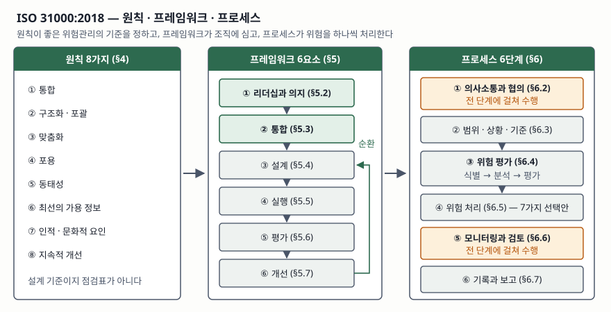

> 실행 검증 없음. 지침 표준의 개념 글이므로 공개 문서 근거만으로 정리했다.
>
> ISO 31000:2018 본문은 유료라 조문 전체를 열지 못했다. 발행 정보·개정 단계는 ISO 카탈로그에서,
> 서문과 서론(2009년판 대비 변경 4가지, 세 층 구조)은 수리남 표준원이 동일 채택본으로 공개한
> 앞부분에서 확인했다. 조항 번호와 원칙·요소·단계의 이름은 2차 자료 3건(노스캐롤라이나
> 주립대 ERM, eCampusOntario 공개 교재, Readynez)을 교차 확인해 썼다. 한국어 정의 문장은
> 원문을 옮긴 것이 아니라 교차 확인한 뜻을 다시 쓴 것이다. (§10)

## 들어가며

위험관리는 기술사 시험에서 한 과목이 아니라 여러 과목에 흩어져 나온다. 프로젝트관리에서는
프로젝트 위험으로, 정보보호에서는 정보보안 위험으로, IT 거버넌스에서는 전사 위험으로
묻는다. 그때마다 답안이 달라지면 공부량이 세 배가 되는데, 세 갈래 모두가 뿌리로 삼는 문서가
ISO 31000이다. 실무에서도 같은 일이 벌어진다. 보안 조직은 자산 기준으로, PMO는 일정 기준으로,
재무는 손실 기준으로 위험을 세는 바람에 같은 사건이 세 곳의 위험 목록에 서로 다른 이름으로
올라가 있고, 어느 쪽이 더 큰지 비교할 방법이 없다. ISO 31000이 푸는 문제가 이것이다.

## 정의

**ISO 31000:2018은 조직이 위험을 관리할 때 쓰는 원칙·프레임워크·프로세스를 제시하는
국제 지침 표준이다.** 특정 산업이나 조직 규모를 가리지 않고, 인증을 전제하지 않는다.

여기서 **위험(risk)은 목표에 대한 불확실성의 영향**이다. 영향은 목표에서 벗어나는 것을 뜻하고,
벗어나는 방향은 부정적일 수도 긍정적일 수도 있다. 그래서 ISO 31000의 위험은 손실만을 가리키지
않으며, 기회를 키우는 활동도 같은 프로세스로 다룬다. 답안 첫 줄에 이 정의를 쓰고 "손실에
한정되지 않는다"를 붙이면 뒤에 쓸 처리 선택안이 왜 7가지나 되는지가 설명된다.

## 등장 배경

2009년판은 위험관리의 틀을 처음 국제표준으로 묶었지만, 프레임워크가 절차서처럼 읽혀 조직마다
'위험관리 부서'를 따로 만들고 거기서만 돌리는 결과를 낳았다. 위험은 사업 결정이 내려지는
자리에서 생기는데 관리는 옆방에서 하는 구조였다.

2018년판이 이 점을 고쳐 쓴다. 서문이 2009년판 대비 **주요 변경 4가지**를 직접 적는다.

| # | 변경 | 뜻 |
|---|---|---|
| ① | 원칙 재검토 | 원칙을 위험관리 성공의 핵심 기준으로 다시 정리했다 |
| ② | 리더십과 통합 강조 | 조직의 거버넌스에서 출발해 최고경영진의 리더십과 통합을 부각했다 |
| ③ | 반복적 성격 강조 | 새 경험·지식·분석이 각 단계의 요소·조치·통제를 고치게 된다는 점을 명시했다 |
| ④ | 내용 간결화 | 여러 요구와 맥락에 맞는 개방형 시스템 모델을 지탱하는 데 초점을 뒀다 |

②가 답안에서 가장 쓸모 있다. 위험관리를 **별도 활동이 아니라 거버넌스의 일부**로 끌어올린
것이 2018년판의 성격이고, 이것이 뒤에 나올 프레임워크 6요소의 첫 자리가 '리더십과 의지'인
이유다.

## 구성요소 — 세 층, 8·6·6

표준은 위험관리를 **원칙·프레임워크·프로세스 세 층**으로 나눈다. 서론이 이 셋을 하나의 그림으로
묶어 제시한다. 원칙이 무엇을 좋은 위험관리로 볼지 정하고, 프레임워크가 그것을 조직에 심고,
프로세스가 개별 위험을 하나씩 처리한다.

### 원칙 — 8가지 (§4)

| # | 원칙 | 무엇을 요구하는가 |
|---|---|---|
| ① | 통합 | 조직의 모든 활동에 포함된다 |
| ② | 구조화·포괄 | 짜인 절차로 빠짐없이 수행해 결과가 일관되게 한다 |
| ③ | 맞춤화 | 조직의 상황과 목표에 맞춰 조정한다 |
| ④ | 포용 | 이해관계자를 적시에 참여시켜 인식을 반영한다 |
| ⑤ | 동태성 | 상황이 바뀌면 위험도 바뀌므로 예측·감지·대응한다 |
| ⑥ | 최선의 가용 정보 | 과거·현재 정보와 그 한계·불확실성까지 근거로 삼는다 |
| ⑦ | 인적·문화적 요인 | 사람의 행동과 문화가 각 단계에 미치는 영향을 고려한다 |
| ⑧ | 지속적 개선 | 학습과 경험으로 위험관리를 계속 개선한다 |

원칙은 점검표가 아니다. 프레임워크와 프로세스를 **설계할 때 판단 기준으로 쓰라고** 둔 것이어서,
답안에서는 8개를 나열한 뒤 "⑤와 ⑥이 충돌할 때 무엇을 택할지가 설계 결정"이라는 식으로
한 줄을 붙이는 쪽이 점수가 높다.

### 프레임워크 — 6요소 (§5)

| # | 요소 | 하는 일 |
|---|---|---|
| ① | 리더십과 의지 (§5.2) | 최고경영진이 방침·권한·자원을 정하고 책임을 배정한다 |
| ② | 통합 (§5.3) | 조직 구조와 의사결정 절차 안에 위험관리를 넣는다 |
| ③ | 설계 (§5.4) | 내외부 상황 이해, 역할·권한, 자원 배분, 의사소통 체계를 설계한다 |
| ④ | 실행 (§5.5) | 계획을 세워 설계한 것을 돌린다 |
| ⑤ | 평가 (§5.6) | 프레임워크가 목적에 맞게 작동하는지 주기적으로 측정한다 |
| ⑥ | 개선 (§5.7) | 변화에 맞춰 적응하고(§5.7.1) 지속적으로 개선한다(§5.7.2) |

③~⑥이 계획-실행-점검-조치 순환이고, ①과 ②가 그 순환을 조직에 붙들어 매는 자리다.

### 프로세스 — 6단계 (§6)

| # | 단계 | 내용 |
|---|---|---|
| ① | 의사소통과 협의 (§6.2) | 이해관계자와 위험 정보를 주고받는다. 전 단계에 걸쳐 수행된다 |
| ② | 범위·상황·기준 설정 (§6.3) | 적용 범위, 내외부 상황, 위험 기준을 정한다 |
| ③ | 위험 평가 (§6.4) | 식별(§6.4.2) → 분석(§6.4.3) → 평가(§6.4.4) 세 단계로 나뉜다 |
| ④ | 위험 처리 (§6.5) | 선택안을 고르고(§6.5.2) 처리 계획을 세워 실행한다(§6.5.3) |
| ⑤ | 모니터링과 검토 (§6.6) | 설계·실행·결과를 계속 감시한다. 전 단계에 걸쳐 수행된다 |
| ⑥ | 기록과 보고 (§6.7) | 프로세스와 결과를 기록하고 보고한다 |

위험 처리 선택안은 **7가지**다. 시작하지 않거나 중단해 회피, 기회를 좇아 위험을 받아들이거나
키움, 위험원 제거, 발생 가능성 변경, 결과 변경, 공유(이전·보험), 정보에 근거한 보유다.
위협과 기회를 가르지 않고 한 목록에 둔 것이 PMBOK과 갈리는 지점이다.

## 도식

> **출처**: [ISO 31000:2018, Risk management — Guidelines (ISO/TC 262, 2018-02)](https://www.iso.org/standard/65694.html) — Introduction의 Figure 1 '원칙·프레임워크·프로세스' 구조. 조항 번호와 각 층의 항목은 [SSB ISO 31000:2018 채택본 앞부분(Foreword·Introduction)](https://www.ssb.sr/media/1178/afschrift-ssb-iso-31000_2018-e.pdf), [NC State ERM Initiative, ISO's Risk Management Framework (2020-06-17)](https://erm.ncsu.edu/resource-center/isos-risk-management-framework), [Readynez, ISO 31000 Principles vs Framework vs Process (2024-04-05)](https://www.readynez.com/en/blog/iso-31000-principles-vs-framework-vs-process-how-they-fit-together-in-risk-management/)로 교차 확인 (일부 2차 자료 기반)

## 비교 — 조직 차원과 프로젝트 차원

같은 위험관리라도 ISO 31000과 PMBOK은 **관리 단위가 다르다.** 전자는 조직이 계속 굴리는
체계이고, 후자는 끝이 정해진 프로젝트 안에서 도는 절차다.

| 구분 | ISO 31000:2018 | PMBOK 제6판 프로젝트 위험관리 |
|---|---|---|
| 대상 | 조직의 모든 활동 | 하나의 프로젝트 |
| 성격 | 지침 — 인증 요구사항이 아니다 | 지식체계 가이드 |
| 단위 수 | 프로세스 6단계 | 프로세스 7개 |
| 위험의 층위 | 단일 층 | 개별 위험과 전체 프로젝트 위험으로 구분 |
| 처리 선택안 | 7가지, 위협·기회 구분 없음 | 위협 5가지와 기회 5가지를 분리 |
| 수명 | 상시·순환 | 프로젝트 생애주기 안에서 종료 |

단계를 맞대어 보면 겹치는 곳과 어긋나는 곳이 드러난다.

| ISO 31000 §6 | PMBOK 제6판 |
|---|---|
| 범위·상황·기준 설정 | 위험관리 계획수립 |
| 위험 식별 | 위험 식별 |
| 위험 분석 | 정성적 위험분석 · 정량적 위험분석 |
| 위험 평가 | 분석 결과의 우선순위화에 포함 |
| 위험 처리 | 위험대응 계획수립 · 위험대응 실행 |
| 모니터링과 검토 | 위험 감시 |
| 의사소통과 협의 · 기록과 보고 | 별도 프로세스 없이 전 프로세스에 분산 |

마지막 줄이 답안에서 점수가 붙는 자리다. **ISO 31000은 의사소통과 기록·보고를 독립 단계로
세웠고 PMBOK은 각 프로세스 안에 녹여 뒀다.** 조직 차원에서는 누가 무엇을 언제 보고하는지가
그 자체로 통제 대상이지만, 프로젝트 안에서는 보고 경로가 이미 정해져 있어 따로 세울 필요가
적기 때문이다. 두 체계를 함께 쓰는 조직이라면 프로젝트에서 감당할 수 없는 위험을 조직 위험
목록으로 올리는 **상부 보고 경로**를 명시해야 두 층이 끊기지 않는다.

> 기출 답안: [기출문제 — 프로젝트 위험관리 프로세스](../../exam/2026-10-24-project-risk-management-processes/index.md)
> · [기출문제 — 부정적 위험 대응 전략](../../exam/2026-10-09-negative-risk-response-strategies/index.md)

## 적용 시 고려사항

**첫째, 인증을 요구받는 자리에 ISO 31000을 내밀 수 없다.** ISO 31000은 요구사항이 아니라
지침이라 적합성 인증 대상이 아니다. 고객이나 규제기관이 제3자 인증을 요구하면
ISO/IEC 27001이나 ISO 37301처럼 요구사항 규격을 함께 써야 한다. 답안에서 "ISO 31000 인증을
취득한다"고 쓰면 그 줄에서 감점된다.

**둘째, 기법은 이 표준에 없다.** 위험을 어떻게 식별하고 분석할지 — 브레인스토밍, 결함수 분석,
몬테카를로 시뮬레이션 — 는 IEC 31010:2019가 담당한다. ISO 31000은 무엇을 할지를, IEC 31010은
어떻게 할지를 적는다. 둘을 짝지어 쓰는 것이 표준의 설계 의도다.

**셋째, 위험 기준을 먼저 합의하지 않으면 프로세스가 돌지 않는다.** 평가(§6.4.4)는 분석 결과를
기준에 비추어 처리 여부를 정하는 단계인데, 기준이 없으면 모든 위험이 '검토 중'으로 남는다.
기준은 조직의 위험 수용 수준을 숫자나 등급으로 적은 것이어야 하고, 이것을 정하는 일은
프로세스가 아니라 프레임워크(§5.4 설계)의 몫이다.

**넷째, 개정이 진행 중이다.** ISO 카탈로그는 2018년판을 2023년에 재확인했다고 적으면서도
현재 단계를 '개정 예정'으로 표시하고 후속 문서 ISO/CD 31000을 개발 중으로 올려 두고 있다.
실무 문서에 조항 번호를 박아 넣을 때는 판 번호를 함께 적는 편이 안전하다.

## 정리

- ISO 31000:2018은 **조직 전체의 위험관리 지침**이며, 위험은 **목표에 대한 불확실성의 영향**이다
- 구조는 **8·6·6** — 원칙 8가지(§4), 프레임워크 6요소(§5), 프로세스 6단계(§6)
- 프레임워크 6요소의 머리글자로 **리·통·설·실·평·개**(리더십과 의지 → 통합 → 설계 → 실행 → 평가 → 개선)를 외운다
- 프로세스는 **범위 → 평가(식별·분석·평가) → 처리**가 본류이고, **의사소통·협의**와 **모니터링·검토**가 전 단계에 걸친다
- 처리 선택안은 **7가지**이고 위협과 기회를 가르지 않는다. 이것이 PMBOK(위협 5·기회 5)과 갈리는 지점이다
- 2018년판의 성격은 **거버넌스로의 통합**이고, 인증 표준이 아니며 기법은 IEC 31010이 맡는다

## 참고 자료

- [ISO 31000:2018, Risk management — Guidelines](https://www.iso.org/standard/65694.html) — ISO/TC 262, 2018-02 발행, 제2판 16쪽, 2023년 재확인, 현재 단계 '개정 예정'(ISO/CD 31000 개발 중)
- [SSB ISO 31000:2018 (수리남 표준원 동일 채택본, 앞부분 공개)](https://www.ssb.sr/media/1178/afschrift-ssb-iso-31000_2018-e.pdf) — Foreword의 2009년판 대비 변경 4가지, Introduction의 원칙·프레임워크·프로세스 Figure 1
- [IEC 31010:2019, Risk management — Risk assessment techniques](https://www.iso.org/standard/72140.html) — 위험평가 기법
- [NC State ERM Initiative, ISO's Risk Management Framework (2020-06-17)](https://erm.ncsu.edu/resource-center/isos-risk-management-framework) — 2차 자료, 원칙 8가지와 프로세스 6단계 교차 확인
- [Azim Abbas · Larry Watson, *Risk Management — Supply Chain and Operations Perspective* §3.2 ISO 31000:2018 (eCampusOntario, 2024, CC BY-NC-SA 4.0)](https://ecampusontario.pressbooks.pub/riskmgmtsupplychain/chapter/3-2-iso-310002018/) — 2차 자료, 원칙 8가지 교차 확인
- [Readynez, ISO 31000 Principles vs Framework vs Process (2024-04-05)](https://www.readynez.com/en/blog/iso-31000-principles-vs-framework-vs-process-how-they-fit-together-in-risk-management/) — 2차 자료, 프레임워크 6요소와 프로세스 6단계 조항 구성 교차 확인
