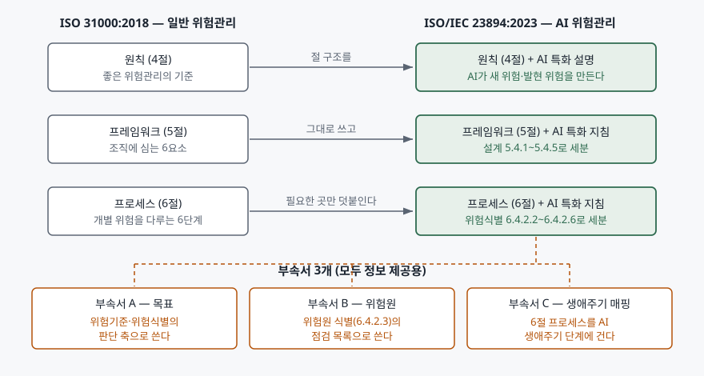

> 실행 검증 없음. 지침 표준의 개념 글이므로 공개 자료 근거만으로 정리했다.
>
> 절·부속서의 번호와 제목은 발행처 공인 미리보기(VDE Verlag가 공개한 ISO/IEC 23894:2023
> 목차·서문·서론·1~4절 앞부분)에서 직접 확인했다. 6.4.2와 6.4.3의 하위 절 이름은 NIST가
> 발행한 AI RMF 대조표에서 가져왔다. **부속서 A·B의 개별 항목 본문은 유료 구간이라 열지
> 못했으므로 항목 이름을 나열하지 않았다.** 부속서의 성격과 쓰임만 적는다.

## 들어가며

AI 거버넌스 문항은 보통 표준 이름을 두세 개 섞어서 묻는다. ISO/IEC 42001로 경영시스템을
세우라고 했다가, 위험관리 절차를 쓰라고 했다가, NIST AI RMF와 비교하라고 한다. 이때
표준마다 하는 일이 머릿속에서 갈리지 않으면 답안이 "AI 위험을 체계적으로 관리한다"는
동어반복으로 흐른다. 실무에서도 같은 혼선이 생긴다. AI 도입 심의에 올라온 위험 목록이
보안팀은 모델 탈취, 법무팀은 규제 위반, 현업은 오판정으로 제각각 적혀 있고 셋을 한 줄에
놓고 비교할 기준이 없다. ISO/IEC 23894는 그 기준을 AI 전용으로 정리한 문서다.

## 정의

**ISO/IEC 23894:2023은 AI를 활용한 제품·시스템·서비스를 개발·생산·배포·사용하는 조직이
AI에 특유한 위험을 관리하는 방법을 제시하는 국제 지침 표준이다.** 적용 범위 절(1절)은 이
지침을 조직의 AI 관련 활동과 기능에 위험관리를 통합하도록 돕는 것, 그리고 AI 위험관리를
실제로 구현·통합하는 프로세스를 기술하는 것까지로 잡는다.

답안 첫 줄에는 성격을 한 번 더 못 박는 편이 낫다. 이 문서는 **인증 대상이 아닌 지침
(guidance)** 이고, 단독으로 쓰는 것이 아니라 **ISO 31000:2018과 함께 쓰도록** 만들어졌다.
인용 표준 절(2절)이 ISO 31000:2018, ISO Guide 73:2009, ISO/IEC 22989:2022 세 건을 규범
참조로 걸어 두어 용어와 뼈대를 그쪽에 맡긴다. 작성 주체는 ISO/IEC JTC 1의 인공지능
분과위원회(SC 42)다.

## 등장 배경

ISO 31000은 산업과 조직 규모를 가리지 않는 일반 지침이라 AI에 그대로 쓸 수는 있다.
문제는 AI가 기존 위험관리의 전제를 흔든다는 데 있다. 23894의 4절 도입부는 AI 시스템이
조직에 **새로운 위험이나 발현되는(emergent) 위험을 들여오고, 목표에 미치는 결과가
긍정적일 수도 부정적일 수도 있으며, 이미 알고 있던 위험의 발생 가능성 자체를 바꾼다**고
적는다. 학습 데이터가 바뀌면 어제 평가한 위험이 오늘 달라지고, 자동화 수준을 한 단계
올리면 없던 위험이 생긴다. 일반 지침만으로는 "무엇을 위험원으로 볼 것인가"를 조직마다
다르게 세게 된다.

그렇다고 완전히 새 표준을 쓰면 조직은 기존 전사 위험관리와 AI 위험관리를 두 벌로
돌려야 한다. 23894가 고른 길은 그 사이다. **ISO 31000의 절 구조를 그대로 복제하고,
AI 때문에 달라지는 자리에만 하위 절을 덧붙인다.** 서론이 이 방침을 직접 밝힌다 — 31000의
지침을 확장하는 곳마다 해당 조항을 가리킨 뒤 AI 특화 지침을 잇는 식이다. 덕분에 이미
31000을 돌리는 조직은 프로세스를 새로 만들지 않고 AI 부분만 끼워 넣는다.

## 구성요소 — 3·6·6·5, 그리고 부속서 3개

본문은 **세 덩어리**다. 서론이 직접 "세 개의 주요 부분으로 나뉜다"고 적고 4·5·6절을 든다.

| 덩어리 | 절 | 하는 일 |
|---|---|---|
| 원칙 | 4절 | 무엇을 좋은 AI 위험관리로 볼지 정한다 |
| 프레임워크 | 5절 | 위험관리를 조직의 주요 활동·기능에 통합한다 |
| 프로세스 | 6절 | 정책·절차·관행을 개별 위험에 적용한다 |

### 프레임워크 — 6요소 (5.2~5.7)

리더십과 의지(5.2), 통합(5.3), 설계(5.4), 구현(5.5), 평가(5.6), 개선(5.7)으로 ISO 31000과
같은 여섯이다. AI 때문에 세분된 자리는 **설계(5.4)** 하나로, 하위 5가지를 둔다.

| # | 5.4의 하위 절 | 내용 |
|---|---|---|
| ① | 5.4.1 | 조직과 그 상황의 이해 |
| ② | 5.4.2 | 위험관리 의지의 표명 |
| ③ | 5.4.3 | 조직의 역할·권한·책임·책무 배정 |
| ④ | 5.4.4 | 자원 배분 |
| ⑤ | 5.4.5 | 의사소통·협의 체계 수립 |

### 프로세스 — 6단계 (6.2~6.7)

의사소통과 협의(6.2), 범위·상황·기준(6.3), 위험평가(6.4), 위험처리(6.5), 모니터링과
검토(6.6), 기록과 보고(6.7)다. 여기서도 AI 특화가 몰린 곳은 **위험평가(6.4)** 이고,
그 안의 **위험식별(6.4.2)** 이 다시 5가지로 쪼개진다.

| # | 6.4.2의 하위 절 | 무엇을 식별하는가 |
|---|---|---|
| ① | 6.4.2.2 | 자산과 그 가치 |
| ② | 6.4.2.3 | 위험원(risk source) |
| ③ | 6.4.2.4 | 잠재적 사건과 결과(outcome) |
| ④ | 6.4.2.5 | 통제 |
| ⑤ | 6.4.2.6 | 영향(consequence) |

자산 식별이 첫 자리라는 점이 답안에서 쓸모 있다. AI에서 보호 대상은 서버가 아니라
**학습 데이터·모델 가중치·특징 표현**이고, 이것들을 자산으로 세어 두지 않으면 뒤의
위험원 식별이 전부 "모델이 틀릴 수 있다" 수준에서 멈춘다. 위험분석(6.4.3)도 일반(6.4.3.1),
영향 평가(6.4.3.2), 발생가능성 평가(6.4.3.3) 셋으로 나뉜다.

### 부속서 — 3개, 전부 정보 제공용

| 부속서 | 제목 | 쓰임 |
|---|---|---|
| A | 목표(Objectives) | AI와 관련해 흔히 세우는 조직 목표의 예시. 위험기준(6.3.4)과 위험식별의 판단 축 |
| B | 위험원(Risk sources) | AI에 특유한 위험원의 예시 목록. 위험원 식별(6.4.2.3)의 점검 목록 |
| C | 위험관리와 AI 시스템 생애주기 | 6절 프로세스를 AI 생애주기 단계에 매핑한 예시 |

셋 다 **informative**, 즉 정보 제공용이다. 요구사항이 아니라 참고 목록이고, 표준 스스로
전부를 다룬 목록이 아니라고 밝히는 종류의 부속서다.

## 도식

> **출처**: [ISO/IEC 23894:2023 Information technology — Artificial intelligence — Guidance on risk management, Contents / Introduction / Clause 1 (VDE Verlag 공개 미리보기)](https://assets.vde-verlag.de/iec-normen/preview-pdf/info_isoiec23894%7Bed1.0%7Den.pdf) · [NIST, Crosswalk: NIST AI RMF (1.0) and ISO/IEC 23894:2023](https://airc.nist.gov/documents/3/ai-2025-00109_revised_ISO_IEC_23894_Crosswalk_to_the_NIST_AI_RMF.pdf) — 절·하위 절 번호와 제목, 부속서 구성

## 비교 — 네 문서의 역할 분담

AI 거버넌스 문항은 이 네 가지를 섞어 묻는다. 무엇이 **인증 가능한 요구사항**이고 무엇이
**방법 지침**인지가 갈림길이다.

| 구분 | ISO 31000:2018 | ISO/IEC 23894:2023 | ISO/IEC 42001:2023 | NIST AI RMF 1.0 |
|---|---|---|---|---|
| 성격 | 일반 위험관리 지침 | AI 위험관리 지침 | AI 경영시스템 **요구사항** | 자발적 프레임워크 |
| 인증 | 불가 | 불가 | **가능** | 불가 |
| 대상 | 모든 조직의 모든 위험 | AI 관련 위험 | 조직의 AI 경영시스템 | AI 시스템 생애주기 |
| 구조 | 원칙·프레임워크·프로세스 | 같은 구조 + AI 특화 | PDCA 기반 4~10절 + 부속서 A 통제 | GOVERN·MAP·MEASURE·MANAGE 4기능 |
| 서로의 관계 | 23894의 규범 참조 | 42001의 위험평가·처리를 **어떻게** 할지 | 23894를 위험관리 방법으로 참조 | 23894와 기능 단위로 대조표 존재 |

**42001과 23894의 경계가 시험에서 가장 자주 묻는 자리다.** 42001은 AI 위험평가(6.1.2)와
AI 위험처리(6.1.3) 절차를 **수립하라**고 요구하지만, 그 절차를 어떤 단계로 짜고 무엇을
위험원으로 셀지는 지정하지 않는다. 그 빈칸을 채우는 문서가 23894다. 답안에서는
"42001이 무엇을 갖추라고 요구하고, 23894가 그것을 어떻게 돌릴지 알려준다"로 한 줄 정리하면
된다.

NIST AI RMF와의 관계는 더 분명하다. NIST가 직접 발행한 대조표가 있어서 기능 단위로 맞물린다.
GOVERN은 23894의 5.2·5.3·5.4·5.6·6.1에, MAP은 5.4.1과 6.3·6.4.2·6.4.3·6.7에, MEASURE는
5.7과 6.3.4·6.4.2.5·6.4.3·6.4.4·6.6·6.7에, MANAGE는 5.5~5.7과 6.5·6.6·6.7에 대응한다.
대조표는 **23894의 6.2 의사소통과 협의가 AI RMF에 대응하는 항목 없이 남는다**는 것도
명시한다. 구조가 다른 두 문서를 맞출 때 남는 조항이 있다는 사실 자체가 비교 답안의 소재다.

## 적용 시 고려사항

- **인증을 목표로 한다면 표준을 잘못 고른 것이다.** 23894는 지침이므로 심사 기준이 되지
  않는다. 인증이 필요하면 42001을 세우고, 그 안의 위험평가·위험처리 절차를 23894로 설계한다.
  답안에서 "23894 인증을 받는다"고 쓰면 그 자리에서 감점된다.
- **부속서를 체크리스트로 오해하지 않는다.** A·B·C는 모두 정보 제공용 예시다. 조직의
  상황에 맞게 고르고 빠진 것을 더하는 입력 자료이지, 전부 적용해야 하는 통제 목록이 아니다.
  42001 부속서 A의 참조 통제와 성격이 다르다.
- **위험을 손실로만 세지 않는다.** 규범 참조인 ISO 31000의 위험은 목표에 대한 불확실성의
  영향이고 방향이 양쪽이다. 23894의 4절도 결과가 긍정적일 수 있다고 적는다. AI 도입
  심의에서 기회 쪽을 같은 프로세스로 다루지 않으면 위험관리가 도입을 막는 절차로만 쓰인다.
- **자산 식별을 먼저 끝낸다.** 위험식별 5가지의 첫 자리가 자산과 그 가치다. 학습 데이터,
  모델, 특징 표현, 추론 로그를 자산 목록에 올려 두어야 그 뒤의 위험원·사건·영향이 구체화된다.
- **용어를 22989로 맞춘다.** 규범 참조에 ISO/IEC 22989:2022가 들어 있다. 조직 내부에서
  '모델'·'AI 시스템'·'학습'을 다르게 쓰면 위험 목록이 다시 섞인다.

## 정리

- **3·6·6·5**로 외운다 — 본문 **3덩어리**(원칙·프레임워크·프로세스), 프레임워크 **6요소**,
  프로세스 **6단계**, 위험식별 **5가지**(자산·위험원·사건과 결과·통제·영향).
- 부속서는 **A 목표 / B 위험원 / C 생애주기 매핑** 셋이고 전부 정보 제공용이다.
- 성격은 **지침**이다. 인증은 42001, 방법은 23894, 뼈대는 ISO 31000.
- AI가 특별한 이유는 **새 위험·발현 위험을 만들고 기존 위험의 발생가능성을 바꾸기** 때문이다.
- NIST AI RMF와는 NIST 발행 대조표로 기능 단위 대응이 되며, **6.2는 대응 항목이 없다.**

> 기출 답안: [기출문제 — ISO/IEC 42001 인공지능 경영시스템](../../exam/2026-10-25-iso-iec-42001-ai-management-system/index.md)
>
> 함께 보기: [ISO 31000 위험관리 — 원칙 8가지, 프레임워크, 프로세스](../2026-10-29-iso-31000-risk-management-principles-framework-process/index.md)

## 참고 자료

- [ISO/IEC 23894:2023, Information technology — Artificial intelligence — Guidance on risk management (ISO 카탈로그)](https://www.iso.org/standard/77304.html) — 발행 정보와 적용 범위
- [ISO/IEC 23894:2023 공개 미리보기 — 목차·서문·서론·1~4절 앞부분 (VDE Verlag)](https://assets.vde-verlag.de/iec-normen/preview-pdf/info_isoiec23894%7Bed1.0%7Den.pdf) — 절·부속서 번호와 제목, 세 덩어리 구조, 4절 도입부
- [NIST, Crosswalk: NIST AI RMF (1.0) and ISO/IEC 23894:2023](https://airc.nist.gov/documents/3/ai-2025-00109_revised_ISO_IEC_23894_Crosswalk_to_the_NIST_AI_RMF.pdf) — 기능별 대응 조항, 6.4.2·6.4.3 하위 절 이름, 미대응 조항
- [ISO 31000:2018, Risk management — Guidelines](https://www.iso.org/standard/65694.html) — 23894의 규범 참조이자 절 구조의 원본
- [ISO/IEC 42001:2023, Information technology — Artificial intelligence — Management system](https://www.iso.org/standard/42001) — AI 위험평가(6.1.2)·위험처리(6.1.3)를 요구하는 인증 표준
- [NIST AI Risk Management Framework 1.0 (NIST AI 100-1)](https://nvlpubs.nist.gov/nistpubs/ai/NIST.AI.100-1.pdf) — GOVERN·MAP·MEASURE·MANAGE 4기능
