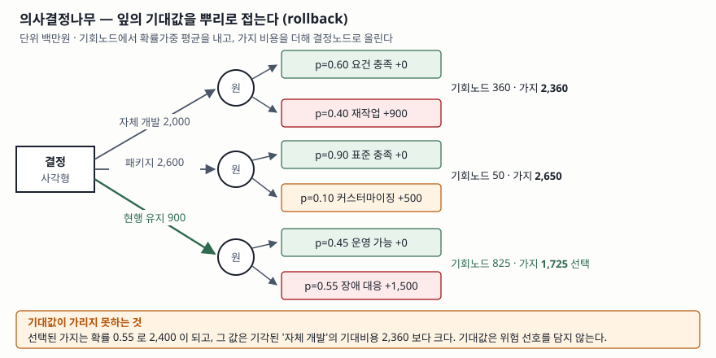
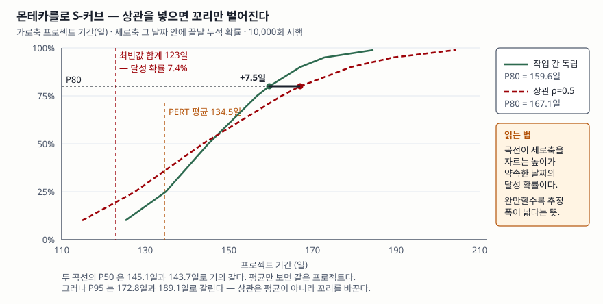

## 들어가며

위험관리 문항에서 정성적 분석과 정량적 분석을 가르라는 요구가 자주 나온다. "정성은
주관적이고 정량은 객관적"이라고 쓰면 거기서 점수가 멈춘다. 둘은 **산출물이 다른
활동**이다. 정성 분석은 위험 등록부에 순서를 매겨 어디부터 손댈지 정하고, 정량
분석은 그 위험들이 원가와 일정에 얼마만큼의 폭으로 작용하는지 **수치 하나 또는
분포 하나**로 낸다. 예비비를 얼마로 잡을지, 납기를 며칠로 약속할지는 정량 분석에서만
나온다. 실무에서도 같다. 경영진이 "그래서 얼마인가"를 물을 때 확률·영향 매트릭스의
빨간 칸을 보여 주는 것으로는 답이 되지 않는다.

> 계산 기법을 다루는 글이므로 세 기법을 직접 구현해 검산했다. 본문의 모든 수치는
> `code/output.txt`에 남은 실행 기록에서 가져왔다. 가상 회사 '마루정보시스템'의
> 수치는 계산 과정을 드러내려고 만든 값이며 실재하는 사업이 아니다.

---

## 정의

**정량적 위험 분석(quantitative risk analysis)** 은 위험과 그 구성 요인을 **값의
의미와 비례관계가 분석의 안팎에서 그대로 유지되는 수(number)로** 평가하는 활동이다.
이 정의는 NIST SP 800-30 Rev. 1의 평가 접근법 절(§2.3.2)을 따른 것이다.

답안에 쓸 때는 뒤의 조건절이 핵심이다. **"수를 쓰면 정량"이 아니다.** 확률·영향
매트릭스에 1~5점을 매기는 것도 수를 쓰지만, 그 3점은 그 매트릭스 밖에서는 아무 뜻이
없다. 같은 문서는 이것을 **준정량적(semi-quantitative)** 평가로 따로 분류한다. 구간이나
척도를 쓰되 그 값과 의미가 다른 맥락에서는 유지되지 않는 방식이다.

그러므로 세 접근법은 **수를 쓰느냐가 아니라 그 수가 맥락 밖에서도 유지되느냐**로
갈린다.

## 등장 배경

위험을 "높음·중간·낮음"으로만 다루던 방식에는 세 가지가 걸렸다.

첫째, **합칠 수 없다.** 중간 위험 열 건과 높은 위험 두 건 중 어느 쪽이 더 무거운지
매트릭스는 답하지 못한다. 등급은 더하거나 평균 낼 수 있는 값이 아니기 때문이다.

둘째, **예비비로 번역되지 않는다.** 높은 위험 세 건에 예비비를 얼마나 얹어야 하는지
등급에서는 유도되지 않는다.

셋째, **평가자마다 갈린다.** NIST SP 800-30 Rev. 1의 같은 절은 정성 평가에서 값이
명확히 정의되거나 뜻이 통하는 예시로 설명되지 않으면 **경험이 다른 전문가가 상당히
다른 결과를 낸다**고 적는다. 등급의 폭이 좁아 상대적 우선순위를 가리기 어렵다는 지적도
함께 둔다.

정량 분석은 이 셋을 화폐 단위와 확률분포로 바꿔 해결한다. 대신 입력 추정의 부담을
사람이 떠안는다. 뒤에서 볼 것처럼 그 부담이야말로 이 기법의 가장 약한 고리다.

## 구성요소 — 기법 3가지와 절차 4단계

### 기법 3가지

IEC 31010:2019은 기법을 용도별로 묶어 부속서 B에 배치한다. 이 글에서 다루는 셋은
각각 다음 자리에 있다.

| # | 기법 | IEC 31010:2019 위치 | 무엇을 산출하는가 |
|---|---|---|---|
| ① | **기대화폐가치(EMV)** | 위험 등록부(B.10.2)와 의사결정나무 분석(B.9.3)의 계산 기반 | 위험 전체의 노출도 **한 수** |
| ② | **의사결정나무 분석** | 선택지 중 고르는 기법(B.9.3) | 대안별 기대비용과 **선택** |
| ③ | **몬테카를로 시뮬레이션** | 결과와 발생가능성을 이해하는 기법(B.5.10) | 결과의 **확률분포**와 S-커브(B.10.4) |

세 기법은 같은 축에 놓인다. **EMV는 수 하나, 의사결정나무는 선택 하나, 몬테카를로는
분포 하나**를 낸다. 산출물의 모양이 다르므로 쓰는 자리도 다르다.

### 절차 4단계

1. **입력 추정** — 각 위험의 확률과 영향, 각 작업의 낙관·최빈·비관 기간을 정한다
2. **모형 구성** — 위험 등록부, 의사결정나무, 일정 네트워크 중 하나로 구조를 만든다
3. **계산 또는 시뮬레이션** — EMV는 가중합, 의사결정나무는 롤백, 몬테카를로는 반복 표본추출
4. **해석과 반영** — 예비비·완충기간·대안 선택으로 옮긴다

### ① 기대화폐가치 — 위험 등록부를 한 수로 접는다

EMV는 **확률 × 영향**을 모든 위험에 대해 더한 값이다. 위협은 음수, 기회는 양수로 둔다.

| 위험 | 확률 | 영향(백만원) | EMV |
|---|---|---|---|
| 데이터 이관 실패로 전면 재작업 | 0.30 | -800 | -240.0 |
| 핵심 설계 인력 이탈 | 0.20 | -500 | -100.0 |
| 성능 미달로 하드웨어 증설 | 0.40 | -300 | -120.0 |
| 패키지 조기 납품으로 기간 단축 | 0.25 | +400 | +100.0 |
| **합계** | | | **-360.0** |

여기서 바로 짚어야 할 것이 있다. 모든 위협이 동시에 터진 최악값은 -1,600이고 EMV는
-360이다. **EMV는 평균이므로 꼬리를 담지 않는다.** 예비비를 360으로 잡으면 네 건이
겹치는 경우에 대해서는 아무 대비도 없는 셈이다. EMV의 쓸모는 "예비비를 정확히 얼마로
하라"가 아니라 **서로 다른 위험들을 같은 단위로 줄 세워 합산 가능하게 만드는 것**이다.

### ② 의사결정나무 — 잎에서 뿌리로 접는다

대안이 여럿이고 각 대안 아래 불확실한 결과가 달릴 때 쓴다. **결정 노드는 사각형,
기회 노드는 원**으로 그리고, 계산은 잎에서 뿌리 방향으로 거슬러 올라간다. 이 거꾸로
접는 계산을 **롤백(rollback)** 이라 한다.



> **출처**: [IEC 31010:2019 Edition 2.0, Annex B.9.3 Decision tree analysis (VDE 공개 미리보기 목차 p.4)](https://assets.vde-verlag.de/iec-normen/preview-pdf/info_iec31010%7Bed2.0%7Db.pdf)

실행 결과는 이렇게 나온다.

```text
[자체 개발]  선투자 2,000 백만원
    요건 충족                p=0.60  추가비용      0  기여      0.0
    재작업 발생               p=0.40  추가비용    900  기여    360.0
    -> 기회노드 기대값    360.0 / 가지 기대비용  2,360.0

[패키지 도입]  선투자 2,600 백만원
    표준 기능으로 충족           p=0.90  추가비용      0  기여      0.0
    커스터마이징               p=0.10  추가비용    500  기여     50.0
    -> 기회노드 기대값     50.0 / 가지 기대비용  2,650.0

[현행 유지 + 부분 개선]  선투자 900 백만원
    운영 가능                p=0.45  추가비용      0  기여      0.0
    장애 대응 비용             p=0.55  추가비용  1,500  기여    825.0
    -> 기회노드 기대값    825.0 / 가지 기대비용  1,725.0
```

기대비용이 가장 낮은 '현행 유지'가 선택된다. 그런데 이 가지는 **확률 0.55로 2,400이
되는** 가지이기도 하다. 2,400은 기각된 '자체 개발'의 기대비용 2,360보다 크다.
기대값 하나로 고르면 **절반이 넘는 확률로 가장 나쁜 결과에 도달하는 대안**을 고르게
된다는 뜻이다. 답안에서 롤백 계산만 보이고 끝내면 이 지점을 놓친다.

### ③ 몬테카를로 시뮬레이션 — 분포를 만든다

각 작업의 기간을 분포로 두고 수천~수만 번 표본을 뽑아 합계의 분포를 얻는다. 여기서는
작업 4개에 삼각분포(최소·최빈·최대)를 주고 10,000회 돌렸다.

| 작업 | 최소 | 최빈 | 최대 | PERT 평균 |
|---|---|---|---|---|
| 요건 정의 | 15 | 20 | 35 | 21.67 |
| 데이터 이관 설계 | 20 | 30 | 60 | 33.33 |
| 개발 | 40 | 55 | 90 | 58.33 |
| 통합 시험 | 10 | 18 | 45 | 21.17 |
| **합계** | | **123** | | **134.50** |

```text
가정                           평균      P50      P80      P95       최대
-------------------------------------------------------------------
작업 간 독립                   145.9    145.1    159.6    172.8    208.8
상관 rho=0.5                145.8    143.7    167.1    189.1    224.0

최빈값 합계(123일) 안에 끝날 확률 : 7.4% (독립 가정)
```

**최빈값을 더해 만든 일정은 달성 확률이 7.4%다.** 각 작업을 "보통 이 정도"로 잡고
합산한 일정이 왜 늘 깨지는지가 이 한 줄에 들어 있다. 삼각분포가 오른쪽으로 길면
합계의 중심은 최빈값 합계보다 오른쪽으로 밀린다. 작업이 많을수록 더 밀린다.



> **출처**: [IEC 31010:2019 Edition 2.0, Annex B.5.10 Monte Carlo simulation, B.10.4 S-curves (VDE 공개 미리보기 목차 pp.3-4)](https://assets.vde-verlag.de/iec-normen/preview-pdf/info_iec31010%7Bed2.0%7Db.pdf)

## 동작 원리 — 상관을 넣으면 꼬리만 벌어진다

위 표의 두 줄이 이 글에서 가장 중요한 대비다. 두 시뮬레이션은 **작업별 분포가 완전히
같고** 작업 사이 상관만 다르다.

- 평균은 145.9일과 145.8일로 사실상 같다
- P50도 145.1일과 143.7일로 1.4일 차이다
- 그런데 **P80은 159.6일과 167.1일, P95는 172.8일과 189.1일**로 갈린다

상관은 중심을 옮기지 않고 **꼬리를 벌린다.** 인력 수준이나 요건 안정성처럼 모든
작업에 함께 작용하는 요인이 있으면, 한 작업이 늦을 때 다른 작업도 같이 늦는다.
독립을 가정하면 늦은 작업과 빠른 작업이 서로 상쇄되어 합계의 분산이 과소평가된다.

상관을 모형에 넣을 때 흔한 실수가 하나 있다. 공통 난수와 개별 난수를 **그냥
가중평균하는 것**이다.

```python
# 틀린 방법 — 개별 작업의 분산까지 줄어든다
u = (1 - rho) * rng.random() + rho * shared
```

이렇게 하면 상관은 들어가지만 각 작업의 분포 자체가 가운데로 모인다. 실제로 이 방식으로
먼저 돌렸을 때 **상관을 넣었는데 P80이 1.6일 짧아지는** 결과가 나왔다. 상관을 키울수록
불확실성이 줄어드는 셈이니 모형이 뒤집힌 것이다.

가우시안 코퓰러를 쓰면 주변분포를 건드리지 않고 상관만 넣을 수 있다.

```python
def triangular_total(rng, tasks, rho=0.0):
    shared = rng.gauss(0.0, 1.0) if rho else 0.0
    total = 0.0
    for _, low, mode, high in tasks:
        own = rng.gauss(0.0, 1.0)
        if rho:
            z = math.sqrt(rho) * shared + math.sqrt(1.0 - rho) * own
        else:
            z = own
        total += _triangular_quantile(_normal_cdf(z), low, mode, high)
    return total
```

`sqrt(rho)`와 `sqrt(1-rho)`로 섞으면 합성된 `z`의 분산이 1로 유지되므로 `Φ(z)`는 여전히
균등분포이고, 따라서 각 작업의 삼각분포도 그대로다. 전체 소스는
[`code/quantitative_risk.py`](code/quantitative_risk.py)에 있다.

## 비교

### 정성 · 준정량 · 정량

NIST SP 800-30 Rev. 1의 평가 접근법 절(§2.3.2)이 가르는 세 가지다.

| | 정성적 | 준정량적 | 정량적 |
|---|---|---|---|
| **값의 형태** | 비수치 범주 (매우 낮음~매우 높음) | 구간이나 척도 (0-15, 16-35… / 1-10) | 수. 의미와 비례관계가 맥락 밖에서도 유지된다 |
| **맥락 밖 통용** | 안 된다 | 안 된다 | 된다 |
| **강점** | 의사결정자에게 결과를 전달하기 쉽다 | 양쪽의 이점을 함께 얻는다. 구간이 "95점은 매우 높음"으로 번역된다 | 대안별 비용편익 분석을 가장 잘 뒷받침한다 |
| **약점** | 값의 폭이 좁아 상대 우선순위를 가리기 어렵고, 전문가마다 결과가 갈린다 | 전문가 판단의 개입이 정량보다 눈에 띈다 | 결과의 뜻이 늘 분명하지는 않아 가정과 제약을 설명해야 한다 |
| **공통 함정** | — | 주관적 판단이 안에 묻히면 엄밀성이 크게 떨어진다 | 같다. 값 결정에 큰 불확실성이 있을 때도 마찬가지다 |

마지막 줄이 답안에서 가장 쓸 만하다. 같은 문서가 준정량과 정량 양쪽에 **같은 경고**를
붙인다. 숫자로 바꾼다고 엄밀해지는 것이 아니라, **주관적 판단이 숫자 안에 묻히는
순간 엄밀성은 사라진다.**

### 기법 3가지

| | EMV | 의사결정나무 | 몬테카를로 |
|---|---|---|---|
| **산출물** | 수 하나 | 대안별 기대값과 선택 | 확률분포 · S-커브 |
| **입력** | 위험별 확률·영향 | 대안·결과별 확률·비용 | 변수별 분포, 변수 간 상관 |
| **계산** | 가중합 | 잎→뿌리 롤백 | 반복 표본추출 |
| **쓰는 자리** | 예비비 근거, 위험 간 비교 | 설계·조달 대안 선택 | 납기 약속, 완충기간 산정 |
| **놓치는 것** | 꼬리와 분산 | 위험 선호. 기대값이 같으면 구분 못 한다 | 입력 분포가 틀리면 결과도 틀린다 |
| **IEC 31010 위치** | B.10.2 · B.9.3 | B.9.3 | B.5.10 (+ B.10.4) |

## 적용 시 고려사항

**첫째, 출력의 정밀도를 입력의 정밀도로 착각하지 않는다.** 시뮬레이션은 P80을
167.1일로 내주지만, 입력이 "개발은 40~90일쯤"이라는 담당자 감각이었다면 소수점 한
자리는 환상이다. 보고할 때는 **입력 추정의 근거를 함께 적는다.** 과거 유사 프로젝트
실적인지, 전문가 판단인지, 셋 중 아무 근거 없는 관행인지가 숫자보다 중요하다.

**둘째, 상관을 빠뜨리면 꼬리가 사라진다.** 앞에서 본 대로 작업 간 상관을 0으로 두면
P95가 16일 짧게 나온다. 기본값이 독립인 도구가 많으므로 **설정을 확인한다.** 특히
같은 팀이 수행하는 작업, 같은 기술을 쓰는 작업, 같은 외부 업체에 의존하는 작업은
독립일 수 없다.

**셋째, 기대값으로 고른 대안의 최악 분기를 반드시 함께 본다.** 롤백이 고른 '현행
유지'는 확률 0.55로 2,400에 도달한다. 조직의 위험 허용수준이 낮다면 기대비용이 더
높아도 분산이 작은 대안이 맞다. **답안에서는 "EMV 최소 대안을 선택한다"로 끝내지 말고
위험 선호를 함께 적는다.**

**넷째, 정량 분석의 비용을 센다.** NIST SP 800-30 Rev. 1은 정량 평가의 이점이
**전문가의 시간과 노력, 도구 도입 비용에 밀릴 수 있다**고 적는다. 위험 등록부 전체를
시뮬레이션에 넣을 필요는 없다. 정성 분석으로 추린 상위 위험에만 적용하는 것이 보통이다.

**다섯째, 가정을 문서로 남긴다.** 분포 형태(삼각·베타·PERT), 상관계수, 시행 횟수,
난수 시드까지 적어야 같은 결과를 다시 낼 수 있다. 이 글의 예제가 시드를
`20261029`로 고정한 이유다.

## 정리

- **정량의 기준은 '수를 쓰는가'가 아니라 '그 수가 맥락 밖에서도 유지되는가'다.**
  1~5점 매트릭스는 준정량이다 (NIST SP 800-30 Rev. 1 §2.3.2)
- **기법 3가지는 산출물로 외운다** — EMV는 수 하나, 의사결정나무는 선택 하나,
  몬테카를로는 분포 하나
- **절차 4단계** — 입력 추정 → 모형 구성 → 계산·시뮬레이션 → 해석과 반영
- **EMV는 평균이라 꼬리가 없다.** 최악값과 다르다는 점을 함께 쓴다
- **최빈값을 더한 일정의 달성 확률은 7.4%였다.** 합산은 중심을 오른쪽으로 민다
- **상관은 평균이 아니라 꼬리를 바꾼다.** P50은 1.4일, P95는 16.3일 차이가 났다
- 고려사항 5가지는 **정·상·최·비·가**로 묶는다 — 정밀도 착각, 상관 누락,
  최악 분기, 비용, 가정 문서화

> 기출 답안: [기출문제 — 프로젝트 위험관리](../../exam/2026-10-24-project-risk-management-processes/index.md)

> 같은 날 쓴 상위 개념: [ISO 31000 위험관리 — 원칙 8가지, 프레임워크, 프로세스](../2026-10-29-iso-31000-risk-management-principles-framework-process/index.md)

## 참고 자료

- [NIST SP 800-30 Rev. 1, *Guide for Conducting Risk Assessments* §2.3.2 Assessment Approaches (2012-09)](https://nvlpubs.nist.gov/nistpubs/Legacy/SP/nistspecialpublication800-30r1.pdf) — 정성·준정량·정량 세 접근법의 정의와 한계
- [IEC 31010:2019 Edition 2.0, *Risk management — Risk assessment techniques* (VDE 공개 미리보기, 목차 pp.3-4)](https://assets.vde-verlag.de/iec-normen/preview-pdf/info_iec31010%7Bed2.0%7Db.pdf) — B.5.10 Monte Carlo simulation, B.9.3 Decision tree analysis, B.10.2 Risk registers, B.10.4 S-curves
- [ISO 31000:2018, *Risk management — Guidelines*](https://www.iso.org/standard/65694.html) — IEC 31010이 뒷받침하는 상위 지침
- 예제 전체 소스: [`code/quantitative_risk.py`](code/quantitative_risk.py) · 실행 기록: [`code/output.txt`](code/output.txt)
