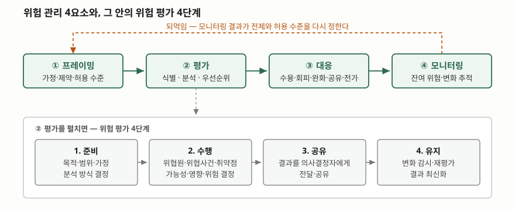

## 들어가며

프로젝트 착수 회의에서 위험 목록을 만든다. 엑셀 한 장에 스무 줄을 적고 각
줄마다 발생 가능성과 영향을 "상·중·하"로 적어 색을 칠한다. 빨간 칸부터
처리하자고 정하고 회의를 닫는다. 그 뒤로 그 파일을 다시 여는 일은 거의 없다.

문제는 그 표가 **의사결정을 돕지 못한다**는 데 있다. 빨간 칸이 여섯 줄인데
예산은 두 줄 분량뿐일 때, 상·중·하는 어느 둘을 고를지 말해 주지 않는다.
통제를 하나 넣는 데 드는 비용이 그 통제가 막는 손실보다 큰지도 알 수 없다.
위험 관리가 시험에 계속 나오는 이유는 이 지점이다 — 목록을 만드는 일이 아니라,
**목록을 결정으로 바꾸는 절차**를 묻는다.

## 정의

**위험 관리(risk management)** 는 조직이 위험을 프레이밍하고, 평가하고,
대응하고, 지속적으로 모니터링하는 **포괄적 절차**다. 미국 NIST 의
SP 800-39 는 위험 관리를 이 네 가지를 요구하는 종합 절차로 규정한다 —
위험 프레이밍(위험 기반 의사결정의 맥락 수립), 위험 평가, 결정된 위험에 대한
대응, 그리고 지속적 모니터링.

**위험 평가(risk assessment)** 는 그중 두 번째 요소이며, SP 800-30 Rev. 1 은
이를 "위험 수준으로 우선순위를 매길 수 있는 위험 목록을 산출해 대응 의사결정에
쓰이도록 하는" 절차로 적는다.

답안 첫 줄에 쓸 한 문장은 이렇게 끊는다.

> 위험 관리란 조직 목표를 위협하는 불확실성을 프레이밍·평가·대응·모니터링의
> 4요소로 다루어, 잔여 위험을 조직이 수용 가능한 수준 안에 두는 반복적 절차다.

## 등장 배경

이전 방식은 **사고가 난 뒤에 대응하는 것**이었다. 장애가 터지면 원인을 찾아
고치고, 같은 일이 또 나면 또 고쳤다. 이 방식의 한계는 두 가지다.

- **자원 배분의 근거가 없다.** 어디에 먼저 돈을 쓸지가 최근에 터진 사고로
  정해진다. 가장 크게 터질 것이 아니라 가장 최근에 터진 것이 우선순위를 가져간다.
- **드물지만 치명적인 위험이 영원히 밀린다.** 10년에 한 번 나는 사고는
  사후 대응 체계에서 한 번도 1순위가 되지 못한다.

여기에 더해 정보시스템이 조직 전체에 걸치면서, 한 시스템의 위험이 그 시스템
담당자의 손을 떠나게 됐다. SP 800-39 가 위험 관리를 조직·임무/업무 프로세스·
정보시스템의 **3계층(tier)** 으로 나눠 다루는 이유가 여기 있다. 어느 계층에서
결정할 문제인지를 먼저 가르지 않으면, 전사 예산이 필요한 대응을 시스템
담당자가 혼자 들고 있게 된다.

## 구성요소 — 4요소와 그 안의 4단계



> **출처**: [NIST SP 800-39 §2.1 Components of Risk Management](https://nvlpubs.nist.gov/nistpubs/Legacy/SP/nistspecialpublication800-39.pdf) · [NIST SP 800-30 Rev. 1 Chapter 3 The Process](https://nvlpubs.nist.gov/nistpubs/Legacy/SP/nistspecialpublication800-30r1.pdf)

### 위험 관리 4요소 (SP 800-39)

| | 요소 | 하는 일 |
|---|---|---|
| ① | 프레이밍 | 위험 가정·제약·허용 수준(risk tolerance)·우선순위와 상충 관계를 정한다 |
| ② | 평가 | 위협·취약점·가능성·영향을 분석해 우선순위가 매겨진 위험 목록을 낸다 |
| ③ | 대응 | 대응 방안을 식별·평가·결정·시행한다 |
| ④ | 모니터링 | 잔여 위험과 환경 변화를 지속적으로 추적한다 |

**프레이밍이 먼저라는 점이 핵심이다.** 허용 수준을 정하지 않고 평가부터 하면,
나온 점수를 보고 그때그때 기준을 만들게 된다. SP 800-39 는 프레이밍의 산출물이
"조직이 위험을 어떻게 평가·대응·모니터링할지를 담은 위험 관리 전략"이라고 적는다.

### 위험 평가 4단계 (SP 800-30 Rev. 1)

1. **준비** — 평가의 목적, 범위, 가정과 제약, 입력 정보원, 쓸 위험 모델과 분석
   방식을 정한다 (5개 과업).
2. **수행** — 위협원 식별 → 위협 사건 식별 → 취약점 및 소인 조건 식별 →
   가능성 결정 → 영향 결정 → 위험 결정 (6개 과업). 문서는 이 순서가 설명을 위한
   것이며 실제로는 과업 간 반복이 필요하고 또 예상된다고 적는다.
3. **공유** — 결과를 의사결정자에게 전달하고 공유한다.
4. **유지** — 변화를 감시해 평가 결과를 최신 상태로 유지한다.

### 위험 대응 5가지 (SP 800-39 §3.3)

SP 800-39 는 대응 방안을 **수용(accept)·회피(avoid)·완화(mitigate)·
공유(share)·전가(transfer)** 다섯으로 든다. 흔히 "회피·전가·완화·수용 4가지"로
외우는데, 그 분류에서는 공유와 전가를 하나로 묶는다. 답안에서는 **다섯으로 적고
공유와 전가를 묶어 넷으로 보는 분류도 있다고 덧붙이는 편**이 안전하다.

| 대응 | 무엇을 바꾸는가 | 정보시스템에서의 예 |
|---|---|---|
| 수용 | 아무것도 바꾸지 않고 손실을 감수한다 | 사내 위키 다운타임을 그대로 둔다 |
| 회피 | 위험을 만드는 활동 자체를 하지 않는다 | 민감정보를 아예 수집하지 않는다 |
| 완화 | 발생 가능성이나 영향을 낮춘다 | 이중화, 백업, 입력 검증 |
| 공유 | 다른 주체와 손실을 나눈다 | 공동 운영, 멀티 리전 분산 |
| 전가 | 손실 부담을 다른 주체로 옮긴다 | 사이버 보험, 책임 조항이 있는 위탁 계약 |

## 비교 — 정성 분석과 정량 분석

SP 800-30 Rev. 1 은 평가 방식을 **정성·준정량·정량 세 가지**로 나눈다.

| | 정성 | 준정량 | 정량 |
|---|---|---|---|
| 값의 형태 | 비수치 범주 (매우 낮음~매우 높음) | 구간·척도 (0~15, 1~10 등) | 숫자. 평가 맥락 밖에서도 의미와 비례가 유지된다 |
| 강점 | 결과를 의사결정자에게 전달하기 쉽다 | 양쪽의 장점을 함께 얻는다 | 대안별 비용·편익 분석을 가장 잘 받친다 |
| 약점 | 값의 범위가 좁아 상대적 우선순위를 가리기 어렵다. 평가자마다 결과가 크게 달라질 수 있다 | 주관적 판단이 숫자 뒤에 숨으면 엄밀성이 떨어진다 | 결과의 의미가 늘 분명하지는 않아 가정과 제약에 대한 설명이 필요하다 |

문서는 정성 방식의 재현성을 높이려면 **값에 근거를 주석으로 달고**, 값을
조합할 때 표나 잘 정의된 함수를 쓰라고 권한다.

### 직접 계산해 본 것

같은 위험 다섯 건을 두 방식으로 평가해 보면 순위가 어긋난다. 아래 숫자는
설명을 위해 만든 **가상의 입력값**이다. 전체 소스는 [`code/`](code/) 에 있고
실행 기록은 [`code/output.txt`](code/output.txt) 다.

정성은 가능성 등급 × 영향 등급, 정량은 연간 발생 횟수 × 1회 손실액으로 뒀다.

```text
  위험           | 정성 순위 | 정량 순위 | 차이
  -------------+-------+-------+---
  핵심 DB 디스크 장애 | 2     | 2     | +0
  배포 스크립트 오작동  | 1     | 4     | +3
  외부 결제 API 지연 | 3     | 3     | +0
  개인정보 유출      | 4     | 1     | -3
  사내 위키 서버 다운  | 5     | 5     | +0

  정성 점수가 같아 순위를 가를 수 없는 묶음: {10: ['핵심 DB 디스크 장애', '외부 결제 API 지연']}
  정성 점수가 가질 수 있는 값의 가짓수: 14가지 (1~25 중)
```

두 가지가 드러난다. 첫째, **자주 나지만 작은 사고**(배포 스크립트 오작동)가
정성에서는 1위인데 정량에서는 4위다. 등급을 곱하는 방식은 "가능성 4등급"과
"연 6회"의 차이를 담지 못한다. 둘째, 5×5 행렬의 곱이 만드는 값은 **1~25 중
14가지뿐**이라 동점이 쉽게 생긴다. 이 계산에서도 10점이 둘 나와 둘 사이의
순위를 가릴 수 없었다. SP 800-30 이 "정성 방식은 값의 범위가 좁아 상대적
우선순위를 가리기 어렵다"고 적은 것이 이 숫자다.

정량이라야 나오는 것이 통제의 순효과다.

```text
  통제안          | 통제 전    | 통제 후  | 줄어든 손실  | 연간 비용   | 순효과
  -------------+---------+-------+---------+---------+---------
  배포 전 스테이징 강제 | 2,400만원 | 400만원 | 2,000만원 | 1,200만원 | +800만원
  DB 이중화       | 6,000만원 | 600만원 | 5,400만원 | 4,000만원 | +1,400만원
  위키 서버 이중화    | 180만원   | 18만원  | 162만원   | 900만원   | -738만원
```

위키 서버 이중화는 위험을 90% 줄이지만 순효과가 음수다. 상·중·하 표만 보고는
이 판단이 나오지 않는다.

## 적용 시 고려사항

- **허용 수준을 먼저 합의한다.** 프레이밍 없이 평가부터 하면 점수를 보고 기준을
  만들게 되고, 그 기준은 매번 달라진다. 수용할 잔여 위험의 상한을 숫자나
  등급으로 먼저 적어 둔다.
- **정성과 정량을 섞되, 섞은 자리를 드러낸다.** SP 800-30 은 정량 평가라도
  주관적 판단이 숫자 뒤에 묻히면 엄밀성이 크게 떨어진다고 적는다. 발생 횟수를
  어디서 가져왔는지(장애 이력, 업계 통계, 전문가 추정)를 칸 옆에 남긴다.
- **평가 결과는 유지되어야 한다.** 4단계의 마지막이 "유지"인 이유다. 위험
  목록을 한 번 만들고 묵히면 프레이밍 시점의 가정이 틀어진 채로 남는다.
  재평가를 촉발하는 조건(임계치 초과, 아키텍처 변경)을 미리 정한다.
- **대응은 계층을 맞춰 결정한다.** SP 800-39 는 전사 차원의 대응 결정이 보통
  1계층에서 이뤄진다고 적는다. 시스템 담당자가 결정할 수 없는 대응을 시스템
  담당자에게 맡기면 그 위험은 영원히 "대응 중"으로 남는다.
- **잔여 위험을 기록으로 남긴다.** 대응 후에도 남는 위험이 있고, 그 수준이
  허용 수준을 넘으면 재평가를 촉발해야 한다. 수용은 "아무것도 안 함"이 아니라
  **기록된 결정**이다.

## 정리

암기 단서는 **"프·평·대·모 / 준·수·공·유 / 수·회·완·공·전"** 이다.

- **4요소** — 프레이밍, 평가, 대응, 모니터링 (SP 800-39 §2.1)
- **평가 4단계** — 준비, 수행, 공유, 유지 (SP 800-30 Rev. 1 Chapter 3).
  수행 단계 안에 6개 과업이 들어간다
- **대응 5가지** — 수용, 회피, 완화, 공유, 전가 (SP 800-39 §3.3).
  공유와 전가를 묶으면 흔히 외우는 4가지가 된다
- **분석 3방식** — 정성, 준정량, 정량. 정성은 전달이 쉽고 정량은 비용·편익
  판단을 받친다. 5×5 등급 곱은 값이 14가지뿐이라 동점을 피하기 어렵다
- 순서가 곧 점수다. **프레이밍이 평가보다 먼저**이고, **유지가 절차의 일부**다

## 참고 자료

- [NIST SP 800-39, Managing Information Security Risk (2011-03)](https://csrc.nist.gov/pubs/sp/800/39/final) — [본문 PDF](https://nvlpubs.nist.gov/nistpubs/Legacy/SP/nistspecialpublication800-39.pdf)
- [NIST SP 800-30 Rev. 1, Guide for Conducting Risk Assessments (2012-09)](https://csrc.nist.gov/pubs/sp/800/30/r1/final) — [본문 PDF](https://nvlpubs.nist.gov/nistpubs/Legacy/SP/nistspecialpublication800-30r1.pdf)
- [ISO 31000:2018, Risk management — Guidelines](https://www.iso.org/standard/65694.html) — 산업 분야를 가리지 않는 일반 지침. 유료 표준이라 이 글은 본문을 인용하지 않았다
- [ISO/IEC 27005:2022, Guidance on managing information security risks](https://www.iso.org/standard/80585.html) — 정보보안 영역의 위험 관리 지침. 같은 이유로 본문을 인용하지 않았다
