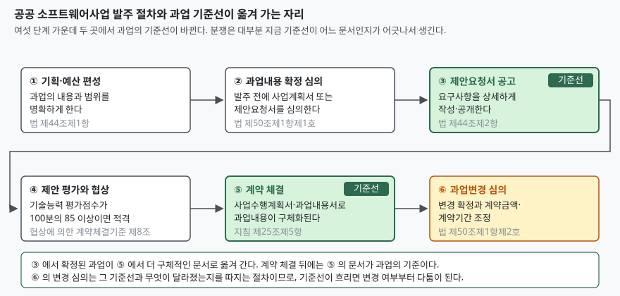

> **실행 검증 없음.** 이 글은 법률·고시 조문과 정부 발간 가이드를 근거로 정리한 개념 글이다.
> 실행 예제와 측정값은 없다. 조문 번호는 2022년 12월판 가이드가 본문에 인용한 조문과
> 2021년 12월 30일 발령된 고시 본문에서 확인한 것이다. 법률의 현행 시행일과
> 제안 평가의 배점 비율은 원문에 닿지 못해 싣지 않았다. 실제 사업에 적용할 때는
> 국가법령정보센터에서 현행 조문을 다시 확인한다.

## 들어가며

공공 정보화 사업의 수행사에 들어가면 늦어도 두 번째 달쯤 같은 장면을 본다. 제안요청서에
"대민 서비스 화면 개선 등"이라고 적힌 한 줄을 두고, 발주기관은 "당연히 모바일도 포함"이라
하고 수행사는 "제안서에 PC 화면만 적었다"고 한다. 둘 다 자기 문서를 들고 있다.

여기서 흔히 나오는 대응이 회의록을 남기는 것이다. 그런데 회의록은 계약문서가 아니다.
무엇이 과업이고 무엇이 추가인지를 정하는 기준이 따로 있고, 그 기준이 사업 진행에 따라
**한 번 더 옮겨 간다**. 그 사실을 모르면 회의록을 아무리 쌓아도 같은 다툼이 반복된다.

이 문제는 양쪽의 선의와 무관하다. 무형의 결과물을 다루는 계약에서 범위를 글로 못 박아
두지 않으면 생기는 구조적 결과이고, 그래서 법이 범위 확정 절차를 따로 두고 있다.

## 정의

**정보화 사업 발주**란 국가기관등의 장이 과업의 내용과 범위를 확정해 사업자가 과업 규모를
산정할 수 있을 만큼 상세한 요구사항으로 공개하고, 제안 평가와 협상을 거쳐 계약상대자를
정하는 일련의 절차다.

이 정의의 두 축은 「소프트웨어 진흥법」 제44조에서 직접 나온다. 같은 조 제1항은 사업을
기획하고 예산을 편성할 때 "과업의 내용과 범위를 명확하게 하여야 한다"고 정하고,
제2항은 발주할 때 사업자가 과업 규모를 산정할 수 있도록 "요구사항을 상세하게 작성·공개"
하도록 정한다.

여기서 눈여겨볼 것은 **의무의 주체가 발주기관**이라는 점이다. 범위를 명확히 하는 일도,
상세하게 적는 일도 발주 측 의무로 규정되어 있다. 같은 조 제3항은 그 상세 요구사항을
작성하기 위해 외부전문기관을 활용하거나 분석·설계 사업을 분리해 발주할 수 있다는
수단까지 붙여 둔다.

## 등장 배경

범위를 글로 못 박지 않은 채 사업이 시작되면 세 가지가 동시에 일어난다.

- **대가 없는 과업 추가**: 요구사항이 "등", "일체", "필요 시"로 적혀 있으면 어디까지가
  계약 범위인지 글로 가릴 방법이 없다. 힘의 균형이 발주 쪽에 있으므로 추가 쪽으로 기운다
- **사업기간 압축**: 범위가 흐린 채로 기간이 먼저 정해지면, 범위가 드러날수록 같은 기간에
  더 많은 일을 넣게 된다
- **분쟁의 기준 부재**: 다툼이 생겼을 때 "원래 무엇이 과업이었는가"를 가릴 문서가 없다

그래서 법은 범위를 정하는 절차를 발주기관의 재량에서 떼어내 **위원회 심의 사항**으로
옮겼다. 「소프트웨어 진흥법」 제50조는 국가기관등의 장이 소프트웨어사업 과업심의위원회를
두도록 하고, 그 심의 사항을 **2가지**로 정한다.

1. 과업내용의 확정
2. 과업내용 변경의 확정 및 이에 따른 계약금액·계약기간 조정

범위를 정하는 일과 범위를 바꾸는 일이 같은 위원회의 같은 조에 나란히 놓여 있다는 것이
이 제도의 설계 의도다. 정할 때 쓴 기준으로 바꿀 때도 따진다.

## 구성요소 / 절차 — 6단계

발주는 다음 **6단계**로 진행되고, 그중 **2곳**에서 과업의 기준선이 바뀐다.

| 단계 | 하는 일 | 근거 |
|---|---|---|
| ① 기획·예산 편성 | 과업의 내용과 범위를 명확하게 한다 | 법 제44조제1항 |
| ② 과업내용 확정 심의 | 발주 전에 사업계획서 또는 제안요청서를 과업심의위원회가 심의한다 | 법 제50조제1항제1호, 지침 제25조제1항 |
| ③ 제안요청서 작성·공고 | 심의 결과를 반영해 요구사항을 상세하게 작성·공개한다 | 법 제44조제2항, 지침 제25조제4항 |
| ④ 제안 평가와 협상 | 기술능력 평가점수가 일정 수준 이상인 자를 협상적격자로 가린다 | 협상에 의한 계약체결기준 제8조제1항 |
| ⑤ 계약 체결 | 사업수행계획서·과업내용서로 과업내용이 구체화된다 | 지침 제25조제5항 |
| ⑥ 과업변경 심의 | 변경을 확정하고 계약금액·계약기간을 조정한다 | 법 제50조제1항제2호 |

### ② 단계에서 위원회가 보는 것

과업심의위원회가 확정 단계에서 심의하는 항목은 가이드 기준으로 **5가지**다.

1. 과업내용(상세 요구사항)과 비용 산정의 적정성
2. 적정 사업기간의 산정 (해당 시)
3. 상용 소프트웨어 직접구매 대상 제외 (해당 시)
4. 소프트웨어사업 영향평가의 재평가 (해당 시)
5. 국가기관등의 장이 심의가 필요하다고 인정한 안건

의결 정족수는 재적위원 과반수 출석과 출석위원 과반수 찬성이고, 위원 가운데 과반수는
해당 발주기관에 소속되지 않은 사람으로 구성한다. 발주기관이 자기 사업의 범위를
혼자 정하지 못하게 막아 둔 것이다.

### 간소화 심의 — 6가지

모든 사업에 정식 위원회를 열지는 않는다. 「소프트웨어사업 계약 및 관리감독에 관한 지침」
제25조제3항은 **6가지** 경우에 위원 2인 이상(그중 해당 기관 소속이 아닌 위원이 2분의 1
이상)의 검토로 갈음할 수 있도록 한다.

1. 총 사업금액이 1억 원 이하인 사업
2. 상용 소프트웨어를 구매하는 사업
3. 다른 국가기관등의 장이 표준화하여 보급할 목적으로 개발한 정보시스템을 구매하는 사업
4. 기존에 심의를 거쳤던 사업을 변경 없이 추가로 실시하는 사업
5. 「전자정부법」 제57조에 따른 정보시스템 감리 사업
6. 「전자정부법」 제64조의2에 따른 전자정부사업관리의 위탁 사업

## 도식

> **출처**: [과학기술정보통신부 — 공공소프트웨어사업 과업심의 가이드 2022.12, Ⅱ. 과업내용 확정 단계 / Ⅲ. 과업내용 변경 단계](https://uitc.pusan.ac.kr/sites/uitc/download/%EA%B3%B5%EA%B3%B5%EC%86%8C%ED%94%84%ED%8A%B8%EC%9B%A8%EC%96%B4%EC%82%AC%EC%97%85%20%EA%B3%BC%EC%97%85%EC%8B%AC%EC%9D%98%20%EA%B0%80%EC%9D%B4%EB%93%9C%282022.12%29.pdf)

기준선이 두 번 옮겨 간다는 것이 이 도식의 전부다. 발주 전에는 제안요청서가 기준이고,
계약을 맺고 나면 사업수행계획서·과업내용서가 기준이 된다. 가이드는 계약 체결 시
합의한 문서로 과업내용이 구체화되면 그 뒤로는 그 문서를 확정된 과업내용으로 본다고
적는다.

## 비교 — 확정 심의와 변경 심의

| 구분 | 과업내용 확정 심의 | 과업내용 변경 심의 |
|---|---|---|
| 근거 | 법 제50조제1항제1호 | 법 제50조제1항제2호·제3항 |
| 시기 | 발주 전 (부득이하면 계약 체결 전까지) | 해당 작업을 시작하기 전 |
| 심의 대상 문서 | 사업계획서 또는 제안요청서 | 사업수행계획서 또는 과업내용서 |
| 기준선 | 제안요청서 | 계약 시 합의한 사업수행계획서·과업내용서 |
| 개최 요청 주체 | 발주기관 | 사업자도 요청할 수 있다 |
| 결과 반영 | 발주 전까지 제안요청서 등에 반영 | 계약금액·계약기간 조정으로 반영 |

차이의 핵심은 **개최 요청 주체**다. 확정 심의는 발주기관만 요청할 수 있지만, 변경 심의는
사업자도 요청할 수 있다. 그래서 발주기관은 입찰공고 시 사업자가 과업심의위원회 개최를
요청할 수 있다는 사실을 명시해야 한다. 수행사 입장에서는 이것이 과업 추가에 대응하는
유일한 제도적 통로다.

반영에는 예외가 있다. 지침 제24조는 심의결과를 계약에 반영하지 않을 수 있는 "특별한
사정"을 **3가지**로 한정한다 — 경미한 변경이어서 반영하지 않기로 양측이 합의한 경우,
사업자가 이의를 제기해 재심의가 필요한 경우, 천재지변 등 불가항력으로 반영이 불가능한
경우다. 한정 열거이므로 그 밖의 사유로는 반영을 미룰 수 없다.

## 적용 시 고려사항

### 1. 제안요청서의 요구사항에 식별자를 붙인다

가이드는 과업 범위를 점검하는 수단으로 **과업대비표**를 든다. 제안요청서의 요구사항
하나하나에 식별자를 붙이고, 제안서·기술협상서·사업수행계획서·요구사항정의서에서 그것이
어떻게 받아졌는지를 한 줄로 늘어놓는 표다. 가이드의 예시는 제안요청 ID가 그대로
요구사항정의서 ID로 이어지는 모양을 보인다.

식별자 없이 서술형으로만 적힌 요구사항은 대비표를 만들 수 없고, 대비표가 없으면
"누락인지 원래 없었는지"를 가릴 수 없다. **분쟁 예방의 실질은 문장력이 아니라 식별자다.**

### 2. 기준선이 바뀌는 시점을 양측이 같이 인식한다

계약 체결 전까지 다투면 제안요청서를 펴야 하고, 그 뒤로는 사업수행계획서를 펴야 한다.
여기서 어긋나면 서로 다른 문서를 들고 같은 말을 반복하게 된다. 착수 회의에서
**무엇이 지금의 기준선인지를 문서 이름으로 못 박아 두는 것**이 뒤의 수십 번 회의를 줄인다.

### 3. 적정 사업기간 산정 결과는 공고문에 붙는다

지침 제10조는 소프트웨어 개발사업의 적정 사업기간을 기능점수 기반 산정표와 사업기초자료,
유사사업 자료로 산정하게 하고, 그 종합 산정서를 입찰공고문·제안요청서에 첨부하도록 한다.
사업금액이 1억 원 이하이면 발주기관이 직접 산정할 수 있다.

수행사 입장에서 이 첨부물은 **제안 단계에서 기간의 타당성을 따질 수 있는 근거**다.
붙어 있지 않으면 그 자체로 질의 대상이다.

### 4. 간소화 요건을 사후에 끼워 맞추지 않는다

간소화 심의 6가지는 사업의 성격으로 정해진다. 일정이 급해서 간소화로 돌리는 것은
요건이 아니다. 특히 "기존에 심의를 거쳤던 사업을 **변경 없이** 추가로 실시하는 사업"에서
'변경 없이'를 느슨하게 읽으면 실질적으로 새 과업이 심의 없이 통과한다.

### 5. 발주 전 상세화에 쓸 수 있는 수단이 법에 있다

법 제44조제3항은 상세 요구사항을 작성하기 위해 외부전문기관을 쓰거나 분석·설계를
분리 발주할 수 있도록 한다. 범위가 불확실한 사업을 그대로 통합 발주하는 것은 이 수단을
쓰지 않기로 한 선택이고, 그 비용은 사업 중반의 과업변경으로 돌아온다.

## 정리

암기 단서는 **"44-50, 기준선 둘"** 이다.

- **법 제44조**는 발주기관에 두 가지 의무를 지운다 — 과업의 내용과 범위를 명확히
  (제1항), 요구사항을 상세하게 작성·공개 (제2항). 수단으로 외부전문기관 활용과
  분리 발주를 둔다 (제3항)
- **법 제50조**는 과업심의위원회의 심의 사항을 2가지로 정한다 — 과업내용의 확정,
  과업내용 변경의 확정과 그에 따른 계약금액·계약기간 조정
- **기준선은 두 번 옮겨 간다** — 발주 전에는 제안요청서, 계약 뒤에는 사업수행계획서·
  과업내용서
- 간소화 심의는 **6가지**, 심의결과를 계약에 반영하지 않을 수 있는 "특별한 사정"은
  **3가지**로 한정 열거되어 있다
- 변경 심의는 **사업자도 개최를 요청할 수 있고**, 발주기관은 그 사실을 입찰공고에
  명시해야 한다

## 참고 자료

- [과학기술정보통신부 — 공공소프트웨어사업 과업심의 가이드 (2022.12)](https://uitc.pusan.ac.kr/sites/uitc/download/%EA%B3%B5%EA%B3%B5%EC%86%8C%ED%94%84%ED%8A%B8%EC%9B%A8%EC%96%B4%EC%82%AC%EC%97%85%20%EA%B3%BC%EC%97%85%EC%8B%AC%EC%9D%98%20%EA%B0%80%EC%9D%B4%EB%93%9C%282022.12%29.pdf) — 법 제44조·제50조 조문과 지침 제10조·제24조·제25조가 본문에 인용되어 있다
- [소프트웨어사업 계약 및 관리감독에 관한 지침 (과학기술정보통신부 고시)](https://www.ulex.co.kr/%EB%B2%95%EB%A5%A0/2100000207648-33440-%EC%86%8C%ED%94%84%ED%8A%B8%EC%9B%A8%EC%96%B4) — 제17조가 「협상에 의한 계약체결기준」 제8조제1항의 협상적격자 요건을 인용한다 (제3자 전재)
- [소프트웨어사업 과업심의위원회 설치·운영 지침 예시 (부산대학교, 제정 2022.7.1.)](https://uitc.pusan.ac.kr/sites/uitc/download/18.download.pdf) — 법 제50조를 근거로 한 기관별 운영 지침의 실제 모양
- [국가법령정보센터 — 소프트웨어 진흥법](https://www.law.go.kr/%EB%B2%95%EB%A0%B9/%EC%86%8C%ED%94%84%ED%8A%B8%EC%9B%A8%EC%96%B4%EC%A7%84%ED%9D%A5%EB%B2%95) — 법률 원문
