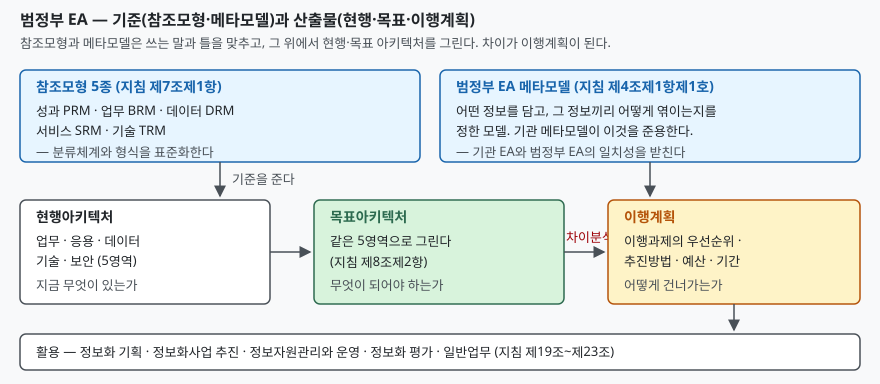

> 실행 검증 없음. 법령과 고시 조문을 근거로 정리했다. 조문 번호와 시행일은 본문에 밝힌 판을 기준으로 한다.

## 들어가며

기관의 정보화사업 계획서를 여러 건 겹쳐 보면 같은 기능이 다른 이름으로 반복해서
등장한다. 한쪽은 "민원 접수", 다른 쪽은 "신청 관리"라고 부르는데 들여다보면 같은
일이다. 사업마다 담당 부서가 다르고, 부서마다 쓰는 말이 다르기 때문이다. 중복을
걸러내려면 두 사업의 산출물을 같은 기준으로 다시 그려 봐야 하는데, 기준이 없으니
매번 사람이 읽어서 판단한다.

전사적 아키텍처는 이 기준을 조직 차원에서 미리 만들어 두자는 접근이다. 우리나라는
이것을 **정보기술아키텍처(ITA)**라는 이름으로 법에 넣었다. 기술사 시험에서 이 주제가
반복해 나오는 이유도 여기에 있다 — 개념이 아니라 **조문으로 정해진 구조**가 있고,
답안은 그 구조를 짚어야 한다.

## 정의

「정보기술아키텍처 도입·운영 지침」(행정안전부고시 제2024-58호, 시행 2024. 7. 10.)
제2조제1호는 이렇게 정한다.

> 일정한 기준과 절차에 따라 업무, 응용, 데이터, 기술, 보안 등 조직 전체의 구성요소들을
> 통합적으로 분석한 뒤 이들 간의 관계를 구조적으로 정리한 체제 및 이를 바탕으로
> 정보화 등을 통하여 구성요소들을 최적화하기 위한 방법

답안 첫 줄로 쓸 때 빠뜨리기 쉬운 것이 뒤쪽 절반이다. 정의가 **체제**와 **방법**
두 가지를 묶고 있다. 현황을 정리한 산출물만 있고 최적화하는 활동이 없으면 정의의
절반만 충족한 것이다.

법적 근거는 「전자정부법」 제45조부터 제48조다(지침 제1조). 제45조제3항이
행정안전부장관에게 지침을 고시할 의무를, 제46조제1항이 도입 대상기관장에게
도입계획 제출 의무를 지운다.

## 등장 배경

아키텍처를 **관점과 영역의 격자**로 보는 발상 자체는 Zachman이 1987년
IBM Systems Journal에 실은 논문에서 나왔다. 그 전까지 정보시스템 문서는 만드는
사람의 필요에 따라 제각각이었고, 같은 시스템을 두고 경영층이 보는 그림과 개발자가
보는 그림이 서로 연결되지 않았다.

우리나라는 이 발상을 개별 기관의 선택이 아니라 **제도**로 들여왔다. 기관마다 따로
수립하면 기관 간 비교가 안 되므로, 전자정부법 제47조제1항은 행정안전부장관이
공동으로 활용할 참조모형을 개발·보급할 수 있도록 하고, 같은 조문에서 참조모형을
"구성요소들을 표준화된 분류체계와 형식으로 정의함으로써 일관성ㆍ상호운용성 등을
확보하기 위한 모형"으로 정의한다. **기관 간 비교 가능성이 참조모형의 존재 이유다.**

## 구성요소 — 참조모형 5종

지침 제7조제1항은 범정부 EA 참조모형을 **다섯 가지**로 못 박는다.

| 약어 | 이름 | 무엇을 표준화하는가 |
|---|---|---|
| PRM | 성과참조모형 | 정보화의 성과를 재는 지표 체계 |
| BRM | 업무참조모형 | 업무의 분류 체계 |
| DRM | 데이터참조모형 | 데이터의 분류와 의미 |
| SRM | 서비스참조모형 | 업무를 지원하는 서비스·컴포넌트의 분류 |
| TRM | 기술참조모형 | 기술 요소의 분류와 표준 |

각 모형의 상세 정의는 지침 **별표3**에 있다. 분류 체계를 실제로 어떻게 짜는지는
행정안전부가 2010년에 공개한 「범정부EA 참조모형 개정안」에 드러나는데, 예를 들어
SRM은 "업무 및 조직에 독립적인 서비스 분류체계"를 지향하고 DRM은 분류 단계를
3레벨에서 4레벨로 넓혔다.

여기서 시험에 자주 나오는 함정이 둘 있다.

1. **보안참조모형은 없다.** 아키텍처 영역에는 보안이 있지만 참조모형은 5종뿐이다.
2. **표준프로파일(SP)은 지침 본문의 참조모형 목록에 없다.** 기술 표준을 다루는 자리는
   TRM이다. 과거 자료에서 TRM과 SP를 묶어 쓰는 표기를 보더라도, 현행 지침 제7조제1항이
   드는 다섯은 성과·업무·데이터·서비스·기술이다.

참조모형과 짝을 이루는 또 하나의 기준이 **메타모델**이다. 지침 제2조제4호는 이것을
"정보기술아키텍처를 구축하는데 필요한 정보 및 정보 간의 관계를 표현한 모델"로 정의하고,
제4조제1항제1호는 범정부 EA 메타모델(별표2)을 준용하도록 한다. 참조모형이 **무엇을
어떻게 분류할지**를 정한다면, 메타모델은 **어떤 정보를 담고 그 정보끼리 어떻게 엮이는지**를
정한다.

## 구성요소 — 아키텍처 5영역과 3단 구조

지침 제8조제2항은 현행·목표 아키텍처를 **업무·응용·데이터·기술·보안**으로 구분할 수
있다고 적는다. 이 다섯이 흔히 BA·AA·DA·TA·SA로 불리는 영역이다.

주의할 점은 조문의 서술어다. "구분하여 수립할 수 **있으며**, 그 구분은 조정할 수
있다"고 되어 있다. **다섯 영역은 강제된 고정 격자가 아니다.** 기관의 규모와 특성에
따라 단계적·점진적으로 수립할 수 있다는 조항(같은 조 제4항)도 같은 맥락이다.
답안에서 "반드시 5영역으로 나눠야 한다"고 단정하면 조문과 어긋난다.

산출물은 **세 단계**로 이어진다.

1. **현행아키텍처** — 업무·응용·데이터·기술·보안 등에 대한 현재 정보(제2조제6호)
2. **목표아키텍처** — 같은 영역에 대한 미래 정보(제2조제7호)
3. **이행계획** — 현행에서 목표로 도달하기 위한 전략·과제 도출과 일정·자원 시행계획
   (제2조제8호). 제9조제2항은 이행계획이 **이행과제의 우선순위·추진방법·예산·기간**
   네 가지를 포함해야 한다고 적는다

## 도식

> **출처**: [정보기술아키텍처 도입·운영 지침 제4조·제7조·제8조·제9조·제19조~제23조 (행정안전부고시 제2024-58호)](https://www.law.go.kr/LSW/admRulLsInfoP.do?admRulSeq=2100000244120)

## 비교

### 참조모형과 아키텍처 영역 — 섞어 쓰면 틀린다

가장 자주 묻고 가장 자주 틀리는 대비다.

| | 참조모형 (5종) | 아키텍처 영역 (5개) |
|---|---|---|
| 근거 | 지침 제7조제1항 | 지침 제8조제2항 |
| 무엇 | 성과·업무·데이터·서비스·기술 | 업무·응용·데이터·기술·보안 |
| 성격 | 분류의 **기준** | 산출물의 **구획** |
| 범위 | 범정부 공통(기관이 준용) | 기관이 자기 것을 그린다 |
| 조정 | 기관 EA 참조모형을 따로 둘 수 있음(제7조제2항) | 구분을 조정할 수 있음(제8조제2항) |

겹치는 이름이 업무와 데이터 둘뿐이라는 점을 기억하면 헷갈리지 않는다. 참조모형에만
있는 것은 **성과·서비스**, 영역에만 있는 것은 **응용·보안**이다.

### EA와 ISP·ISMP

| | EA(ITA) | ISP·ISMP |
|---|---|---|
| 근거 | 전자정부법 제45조~제48조 | 사업별 계획 수립 절차 |
| 시간 | 상시 유지·현행화(지침 제15조) | 기간을 정한 계획 수립 |
| 산출 | 현행·목표·이행계획과 등록 정보 | 중장기 계획서 / 사업 발주 자료 |
| 관계 | 지침 제19조가 정보화계획 수립 시 EA 활용을 요구 | EA를 입력으로 받아 쓴다 |

> 개념 정리: [ISP와 ISMP — 무엇이 다른가](../2026-10-16-isp-vs-ismp/index.md)

## 적용 시 고려사항

1. **현행화가 끊기면 EA는 비용만 남는다.** 지침 제15조는 현행화 사유를 **여섯 가지**로
   든다 — 조직구조 변경, 업무기능·절차 변경, 정보화 계획 수립·변경, 기관메타모델 변경,
   정보시스템과 그 연관구조·기반구조의 구축·운영·고도화에 따른 변경, 그 밖에 필요한 상황.
   앞의 둘은 정보화 부서 밖에서 일어나므로, 조직 개편 정보가 EA 담당에게 닿는 경로를
   먼저 만들어야 한다.
2. **품질을 측정 대상으로 잡는다.** 제2조제9호는 품질 요건을 **현행성·충실성·정확성·정합성**
   네 가지와 성숙도 확보 수준으로 정의하고, 제16조제2항은 별표5의 범정부 EA 성숙도
   모델을 기준으로 분석·관리하도록 한다. "정보를 다 채웠다"는 완료 기준이 아니다.
3. **활용 경로를 설계에 포함한다.** 제19조부터 제23조까지가 활용처를 **다섯 갈래**로
   든다 — 정보화 기획, 정보화사업 추진, 정보자원관리와 정보시스템 운영, 정보화 평가,
   일반업무. 특히 제20조제2항은 제안요청서·과업지시서 작성에 EA를 쓰라고 적는다.
   수립만 하고 발주 문서와 끊어 두면 제도 취지를 비껴간다.
4. **성과지표는 성과참조모형을 준용한다.** 제17조제1항이 그렇게 정하고, 제17조제2항은
   기관의 성과관리 체계에 반영하라고 한다. EA 전용 지표를 따로 만들어 두면 기관 성과와
   연결되지 않아 다음 해에 사라진다.
5. **두 시스템을 구분한다.** 기관의 EA 관리시스템(제2조제12호)과 범정부 정보자원관리시스템
   (제2조제13호)은 다른 것이다. 제10조는 기관이 EA 관리시스템을 구축하되 협의로 제외되면
   정보자원관리시스템으로 대체 활용하도록 한다.

## 정리

- 정의는 **체제 + 최적화 방법**의 두 겹이다(지침 제2조제1호). 뒤쪽을 빼면 반쪽이다.
- **5 - 5 - 3**으로 외운다. 참조모형 **5종**(성과·업무·데이터·서비스·기술),
  아키텍처 **5영역**(업무·응용·데이터·기술·보안), 산출물 **3단**(현행·목표·이행계획).
- 참조모형에만 **성과·서비스**, 영역에만 **응용·보안**. 보안참조모형은 없다.
- 이행계획의 필수 항목 **4가지**: 우선순위·추진방법·예산·기간(제9조제2항).
- 품질 요건 **4가지**: 현행성·충실성·정확성·정합성(제2조제9호).
- 현행화 사유 **6가지**(제15조), 활용 갈래 **5가지**(제19조~제23조).

## 참고 자료

- [전자정부법 제45조~제48조 (법률 제21394호, 시행 2026. 8. 28.)](https://www.law.go.kr/LSW/lsLinkProc.do?lsNm=%EC%A0%84%EC%9E%90%EC%A0%95%EB%B6%80%EB%B2%95&lsId=42450&datClsCd=010102&joNo=004500000%5E004600000%5E004700000%5E004800000&mode=10&chrClsCd=010202&gubun=admRul)
- [정보기술아키텍처 도입·운영 지침 (행정안전부고시 제2024-58호, 시행 2024. 7. 10.)](https://www.law.go.kr/LSW/admRulLsInfoP.do?admRulSeq=2100000244120)
- [행정안전부, 범정부EA 참조모형 개정안 (2010)](https://www.korea.kr/archive/expDocView.do?docId=25016)
- J. A. Zachman, "A Framework for Information Systems Architecture", IBM Systems Journal, 26(3), 1987, pp. 276–292. [DOI 10.1147/sj.263.0276](https://doi.org/10.1147/sj.263.0276)
